# MTR 代码说明与主要流程

0.68.0 票务按里程计费（第一期，改造记录 6.13）：
- 0.68.1 计费寻路优化（2026-11-12，仅服务端，结果与之前逐项相同，`FarePathEquivalenceTest` 以 `ReferenceFareNetwork`（旧算法副本）对照）：`FareNetwork.find(起, 终, 起始组, List<终止组集合>)` 每个起始组只跑一遍 Dijkstra，终点处对各终止组一起评估，已到达代价不小于所有终止组当前最优时停止；路径按（起终站、起止组）缓存在线网对象里（LRU 8192，线网重建即清空）；`FareTrip.charge` 每个进站组调用一次；组内最长距离只在 `FareLevels.needsLongest()`（公式阶梯且未设最长距离）时计算，`getLongestBlocks` 改用单组 Dijkstra `farthest`。600 站 40 线实测单次出站 2.4 ms → 0.75 ms（不命中缓存）。
- 里程来源：手画路径的线路按手画轨道（`RoutePaths.getBlocksBetweenStops(List<PathData>, …)` 静态方法，`RoutePath` 同名方法转调）；`FareData.getNetwork` 重建时收集仍按直线计算、可寻路的线路，交给 `RailwayData.findRoutePathsInBackground`（复制轨道、独立线程、与仪表盘地图同一 `RoutePaths.Search`），一次一批、每条线路每分钟最多一次；找到后 `timingVersion` 增加，下次计费重建线网。线网键加入手画路径（长度与首尾对象）。
- 组件 `transitsim.fare`：`FareLevels`（公式 起步价 + ⌈max(0, 里程 − 初始里程) ÷ 单位里程⌉ × 单位价格；`formulaTiers` 生成阶梯，`setTiers` 手调后 `manualTiers`；`getFare` 按阶梯并受 `cap` 限制，超过最后分界按最后一段；`getSameStationFare` 起步价或超时罚款）、`FareNetwork`（车站为点、线路相邻停站间轨道为边且标组，无向；`find` 以(跨组数, 里程)字典序 Dijkstra，起终组不符各算一次跨组；`getLongestBlocks` 组内最长计费里程）、`FareTrip.charge`（闸机组合：出站单组按跨组最少路径定；两头共享取最便宜；分段各按本组计价相加；同站进出按出站/进站组或最便宜的共享组收起步价或超时罚款）。测试 `transitsim.fare.FareTest`。
- 游戏端：`NetworkSettings` 新增 `fareLevels`（组键→票价级别）、`fareRouteGroups`（线路改组）、`fareStationGroups`（车站所属组），三种写法（存档键 `fare_levels`、`fare_route_groups`、`fare_station_groups`，数据包末尾追加，`copyFrom`/`equals`）。`FareData`：组键默认 `line:<交通方式>:<线路键>`，线路可改到任意组名；车站所属组默认为停靠线路的组；`getNetwork` 由 `RoutePaths.RoutePath.getBlocksBetweenStops`（相邻停站间轨道长度，无路径时直线距离）建线网，线路、改组或路径计时版本变化时重建（`RailwayData.getFareNetwork`）。闸机按所在车站（3D 车站范围）定组，多组即共享，不再单独设置。
- `TicketSystem`：保留公开成员；余额与进站记录按 UUID 存记分板（`getPlayerScore`：按名字记的余额每次读时加到 UUID 上并清掉名字那条，命令按名字充值仍有效；其他记分项 UUID 没有时才迁过去，`mergeScore`）；进站记 `mtr_entry_zone`=1、闸机位置（`mtr_entry_gate_hi/lo`）、进站分钟（`mtr_entry_minute`）；出站 `FareTrip.charge`，旧记录或不连通按出站组起步价；去掉创造模式半价（`OPEN_CONCESSIONARY` 保留不用）。出站计费方法改名 `chargeOnExit`；保留一个不被调用的 `onExit(Station, Player, Score, Score, boolean)`，供 YJCM 1.2.4 `MixinTicketBarrier`（`defaultRequire: 1`）注入，否则装 YJCM 无法启动；YJCM 省钱机折扣由 `applyFareSaver` 反射读 `Joban.discountMap` 在里程票价上扣（min(折扣, 票价)，用后删除，聊天栏提示）。`FareLevels.clamp` 在存档和数据包读入时把票价、罚款、里程钳到 ≥ 0（负票价会倒贴钱）；未手调时 `equals` 不比较阶梯。Metropolis 0.4.0-beta（Fabric）闸机：`cn.zbx1425.mtrsteamloco.mixin.MetropolisTurnstileMixin`（`@Pseudo`，目标 `team.dovecotmc.metropolis.block.BlockTurnstile.method_9534`，`remap = false`，`require = 0`，登记在 `mtrsteamloco.mixins.json` 的 mixins）：重定向 `CompoundTag.putString`，写 `entered_station` 时同时在卡/票 NBT 记 `mtm_entered_gate`（闸机位置）、`mtm_entered_minute`；重定向 `CompoundTag.remove`，清 `entered_station` 时一并清掉；`@ModifyVariable` 按局部变量名 `cost` 把出站扣费换成 `TicketSystem.getTripFare(Level, 进站闸机, 出站闸机, 分钟)`（与 MTR 闸机同一计费，公用 `getTripFare(RailwayData, …)`），无记录或出站闸机不在车站时保留原区域票价。仍从卡/票里扣，Metropolis 售票机、补票机不变。`FareScreen` 只看不改的组不写入设置（`getLevels`/`editLevels`），收到服务端最长距离前阶梯条不可改，数字框不能输入负号。
- 界面：仪表盘地图下方新增“票价”按钮 → `FareScreen`（票价／线路／车站三页；票价页公式字段、最长距离、上限、超时，阶梯条可拖动分界、点段改价、加删分界，手调后改公式时选择重算或保留）；`FarePackets`（`PACKET_REQUEST_FARE_GROUPS` 取各组与最长距离，`PACKET_SET_FARES` 整体替换三张表，服务端校验权限）。

0.67.3 YJCM 发车计时器：`ScheduleEntry.waitingToCountDown`（仅客户端，不进数据包）由 `atTime` 设为“现在 < 发车 − 站台停站”，发车时刻为负（原因不明的扣车）时恒为 true。`YjcmDepartureTimerMixin`（`@Pseudo`，目标 `fabric|forge.com.jsblock.render.RenderDepartureTimer`）按局部变量名 `scheduleList` 去掉这些条目，计时器在最后一段停站时间前保持空白，然后从站台停站时间倒数。

0.67.2 YJCM 显示屏：`cn.zbx1425.mtrsteamloco.mixin.YjcmPidsMixin`（`@Pseudo`，目标 `fabric|forge.com.jsblock.render.RenderRVPIDS/RenderLCDPIDS`，`remap = false`，`require = 0`）按 YJCM 1.2.4 `render` 方法局部变量名挂钩：`currentSchedule` 存下当前条目，`arrivalText` 被设为 null（已到站）且条目有发车时刻时换成 `gui.mtr.departure_time`。登记在 `resources/common/ante/mtrsteamloco.mixins.json`（构建复制到 common 资源）。没装 YJCM 或其方法不同则不生效。

0.67.1 `TrainServer.standingDepartureMillis`：关门时刻未知（等进路放行等）时，若时刻表/运用计划发车（`getPlannedDepartureHere`）未到，以负数发送；`ScheduleEntry.atTime` 只按正值重算到站，`RenderPIDS` 取绝对值显示“HH:mm 发车”。数据包格式不变。

0.67.0 停站列车的发车时刻（协议变更）：`ScheduleEntry.departureMillis`（数据包末尾追加 long）由 `TrainServer.standingDepartureMillis` 给出（关门剩余 + 关门时间，未知为 0）。客户端 `ClientData` 收包后存 `RECEIVED_SCHEDULES`，`updateSchedules` 在收包时及每 tick（仅含停站条目的站台）以 `ScheduleEntry.atTime`（到站 = min(现在, 发车 − 站台停站)）重建 `ALL_SCHEDULES_FOR_PLATFORM` 与 `SCHEDULES_FOR_PLATFORM`；之前服务端每次把久停列车的到站报为“现在”，YJCM 计时器在 20、19、18 之间跳。`RenderPIDS` 对已到站且有发车时刻的条目显示“HH:mm 发车”。

0.66.8 停站列车不报的根因：`TimeSegment.getTime` 刹车段的加速度被四舍五入到 3 位小数（如 0.0125→0.013），在段末（即停车点）根号内为负，时间为 NaN；`TrainServer` 生成到站信息要求 `currentTime >= 0`，停站列车因此一条都不报，PIDS 跳过本班、YJCM 发车计时器空白、站台调用缺失。修正：根号内取 `max(0, …)`（组件，`TimeSegmentTest`）；`TrainServer` 在段末或 NaN 时取该段 `endTime`。

0.66.8 调试面板：离站时另记到达（`lastArrivalMillis` = 离站时刻 − 已停时间，`lastPlannedArrivalMillis`）与停站期间出现过的扣车原因（`stopHolds`，按首次出现顺序）；“报给显示屏”末尾加 `[所在区段/区段总数, 前方站台区段数]`，用于区分没找到区段与前方没有站台区段。

0.66.7 折返空隙的到站信息：`TimeSegment.indexAt` 在路径调头处（前后两段之间的空隙）返回 -1，`TrainServer` 生成到站信息时整列车不报，停在起点站等运用、或在终点站折返的列车从 PIDS、YJCM 发车计时器、站台调用中消失，直到开动。现由 `gapSegmentIndex` 取空隙前一段（以停站结束的那段），当前时间取其 `endTime`，`standingHere` 照常按站台停站时间推到站。

0.66.6 调试面板“报给显示屏”：`TrainServer` 生成到站信息时记下前 4 个停站站台与到站时刻（`reportedSchedules`）；不在任何区段（`#no_segment`）、不在线且未定出库时刻（`#no_departure`）时说明未报；在车厂等运用（`standingForDuty`）的列车条目会被 `PidsSchedules.forDisplay` 去掉，标“显示屏不显示”。YJCM 发车计时器（`RenderDepartureTimer`）取最近站台 `SCHEDULES_FOR_PLATFORM` 排序后第一条，只有其到站时刻 ≤ 现在才显示 |站台停站/2 − 已到秒数|。

0.66.5 “发车前”触发：`PlatformDwell.departureMillis` 原来只在开始关门（约发车前 4.2 秒）才由运动规则给出，提前 N 秒的时刻表传感器最多提前 4 秒、实为关门时触发。`TrainServer.withKnownDeparture` 在列车停站、开门、已知何时关门（`TrainRules.getTicksUntilDoorsClose` ≥ 0：停站时间、时刻表或运用发车）时，用“关门剩余 + 关门时间”补上预计发车；游戏驱动（`onDwell`）与模拟组件驱动（`showSimulated`）两处都经过它。原因未知的扣车（等进路、调度扣车）仍为 0，不提前触发。

0.66.4 调试显示扩展：`Config.showDebugInfo`（设置界面“显示调试信息”）不拿刷子也显示；`RenderTrainDebug.blockLines` 对 PIDS（`IPIDS.TileEntityPIDS`）、到站投影（`BlockArrivalProjectorBase`）、时刻表传感器（`BlockTrainScheduleSensor`）读 `ClientData.ALL_SCHEDULES_FOR_PLATFORM`，列出站台、前 8 条到站（通过/计划标记，显示屏会隐去的条目打 ×）及传感器设置与按当前列表是否触发；看着方块时优先显示方块（列车更近且方块在 4 格外时显示列车）。`ConfigScreen.getButtonX` 让按钮紧跟最长文字，`render` 画隔行底纹与悬停高亮。`TrainServer` 生成到站信息时，已停在站台的列车用 `standingArrivalMillis`（现在与“发车时刻 − 站台停站时间”取早）作为到站时刻，修正 YJCM 发车指示器与 PIDS 对提前到站列车不显示的问题；离站时记录 `lastDepartureMillis/lastPlannedDepartureMillis/lastDepartureStopId`（`getPlannedDepartureHere` 取运用发车与时刻表发车的较晚者），调试面板“上次发车（实际 / 计划）”给出早/晚秒数。`SimulateDay --origins` 用 `DayRun` 统计每个班次在首站的发车相对班次时刻与计划的偏差。

0.66.3 调试面板措辞：列车停在站台时该行显示“本站”（`this_stop`），行驶中仍为“下一停车站”；停站时间未到点时，若已知要等运用发车或时刻表发车（发车时刻晚于停站结束），扣车原因提前显示，只读数据、不调用 `choose*`。

0.66.2 组件每 30 秒重启：存车线 8431（田端高速 2）的列车接不上，组件把它交给游戏后每 30 秒清空排除名单整组重启再试，每次又失败。成因：0.66.1 之前游戏副本没有路径对象，`getActiveTripPath` 为空，路径重新生成时线上列车正在跑的路径没被保留，组件找不到它。改动：`TickRunner.restore` 中停放（不在线上）的列车路径失效时调用新的 `TrainService.forgetTripPath` 照常接管，线上列车仍判定接不上；`LiveSimulation` 排除时记下 `Siding.getCarryOnKey`（路径集合与各列车在线/路径键），只有它变化才在 30 秒后重试，否则 5 分钟兜底。

0.66.1 组件重启时的门与游戏副本的运用：`TickRunner.HeadlessTrain.restoreDoors` 在 `restore` 末尾按停站计时推出门目标与开度（记录里没有门；按关门开始时门又立即打开，组件每 30 秒重启一次就让停站列车各响两次关门铃）。`TrainServer.showSimulated` 读入组件的运用状态后调用新的 `TrainService.takeTripPath` 接上行程路径对象（读入只带键），游戏副本的 `isOnDuty`、运用发车时刻等不再一律为“无”，调试面板、调度台、晚点报警随之正确。

0.66.0 版本检查只比协议：服务端照旧发送完整版本 `MTM_Logic x.y.z`，客户端（`PacketTrainDataGuiClient.openVersionCheckS2C`）只比较 `IPacket.getProtocol` 取出的前两位；以后改数据包或存档升第二位，只改一侧内部逻辑升第三位，第三位不同仍可连接。因 0.65.30/0.65.31 改过数据包，本版起协议为 0.66。

0.65.33 开关门反复切换的观测：`TrainServer.noteDoorFlip` 记录每列车最近一分钟开关门目标的切换，停站中一分钟内达 6 次时写服务端日志（驱动方、扣车原因、前方占用、停站计时、是否在运用、运用发车时刻），每分钟最多一次；调试面板新增“驱动”（模拟组件/游戏）与“一分钟内开关门切换”。

0.65.32 关门时间与扣车原因：`TrainRules.getHoldReason` 取代 `isHeldAtStop` 的判断主体（顺序与调用不变，返回原因），游戏 `TrainServer.isHeldAtStop`/`isRailBlocked` 和组件 `TickRunner.HeadlessTrain` 记下最近一次的扣车原因与前方占用，游戏从组件同步时一并复制；调试面板只在停站时间到点后显示它（含选折返去向、前方占用等）。`getTicksUntilDoorsClose` 在停到该关门却仍未走、且没有已知结束时刻时返回 -1（调试面板预计发车显示“未知”，客户端关门声等门真正开始关闭再播）；`DwellTimeBveTrainSound` 修正提示音短于关门动作时永不播放的问题。删除 0.65.31 的 `describeHold`。

0.65.31 刷子调试显示与附加包到站信息：手持刷子准星对着列车时，`RenderTrainDebug`（由 `RenderDrivingOverlay.render` 调用，两种加载器共用）找出最近的列车，经 `TrainDebugPackets`（`PACKET_TRAIN_DEBUG`，每秒最多一次）向服务端请求 `TrainServer.getDebugLines`：列车、车厂/存车线、线路、运用、班次、下一停车站、计划到发、预计发车、晚点、已停/停站时间、离关门、扣车原因（`TrainRules.describeHold`，不做选择、无副作用）、速度、控速上限、状态；以 `#` 开头的值由客户端翻译（`gui.mtr.train_debug_*`）。附加包：`RailwayData.getSchedulesAtPlatform` 与 `ClientData.SCHEDULES_FOR_PLATFORM` 只给停站且未过时的到站（`ScheduleEntry.shownToOtherMods`），本模组的 PIDS、车次传感器、路径查找改用 `getAllSchedulesAtPlatform`/`ALL_SCHEDULES_FOR_PLATFORM`。

0.65.30 关门声与停站时间：`TrainRules.getTicksUntilDoorsClose`（组件）按停站总时长、门动作时间以及已知的计划发车/运用发车扣车算出离开始关门还有多少 tick；调度扣车、待避、前方未放行等结束时间未知时为 -1。`TrainServer.getTicksUntilDoorsClose` 调用它，`Train.writePacket`/`writeStatePacket` 在包尾（ANTE 追加内容之前）写入，客户端 `Train`/`TrainClient.State` 读入并以接收时刻倒计时（`getDoorsCloseTicksLeft`）。ANTE 的 `DwellTimeBveTrainSound` 关门提示音与 `RenderTrainDK3` 门动画改按它计时，不再按站台轨道停站时间；未知时提示音在门开始关闭时播放、DK3 门保持打开。

0.65.29 站台端门对齐：`models/export_platform_edge_doors.py` 把端门模型整体后移 `Z_OFFSET`=2 像素，门框落在 z 2..4，与屏蔽门/站台门玻璃（其模型 x 2..4 经方块状态旋转）同一面；开门模型按铰链 (15, 3) 计算平移。`BlockPlatformEndDoor` 新增方块属性 `inward`（开门方向）：放置时 `rowFacing` 沿用左右相邻屏蔽门/站台门的朝向，玩家站在另一侧时 `inward`=true，门扇仍在同一格同一面；空手潜行右键切换开门方向（并关门），普通右键开关。外开碰撞 z -12..4，内开 z 2..18；方块状态每种 32 个变体，内开模型 `*_open_in`。资源包 1.0.6。

0.65.28 图片搜索：画框设置（`ImportedPaintingScreen`）的图片下拉列表打开时直接输入即搜索，列表顶部一行显示搜索词，按 `mtr.image.ImageSearch` 过滤（不分大小写，空格分开的每个词都要出现在名称中）；退格删字，Esc 先清空搜索再关闭，回车选中；搜索非空时原版画一行只在其名称匹配时出现。空格现在是搜索字符，不再用于选中。

0.65.27 报站与新建时刻表：`TrainClient.simulateTrain` 的下一站改由 `AnnouncementStops.nextStop`（组件）按列车自己的路径找车头前方第一个有停站时间的站台，班次例外或调度跳停通过的站不再报为下一站；本站、线路仍由 `RailwayData.useRoutesAndStationsFromIndex` 给出。网页新建时刻表（`LinePanels.tsx` 的 `TableDays`）先调用 `core/timetable.ts` 的 `liftCommonPasses`：各表每一班都由例外通过的站改为线路级通过（`timetable.pass`），去掉这些例外里的通过及该站的设定时刻，新表和以后加的班次共用。汇总时刻表上方“最低性能”的三个输入框（`SummaryTable.tsx`）以线路、表和当前数值为 `key`，切换线路或表时重新显示该线路的数值，不保留上一条线路的输入。

0.65.26 出入库遇交叉渡线：`LineDepotWays.Graph.freeLeg` 在车厂与车站之间的最短路线逆着本线其他站台走时（常见于经交叉渡线到了对向线），把这些站台按该方向加入 `LegRouter.Request.avoid` 重新找路，最多 4 轮，不再直接判为走不通；`throughDepotLeg` 保留 `avoid`。`RoutePaths.findDepotWay` 新增带 `why` 的重载，走不通时由 `diagnoseDepotWay` 给出原因（轨道不连通、只能逆着站台走并列出站台、多个出入口未设规则、规则指定的车站或路径走不通、只能反向到站且无处折返）。`Depot.measureDepotWays` 把原因存入 `DepotLegs.outReasons/backReasons`（存档列表和数据包在原字段之后追加），写服务端日志；`EditorData` 以 `noWayOutWhy/noWayBackWhy` 交给网页检查栏，文案在 `PathFailureText.depotWay`。

0.65.25 路径失败提示：`RoutePaths.diagnose` 在笼统的走不通之前，先对走不通的那一段逐个加入该段的必经节点重试，不经过时能走通、经过某个节点就走不通，则给出 `PathFailure.Type.WAYPOINT_UNREACHABLE`（位置为该节点，`node1`/`node2` 为前后两站的站台）。`PathFailure.diagnose` 的 `DISCONNECTED`、`NO_ROUTE` 也带上前后两站站台。`PathFailureText` 用新文案写出站名和节点；服务端日志“found no path for route …”后附 `RoutePaths.describe` 的原因。网页运行图（`RunningDiagram.tsx`）不再画没有各站时刻的线路（原来按区间 0 秒画成竖线），改在图上方列出 `model.untimedNotes` 给出的线路和原因。

0.65.24 补充修正：`PathFinder.appendPath` 改为整段 `addAll`，拼接到 `JoinedPath` 的出入库、回其他存车线路径保持为一个分段，不再按轨道逐条拆成单元素分段。`Siding` 读档时逐条读取 `duty_ledger`，逐列读取列车（`loadTrain`）：某条定义摘要不符，或列车引用的定义缺失，只跳过该条或该列车并写日志，存车线本身照常载入。

0.65.24 站台端头门：模型导出器生成独立的开门模型，使门扇绕把手对侧门框旋转。上下两半使用同一旋转中心，门扇向站台外侧转开，碰撞箱随门扇延伸到方块外侧。

0.65.23 运用查询：车厂生成运用时按单趟营业、接续、出入库段引用轨道模板。全天接续表按版本存档，列车保存计划引用与当前段索引，运行时按班次时间定位。重启时先载入计划定义再恢复列车，正在执行的旧运用仍引用原计划。详见《MTR-模拟组件与解耦》的运用段索引与接续存档一节。

0.65.13 网页大线网：drawNetwork 合并到 requestAnimationFrame，每帧按 netStyles 快照解析区段归属，区段内多条轨道不再反复扫描全区段。WeakMap 按不可变点数组缓存全曲线边界及局部原点 Path2D；屏幕变换保留线宽/虚线相位，大坐标先作差；缩小时采用小于半像素的折线简化，缓存最多六级。隐藏画布直接退出，悬停按边界预筛。合成 5000 轨同区段回归验证键读取不超过 10000 次；未以小样本浏览器验证宣称实服 FPS 数值。

0.65.13 报站：Siding 的运用路径从 dutyStarts[0] 起数站，出库前导段为零；AnnouncementStops 区分重复站台的多次经过，客户端用当前物理站台校验旧路径的偏移索引，自动报站和本站提示读取同一组车站数据。原有四参数查站接口保留，避免附加模组调用断裂。

0.65.13 车辆同步：isSameVehicle 纳入不可变存车线长度/车宽/运输方式；长度改变必须替换客户端实例。未知车辆或状态校验失配、铁路数据重载清空车辆后，客户端限频请求完整附近快照；服务端每两秒最多接受一次，在同一 tick 发送准确保留 ID 列表，再重发完整车辆，即使车辆未移动。退出时清理请求状态，不移动或删减服务器库存。

0.65.13 媒体：audioMaxTotalMegabytes、imageMaxTotalMegabytes 默认各 256，音频硬性单文件上限与默认值为 5 MiB；音频及图片上传 HTTP JSON 可容纳 8 MiB Base64 请求。图片目录同步总容量并在网页显示去重用量；已有自定义配置保留。Q 盘指定服务器的两项总容量已单独备份并改为 256。

0.65.12 站台屏蔽门端头门：新增 `psd_end_door` / `psd_end_door_2` 方块、物品及方块实体。`BlockPSDEndDoor` 继承屏蔽门以复用顶部识别、四部件放置/破坏/碰撞和 RenderPSDAPGDoor 两种样式；使用独立实体类型存取既有 open/temp NBT。右键从任意门页定位左下部件，仅同步本组四块的开启值，维持开关状态，计划关门 tick 不影响它。TrainServer 排除端头门自动开门扫描，列车门模型与逻辑未改。物品枚举新值追加到末尾以保留已有 ordinal。模型和图标 JSON 指向原屏蔽门资源，新增配方、掉落及镐标签，资源版本 1.0.2，逻辑版本 0.65.12。

0.69.0 共用折返线（8 号线三站死锁）：`Depot.turnTimesFor` 给每个站台的折返线等待记上是哪条折返线（`DutyGenerator.HOLD_RAIL_KEY`，由折返轨的两个节点算出），生成器传给 `OperationNetwork.setTurnBackHold(…, rail)`；`DutyPlanner.isHoldFree` 在共用同一条折返线的站台上（`platformsTurningOn`）若等待期间有别的班次在那里终到（`isTurnedOnMeanwhile`，按全部班次的终到时刻），就不在折返线上长等，改在站台等或另找车。以前长等按来源站台登记，三站上下行两个站台共用中间折返线时，一列 A 上行终到的车在折返线等 5 分钟，B 下行终到的车要倒进同一条折返线，两车互等。网页数据里跳过这个键。测试：`DeadEndTerminusTest.noLongWaitOnATurnBackRailAnotherTrainTurnsOnMeanwhile`。

0.69.0 车间留一节车厢（用户 2026-11-12）：`transitsim.run.Authority.setMargin`（`TickRunner` 每 tick 设为存车线的车厢长度 `siding.spacing`；手动驾驶为 0），持有范围从车尾再往后一个车厢长，没批到的下一组前停在它起点前一个车厢长处；两车在汇合点不再车头顶着停在同一节点上（8 号线中间折返线出口实测）。`-Pmtr.trainMargin=false` 对照：两小时九线数据，有留距 999 次到站、没有 1035 次，死锁一样（17:02:39 的 [3, 16] 两边都有，待查）。测试：`AuthorityTest.trainsKeepACarsLengthOfRoomFrontAndBack`。

0.73.2 站后双折返轮流用（用户 2026-11-13，只改服务端）：终点站后有两股（或更多）折返线时，相邻两班轮流用（以前取第一股空着的，前车已经出来时后车还进第一股）。规则在组件 `TrainService.chooseTurnBack`（见 9.5 节"怎么选"第 5 步），游戏 `TrainServer` 用同一个 `TrainService`，不用另改。组件测试 `DoubleTurnBackTest`（三站上行、站后两股尽头折返线、三站下行，`TickRunner` 跑一小时：短折返时 A、B 严格交替且关掉轮换会失败，长折返时两股同时有车；两种都不出现两车同股、`RunInvariants` 无违例、下行准点）和 `TrainServiceTest.consecutiveTrainsTurnBackOnTheRailsInTurn`。另外：`LineDuties` 的"先到先出"日志（某存车线只能经终点站折返线到首站）只在内容变化时打印（`LOGGED_PASSES`，L14）。测试夹具加 ⑩ 号线（见第 1 节第 8 条），`autotest` 的 `lib/screens.ts` 有了统一的 `openGroupFor`（按线名展开不到时逐个展开折叠的线路组，`lib/lines.ts` 转出），`openRouteEdit` 在仪表盘搜索框输入线路名再找那一行（搜索时 `DashboardScreen.updateRouteRows` 不折叠线路组；找不到才展开组），`openDashboard` 先清空搜索框；`hoverRow` 先取非组标题行、可取同名的第 n 条（Q 盘环线两条同名线路时点到了组标题，编辑按钮是隐藏的）。

0.73.1 声音树状选择（用户 2026-11-13，只改客户端）：选声音的界面改为树，一次显示一层（`mtr/screen/SoundTree.java`，整屏版 `SoundPickerScreen.java`）。根节点依次是 minecraft、mtr、上传音频，再是其他模组的命名空间；游戏声音按 ID 里的点分文件夹，上传音频下一层是上传者，再下是文件。点文件夹进入，第一行回上一级，搜索时列出当前文件夹下的全部声音。广播器声音框旁的列表和"拼接…"里的选择都用它（含游戏声音，可试听）；音频方块的片段只列"上传音频"一支（它只能播上传文件，用户选的），打开时直接在这一层。

0.73.0 票务规则（用户 2026-11-12，存档和网络包改动）：以前票价按"票价组"算，每条线自动一组，票价栏就是一条线一项，线路栏按种别（上下行、各停/快速）逐个列出。现在：

- **票务规则**（`NetworkSettings.fareRules`：ID → `FareRule`，名字和参考线路；按顺序，第一条是默认规则，至少一条；存档键 `fare_rules`，网络包在车站票价组之后、行车侧之前）。规则的票价仍在 `fareLevels` 里，键改为规则 ID；线路（`fareRouteGroups`，按线路 ID）和车站（`fareStationGroups`）记规则 ID。`keepFareRulesKnown` 去掉不存在的规则的票价和归属。旧存档没有 `fare_rules`：读成一条"默认"规则，旧的分组票价和归属全部丢掉（用户选的）。
- **线路归属**（`FareData.getGroupKey(route, dataCache, settings)`）：自己的规则，否则同一条线其他种别的规则（线路后来新加的种别跟着这条线），否则默认规则。`getAutoGroupKey` 现在只当"线路键"用（同一条线的各方向、种别相同），`getLines` 列出全部线路。
- **参考线路**：规则可以选一条线路，阶梯按这条线的长度（它最长的种别从头到尾的距离，`getLegs` 顺带算出 `lineLengths`）做到底；组件 `FareNetwork.setLongestBlocks` 设定这个"最长距离"，不再按规则内线路的最长行程算。最长距离手填时仍以手填的为准。
- **界面**（`FareScreen`）：票价栏列规则，左下"新增票务规则"；选中规则后可改名、换参考线路（依次切换，第一项是"无"），"删除后线路和车站归：X"选好去向再"删除"，归它的线路改为 X，手动指定了它的车站改为 X。线路栏一条线一行（`LineItem`），不再按上下行、种别分开，点规则按钮把这条线的所有种别一起设过去。车站栏不变，列的是规则。`FarePackets` 带上规则，服务端检查后整体替换。
- 测试：`FareTest.aReferenceLineSetsTheLongestDistance`、`NetworkSettingsTest`（存读、复制、旧存档迁移、删规则后清理）。

0.72.0 广播器（用户 2026-11-12，网络包改动）：

- **只保留原版用法**：广播器（`BlockTrainAnnouncer`）只在列车经过时向车上乘客播报（`TrainServer` 扫到它后调 `announce`，每位乘客 20 秒内一次），和 MTR 原版一样。本分支加过的到站触发（到站前、停站后、发车前 N 秒，`StationCall`）、触发秒数和"向站台广播"都删掉：方块不再 tick，设置界面去掉秒数输入框、触发方式和听众按钮。旧存档里的 `station_trigger`、`station_seconds`、`station_to_riders` 原样读进来再写回去（`retiredSettings`），不再起作用，所以这类广播器恢复为列车经过时向乘客播报。时刻表传感器的触发不受影响。
- **多段拼接**：广播器存一张声音列表（`mtr.audio.AnnouncementClips`：每段一个声音和播完后的空隙，单位 0.1 秒，最多 16 段），可以是游戏的声音、上传的音频或网址，存成文本 `[["声音",空隙],…]`（存档键 `sound_clips`）。第一段仍写进 `sound_string`、`sound_id`，旧版本照样播第一段；旧存档没有 `sound_clips`，读成一段。设置包的字符串改为"文字、第一段声音、列表"（不再有触发设置）；播报包（`PacketTrainDataGuiServer.announceS2C`）在原来的文字和声音后面再带列表。客户端 `AnnouncementPlayer.play(clips, pos)` 按组件 `ClipSequence` 一段接一段播（`Sequence`，每个客户端 tick 由 `AnnouncementPlayer.tick` 推进）：游戏的声音和游戏已认识的上传音频用 `SimpleSoundInstance` 播，问声音管理器是否还在播；其余上传音频和网址照旧解码后直接输出，播放线程播完置标志（`decodeAndPlay` 的 `done`）。拿不到的声音（文件还没下载、网站不在允许名单）当作立即播完。新的播报照旧打断上一条。界面（`TrainAnnouncerScreen`）："音频文件"输入框是第一段，旁边的"拼接…（N 段）"打开列表：每段可输入或"选择"声音（选择列表里点一下试听），填播完后空几秒（最后一段没有），上下移动、删除、添加。
- 测试：`AnnouncementClipsTest`。

0.71.0 导入图片支持 JPEG（2026-11-12，存档里的图片名和网络包能带 `.jpg`，客户端和服务端要一起换）：用户上传 3.6 MB 的照片被提示"不能超过 5 MB"。原因是网页（`ImagesLibrary.tsx` 的 `prepareImage`）把所有图片在画布上重画成 PNG 再上传，照片的无损 PNG 通常是 JPEG 的 2–4 倍。PNG 并不是游戏的要求（1.20.1 的 `NativeImage.read` 用 stb_image，不校验 PNG 文件头），只是导入图片当初只认 PNG 和 GIF。现在：`ImageFiles.check` 认 JPEG（`isJpeg`：FF D8 FF），先用 `ImageReader` 读文件头里的宽高、超过 2048 先拒绝，再整张解码确认读得出（`checkJpeg`）；图片名允许 `.jpg`（`isReference`），扩展名和内容类型按内容取（`extensionOf`、`contentTypeOf`，`ImageServer`、`ImageDatabase.add`、`EditorServer` 用它们）。客户端（`ImportedImages.texture`）用 Java 的解码器（`decodeJpeg`）逐像素写进 `NativeImage`，不依赖游戏自己的解码（以后的游戏版本只读 PNG）。网页：PNG、JPEG 不超过 5 MB 原样上传；超过时按原格式重存（JPEG 质量 0.9），还超过就按比例缩小直到放得下，上传完成的提示里写缩到了多少像素。JPEG 没有透明。CMYK 等 Java 读不了的 JPEG 会被服务端拒绝（提示"请选择不超过 5 MB 的有效 PNG、JPEG 或 GIF"）。测试：`ImagesTest.acceptsJpegAsItIs`、`editor-web/test/images.test.tsx`。

0.70.0 Q 盘世界的几项（2026-11-12）：

- **跨车型套用运用组**（网页，`editor-web/src/core/depotMove.ts` 的 `applyDutyGroup`，`views/DepotExtras.tsx` 的运用组面板）：列出其他车厂所有按运用图的运用组（自动排的也算），不再只列同车型的；车型不同时在那一行选"放到"本车厂的哪种车型，放进那种车型的存车线。Q 盘每个车厂一种车型，以前列表总是空的。
- **线路换车厂**（网页，`views/MoveLinePanel.tsx`，逻辑在 `core/depotMove.ts`）：入口在运用图顶部"⋯"菜单和左侧车厂、线路的右键菜单（旧代码冻结，新页面在 `legacy/engine.ts` 的 `openMenuAt` 里给 `#tree` 的菜单追加 `treeExtras`）。选原车厂、线路（可只选几个种别）、目标车厂和它的车型：`entryWithout` 从原车厂的负责线路和各存车线去掉这些线路，`entryWith` 加到目标车厂（只跑部分线路的同车型存车线也勾上），经旧代码的 `depotEntryOf`/`storeDepotEntry` 存进草稿。原车厂这条线的运用直接去掉（用户 2026-11-12 决定）：手排的由 `takeRoutes` 从运用里拿掉这些线路的班次（其余班次留下，空了的库位删掉并重编 `next`），自动排的等服务端按新线路重排。勾"连运用一起搬"时，拿出的运用由 `putTaken` 按存车线顺序放进目标车厂所选车型的存车线，目标车厂改为按运用图。可同时"对换"，把目标车厂的一条线按同样办法换回原车厂。只改草稿，应用照常。
- **音频方块的音频列表**（存档和数据包改动）：`SpeakerSettings.clips`（`Clip`：音频和播完后的空隙，单位 0.1 秒），`sound` 仍是第一段；间隔改存 `intervalTenths`（0.1 秒，0–3600 秒），`intervalSeconds` 是它取整。存档键 `clips`（列表，每项 `sound`、`gap_tenths`）、`interval_tenths`；旧档没有这两项，读成一段、间隔按 `interval_seconds`。设置包和播放包（`AudioSpeakerPackets.play`）都改为发整张列表（每段的音频、哈希、空隙）和 0.1 秒的间隔。服务端 `BlockAudioSpeaker` 要每段都已上传才播放（`hashes`），单次播放的时长用组件 `ClipSequence.totalTicks`（各段时长加中间空隙）交给 `PlaybackGate`。客户端 `SpeakerPlayback` 等所有段都缓存好再开始，按组件 `ClipSequence` 一段接一段播：每段播完空它的空隙，最后一段后循环按间隔空一段再从头，单次播放就结束。只有一段且间隔为 0 的循环仍用游戏自带的无缝循环。
- **循环间隔可以改了**：`AudioSpeakerScreen` 以前在循环模式下把间隔输入框锁住（`updateRegionFields`），而循环也根本不读间隔。现在循环模式下这一栏是"循环间隔"，可输入到 0.1 秒；"重复触发"按钮仍只在红石和位置触发时可用。音频按钮打开 `ClipList`：每段可换音频、填播完后空几秒（最后一段没有这一栏，用间隔）、上下移动、删除，添加一段从已上传的音频里选，最多 16 段，放不下时分页。
- **导入图片画自发光**：`PaintingSettings.emissive`（JSON 里的一项，旧设置没有就是关），设置界面在旋转按钮旁多一个开关（`ImportedPaintingScreen`），`ImportedPaintingRenderer` 开着时光照取满亮度（`LightTexture.FULL_BRIGHT`），不受周围亮度影响。渲染类型仍是 `entityTranslucentCull`：0.70.0 曾改用 `entityTranslucentEmissive`，它不写深度、不剔除背面，开光影（Eclipse）时图片背面的镜像和后面的物体都透了出来，0.70.1 改回。
- 文字：`gui.mtr.audio_speaker_loop_interval`、`audio_speaker_sounds`、`audio_speaker_clips`、`audio_speaker_clips_help`、`audio_speaker_no_clips`、`audio_speaker_add_clip`、`audio_speaker_invalid_gap`、`image_emissive_on/off`；网页英文在 `i18n.js`。
- 测试：`ClipSequenceTest`、`SpeakerSettingsTest.clipsAndTheirGapsSurviveSaveAndPacketAndOldSavesHaveOneClip`、`editor-web/test/depotMove.test.ts`。
- YJCM 进站闸机"走进去不开门、没提示"：YJCM 1.2.4 的 `TicketBarrier1` 继承 MTR 的 `BlockTicketBarrier`，只改外形，碰撞形状、朝向和进站调用（`TicketSystem.passThrough`）与 MTR 自带闸机完全一样；本分支没改过闸机方块。服务端不出任何提示的情况只有两种：闸机不在车站范围内（`getStation` 为空），或从背面走进（背面只负责关门）。未在游戏里复现，待查（U421）。

0.69.1 Q 盘世界手测修正（2026-11-12）：

- **规则线路按名字认**：出入库规则按线路键匹配（`DepotRules.match` → `isForLine`/`sameLine`）。线路键是"运输方式|各语言线路名"，随线路名变；现在运输方式相同、任一语言的名字相同就算同一条线。例如线路名还是"S1"时勾的规则，线路改名为"S1各停|S1 Local"（键 `TRAIN|s1|s1`）后仍然生效。网页出入库规则面板（`DepotPanel.tsx`，`core/depots.ts` 的 `sameLine`）按同样的规则显示勾选；再点一次就改存成现在的键；哪条线都对不上的键加删除线，显示"（找不到）"，点一下去掉。
- **始发站折返时 PIDS 和发车计时器的时刻**：列车出库后在始发站台折返再开班次时，停站这一刻所在时间段的终点是出库段经过的站台，"下一停站"却是班次的第一站，同一站台对应两个路径下标。`TrainServer` 的到站表因此不认为它在站，计划时刻查成 0，显示屏按"到站 + 停站时间"推算发车。现在 `standingHere` 也认"下一停站就是这个站台"，计划时刻按下一停站取。
- **扣车时的发车时刻**：列车因等折返、等放行、等选路等原因扣在站台时，`standingDepartureMillis` 不再按"离关门 tick"算（停站时间停在关门前，结果一直是几秒后发车，发车计时器在 4 秒处来回跳），改报"结束时间未知"（负数，取计划发车和现在中较晚的）。计时器留空，PIDS 显示计划发车。只有时刻表和运用发车这两种扣车，结束时间是已知的。
- **PIDS 调试屏**：发车列显示服务端发来的发车时刻（`ScheduleEntry.departureMillis`），没有才用"到站 + 停站时间"（`RenderTrainDebug`）。
- **选出入口和画回送路径时地图按真实几何画**（`editor.js` 的 `netExact`）：缩小时也不改画示意图，选出的路线与轨道重合。

0.69.0 时刻表传感器与通过车（用户 2026-11-12）：`StationCall` 多一种"通过"（`isPassing`），`TrainServer` 在开往下一停站的路上，为途经不停的站台各建一个（`passingCalls`，按站台保留到通过为止，`approachMillis` 为到达该站台的时刻），所以"到站前 N 秒"对通过车也触发，每车每传感器一次；"停站后""发车前"对通过车不会到期。传感器加"哪些车"（`TileEntityTrainScheduleSensor.trainKind`，存档键 `train_kind`：0 停站车和通过车，1 只停站车，2 只通过车；旧传感器没有这项，按 0 读），新的三种触发和原有触发（按 `ScheduleEntry.pass`）都按它筛；设置界面在触发方式旁多一个按钮（`TrainScheduleSensorScreen`，文字 `gui.mtr.station_train_kind_*`），随 `setData` 的第三个字符串发给服务端。测试：`PassingStationCallTest`；夹具 2 号线加"2号线快车"（三站通过），三站上行站台北侧放 5 个不同设置的时刻表传感器（区块常加载），TestKit 服务端每 tick 记它们通电的时刻（`/sensors`），`run.spec.ts` 核对每个传感器在它该管的车到前约 10 s 通电、不该管的车不通电。

0.69.0 折返线让行（6 号线）：`Arbiter.resolve` 记下这一轮挡住别人请求的持有者（`isBlocking`），`RunReservations.isBlockingOthers`；`TrainRules.Train.isBlockingOthers`（组件 `TickRunner.HeadlessTrain`、游戏 `TrainServer.RulesTrain` 实现）。在折返线上等下一班（混合折返，`getTurnBackLeaveMillis`）的车，有别的车等着用它占的轨道时不再等，先开去站台等（`waitsBeforeRequestingRun`、`describeHold`）。以前 6 号线一列车在五站后的折返线等 5 分钟，从车厂出来、要穿过这条折返线去跑更早班次的车全堵在正线上。尽头站先进先出：`DepotLegs.of` 从运用路径找出每个首站的出库路线在最后一次折返前经过的站台（`passedBeforeTurning`，存 `outPasses`，不存档不发包，寻路后重算），`LineDuties` 交给 `DutyGenerator.SidingInput.passes`，生成器调 `OperationNetwork.addDepotPassing`；`DutyPlanner` 在线上没有赶得上的车时，若有车已到"经由折返线可到的另一站台"（`turningLate`，先到的优先），且能到这个首站的车厂全都要从那个站台后面的折返线进来（`isOnlyReachedBehind`），就让这列车跑这一班（稍晚，记为折返不够），不派车厂的车从它后面绕进来。先到的车晚于这一班 3 分钟以内到达也算（`TURNING_LATE_WINDOW_MILLIS`）：车厂的车走同一股道跟在它后面，反正更晚（2 号线快车实测：出库车全线跟在一列站站停的下行车后面，到一站后又等了 3 分钟站台）。折返能力检查：`DutyPlanner.turnBackCapacity` 对每个折返去另一站台的终点站台，比较相邻两次到达的最短间隔和折返用时（`connectionMillis`），间隔更短时报 `TURN_BACK_CAPACITY`（站台、间隔、折返用时），服务端排运用日志写"trains come in at platform … every … s, but turning round takes … s: its turn back can't keep up"。测试：`DeadEndTerminusTest`（先到先走、有别的出库路线时照旧、30 s 间隔报折返能力不够而 5 分钟不报）、`DepotLegsPassesTest`。`simulateDay` 的 `-Pmtr.debugStuck` 多打一行：运用发车时刻、离开折返线时刻、现在。`-Pmtr.runningSides=false` 按以前把复线当单线办理，对照用。测试：`/trains` 多给每列车当前的线路和班次（`route`、`trip`），`lib/timing.ts` 匹配时只认服务端说的那一班，30 s 间隔也不会认错。

0.69.0 复线按行车侧办理（L06）：`NetworkSettings.runningSides`（存档键 `running_sides`，网络包末尾一项，`copyFrom`/`equals` 带上；`getRunningSide(线路键)` 线路自己 → 逻辑线路 → 全网，默认右侧）；`mtr.advanced.RunningSides.get(railwayData)` 由各线路路径（`RoutePaths.getFound` 或手绘路径）收集轨道和线路键、按 `Rail.getPosition` 每 8 格取点，调组件 `RunningDirections.compute`，按轨道数、`RoutePaths.getTimingVersion`、线路数和设置的哈希缓存，另按 rails 对象记一份给只有 rails 的地方；`SimExport.toDataset` 先算一次，`toTracks` 给 `DataTrack` 填顺/逆/无；组件 `PathClaims.between` 据此对顺行车侧的双向轨道逐段办理。网页：`EditorActions` 的 `networkSettings` 操作收 `runningSides`（值 1、-1 或 null），`EditorData` 发给网页；界面待做。测试夹具各线（上行走北股、下行走南股，即左侧行车）设为左侧。

0.68.5 出库按离开首站计时（L05 续）：`DepotLegs` 记的各首站出库用时改用 `StopTimes.getDepartureLeadMillis`（到首站的时间加首站停站），规划器（`OperationNetwork.Depot.linkMillis` → `DutyPlanner` 的 `leaveMillis` → 运用的 `outLeadMillis`）按它让车提前出库，所以车到首站停完站正好按班次时刻发车。以前只算到达首站，车在班次时刻前约 2 s 才到，再停 8 s 左右，晚点发车。未排运用时的"出库路程 + 15 s"和备用车接管不变。

0.68.4 出库首班在始发站停车（L05）：`Depot.getDutyPlan` 用线路路径的 `RoutePaths.RoutePath.getSlice` 作运用各段的模板，切片按"从首站站着出发"把首站的停站时间置 0；`Siding.DutyBody.join` 把出库路径最后一根轨（首站站台）换成模板的第一根，于是首站不停，车出库直接通过始发站，也就没有在始发站等点。现在模板首站停站时间为 0 时换成该站台自己的停站时间（再由 `applyStopSettings` 套用线路的停站设置），和逐站寻路时一样。后续各段的首站由折返连接路径的最后一根轨提供，不受影响。

0.68.3 删线路的残留引用提示（U96）：`PacketTrainDataGuiServer.reportRouteReferences` 先记下哪些车厂、运用和直通用到这条线路，再删；删除由 `PacketTrainDataBase.deleteData` 用 `execute` 排成服务端线程的下一个任务，以前紧接着就查"线路还在不在"，总是还在，于是从不提示。现在查和提示（`reportDeletedRoute`）用 `server.execute` 排在删除之后。

0.68.2 示意图照实际图抽象（2026-11-12，用户要求"按实际图抽象成直角加 45 度折线"）：`orthogonalTracks` 不再用 `schematicLayout` 的站间拉直，也不再把站端道岔对齐到站台（那两步把并排双线画成方框）；节点就在实际图（`trackSchematic`）的位置，只把站台拉直。区间仍由 `collectChain` 从锚点串成链，然后分两步：① 所有链的实际折线先用 Douglas-Peucker（容差 8）取折点，`sharedDirections` 给每一段定八个方向之一，取它和附近走向相近的别的股道（中点互在 28 以内、方向差 30° 以内，按轴向即倍角平均、按长度加权）的平均方向再取整，所以并排的股道方向一致；② `followTrack` 把同方向的连续段合成一段（run），每段朝实际折点走主方向，剩下的零头（和主方向差 45°）能接上前一段同向的放在前面、能接下一段同向的放在后面，下一段方向和它差 45° 时留给下一段吸收，否则就地画出；最后一段准确落在节点上。评测在 `editor-web/test/schematicQuality.ts`：实际图里并排的股道在示意图里是否被拉开、新增交叉、非 45° 线段、坐标是否有效、台阶数；样本是从游戏导出的真实线网（`test/fixtures/networks`，由 `autotest/tools/export-network.mjs` 导出），`SCHEMATIC_GALLERY=<目录>` 时输出两种图的 SVG。Q 世界今天的快照：方框（并排被拉开）11→13（剩下的是分岔处本来就渐渐分开的两股）、新增交叉 26→9、台阶 26→2。

0.65.11 配线图：`trackSchematic` 保留原曲线作为实际图；`schematicLayout` 按站间主线共同移动附近双线，隔离不相连组件；`orthogonalTracks` 将没有道岔的二度节点串成连续区间，以横竖主段和 45° 斜接段布线，再按长度把原轨道 ID 分配回路径。站台保留尺寸并对齐，站前渡线节点按股道成组排列，旁路存车线和分支留出侧向间距。实际图数据不被修改，列车仍按原轨道索引定位；原地图编辑功能移到“轨道编辑”入口。

0.65.11 编辑传输：`ClientEditing` 的 EDIT/EDIT_BATCH 大于 24 KiB 时由 `EditTransferPackets` 分片，`EditTransferAssembler` 校验传输号、类型、长度、偏移和 30 秒超时。单个逻辑请求仍限制 1 MiB，每玩家仅保留一个在途请求，退出或跨维度丢弃未完成内容；全部收齐后交回原 EditGuard 权限、修订及分组事务处理。没有扩大原版自定义包限制，也不会逐片应用半份时刻表；网络版本同步提升。

0.65.11 图片：`ImageFiles.MAX_BYTES` 升至 5 MiB；网页使用服务端公布的 maxBytes，提示及 mock 同步更新。仅图片上传端点将 JSON 请求体上限提高到 8 MiB，以容纳 Base64 膨胀；其他端点仍为原上限，2048 像素和 GIF 帧/总像素限制不变。

0.65.10 时刻表：`SummaryTable.Frame` 将 tools 与表格分成同级 `.summary-tools` / `.summary-scroll`，外框禁止滚动，表格容器独立滚动。线路汇总和单种别共用该结构；事件与 root 引用保留在父容器，表头/站名 sticky 仍相对表格滚动。修正旧 `.legacy-slot > .table-view { overflow: visible }` 导致工具栏与表格一起移动的问题。

图片编辑锚点提示：`ImportedPaintingRenderer` 在拿刷子时绘制原版实体尺寸的框、中心十字及朝向相机的文字，偏移时画连接线。锚点标记不应用图片偏移或旋转，即对应原版交互位置；自定义纹理尚未加载时也显示提示。没有改写原版碰撞或右键射线。

0.65.9 图片变换：`PaintingSettings` 增加 rotationX/Y/Z（-360–360 度，旧 JSON 默认 0），沿已有实体 NBT/同步字符串/应用包往返，无新增独立包。`PaintingTransform` 统一 X→Y→Z 旋转；渲染围绕图片中心，变换后的格子中心用于取光。自定义图片以两个反向绕序、背面翻 U 的透明面绘制，去除木板和侧边，纹理未就绪时不回退原版背板。`ImportedPaintingScreen` 的图片下拉框按需加载可见缩略图；`PaintingRotationScreen` 提供投影控制环、角度拖动、Shift 15° 吸附和重置。预览只在当前编辑实体上替代渲染参数，应用才发送服务器，取消/关闭恢复存档设置；原版画仍沿原版渲染。旋转不改变挂墙锚点、碰撞和掉落规则。

0.65.8 性能：大量列车场景 30 秒 JFR 的 1786 个渲染线程样本中，轨道姿态计算出现 325 次、轨道贴图绘制出现 434 次（调用栈占比，不可直接相加或换算 FPS）。`RailMixin.render` 使用每轨一组的 `RailGeometryCache`，以几何参数、宽度和倾斜映射快照判定失效；长于 8192 格的轨道不缓存。缓存仅含顶点，不缓存世界、光照、相机和渲染对象。相邻轨道段复用端点姿态；`drawTextureWorld` 在 double 中减相机坐标后传入顶点，移除逐四边形矩阵压栈与复制，保持大坐标精度。未降低车体细节。

0.65.7 音频：位置检测仍为独立坐标球形区域，发声和方向以方块中心为准。六方向按半空间并集判断，不再用最大轴偏移划分扇区，斜向及高度差不会误分。纯 Java `transitsim.sim.PlaybackGate` 控制触发冷却：允许打断时从触发计间隔，播完模式加音源时长；期间触发直接忽略不排队。客户端同时保护实际播放及结束后间隔，以涵盖冷缓存下载延迟。新设置在 NBT、配置包、播放包中同步，旧 NBT 默认允许打断且间隔为零；协议版本升至 0.65.7。

- **最后更新**：2026-11-05，折返方式（9.5 节，MTM_Logic 0.9.0）；之前 2026-11-04，对应提交 `4f880df`。这次补进了按时刻表就位（`7dc4d97`、`58cf977`，4.8 节）、共用线路的车厂共享班次（`a1ed043`，4.6 节）、改动在处理器之前读出（`e7abbc7`，8.2 节）。
  - 另一个会话正在做的 `transitsim.planning.AutoDuties`（从时刻表自动生成运用）还没有接进游戏，等它合并后再写进来。
- **写给谁**：第一次读这个仓库代码的人。先看第 1、2 节知道东西在哪，再按要改的功能看第 3 至 9 节的流程。
- **和别的文档的关系**：
  - 这份只讲"代码在哪、怎么跑起来"。为什么这样设计、改过什么，看 `MTR-3.x改造记录与寻路方案.md`。
  - 运行模拟组件（`transit-sim`）的分离情况看 `MTR-模拟组件与解耦.md`，对外接口看 `MTR-模拟组件契约.md`。
  - MTR 4 资源包和转向架看 `MTR-加载MTR4资源包设计.md`。
- **维护规则**：新增一个主要的类或改了某个流程的调用顺序，就更新这里对应的一节。行号会变，这里只写类名和方法名。
- **类说明**：第 2 节表里的核心类在源码里都有类级 Javadoc，讲这个类管什么、在流程里的位置；这里讲类之间怎么串起来。
- **UML 图**：用 Mermaid 写在 ` ```mermaid ` 代码块里，GitHub、VS Code（装 Markdown Preview Mermaid Support）、Typora、IDEA 都能直接显示。类图在 2.4 节，时序图、活动图、状态图在各流程小节的末尾。改流程时同时改图。

## 1. 仓库结构

| 目录 | 内容 |
|---|---|
| `common/src/main/java/mtr/` | MTR 3.2.2 本体和本分支的改造，Fabric 和 Forge 共用 |
| `common/src/main/java/cn/zbx1425/mtrsteamloco/` | 合并进来的 ANTE（mtrsteamloco）：OBJ/bbmodel 模型、JS 脚本、装饰物、3D 轨道 |
| `transit-sim/` | 运行模拟组件，不依赖 Minecraft；有自己的单元测试 |
| `fabric/`、`forge/` | 两个加载器的入口类、mixin 和平台相关代码 |
| `resources/common/` | 共用资源：`normal`（MTR 本体，含网页 `website`）、`ante`、`lifts` |
| `resources/fabric/`、`resources/forge/` | 加载器专用资源；`no-ante` 是不带 ANTE 的构建用的；`resources/fabric/mtm_logic` 是嵌在 Fabric jar 里的 MTM_Logic 小 jar（`fabric.mod.json` 和图标 `assets/mtm_logic/icon.png`），Forge 的 MTM_Logic 图标是 `resources/forge/normal/mtm_logic_icon.png`（`mods.toml` 第三个 `[[mods]]` 的 `logoFile`） |
| `examples/` | 自定义资源包示例 |
| `testkit/` | `MTM_TestKit`：只给游戏内自动测试用的独立 Fabric 模组（2026-11-12），不进发布包，只放进测试服和测试客户端；版本是 `gradle.properties` 的 `mtm_testkit_version`，不影响协议 |
| `autotest/` | 游戏内自动测试的运行器（Node，`@playwright/test`）：`lib/game.ts` 封装 TestKit 的接口，`lib/editor.ts` 打开网页编辑器，`cases/<清单编号>.spec.ts` 是测试；本机用 `bash C:/gtmp/fast/ui-test.sh` 运行 |

**游戏内自动测试的调用顺序**（2026-11-12，设计见 `MTR-自动化游戏内测试设计.md`）：
1. `ui-test.sh up` 把最近一次构建的 MTR、MTM_Assets 和 TestKit 复制进测试服（`C:/gtmp/ui/server`，只监听 127.0.0.1、端口 47621（常用端口被转发到公网，脚本开服前检查 `server-ip`、端口和 rcon/query 都关着），`server.properties` 指定超平坦、固定种子）和测试客户端（MultiMC 实例 `MTM_AutoTest`），删掉旧世界后开服。
2. 服务端启动完成时 `TestKit.onInitialize` 注册的 `SERVER_STARTED` 调 `ServerDriver.start`：在 127.0.0.1 随机端口开 HTTP（JDK `HttpServer`），端口、随机令牌和 PID 写进 `<服务端目录>/testkit/endpoint-server.json`；每个请求要带令牌头 `X-TestKit-Token`，带 `Origin` 的（浏览器页面发的）一律拒绝。处理都用 `Http.onThread` 放到服务端线程执行。
3. 脚本调 `/fixture`：`Fixture.build` 在 y=-60、z=0 上照轨道连接器的步骤（`ItemNodeModifierBase.onEndClick` 算朝向、`RailwayData.addRail` 两个方向，玩家用 Fabric 的 `FakePlayer`，因为日志模块要玩家名）铺一条直线：西存车线、甲乙丙三个站台、东存车线；再建三个车站、30 个没有范围的填充站、两条线路（测试线、测试线回程）、两个车厂（西不限车数、东最多一列，存车线的私有字段用反射设），最后 `dataCache.sync()`。返回各对象的 id，脚本存为 `fixture.json`。
4. 脚本用 `MultiMC -l MTM_AutoTest` 启动客户端；`TestKitClient` 在 `CLIENT_STARTED` 调 `ClientDriver.start`，同样写 `endpoint-client.json`；标题界面出现后脚本调 `/join` 连上测试服（MultiMC 的"启动时加入服务器"到不了 1.20.1），再在服务端 `op` 这个玩家。
5. `ui-test.sh test` 运行 `npx playwright test`。`lib/test.ts` 在每个测试前关掉界面、记下两边日志和聊天的序号，测试后两边日志里新增的错误或异常（`LogCapture` 收集的 WARN 以上、排除已知噪声）都算失败。
6. 客户端接口：`/state` 由 `WidgetTree` 反射界面对象的字段给控件起 id（`界面类名.字段名`，`DashboardList` 里的是 `界面类名.列表字段.字段名`），并导出 `DashboardList` 当前显示的行和每行的位置；`/click`、`/move`、`/type`、`/key`、`/scroll` 调界面自己的 `mouseClicked`、`charTyped`、`keyPressed` 等，和玩家操作走同一条路；`/use`、`/use-item` 调 `MultiPlayerGameMode.useItemOn`/`useItem`；`/chat` 发聊天或命令，`/suggest` 取命令补全（需要服务端补全的会问服务端）；`/chat-log` 是 Fabric `ClientReceiveMessageEvents` 收到的消息；`/client-data` 和服务端 `/snapshot` 都用 `DataJson` 按各对象自己的 msgpack 存档格式转 JSON，两边可以逐字段比较；`/editor-url` 调 `EditorServer.open()` 取网页编辑器的带 key 地址。服务端另有 `/command`（以控制台身份执行命令并返回输出）和 `/node`（节点角度、是否关键节点、连着的轨道和两端朝向）。
7. **屏幕上画的文字**（2026-11-12）：界面自己画的文字（状态行、标签、冲突说明）不是控件，TestKit 用两个 mixin 记下来：`FontMixin` 在 `Font.drawInternal` 的两个重载开头记下文字、位置（经过当时的变换矩阵，即界面坐标）和颜色，`GameRendererMixin` 在每帧开始时把上一帧的换成"最后一帧"（`ScreenText`）；`/state` 的 `texts` 就是它。TestKit 的 refmap 改名 `mtm_testkit-refmap.json`，因为根构建脚本给每个子项目都设了 MTR 的 `mtr-refmap.json`，两个 jar 同名会冲突。常用的界面路径（打开线路、时刻表、车厂，加班次、选班次）在 `autotest/lib/screens.ts`；网页测试默认开新版编辑器（`lib/editor.ts` 的 `openNextEditor`，先打开旧页面取得 key，再进 `next/`）。
8. **线网布局夹具**（2026-11-12，`MTM_FIXTURE_NAME=lines`）：`Lines.build` 在同一个世界里按 z 相隔 300 铺六条 5 站双线（上行 z=0、下行 z=8，站台 60 格，站在 x=0/200/400/640/840，一站后都是站后折返线），每条一种用户要的布局：① 五站站前渡线 + 站后两股各接存车线；② 五站站后折返线，车厂接在折返线后；③ 五站站后折返线，车厂在折返线前从上行分岔；④ 站前渡线 + 五站下行外侧单独出库站台（下行的 `startPlatforms` 设它）；⑤ 三站后两股正线间的折返线，车厂接在其后；⑥ 同 ⑤ 的折返线，车厂只从下行分岔。①④ 的上行把五站下行站台设为 `terminalPlatforms`（站前折返）。⑤⑥ 另有短交路一站↔三站。轨道全用 `Fixture.connectRail`（玩家轨道连接器的步骤），所以曲线都过 MTR 自己的半径检查。服务端驱动另有 `/trains`（每条存车线每列车：车头位置、速度、是否在线、门、里程；存车线的私有 `trains` 用反射读）和 `/clock`（时刻表时区 `OperatingDay` 下的现在）。测试在 `autotest/cases-lines`：`lines.spec.ts` 用时刻表界面给 16 条线路排班（`07:10:00 + 15 * 00:06:00` 一行，两端始发，从现在起 3 分钟），刷新六个车厂的路径，再逐线查路径没有失败、最新一次排班每班有车、时刻表"最快"一列每站都算得出、冲突检查不是"未检查"；`run.spec.ts` 每秒读一次 `/trains`，查上线、到两端、⑤⑥ 用过中间折返线、不瞬移、不重叠，并列出在线停了 4 分钟以上的车。服务端控制台把中文打成问号，测试按名字的英文半边匹配。另加三条（2026-11-12）：⑦ 长区间，三站在 x=0/200/2200（`LONG_STATION_X`），二站→三站一根 2000 格轨道，车厂在五站式的站后折返线后；⑧ 首尾直通，线路 A 一站↔三站、B 三站↔五站，三站后有 ⑤ 式的中间折返线；⑨ 中途接入与三段直通，线路 A 一站→三站、B 二站→四站、C 四站→五站及回程，三站两个站台 `timetableBoundary`。每条线的结果多了 `stationX`。`lib/lines.ts` 的 `serviceTimes` 定各线路班次（⑦ 每 30 s，⑧⑨ 每 6 分钟、接续线路晚一两分钟），`throughLinks`/`setThroughLinks` 在时刻表界面设直通（⑧ 隔班，⑨ 全部，⑨ 的 A→B 点一次"接入站"、B 下行→A 点一次"转出站"），写进结果目录 `through-links.json`；`run.spec.ts` 对 ⑦–⑨ 按站台坐标识别停站（`lib/timing.ts` 的 `stopEventsAt`），查 ⑦ 长区间同一股道同时有多列车、入口外没有车等前车，查 ⑧⑨ 直通班次同一列车跑下一段、在衔接站按前一段到、按后一段发。再加 ⑩ 站后双折返（2026-11-13，`Lines.doubleRearTurnBack`）：五站后两条并排尽头折返线 T1（上行直进）、T2（经渡线 A），T1 经渡线 B 回下行，两渡线间下行正线上进 T2 和出 T1 的车对向；车厂从下行正线在 B 与 T2 之间分岔（不接在折返线尾，否则那股不是尽头线，游戏不当它是可选折返股道）。结果里多 `tails`（两股的 x 起止和 z）；`serviceTimes` 给 ⑩ 每 150 s 一班；`run.spec.ts` 按车头所在股道记每次进折返线，查两股都用过、相邻两次不同股、同一时刻一股不超过一列车，折返用时照通用的折返检查。
9. `ui-test.sh down` 先请两边自己退出（`/quit`、`/stop`），30 秒后还在才按 endpoint 里的 PID 结束这两个进程，不碰别的 java 进程。

**主线程上每 tick 都会调到的地方不要每次重算**（2026-11-05、11-07 量过，见解耦文档 L3；11-07 的结果：平时每 tick 约 10 毫秒，三分之二在 `Siding.simulateTrain` 照组件结果更新列车；组件重建 `LiveSimulation.start` 一次约 0.5 秒、整段在主线程上，是下一个要移到后台的地方）：`SavedRailBase` 的端点和中点算一次就留着（`positionArray`、`midPos`，端点不会变）；列车写时刻时，时间段在路径上的位置留在 `TimeSegment` 上（`Train.getSegmentIndex`，路径的距离表换了或变长变短才重算）；按频率发车的车厂的存车线列表留着（`Depot.getSidingsInDepot`）；上游路线查找没有请求时十个 tick 才搜一次（`RailwayDataRouteFinderModule`，只供网站地图的连接密度）。

**本项目新加的游戏内文字要放在 `common/src/main/lang/*.json`**：构建前的准备步骤用 Crowdin 的翻译包覆盖 `common/src/main/resources/assets/mtr/lang`，再把 `common/src/main/lang` 里没有的键合并进去（根目录 `build.gradle`）。写在 `assets/mtr/lang` 里的中文会被覆盖，游戏退回显示英文。只合并缺的键，所以改上游已有的文字要改 Crowdin 那边；值里不能有英文双引号，因为合并时不转义。
  - **文件名一律小写**（2026-11-06）：Minecraft 按小写的语言代码找 `lang/zh_cn.json`，jar 里的文件名区分大小写，而 Crowdin 包里是 `zh_CN.json`，以前正式 jar 里 MTR 的非英文翻译都找不到，退回英文（开发环境的 Windows 目录不分大小写，看不出来）。准备步骤先删掉 `assets/mtr/lang` 里旧的翻译文件（`en_us.json` 不在包里，保留），解包时改成小写，合并时也按小写文件名找。
  - Crowdin 包缺中文的 MTR 界面文字（资源包创建器、车厂"正在生成路径"、几项设置等）和 ANTE 缺文字的键，都在 `common/src/main/lang` 里补上；语言键全局通用，`gui.mtrsteamloco.*` 也可以放这里。PIDS 和指示牌上的非 `_cjk` 键（如 `terminates_here_1..3`、`sign.mtr.*`）是双语显示里的英文那一半，故意不翻。ANTE 界面里写死的中文和英文（轨道修改器、路线路径创建器、选择界面的标题和按钮、物品提示）改成语言键。

**网页新建线路**（L4）：`newRoute` 操作的 `route` 为空时，`EditorActions.applyOperation` 不找来源线路，直接调 `createRoute(null, …)`：按 `mode` 建 `new Route(mode)`，线路组名取 `line`，颜色同时作线路组颜色和线路自己的颜色；不带班次、不加入车厂（即使操作里写了也不用）。网页那边是 `newLineDialog`。

**新物品的贴图和配方要放在 `resources/common/normal`**：构建前的准备步骤会删掉 `common/src/main/resources` 下的 `assets/mtr/textures`、`assets/mtr/sounds`、`data/mtr/recipes`、`data/mtr/loot_tables` 等，再从 `resources/common/` 复制回来（根目录 `build.gradle`）。只放在 `common/src` 里的贴图不会进 jar，游戏里显示紫黑格；圆形隧道创建器就是这样漏掉的（2026-11-05 补上）。物品模型（`models/item`）不在删除之列，所以模型在、贴图不在。

代码用 Manifold 预处理（`#if MC_VERSION >= "12000"`）同时支持多个 Minecraft 版本；目前只构建 1.20.1，GitHub 的 CI（`.github/workflows/build.yml` 两个矩阵）也暂时只构建 1.20.1（2026-11-08 起，其他版本的改动没跟上，构建必然失败），恢复时把注释里的版本列表放回去。`mtr/mappings/` 是各版本之间的兼容层，写新代码时调 Minecraft 的接口优先找这里有没有包装。

## 2. 包的分工

### 2.1 `mtr/`（本体）

| 包 | 负责什么 | 重要的类 |
|---|---|---|
| 根目录 | 注册和入口 | `MTR`（服务端初始化、tick、玩家进出）、`MTRClient`（客户端初始化）、`Registry`/`RegistryClient`（注册的封装）、`Blocks`、`Items`、`SecurityConfig` |
| `data/` | 铁路数据和列车运行，服务端的核心 | `RailwayData`（一个维度的全部数据）、`Rail`、`Station`、`Platform`、`Siding`、`Depot`、`Route`、`Train`/`TrainServer`/`TrainClient`、`DataCache`、`SignalBlocks`、`Lift` |
| `data/` 里的模块 | 从 `RailwayData` 拆出去的功能 | `RailwayDataFileSaveModule`（存档）、`RailwayDataDriveTrainModule`（手动驾驶）、`RailwayDataRouteFinderModule`（乘客寻路）、`RailwayDataCoolDownModule`、`RailwayDataRailActionsModule`（造桥造隧道）、`RailwayDataBackups` |
| `path/` | 车厂的路径 | `DeterministicPathFinder`（新寻路，用组件的 `RailRouter`）、`PathFinder`（旧寻路）、`PathData`（路径上的一段轨道）、`PathFailure` |
| `advanced/` | 本分支加的功能和组件的适配器 | `LiveSimulation`（组件模拟器跑列车）、`PathRegionSync`、`RouteLayouts`、`StationLayouts`、`GraphRecords`、`TrackViews`、`SandboxRuns` |
| `packet/` | 网络包 | `IPacket`（包 ID）、`PacketTrainDataGuiServer`/`PacketTrainDataGuiClient`（收发）、`PacketGuard`（大小和频率限制）、`EditGuard`（多人编辑冲突） |
| `client/` | 客户端数据和资源 | `ClientData`（客户端看到的数据）、`ClientCache`、`CustomResources`（读资源包）、`TrainClientRegistry`/`TrainProperties`（车型）、`DynamicTrainModel`、`MapDataCache`/`MapCacheDatabase`（地图缓存）、`RouteMapGenerator`（线路牌、PIDS 上的线路图贴图：`MapRoute` 把线路裁成停车站；只有一条环线时 `generateLoopMap` 画成闭合的环，本站在下排、上排绕回、箭头指方向，否则按直线往前往后各半圈） |
| `client/editor/` | 高级编辑器（文中的"网页编辑器"） | `EditorServer`：客户端自己在本机开一个网页服务，只监听本机、随机端口，只认本次会话生成的密钥，用系统浏览器打开。它读客户端已知的数据，单人和服务器上用法一样；改动仍然通过游戏的网络包发给服务器检查（8.2 节）。页面在 `common/src/main/resources/assets/mtr/editor/`（`index.html` 一个页面两个工作区：`shell.js` 切换，`editor.js` 运行编辑，`media.js` 媒体库；`i18n.js` 翻译；8.6 节）。正在逐层搬过去的新版页面在同一目录的 `next/`，源码在仓库根目录 `editor-web/`（8.7 节）。它和服务器给所有人开的地图网页服务（`servlet/`）是两回事 |
| `render/` | 绘制 | `RenderTrains`（列车、电梯和轨道的总入口）、`TrainRendererBase`/`JonModelTrainRenderer`（画车厢）、各种站牌和信号。普通站牌和站名牌沿用繁中、英语、日语三行（2026-11-09）；0.65.6 起线路图及站台方向显示改为繁中、英语两行，下述为普通站牌规则：固定文字取 `data/SignTexts` 的三语词表（`BlockRailwaySign.SignType` 建 `customText` 时，表里没有的照旧按游戏语言），车站牌 `SignTexts.station`（"X站｜X Station｜X駅"）、方向箭头 `SignTexts.to`（"往X｜To X｜X方面"，`RouteMapGenerator.generateDirectionArrow`，线路牌和屏蔽门上方的线路显示也用它）、带标志的入口站名牌 `RenderStationNameTiled` 同样；站名按 `\|` 分段，第一段汉字是繁中名、第一段字母是英文名、第二段汉字或假名是日文名（没有就用中文名），只有英文的只画英文一行，只有中文的不画英文行；多个站名经 `IGui.mergeStations` 合并后用 `SignTexts.ordered` 排回繁中、英文、日文的顺序 |
| `screen/` | 界面 | 车厂、线路、站台、仪表盘等界面 |
| `block/`、`item/`、`entity/` | 方块、物品、实体 | `EntitySeat`（玩家坐的座位实体，也是画车的触发点） |
| `model/` | 内置车型的 Java 模型 | |
| `sound/`、`audio/` | 列车声音、报站和上传的音频 | `AudioServer` |
| `servlet/` | 内置网页服务（Jetty） | `Webserver`，路径 `/data`、`/info`、`/arrivals`、`/delays`、`/route` |
| `compat/` | 和 Dynmap、BlueMap、Squaremap 等的兼容 | |

### 2.2 `cn/zbx1425/mtrsteamloco/`（ANTE）

| 包 | 负责什么 |
|---|---|
| 根目录 | `Main`（注册装饰物、直线节点、各种创建器和网络包）、`MainClient`（渲染器和资源重载）、`ClientConfig`（客户端设置）、`CustomResources`（读 ANTE 的模型和脚本资源） |
| `mixin/` | 改 MTR 本体行为的地方，见 3.4 节 |
| `scripting/` | JS 脚本：`ScriptHolderBase`（加载和沙箱）、`train/`（列车脚本）、`eyecandy/`（装饰物脚本）、`util/`（注入给脚本的工具类） |
| `render/` | 模型绘制、3D 轨道（`rail/`）、`RailDistanceRenderer`、光影兼容 `ShadersModHandler` |
| `data/` | 3D 轨道形状、装饰物和轨道模型的注册表、车身侧倾 `Rolling` |
| `gui/`、`item/`、`block/`、`network/` | 界面、工具物品、方块、网络包 |

### 2.3 `transit-sim/`（运行模拟组件）

不引用 Minecraft，由 MTR 通过适配器喂数据。

| 包 | 负责什么 |
|---|---|
| `network` | 线网图 `RailGraph`、寻路 `RailRouter`、区域和站台图、线网快照 `Network` |
| `motion` | 列车运动：`TrainMotion`（现在的规则）、`legacy/LegacyTrainMotion`（旧规则，用来对比）、速度曲线 `SpeedCurves`/`SpeedProfile` |
| `plan` | 时刻表、运用、折返、停站规则 |
| `planning` | 运用计划的生成和检查 |
| `sim` | 无头模拟器 `Simulator`、事件模拟 `EventSimulator`、占用 `Occupancy`、走行预约 `RunReservations` |
| `io` | 二进制读写 |

线网测试分两层：组件的 `LogicalLinesTest` 把 Y 字口表示为主线两臂和一条独立支线，运营线路可以获准从支线直通主线；宿主的 `RailNetworksTest` 用真实 `BlockPos`、`RailAngle` 和 `Rail` 检查三臂两两寻路、同一 XZ 不同高度不误连，以及显式坡道连接上下层。

### 2.4 核心类的关系（UML 类图）

服务端的数据模型。客户端有同样的数据类（`ClientData` 里的集合），列车换成 `TrainClient`。

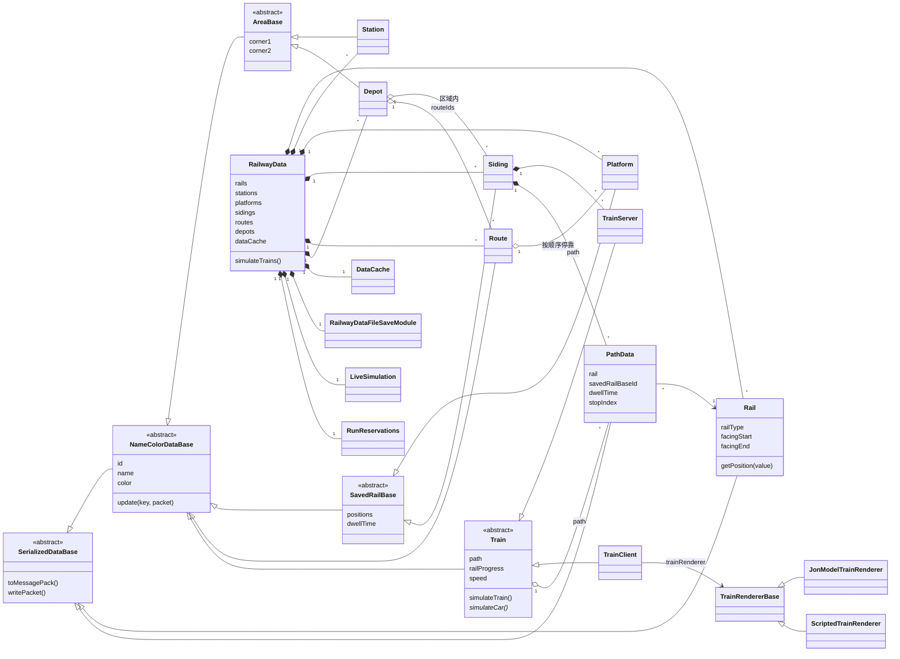

## 3. 启动和注册

### 3.1 入口

```
Fabric: MTRFabric / MTRFabricClient      Forge: MTRForge
        │                                        │
        └──────────────┬─────────────────────────┘
                       ▼
        MTR.init(...)              注册方块、物品、实体、网络包、事件
        cn.zbx1425.mtrsteamloco.Main.init(...)   注册 ANTE 的内容
                       │（客户端另外）
                       ▼
        MTRClient.init()           注册渲染器、客户端网络包、按键、客户端 tick
        cn.zbx1425.mtrsteamloco.MainClient.init()
```

### 3.2 `MTR.init` 里注册的事件

网页服务（`Webserver`，默认 8888 端口）和高级编辑器的本地服务（`EditorServer`）的线程池是守护线程。以前端口被占时 `webServer.start()` 失败，已经启动的线程池不会停（`stop()` 只停"已启动"的），服务器 `/stop` 后进程一直不退出；现在启动失败会立刻停掉，`stop()` 只要没停就停。

- **网络包**：客户端发上来的包都经过 `PacketGuard.register` 注册，先检查大小（1 MB）和频率（每秒 400 个），再交给 `PacketTrainDataGuiServer.receiveXxxC2S`。
- **服务端 tick**（`Registry.registerTickEvent`）：每个维度调一次 `RailwayData.simulateTrains()`，见第 4 节；然后 `AudioServer.tick`，每隔一段时间给所有玩家发服务器时间。
- **玩家加入**：发版本检查、线路用语、时刻表和运动设置、服务器时间、编辑版本号、编辑权限、音频列表，再调 `RailwayData.onPlayerJoin`。
  - **版本检查**（2026-11-05 起）：`PacketTrainDataGuiServer.versionCheckS2C` 发 `IPacket.getNetworkVersion()`，即 `MTM_Logic <版本>`（`gradle.properties` 的 `mtm_version`，构建时写进 `Keys.MTM_VERSION`）。客户端 `PacketTrainDataGuiClient.openVersionCheckS2C` 和自己的比，不完全一样就断开连接，显示双方的版本。网络包或存档有任何变化都把 `mtm_version` 加一。以前比的是 MTR 版本加协议号（`IPacket.PROTOCOL_VERSION`，已去掉）；ANTE 原来另有一套检查（`PacketVersionCheck`），合并进同一个 jar 后也去掉了。
- **玩家离开**：清掉这个玩家的同步状态、包计数、编辑状态。
- **服务器启动**：读 `config/` 下的 `mtr_security.json`、线路用语、时刻表设置、`mtr_motion.json`，启动网页服务和音频服务。

### 3.3 `RailwayData` 的创建和读档

`RailwayData.getInstance(level)` 按维度取实例，第一次取时创建，`load` 时由 `RailwayDataFileSaveModule.load()` 从维度存档目录下的 `mtr.db`（SQLite，经 `RailwayDataFileStore.open`）读出全部数据，再 `dataCache.sync()` 建好各种 ID 索引。

### 3.4 ANTE 怎么接到本体上

ANTE 不改本体的源码，靠 `mixin/` 里的注入改行为。读代码时看到本体某个方法的行为和源码不一致，先查这里。

构建时 `MixinLintTest`（common 的测试）扫 `mixin/` 的源码，找三种会悄悄换掉本体代码的写法：
- 带初始化的 `@Shadow` 字段：初始化会被合并进目标的构造函数，覆盖本体的值（占用表崩溃就是这个）；
- 和目标类某个方法同名同参数、又没有注解的方法：它会直接覆盖目标的方法；
- 会取消的 HEAD 注入，取消是一条独立语句，或者方法体超过 4 条语句：等于用自己的一份代替目标方法。只在 if 后面短短取消一下的不算。

后两种看过、确认不会盖掉本体改动的，写在测试的 `ALLOWED` 里并注明原因。新出现的、或者写在 `ALLOWED` 里却已经没有的，测试失败。改了 mixin 或者改了被注入的本体方法时，按失败信息检查。

**运行钩子暂时隔离**（0.37.0，用户定的"暂时隔离 ANTE 有关部分"，只隔离影响列车运行的 mixin）：服务端 `config/mtr_security.json` 的 `anteRunHooks`（`SecurityConfig.anteRunHooks`）默认 `false`，文件里没有这一项也是关。关着时下面几个钩子一开头就返回，走本体自己的逻辑；改成 `true` 重启恢复 ANTE 原来的行为。
- `TrainMixin.onScanDoors`：不再在 ANTE 装饰物（当站台用的 eye candy）和 Metropolis 的站台方块旁开门，只认本体的站台、屏蔽门和安全门。
- `TrainMixin.convertMaxManualSpeed`：手动驾驶最高速度按本体的规则（只到钻石轨道，超出按铁轨速度）。
- `SidingScreenMixin`：0.38.0 起删掉了，存车线界面不再有手动驾驶速度滑块（5c，见下）。客户端仍从 `PACKET_EDIT_PERMISSION` 末尾多出的布尔值知道开关（`ClientData.anteRunHooks`），旧包没有这一位时当作关，目前没有界面用到它。
- `RailwayDataMixin.simulateTrains()`：调本体的方框判断 `RailwayData.isRailNearInBox`（原来 `simulateTrains()` 里的 lambda 抽出来的），不改 `RAIL_UPDATE_DISTANCE`。

不隔离的：P 类型速度轨道（`RailTypeMixin`，按名字存档，关掉会读成铁轨再存就丢了）、`RailMixin` 的竖曲线和侧倾（是形状，和绘制配套）、列车和轨道上 ANTE 的存档和网络包字段、渲染和骑乘这些客户端 mixin、模型和 JS 脚本。组件本来就不依赖 ANTE。测试 `AnteRunHooksTest`。


| mixin | 改了什么 |
|---|---|
| `RailwayDataMixin` | 替换 `simulateTrains()`，用 ANTE 自己的"轨道是否在玩家附近"调 `simulateTrains(RailNearPlayer)`（3D 轨道的形状不同）。只影子 `world` 和 `RAIL_UPDATE_DISTANCE`，**都不带初始化**：Mixin 会把 mixin 里字段的初始化合并进目标的构造函数，以前这里的 `trainPositions = new ArrayList<>(2)` 把本体的占用表换成了空表，列车在游戏里一直没占轨道，2026-11-05 读占用表时崩溃（和 ANTE-advanced `2f3921c8` 同一个修法） |
| `CustomResourcesMixin` | 在本体读资源包前后插入 ANTE 的资源读取；记住最近读到的贴图，给接下来的 OBJ/bbmodel 用 |
| `TrainClientRegistryMixin` | 取车型时先找 ANTE 注册的脚本车型 |
| `RenderTrainsMixin` | 列车绘制前后的准备和收尾、拿着轨道工具时的显示 |
| `JonModelTrainRendererMixin` | 在车厢绘制的第一次 `rotateX` 处加车身侧倾 |
| `TrainClientMixin` | 构造和 `copyFromTrain` 后带上 ANTE 的数据；`handlePositions` 是 ANTE 的版本（多了车身侧倾）。以前它还整个替换 `TrainClient.simulateTrain`，用的是一份旧代码，本体后来加的直通班次线路（`tripRouteIds`）因此不生效；2026-11-05 去掉了，`simulateTrain` 是本体自己的 |
| `TrainMixin`、`VehicleRidingClientMixin` | 给列车和乘客加额外数据（`TrainExtraSupplier`、`VehicleRidingClientExtraSupplier`），并改乘客的位置计算 |
| `RailMixin` | 3D 轨道的模型、侧倾、竖曲线（`getPositionY`）、开门方向、自定义配置和带侧倾的绘制（`RailExtraSupplier`）。轨道的形状、长度和角度是本体自己的：2026-11-05 去掉了 ANTE 的贝塞尔模式和对 `getLength`、`getPosition`、`getRailAngle`、`isValid` 的重写，读档时也不再用 ANTE 存的弧度角覆盖本体的角度。ANTE 存成贝塞尔的旧轨道由 `Rail(Map)`（`fromAnteBezier`）按两端位置和方向算成本体的形状，算不出有效轨道的保留原样。以前它还把 `goodRadius()` 改成总是成立，2026-11-05 去掉了，新连的轨道又要满足本体的最小半径（2 格） |
| `RailTypeMixin` | ANTE 的 P 类型速度轨道（P-1 至 P600、P1000 至 P10000）。原来配套的 `SidingScreenMixin`（存车线界面手动驾驶速度滑块的范围）0.38.0 随滑块一起删了 |
| 已去掉的 | 2026-11-05：`ItemNodeModifierBaseMixin` 整个替换连轨工具的 `onEndClick`，本体自己的连轨（0.1° 角度、不能折回的检查）从没跑过；`ItemRailModifierMixin` 切换贝塞尔路径模式。全向节点只剩方块注册名 `mtrsteamloco:direct_node`（`BlockDirectNode` 是普通的本体节点，保留是为了已有存档里的这些方块和它们的轨道），物品、设角度的界面、方块实体、绘制和换节点的包都删了；贝塞尔路径编辑器（`RailPathEditor`）也删了 |
| `FQ*`、`FQGraalServices` | 让 GraalJS 在模组环境里能加载 |
| `ItemWithCreativeTabBaseMixin` | 刷子点节点时打开 ANTE 的轨道编辑界面（模型、侧倾等）；它和本体"刷子右键节点输入精确角度"的关系还要在游戏里看 |

## 4. 服务端每个 tick（列车运行）

入口是 `RailwayData.simulateTrains(RailNearPlayer)`。不带 ANTE 时由 `simulateTrains()` 调用，"轨道在玩家附近"的判断是轨道两端点的包围盒向外扩 128 格（`RAIL_UPDATE_DISTANCE`）后包含玩家；带 ANTE 时 `RailwayDataMixin` 换成按 3D 轨道形状判断，其余步骤相同。

### 4.1 一个 tick 的步骤

| 步骤 | 做什么 | 具体实现 |
|---|---|---|
| 1 发附近轨道 | 玩家离上次发轨道的位置超过 16 格（曼哈顿距离，`PLAYER_MOVE_UPDATE_THRESHOLD`）就重发 | 把附近的轨道写进一个 `PACKET_WRITE_RAILS` 包；超过 1 MB（`MAX_PACKET_BYTES`）就不发。客户端 `ClientData.writeRails` 整个替换 `ClientData.RAILS` |
| 2 清本 tick 状态 | `updateNearbyTrains.startTick()`、`occupancy.nextTick()`、`signalBlocks.resetOccupied()` | 上一 tick 的站台时刻表移到 `lastSchedulesForPlatform`（列车本 tick 要读），`schedulesForPlatform` 清空等列车重新填 |
| 3 算经过的 tick 数 | `tickCompensator.nextTick(当前毫秒)` | 按真实时间折算成 tick（50 毫秒一个），每 tick 最少 1、最多 4；舍入的余数留到以后的 tick（上限 8，下限 -1），服务器卡顿时列车不落后于真实时间 |
| 4 侧线排序 | 按侧线 ID 排序 | 保证每次 tick 的处理顺序一样，结果可复现（架构审查 R03） |
| 5 侧线取车厂设置 | `siding.setSidingData(world, depot, rails)` | 速度曲线、减速度等从所属车厂拷到侧线 |
| 6 组件模拟器 | `liveSimulation.tick(this, trainPositions)` | 见 4.4。它先走，看到的是上一 tick 结束时游戏里列车的位置 |
| 7 侧线和列车 | 每条侧线 `siding.simulateTrain(...)` | 见 4.2 |
| 8 运动事件 | `handleMotionEvents()` | 列车运动产生的事件（出发、到站、通过、折返、回库）在这里统一处理 |
| 9 分配走行 | `runReservations.resolve(当前毫秒)` | 见 4.5。本 tick 所有列车申请的走行一起分配，结果和列车处理顺序无关 |
| 10 车厂发车 | 每个车厂 `depot.deployTrain(this, world)` | 见 4.6。用 try/catch 包住，一个车厂出错只在日志里报一次，不影响别的车厂 |
| 11 电梯 | `lift.tickServer(...)`，再 `updateNearbyLifts` | |
| 12 模块 | 冷却、手动驾驶、造桥造隧道、乘客寻路、`pathRegionSync.tick` | `PathRegionSync` 每隔几秒算一次轨道、分界、站台、线路的指纹，变了才在后台线程重算区域数据 |
| 13 同步列车 | `updateNearbyTrains.tick()` | 见 4.7 |
| 14 时刻表和信号 | 每 60 tick（`SCHEDULE_UPDATE_TICKS`）把所有玩家排进队列，每 tick 只给队首一个玩家发 | 发给这个玩家的：附近 16 格内站台或所在车站的时刻表、附近轨道的信号区段状态和轨道占用，打成一个 `PACKET_UPDATE_SCHEDULE` |
| 15 索引 | 站台或侧线数量变了就 `dataCache.sync()` | |
| 16 修节点和存档 | `railNodeRepair.tick`、`saveNow`、`autoSaveTick` | `railNodeRepair` 补回服务器在存世界前停掉而丢失的轨道节点方块；存档见第 7 节 |

**时序图**（一个 tick）：

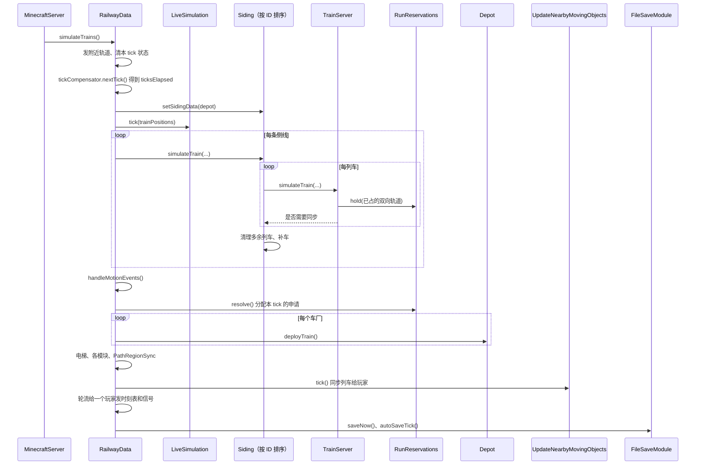

### 4.2 侧线：`Siding.simulateTrain`

1. 侧线没有所属车厂（`depot == null`）就什么都不做。
2. **读档后第 2 个 tick**：不由组件模拟器接管的侧线，把需要对齐的列车（`needsAlignment`）按位置从前到后 `alignToTimetable`，放到时刻表上它此刻该在的位置，再全部标记同步。要等第 2 个 tick 是因为所有侧线跑过一次之后列车位置和车厂的线路才都知道。
3. **逐列车**：
   - 手动驾驶的列车先由 `RailwayDataDriveTrainModule.drive` 处理按键。
   - 给列车设好停站时间（`setStopTimes`）、速度曲线（`setSpeedCurve`）、上一 tick 的站台时刻表，然后 `train.simulateTrain(...)`（见 4.3），返回 true 表示要同步给客户端。
   - 取走列车的运动事件（`drainMotionEvents`）。
   - 非连续运动的列车把自己占的轨道写进 `trainPositions` 并占用信号区段（`writeTrainPositions`）。
4. **清理和补车**（组件模拟器接管的侧线跳过这一步）：
   - 车厂里（不在线上）的列车只留一列，多的删掉；两列车位置（`railProgress` 取到 0.1 格）完全相同时删掉后一列。
   - 有列车还在侧线附近（`closeToDepot`）就不补车。
   - 回到车池里另一条存车线的列车（`takeReturnedElsewhereSiding`，见 4.6 的回库）从这条侧线清掉，并在目标存车线上记一列"待到"（`Siding.pendingArrivals`），那条存车线下一次补车时先补这一列，不受车池计数限制（只看自己的上限）。目标可以是同一运营线路别的车厂的存车线。
   - 需要时新建一列 `TrainServer` 放在侧线上：
     - 按运用跑的车厂（`depot.getRunDuties() != null`，用时刻表的车厂都是）：按**车池**计数。车池是同一车厂里车型和编组都相同的存车线（`Siding.getPoolKey`），每个 tick 开始时 `RailwayData` 重新分组（`Depot.clearPools`、`addToPool`）。按运营线路排运用的车厂，计数用**线路车池**（`Depot.getLinePool`）：本车厂的车池加上同一规划单元里别的车厂同键的存车线；每条存车线的槽位按它自己车厂的运用算，列车数加上"待到"的。侧线没有车时补一列；否则车池的车少于车池的槽位数（`Depot.getPoolTrains`、`getPoolSlots`）、这条侧线也没到自己的上限（`getTrainLimit`）时才补。
     - 其余车厂按"无限列车"或最大列车数。
     - 不限数量或最大数大于 0 时列车 ID 随机，否则用侧线 ID。
     - 组件模拟器（`TickRunner.SidingRun.tick`）用同样的规则。

### 4.3 一列车：`TrainServer.simulateTrain` 和 `Train.simulateTrain`

`TrainServer.simulateTrain` 的顺序：

1. 记下旧状态（下一停车点、乘客数、手动、是否停着、门），用来最后判断要不要同步。
2. **移动**：
   - 组件模拟器接管时（`simulated != null`）：`showSimulated` 把模拟器里那列车的位置和状态抄过来，再调 `Train.simulateTrain` 只做车厢、乘客、开门这些要世界的事。
   - 否则：`service.updateOvernight()`（跨天的班次处理），`Train.simulateTrain` 按规则移动，`holdRun()` 更新自己在走行预约里占着的轨道（4.5），`service.update(isOnRoute)`。
3. **站台时刻表**：沿 `timeSegments`（生成路径时按速度算好的每段轨道的时间）往前推算这列车到后面每个站台的时间，取"推算时间"和"计划到达时间"中较晚的一个，写进 `schedulesForPlatform`。环线跑完一圈后接着推第二圈。
4. **手动和自动切换**：允许手动的列车在车厂里总是手动；上线后手动操作冷却够 `manualToAutomaticTime` 就转回自动，并按门的状态补算已停时间。
5. 返回是否需要同步：走行段版本变了、有乘客下车、下一停车点变了、手动状态变了、从停着变成走、门的目标变了，任一成立就同步。

`Train.simulateTrain(world, ticksElapsed, depot)` 是服务端和客户端共用的部分：

1. **算运动**，三选一：
   - `movedBySimulator`：模拟器已经移动过，只取停站时间。
   - `followSegment`：客户端按服务端发来的走行段走（速度曲线列车，G2）。
   - 否则按 `mtr_motion.json`：`LegacyTrainMotion.tick`（旧规则）或 `TrainMotion.tick`（组件规则，见下）。返回 -1 表示已经在路径末尾，不再处理。
2. **算车厢端点**：`positions[0..trainCars]`，第 i 个端点在路径上的进度是 `railProgress - i × spacing`（反向时倒过来），用 `Rail.getPosition` 求出坐标，再加上运输方式的轨道高度 `railOffset`。
3. **`handlePositions`**（服务端）：
   - 列车包围盒外扩 128 格内的玩家或正在坐车的玩家，记进 `trainsInPlayerRange`，用来决定同步给谁。
   - 车头下方要检查的方块：列车红石感应器、货物装卸器（和相邻容器交换物品）、报站器（对车上乘客报站）。只查已加载的区块。
   - 附近没有玩家时返回 false，后面不再逐车厢处理。
4. **逐车厢 `calculateCar`**：车厢中心取两端点的平均再加 1 格高；`yaw = atan2(Δx, Δz)`，`pitch = asin(Δy / 车厢实际长度)`；左右各扫一次门旁边的方块（`scanDoors`），有站台或屏蔽门且门在开才算这一侧开门。结果交给子类的 `simulateCar`：服务端处理乘客上下车和座位，客户端画车（第 5 节）。
   - 屏蔽门、安全门开门时改的是门的方块实体（`TileEntityPSDAPGDoorBase.setOpen`），刚放下的门（`temp`）第一次写出数据时要把方块的 `TEMP` 改成 false 让客户端重画；这一步放到下一刻用 `TickTask` 做，不能在 `writeCompoundTag` 里直接改方块：那时区块正在把改过的方块发给玩家（方块实体的更新包），这时改方块会让这一截区块（16 格高）留下"有改动"的记录却没有发送标记，1.20.1 的 `ChunkHolder` 之后再也不发这一截的方块变化，玩家敲掉的方块在客户端又回来，直到服务器重启（2026-11-09）。

**活动图**（`Train.simulateTrain`）：


PIDS 发包时，`PidsSchedules` 从已生效的车厂运用和运用路径补每站台最近一班尚未开始的计划到站。运用开始后由列车上报实时到站。计划条目仅合并到发给客户端的站台显示数据。计划到站在服务端线程每 3 秒（`SCHEDULE_UPDATE_TICKS`，有玩家在站台附近时）全网重算一次，一次超过 50 ms 写一条日志（每分钟最多一条），用来在大线网上量。

`TrainServer` 把实际在线列车下一载客站的实时预测和运动内核的停站状态汇成 `StationCall`，广播器和时刻传感器按站台读取。一次停靠中每个方块只触发一次。发车预告只在已有的发车检查放行后计时，不提前申请进路。

### 4.4 组件的运动规则：`TrainMotion.tick`

在 `transit-sim` 的 `transitsim.motion`，不依赖 Minecraft。`Train` 把自己实现成 `MotionState`（速度、位置、门、下一停车点）、`MotionTrack`（路径和每段的累计距离）、`MotionVehicle`（车厢数、间距、加减速度）、`MotionHooks`（能否发车、轨道是否被占、开门、到站回调）交进去。

- **在车厂里**（`!isOnRoute`）：位置固定在侧线中间，速度 0。自动列车 `canDeploy()` 为真（车厂允许发车，按运用的还要拿到出库走行），或手动列车推了牵引，就 `startUp` 上线，发 `DEPARTED` 事件。
- **到路径末尾**且不留在线上：回库，清乘客，发 `RETURNED`。
- **停着**：
  - 前方一段轨道（车头所在段 +1，掉头时 +2）被占就算 blocked。
  - 环线到了重复点就跳回重复起点（掉头的环线同时反向），发 `LAP`。
  - 刚停下时调 `onStopReached`（扣车、到站记录在这里）。
  - 已停时间累加，但到"总停站时间 - 关门 64 tick - 延迟 20 tick"之后，如果被扣车或前方被占就不再累加，门保持开着。
  - 服务端停够时间、前方不占、（手动时推了牵引）就 `startUp` 出发。
- **走着**（服务端）：
  - 制动距离 = `v² / 2a`（用速度曲线的列车用减速度）+ 本 tick 走的距离 + 2 格余量。在制动距离内找第一段被占的轨道，找到就把停车点设在它前一段；否则停车点是下一个站台。
  - 速度：用速度曲线的列车服务端按走行段（`followRunSegment`）、客户端按速度曲线（`followSpeedCurve`）；不用曲线的，进入制动距离且必须停就按匀减速降速，否则向这段轨道的限速加速或减速（加速度 × 经过的 tick）。手动列车按档位加减速，不超过手动最高速度。
  - 前进 `速度 × ticksElapsed`（或曲线给出的距离）；越过停车点时，必须停就停在停车点上并发 `STOPPED`，不停的站（通过站）发 `PASSED` 继续走。
- **门**：门的值每 tick 变化 `ticksElapsed / 64`，开着或在动时不允许牵引。

旧规则 `LegacyTrainMotion` 是改造前的同一套流程，留着对比用。

**状态图**（`TrainMotion.tick` 里列车的状态）：

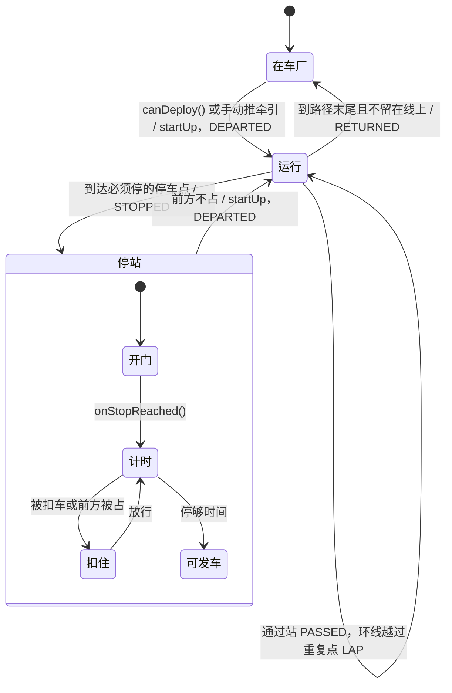

### 4.5 单线走行预约：`RunReservations`

在组件的 `transitsim.sim`，防止按运用运行的列车在单线上对向相遇。

- 只管"双向轨道"：反方向也有轨道的那一段（`getRunMoves` 用 `rails.get(end).get(start)` 判断）。同向的列车由信号区段管，不在这里互相等。
- **持有**：在线、自动、按运用运行的列车，每 tick 调 `hold`，持有从车尾到"本段走行终点"之间所有双向轨道（带方向）。车尾离开一段轨道才放掉；回库、手动或不按运用的列车 `release` 全部放掉。没有再调 `hold` 的列车在 tick 结束时自动放掉。
- **申请**：准备离站的列车 `request` 下一段走行的轨道，带计划发车时间。`resolve` 在 tick 结束后统一分配，顺序固定：已等了 `AGING_MILLIS` 以上的按等待时间最长的优先，其余按计划发车时间，再按列车 ID。有等太久的申请没能满足时，还没进入那段轨道的反向列车也不放进去，避免一直被对向车流挡住。
- 下一 tick 列车 `takeGrant` 拿到结果才发车（`isRunGranted`）；出库也一样要先拿到走行。

**时序图**：

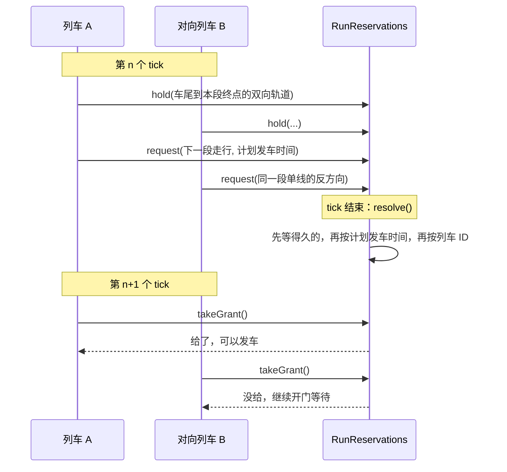

#### 咽喉进路锁（L2，`ThroatLocks`）

和单线预约用同一个 `RunReservations`：`Move` 可以是一个道岔（节点和经过方式，`Move.turnout`），在仲裁器里是道岔资源，同一方式共用、方式不同互斥。每列按运用运行的车有一个 `ThroatLocks`（路径变了重建），由宿主（游戏的 `TrainServer`、组件的 `TickRunner.HeadlessTrain`）这样用：

- **离站**（`isRunGranted`）：申请的走行里加上这一站出站进路的道岔（`getExit`）和已经持有、车尾还没过的道岔（`getHeld`），给了以后 `onGranted` 记下。
- **每 tick**（`holdRun`）：不在等离站时调 `approach`：下一站进站进路还没给、车头离停车点（驶入咽喉那段轨道的起点）不超过制动距离加 32 格，就带上已持有的一起申请；然后持有单线加 `getHeld`。
- **轨道被占**（`isRailBlocked`）：`isBlocked` 为真时那段轨道算被占，运动规则让车停在它前面。
- 节点相交的轨道数：游戏按轨道表，组件按所有存车线路径的轨道（没有路径用的轨道挡不着谁）。开关 `ThroatLocks.enabled`，由 `SecurityConfig.throatLocks` 设。
- 新旧隔离：车厂列车走的轨道（存车线路径和运用路径的节点）连成网（`transitsim.network.LockNetworks`），一张网上同时有按运用的车厂和不按运用的车厂（按频率发车等）时，这张网上按运用的车不锁咽喉。游戏由 `RailwayData.updateLockNetworks` 每 100 tick 重算（`isThroatLocksOff`，变化时写日志），组件在 `SimDataset.buildRunner` 设 `DepotBoard.throatLocksAllowed`，网页编辑器数据里车厂带 `oldLogic` 和 `throatLocksOffBy`。没有运用、也不会发车的车厂（没有线路，或按实时时刻没有发车时刻、按频率各小时都是 0，例如刚新建的）带 `notConfigured`，网页显示"未配置"而不是"旧逻辑"；它没有路径时也不和别的车厂连成网。
- **联锁区**（MTM_Logic 0.10.0）：联锁色（`SecurityConfig.interlockColor`，默认品红）的信号闭塞分区是整块锁的联锁区。
  - 游戏用 `SignalBlocks.getZones(颜色)` 得到"轨道 → 分区 ID"表，信号闭塞版本或颜色变了才重建，给出的表不再改动，所以别的线程也能用。客户端用 `ClientData.SIGNAL_BLOCKS` 和随 `PACKET_EDIT_PERMISSION` 发来的 `ClientData.interlockColor` 算同样的表（`ClientThroats`）。
  - `ThroatRoutes.of` 多一个轨道到区的查询：走进站、出站进路时，经过的轨道在区里就记下这个区（`Item.zone`，`index` 是进区的第一条轨道，`endIndex` 是出区后的那条），并像道岔一样清零"64 格没有道岔"的计数。区对区同 ID 就冲突，不分方式；区和道岔不冲突。`getPlace` 给出显示用的节点（道岔的节点，或进区的节点）。
  - `RunReservations.Move.zone(id)` 在仲裁器里是 `Kind.TRACK`，一次只给一列车。`ThroatLocks` 按 `endIndex` 放开（车尾离开区的最后一条轨道），`granted` 按 `index * 2 + 是否区` 记，道岔和区从同一个节点开始也不互相覆盖。`TrainServer` 在区的表换了时重建 `ThroatLocks`。
  - 时刻表检查 `checkThroats` 按"道岔节点"或"区"分组（`useKey`），冲突的位置用 `getPlace`。网页的咽喉提示另写联锁区个数（`EditorData` 的 `throat.zones`），交叉列表里区的冲突写"在联锁区"。
  - 组件：`SimDataset` 格式 10 在每个信号闭塞分区后带"是联锁区"（`interlockBlocks`，`SimExport` 从 `SignalBlocks.getInterlockFlags` 填），`TickRunner.setInterlockZones` 给区编号（在列表里的位置加 1）。
  - 联锁区仍是普通的信号闭塞，占用照旧；按频率和手动驾驶的车不办进路。
- **闭塞区段**（MTM_Logic 0.11.0，`transitsim.network.BlockSections`）：没涂色的长轨道切成区段，占用、追踪停车和信号灯色都按区段。
  - **长度**：每条轨道按自己的限速算常用制动距离 `v²/(2a)`，`a` 是 `BlockSections.deceleration`（`SecurityConfig.blockDeceleration`，默认 1.0 m/s²），不小于 `minLength`（`blockMinLength`，默认 400 格，比大多数列车长，停着的车只占一两段）。
  - **轨道**：比区段长的平均切成 `ceil(长度/区段长)` 段，从节点小的那一端编号，第 0 段用轨道自己的键，其余段的键由轨道键和段号算出（`getPieceKey`）。不能加速的轨道（站台、存车线、折返线）不切：宿主传限速 -1（组件 `TickRunner.cutSpeed`，游戏 `TrainServer.cutSpeed`）。
  - **分区不切**（用户 2026-11-05 定）：玩家涂的信号闭塞分区不论多长都整块是一个区段，里面长轨道的每一段都算进去；一条轨道在几种颜色的分区里时取它们的并（`getSection`）。原来计划超长分区也切，yel 实测切开后两列车会各占一段、互相挡住（占用死锁，仲裁器看不到），2 小时少 5%–20% 的到站，所以改成不切。游戏由 `SignalBlocks.updateSections` 在每 tick 列车跑之前、分区变了时重算（轨道长度和限速来自 `RailwayData.railInfo`）；组件在 `TickRunner.getBlockSections` 用存车线和运用路径上的轨道算。
  - **占用**：列车占它车身覆盖的每个区段（`getCoveredUnits`：整条轨道的键，或长轨道上覆盖到的段），再带上所在分区区段的其余部分（游戏 `SignalBlocks.occupy(轨道, 区段, …)`，组件 `writePositions`）。一条轨道"被占"是它有任何一段被别的车占着。
  - **停车**：运动内核多一个钩子 `MotionHooks.getSectionBlockedPosition(轨道, 位置)`，给出这条轨道上从这个位置往前第一个被别人占的区段的起点，默认没有。`TrainMotion.tick` 先看车头所在轨道往前的区段，再看前方被占的轨道：被占的区段从轨道中间开始时，车停在区段起点（`sectionStop`，越过时拉回并停下），否则照旧停在前一条轨道的终点。停着的车只要下一条轨道开头的那段空着就能起动（`isTakenAtStart`），车头前方 1 格内的区段被占时不起动（`isSectionTakenJustAhead`）。没有切开的轨道行为不变。
  - **查卡车**：日跑工具加 `-Pmtr.debugStuck=true`，跑完列出停在两站之间的车、车头所在轨道的段数、前方是否被占和挡住它的车。`-Pmtr.blockMinLength=1000000` 相当于不切，用来对比。
  - **跳 tick**：`getMovingQuietTicks` 的边界加上车头、车尾所在轨道的下一个区段起点（`getNextSectionStart`），车头所在轨道前方有被占区段时不跳；`Standing` 判断被挡和运动内核一样。
  - **客户端**：服务端同步时发所有分区的占用标记（不再只发附近的）和全网被占的区段，每个写成"轨道键 + 第几段"（`SignalBlocks.getPiece`），客户端存进 `ClientData.OCCUPIED_SECTIONS`。信号灯色由 `SignalAspects.getAspect` 算：从信号机的节点沿朝向走客户端有的轨道，按同样的切法数区段，第 j 个区段被占就是第 j 档（1 红）；道岔后每一支都看，取最限制的；地图上有、客户端没有的轨道按被占。客户端按它知道的轨道长度切，远处轨道长度不知道时区段数可能和服务端不同，只会让灯色更限制。铁路检查对切开的轨道写出段数、每段多长和哪几段被占（`gui.mtr.rail_sections`）。
- 卡死：仲裁器发现列车在单线或道岔上互相等成一圈时，冻住相关资源、每圈报一次。游戏每 tick 给出预约（`RailwayData` 里 `runReservations.resolve`）之后取出这些报告，在服务端日志写一行 `Minecraft Transit Railway: trains waiting on each other for their runs [列车…]`。以前只有组件的模拟器读它们，按速度曲线跑的车厂和模拟器共用预约，报告被模拟器取走后就丢了，服务端日志看不到。

### 4.6 车厂发车：`Depot.deployTrain`

- 组件模拟器接管的车厂直接返回，由模拟器发车。
- **按运用**：用时刻表的车厂一律按运用跑（`getRunDuties`：设了运用用自己的，否则用寻路时按时刻表自动生成的 `autoDuties`，见 9.4）。车厂只负责放车，车出库后带着自己的运用跑（`duty_day`）。`Depot.deployDutyTrain` → `DepotDispatcher.findDutyDeploy`：
  - **什么时候放**：运用首班的时刻减去出库用时（存车线到首站的最快时间）再减 15 秒。每 tick 最多放一列，准点的先放，同样准点时最早到点的先放。放了就记下这一天这个槽位已经跑过（`dutyRunDays`，按"槽位所属的存车线:槽位"）。
  - **出库间隔**：车厂设了 `releaseInterval`（秒，游戏的车厂界面）时，两次放车至少隔这么久；被压住的车不算晚点。
  - **出库进路**：车要先拿到出库线到首站的进路（`TrainServer.canDeploy` 里的 `isRunGranted(1)`，含正线方向预约，计划发车时刻作优先级）才算准备好，拿不到就在库里等。
  - **晚了**：错过超过 `MAX_DEPLOY_DELAY`（10 分钟）、运用还没跑完（或留线过夜）时照样放（`DutyDeploy.late`），放出后 `joinDutyLate` 把车放到运用里还赶得上的第一站，只放在站上。
  - **车池替补**：槽位自己的存车线没有准备好的车时，由同一车池里另一条有车、也有这个运用路径的存车线放车（`pools` 参数）。`DutyDeploy.dutySidingId` 记下槽位属于哪条存车线，车存成 `duty_siding`，过夜接班和"今天已跑"都按它算。
  - **回库**：车在运用最后一站准备回库时选一次去哪（`TrainService.chooseDutyReturn` → `Depot.chooseReturnSiding` → `DepotDispatcher.chooseReturnSiding`）：在还有空位（自己的车加上正赶去的车、待到的车少于上限）的**线路车池**存车线里，选今天下一个还没出库的运用最早的那条，没有就回自己的。线路车池见 4.2，可以是同一运营线路别的车厂的存车线；每条候选的槽位和"今天跑过没有"按它自己车厂读（`DepotDispatcher.chooseReturnSiding` 的静态重载，参数 `slotsOf`、`DutyRuns`）。换到同一运用、终点不同的路径（键 `<运用键>#<存车线>`，`TripPath.getReturnSidingId` 从键读出存车线）。进了别的存车线，原存车线清掉它，那条存车线补一列（4.2）。
    - （0.18.0，P1-B）候选只算这份运用有回库路径的存车线（`Board.chooseReturnSiding(sidingId, depotId, canGoBack)`，`canGoBack` 由 `TrainService` 查 `tripPaths` 里有没有 `<运用键>#<存车线>`），不再选中回不去的再退回原处。回送指令的车厂 D 没有同车型、有空位又有路的存车线时，车仍按平常回库（车总得回到某处），但写日志并记进 `Depot.returnOrderMisses`（模拟器是 `DepotBoard.returnOrderMisses`），网页"同步状态"提示。
  - **过夜接不上：停在原地等处理**（0.18.0，P1-C）：`TrainService.updateOvernight` 找不到第二天从所在站台出发、还没跑过的运用时，不再 `returnToDepot()`（车从站台消失回到存车线），而是记下原因（`HoldReason`：`NO_DUTY` / `OTHER_PLATFORM` / `ALREADY_RUN`，只在原因变了时写一次日志），车停在原地；之后每次更新都再查，有了合适的运用就接着跑。`RailwayData` 每 100 tick 收集各车厂停着的车（`HeldTrains.collect` → `Siding.forEachHeldTrain`）和回送指令没能执行的记录，有变化（或每分钟一次，只要还有）就发 `PACKET_HELD_TRAINS`；客户端存进 `Depot.clientHeldTrains`、`returnOrderMisses`，`EditorData` 放进车厂的 `held`、`returnMisses`。网页"同步状态"对每列停着的车给"直接收回"，发 `recall` 操作 → `PACKET_RECALL_TRAIN`（`HeldTrains.receiveRecallC2S`，要编辑权限）→ `Siding.recallHeldTrain` → `TrainService.recallHeld`，日志写是谁收回的。停着的状态不存档，读档后会重新查一遍。
  - **回送指令**：运用最后一段的班次在时刻表里设了回送车厂（`RouteTimetable.returnOrders`，见 9.4），就改用 `Board.chooseReturnSiding(sidingId, depotId)`：只在那个车厂同车型、编组、有空位的存车线里选（下一班最早要车的），那个车厂没有合适的存车线时照上面自动选。车厂寻路时把这些车厂的存车线也算进回库变体（`Depot.generateMainRoute` 的 `lineSidings`）。
- **共用线路的车厂**：按运用跑时车不预约班次。自动运用生成前先让出共用线路的其他车厂已在跑的班次（`Depot.getSharedTaken`：它们自己设的运用，以及 ID 更小的车厂的自动运用），见 9.4。下面"共享班次"那一段只对按频率、按时刻表在线预约的车厂起作用。
- **按时刻表或频率**：本 tick 请求发车的侧线（列车在 `canDeploy` 里调 `requestDeploy`，只有出库的第一段轨道没被占才请求）按侧线顺序从 `deployIndex` 开始轮流找：
  - 有时刻表的线路：`findDeployService` 找下一个还没发出的班次，找到就记下这个班次（`lastDeployedTrips`、`reserveTrip`）并 `deployTrain(班次时间, 线路)`。
  - 没有时刻表：到了发车间隔（`getMillisUntilDeploy(1) == 0`）就 `deployTrain()`。
  - 每 tick 最多发一列，发完 `deployIndex` 往后移，下次从下一条侧线开始，保证各侧线轮流。
- 发不出去的列车不排队，跳过这个班次，时刻表不会越积越晚。
- **共用线路的车厂共享班次**（`a1ed043`）：`DataCache.sync()` 时先 `clearSharedServices()`，再把每两个 `routeIds` 有交集的车厂互相 `shareServicesWith`（各自的 `DepotDispatcher` 记为 peer）。之后：
  - 判断某个班次是否已被占（`isReserved`）时，自己和所有 peer 的预留都算。
  - `getLastDeployedTrip(线路)` 取自己和 peer 最后发出班次中最晚的一个，所以比它早的班次两边都不会再发。
  - 结果：两个车厂按同一张时刻表跑同一条线路时，每个班次只由一列车跑。一个车厂占用或放掉班次，也会唤醒另一个车厂里等着的列车。组件的模拟器里做法相同（同一个数据集里共用线路的 `DepotBoard` 互相连接），由 `SharedServicesTest` 检查。

### 4.7 列车同步到客户端：`UpdateNearbyMovingObjects.tick`

每个玩家记着上一 tick 范围内有哪些列车（`dataSetInPlayerRange`）和本 tick 的（`newDataSetInPlayerRange`，由 `handlePositions` 填）。

1. 有列车离开某玩家范围（或被删除），给他发一个 `PACKET_DELETE_TRAINS`，内容是**还要保留**的列车 ID 列表；客户端把不在列表里的列车标为 `isRemoved`，下一帧移除。
2. 对范围内要同步的列车（本 tick `simulateTrain` 返回 true，或刚进入范围）：
   - 玩家已经有这列车，且路径和车型没变（`getSyncKey` 相同：路径各段端点、车型 `trainId`/`baseTrainType`、节数、车厢间距、车长，加 ANTE 的 `customConfigs`）：只发状态包（`writeStatePacket`，G2），合并到 `PACKET_UPDATE_TRAIN_STATES`。
   - 否则发完整数据（`writePacket`，含路径），记下 sync key。
3. 完整数据按 1 MB 一个包拼起来发 `PACKET_UPDATE_TRAINS`；单列车超过 1 MB 的不发，服务端日志写一次"is too big to send to players"（以前悄悄丢掉）。

运用结束回库时，`TrainService` 通过 `followPath(null)` 切回存车线路径。模拟组件和 Minecraft 宿主都在同一次切换中调用 `RunMotion.parkAtSiding`，将车头里程置为存车线长与列车长度之和的一半。这样客户端拿到的里程和路径使用同一坐标系，车厢两端仍沿轨道取样。

**长路径分轮发送（2026-11-09，`mtm_version` 0.62.13）**：按运用跑的列车，路径是一整天的运用（出库、各趟首尾相接、回库），Q 上一列车跑全天 229 班的环线运用有 7067 段，整条写进包约 1.16 MB，超过上限，玩家从来看不到这列车。现在：
- `Train.writePath`/`readPath`：路径里每条轨道（`Rail`）只写一次，各段按编号引用，段的其余内容（`PathData.writePacketWithoutRail`）照写。
- `Train.getSendWindow`：路径超过 `SEND_WINDOW_MIN`（2048 段）且不是首尾循环（`repeatIndex1/2` 为 0）时，只发车头所在的这一轮和下一轮，起点往前多带一节车长加 64 格（车尾要画）。一轮到路径掉头处为止（一段把前一段倒着走）；一直绕圈不掉头的，在停站处切，每轮不超过约 `SEND_BLOCK`（512）段（`getRounds`，按路径缓存）。发出去的部分从 0 编号：里程减去起点之前的长度，`nextStoppingIndex`/`nextPlatformIndex` 减去起点，走行段（`RunSegment.Spec`）的起点和目标位置同样平移；状态包（`writeStatePacket`）同样平移。
- 状态包写的同步编号必须用公开的 `getSyncKey()`：ANTE 的 `TrainMixin` 在它上面加了自定义配置，客户端也用它比；按分轮的内部方法直接算会绕过 mixin，客户端拒收每个状态包，车门的 `doorTarget` 一直不变，门不开、按住 Shift 也下不了车（0.63.1 修好，测试 `TrainSendWindowTest.theStateCarriesTheKeyAsAddedToByMixins`）。
- `getSyncKey` 只算发出去的那部分（各段端点、所在站台、停站序号和停站时间，加车型），客户端在自己收到的路径上算出同样的值，所以状态包照常对得上。车头进入下一轮时（停在折返站时）部分变了，sync key 跟着变，玩家收到一次完整数据。
- Q 副本实测：每次发 40 段，约 11 KB，换段都在车速为 0 时。
- 调试：`-Dmtr.debugPlace=车厂名` 让服务端在模拟器跑起来 10 秒后对这个车厂"按时刻表摆放"（和玩家点一样，只是不发消息），之后每 5 秒打印组件驱动的存车线上每列车的包大小、发出的段、是否在线上、路径长度、里程（`LiveSimulation.debugPlace`、`TrainServer.describeShown`）；摆放时找不到运用路径的列车写一次"can't be shown where the simulator has it"。

客户端在网络线程读包、在主线程（`client.execute`）改数据：`updateTrains` 新的列车加进 `ClientData.TRAINS`，已有的同一车型（`Train.isSameVehicle`）`copyFromTrain`，换了车型的（存车线换车型后列车 ID 可以不变）整列换成新的 `TrainClient`，旧的标 `isRemoved`——节数、间距和模型是列车构造时定的，只抄路径和进度会让旧车的后几节超出存车线起点、叠在一点横在轨道上；`updateTrainStates` 对已有列车 `applyState`。两次更新之间客户端用同样的运动规则自己推算位置。

**时序图**：

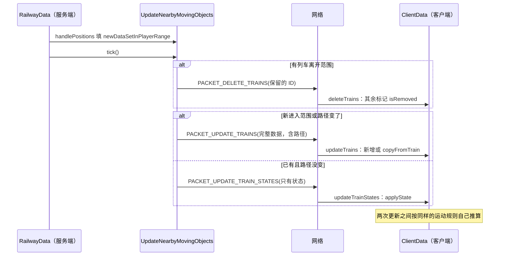

### 4.8 组件模拟器接管：`LiveSimulation`

由 `mtr_motion.json` 的 `componentDrive` 决定：关（0）、对比（1）、开（2）；用旧规则时总是关。

- **能接管的车厂**：用速度曲线、不是连续运动的车厂（按时刻表、运用或频率都可以）。别的车厂的列车作为外部列车告诉模拟器。
- **启动**：等读档后侧线都知道所属车厂、列车都已对齐（`hasSettled`）才第一次启动，从游戏里列车的当前位置开始。没有能接管的侧线时每秒重试一次。
- **开**：模拟器每 tick 推进到当前时间，游戏里这些侧线的列车只显示模拟器的列车（`setSimulated`），自己做车厢、乘客、开门、占轨道和信号。轨道或计划变了（编辑后等 2 秒再看，或每 5 分钟检查一次），或服务器停了超过恢复时间，就从游戏列车的当前位置重新启动。模拟器的列车同样在游戏的 `RunReservations` 里持有和申请走行，和游戏自己的列车互相等待。
- **对比**：模拟器在旁边独立跑，游戏照常移动所有列车；每 60 秒在日志里报两边差多远（1 格内算一致），然后从游戏列车重新开始。
- **手动驾驶**：手动的列车由模拟器交给游戏（`TakeOver`），回到自动时把位置和速度还给模拟器（`Release`）。
- **出错**：任何异常都不会打断游戏的 tick；模拟器关掉，直到设置被改，游戏从模拟器留下的位置接着跑。

#### 按时刻表就位（`placeByTimetable`，协议 42）

模拟器接管的车厂本来只能一列一列发车，白天才应用的时刻表要几个小时才能把线路排满。现在可以让车厂的列车直接出现在时刻表此刻安排的位置：

1. **发起**：在网页编辑器里右键车厂 → `EditorServer` → `PacketTrainDataGuiClient.placeTrainsC2S(depotId)` 发 `PACKET_PLACE_TRAINS`。服务端 `receivePlaceTrainsC2S` 在主线程上检查权限，调 `RailwayData.placeTrainsByTimetable` → `LiveSimulation.placeByTimetable`。
2. **检查**：模拟器必须正在**接管**这个车厂，否则在聊天栏提示"不是组件运行的车厂"；上一次就位还没算完时提示"正在计算"。
3. **选车厂**：从这个车厂开始反复扩展，把和已选车厂共用线路的车厂都加进来，直到不再增加。共用线路的车厂跑同一条线和同一张时刻表，分开算会把列车叠在一起。
4. **准备数据**（主线程）：复制模拟器的数据集，去掉列车，只留选中车厂的侧线，序列化成字节。聊天栏提示正在计算哪些车厂。
5. **计算**（主线程，下一个 tick 里 `LiveSimulation` 重新 `start` 时，`Placement.takeInto`）：
   - **车厂都按运用跑时**（用时刻表的车厂都是）：用这份数据建一个 `TickRunner`，`placeDutyTrains` 给此刻在外的每个运用放一列车，直接放到运用此刻的位置（在站就在站，在区间按最快曲线拉伸到计划运行时间算出位置和速度，`TrainService.placeOnRun`），不用从运营日开始推演，几毫秒就算完。
   - **否则**（还有按频率跑的车厂）：从运营日开始（`DutyShapes.getDayStart`）建一个 `EventSimulator`，按组件的规则推进到当前时间。
6. **接回**：拍下当前列车的记录后：
   - 从记录里删掉这些侧线上的列车，**玩家正在手动驾驶的除外**，换上算出来的列车。
   - 这些侧线已发出的班次、运用已跑过的日期、最后发车时间、发车轮转位置也一起换掉，已经发出的班次不会再发一遍。
   - 模拟器从这份记录启动，聊天栏报告每个车厂现在有几列车；计算失败也会提示。

**时序图**：

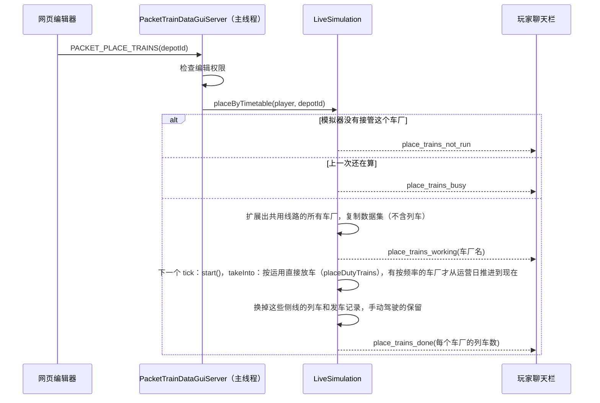

**状态图**（`componentDrive` 和模拟器）：

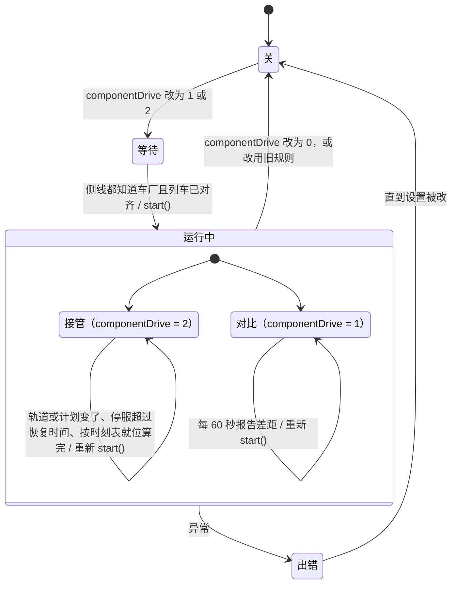

## 5. 客户端每帧（画列车）

### 5.1 谁触发绘制

列车不是实体，没有自己的渲染器。`RenderTrains` 注册成座位实体 `EntitySeat` 的渲染器，借它每帧被调用：

- 有座位实体时，第一个被画的座位触发 `RenderTrains.render(entity, ...)`，记下它的 UUID（`renderedUuid`），同一帧其他座位直接返回。
- 没有座位实体时，Fabric 的 `MTRFabricClient`（世界渲染事件）和 Forge 的 `LevelRendererMixin` 调 `render(null, ...)` 作为后备。
- 装了 Pehkui 时只走后备路径。

### 5.2 `RenderTrains.render` 的步骤

1. **帧时长**：暂停或本游戏 tick 已经画过时为 0（列车不动），否则是上一帧时长（以 tick 计）。
2. **列车可见距离**：开了动态帧率时，帧时长大于 0.5 tick 就把最大距离往 `DETAIL_RADIUS`（32 格）收一半，小于 0.4 就加 1；否则固定为渲染距离 × (`trainRenderDistanceRatio` + 1)。
3. `TrainRendererBase.setupStaticInfo`：保存本帧的相机、世界、矩阵、缓冲区。
4. **不透明批次**（`setBatch(false)`）：`ClientData.TRAINS` 每列车 `train.simulateTrain(world, 帧时长, ...)`，回调里显示速度或站名提示、播报站。
5. **半透明批次**（`setBatch(true)`）：重放各车厢记下的半透明绘制（`trainTranslucentRenders`）。
6. 画电梯、轨道和节点，最后按贴图分批提交（`scheduleRender`）。

**时序图**：

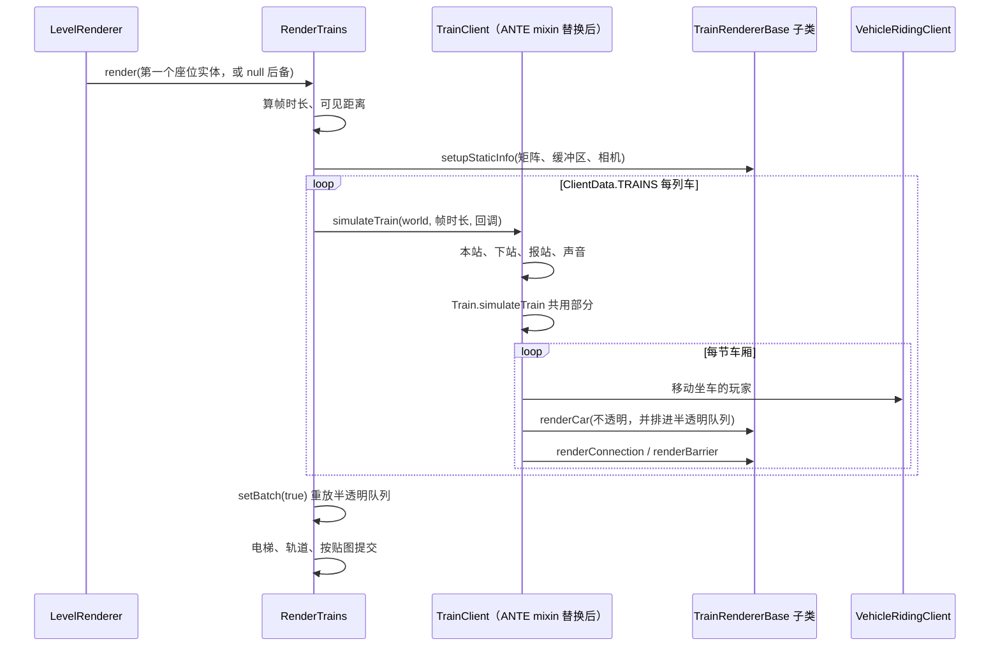

**坐标约定**（`27d96cf` 起）：渲染矩阵以摄像机为原点，避免离世界原点很远时浮点精度不够、列车抖动。`renderCar` 等拿到的 x、y、z 是**世界坐标**，渲染器要用 `TrainRendererBase.translateToWorld(viewOffset, x, y, z)` 平移（没有视角偏移时减去摄像机位置），不能直接 `matrices.translate(x, y, z)`。ANTE 合并进来时它的列车渲染器（DK3、D51、脚本车型）还是直接平移，车被画到了别处，`91bb3a1` 改正。ANTE 的 3D 铁轨在 `RenderTrainsMixin.renderTail` 里先减去摄像机位置，再按世界坐标画。

### 5.3 一列车：`TrainClient`

- 带 ANTE 时 `TrainClientMixin` 替换 `TrainClient.simulateTrain`：先清掉上一帧的半透明队列，按当前停站算出本站、下站、终点站和线路，处理报站和声音，再调 `Train.simulateTrain(world, 帧时长, null)`（4.3 的共用部分，车厢定位时检查两侧是否有站台），最后取消原方法。
- `TrainClient.simulateCar`（每节车厢）：
  - `vehicleRidingClient` 移动坐车的玩家，算出视角偏移。
  - `trainRenderer.renderCar(...)` 马上画不透明部分，同时把同一调用加进半透明队列。
  - 有前一节车厢时按两节车厢的四个角算出连接处，`renderConnection` 画风挡，或 `renderBarrier` 画护栏。

### 5.4 车厢：`JonModelTrainRenderer.renderCar`

1. 先保存两端点中心（`endsX/Y/Z`，转向架贴轨道时从这里算）。
2. 资源包定义了自定义转向架、又不是雅可比转向架时，`getPlacementOnBogies` 按 MTR 4 的方式由两个转向架的位置重新算车体的位置、yaw、pitch。
3. 半透明批次且没有模型就返回；`applyAverageTransform` 判断超出可见距离也返回。
4. 平移到车厢位置，`rotateY(π + yaw)`、`rotateX(π + pitch)`（运输方式不允许俯仰时 pitch 取 0）。ANTE 的 `JonModelTrainRendererMixin` 在第一次 `rotateX` 处插入车身侧倾。
5. 光照取车厢中心方块的方块光和天空光。
6. 画模型：
   - 没有模型时画原版矿车或船。
   - 有模型时，距相机 32 格（`DETAIL_RADIUS`）内或 Replay Mod 下画细节（内饰、门、灯）。
7. 转向架：
   - 自定义转向架：近处的车厢在车体画完后按轨道放（`renderBogieOnTrack`，各自取转向架前后 ±1 格的轨道点定方向）；远处的固定在车体上（`renderBogieOnBody`）。
   - 内置转向架：设置里开了"沿轨道转向"、在细节距离内、不是雅可比转向架时同样按轨道放；否则在 ±`bogiePosition` 处固定在车体上；雅可比转向架只在首尾车厢的端部画。
8. 缆车另外画抓索器。

### 5.5 脚本车型：`ScriptedTrainRenderer.renderCar`

1. 有基础车型（`baseRenderer`）时先照常画它。
2. 半透明批次直接返回。
3. 算出车厢的位姿矩阵（`translateToWorld` 平移到车厢位置，再加乘客视角偏移、yaw、pitch、侧倾），连同左右门状态写进 `TrainWrapper`（脚本里的 `train` 对象），给脚本读。交给脚本的 `worldPose` 是世界原点的矩阵（`translateToWorld(viewOffset, 0, 0, 0)`），脚本按世界坐标画的东西照旧在原位。
4. 把脚本**上一次** `render` 提交的模型按这个位姿画出来（`commitCar`）。
5. 最后一节车厢处理完后 `extraFinished`，并 `tryCallRenderFunctionAsync` 让脚本在脚本线程上算下一帧要画什么（第 10 节）。所以脚本画出来的东西比列车位置晚一帧。

### 5.6 多列车同屏渲染优化

1. **仅停站时扫描列车两侧站台。** 游戏内「仪表盘 → 选项 → 渲染优化（实验）」立即生效并写入客户端的 `config/mtr.json`，键为 `optimize_train_rendering`，默认关闭。OBJ 和 BBModel 都经由 `Train.calculateCar` 进入同一扫描。启用后，`TrainClient` 用 `PlatformDwell.isAtStop` 确认车已停在有停站时间的站台停车点。车厂停放、通过站台和信号前临停跳过扫描。手动驾驶在站台旁停车并操作车门时也扫描，连续运行的缆车在路线上保留原扫描。启用 `anteRunHooks` 时，客户端记录已更新的装饰屏蔽门，离站或移除列车时直接关闭仍由该车控制的门。服务端的屏蔽门扫描照常执行。
2. **视锥裁剪。** 共用的 `LevelRendererMixin` 在实体绘制前发布主相机视锥，每次渲染开始和返回时清空。OBJ 使用合批后的顶点范围，BBModel 使用立方体与旋转枢轴的范围，再预留部件偏移、车门运动和内置转向架的空间。车厢在计算转向架姿态之前判断一次，同时控制不透明绘制和半透明入队，风挡与护栏检查相邻车厢之间的范围。列车位置、乘客和声音照常更新。脚本车型、自定义转向架车体、未知范围、乘客视角偏移、光影和兼容渲染沿用原路径。
3. **后续设计，减少模型提交开销。** BBModel 在资源加载阶段把 `DynamicTrainModel` 的 JSON 部件属性转成按绘制阶段筛选的列表，车门位置、灯光和目的地继续按车厢计算。OBJ 的 `BatchManager` 已共享材质状态，仍逐网格提交。先给同一网格、材质和阶段的不透明部件做 GPU 实例化，给每个实例传入变换和光照。透明绘制继续排序，Blaze3D 兼容路径继续可用。

用同一世界、相机、资源包和视距分开测试 OBJ、BBModel，再测混合场景。记录 1、5、10 列车的实际车厢数、平均及 P95 帧时、`Train.scanDoors` 采样和绘制调用数。比较时固定动态帧率设置。流程与人工验收见 L09 和 L10。

### 5.7 原版装饰方块实体裁剪

同一实验开关也控制 `BlockEntityRenderDispatcherMixin`。主相机视锥完全排除方块周围的保守范围时，跳过原版旗帜、告示牌、悬挂告示牌和头颅的逐帧绘制。以渲染器类型确认目标，模组替换的渲染器、ANTE 装饰方块、物品预览和普通区块网格均走原路径。视野内的装饰模型仍按原方式绘制。测试时在同一个区块同时摆放镜头内外两组装饰，分别比较正对和背对时的帧时与方块实体绘制调用。

## 6. 资源包加载（客户端）

资源重载时 `mtr.client.CustomResources.reload(manager)` 的顺序：

1. **[ANTE `CustomResourcesMixin` HEAD]**：检查 OpenGL 版本，保存 GL 状态，清空 ANTE 的模型和贴图图集（`CustomResources.reset`），预加载列车模型（`TrainModelPreloader`），开始延迟上传模型（`DeferredModelUpload.begin`）。
2. **清空**：`TrainClientRegistry.reset()`（只剩内置车型）、贴图可用性缓存、字体、自定义站牌。
3. **读 `mtr:mtr_custom_resources.json`**：`readResource` 读所有资源包里同名的文件（每个包一次）。带 ANTE 时 `readResource` 整个由 mixin 接管：`.obj` 或带 `|` 的路径不读文件，直接生成一个假的 bbmodel 数据交给回调；`.bbmodel` 文件在 JSON 里附上假数据；其余照常解析 JSON。
4. **每个车型**（`custom_trains` 里的每一项）：
   - 车型 ID 是 `mtr_custom_train_` 加键名；从 `base_train_type` 找基础车型，没写的属性都继承它（名称、描述、渲染器、声音、转向架……）。
   - 先读两个转向架（`readBogie`），再用 `getOrDefault` 读车厢贴图。顺序不能换：ANTE 的 mixin 会记住最近一次 `getOrDefault(texture_id)` 读到的贴图和是否翻转 V，用在接下来加载的 OBJ 或 bbmodel 上。
   - 声音：写了 `bve_sound_base_id` 用 BVE 声音，写了 `speed_sound_base_id` 用 MTR 声音，都没写跟随基础车型。
   - 有基础车型时，用基础车型的 Java 模型（换上门动画类型）注册一次。
   - 写了 `model` 和 `model_properties` 时，再读这两个文件：有 `parts_normal` 的是旧格式（`DynamicTrainModelLegacy`），否则 `DynamicTrainModel`；基础车型改为 `<运输方式>_<长度>_<宽度>`，用这个模型覆盖注册。
   - 单个车型出错只记日志；加载超过阈值的车型在日志里警告。
5. 读自定义站牌等。
6. **reload listeners**：依次调用注册过的监听器。ANTE 在 `MainClient.init` 里注册了 `cn.zbx1425.mtrsteamloco.CustomResources.init`，它在这里运行：重载装饰物（`EyeCandyRegistry`）、轨道模型（`RailModelRegistry`）、重置脚本线程（`ScriptHolderClient.resetRunner`）、加载脚本车型（`ScriptedCustomTrains.init`）、上传内置蒸汽机车的模型，并注册 ANTE 内置车型（DK3 等）。
7. **[ANTE mixin TAIL]**：结束延迟上传、清掉预加载的 OBJ、报告节省的共享几何内存、做一次完整 GC、报告各阶段耗时、重建列车的渲染和声音组件（`resetComponents`）；有加载错误时弹出错误界面；恢复 GL 状态。

**时序图**：

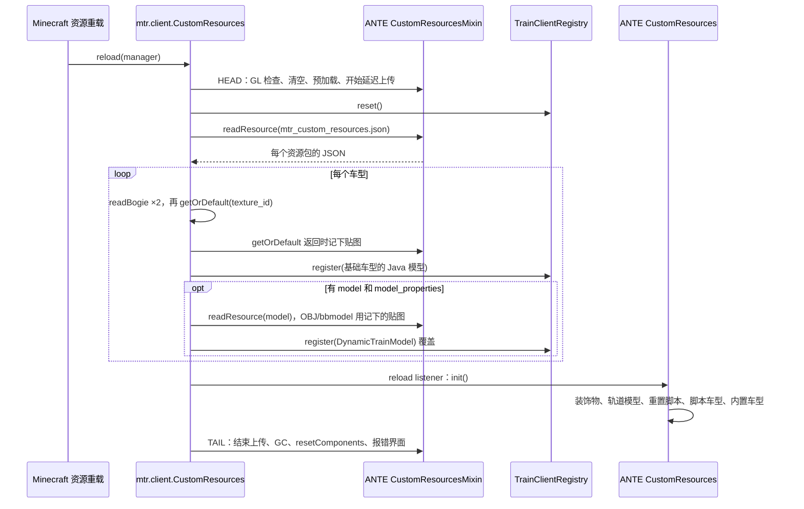

## 7. 存档

### 7.1 存在哪

| 内容 | 位置 | 格式 |
|---|---|---|
| 铁路数据 | 维度存档目录下的 `mtr.db` | SQLite，每类数据一张表，每个对象一行，值是 msgpack（`toBytes`：`messagePackLength` 写表头，`toMessagePack` 写内容） |
| 备份 | 同目录 `mtr-<时间>-base.db`、`mtr-<时间>-inc.db` | 每批一个完整备份加若干差异备份（`RailwayDataBackups`） |
| 地图缓存 | 客户端本地 SQLite | `MapCacheDatabase`、`MapDataCache`，服务端只发摘要不同的部分 |
| 服务端设置 | `config/mtr_security.json`、`mtr_motion.json`、时刻表设置、线路用语 | JSON，服务器启动时读 |
| 客户端设置 | MTR 的 `Config`、ANTE 的 `ClientConfig` | 设置界面保存时写 |

`RailwayDataFileStore.open` 打开数据库；它本身不引用 SQLite 的类，这样 SQLite 加载失败时能在这里处理。

### 7.2 读档

`RailwayDataFileSaveModule.load()` 读出每张表，逐行还原对象。读不出来的行跳过并计数（`skippedEntries`）：

- 有跳过的行时，本次运行期间不删除数据库里的任何行，读不出来的数据和依赖它的数据都原样保留。
- 读档开始了但没有读完（`loadStarted` 且 `!dataLoaded`）时，`autoSave` 什么都不写，避免内存里不完整的数据覆盖存档。

### 7.3 写档

有三条路径：

**活动图**：

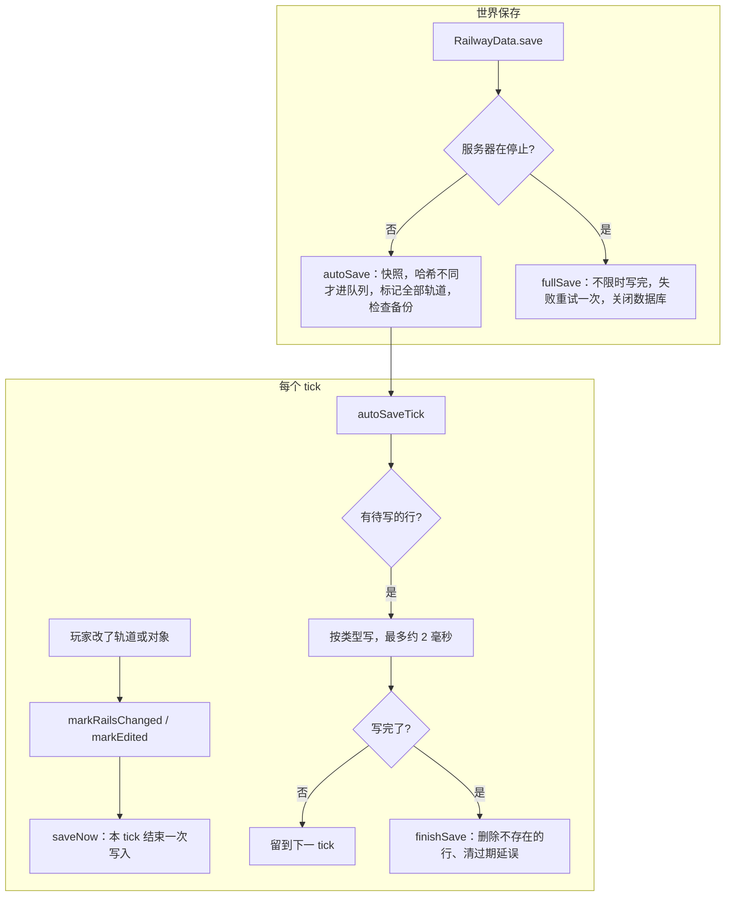

1. **本 tick 结束立即写**（`saveNow`，每 tick 调）：玩家刚改的轨道（`markRailsChanged`）和对象（`markObjectChanged`，由 `markEdited` 调），以及编辑版本号，一次写入。轨道改动因此不会因为服务器崩溃而丢失。
2. **自动存档**（世界保存时 `RailwayData.save` → `autoSave`）：
   - 在同一时刻给除轨道外的所有对象拍快照（`stage`），保证存下的数据彼此一致。
   - 每个对象序列化后算哈希，和数据库里已有的比，**只有变了的才进待写队列**。列车位置、车厂最后发出的班次也算在对象内容里，所以会每次更新。
   - 轨道数量多，不拍快照，标记全部轨道位置，之后每 tick 处理一点。
   - 同时检查要不要做备份（`dataStore.backup()`，在单独的线程里做）。
   - 之后每 tick `autoSaveTick` 按类型依次写，每次最多用约 2 毫秒，超时就留到下一 tick。全部写完后 `finishSave` 删除已经不存在的对象的行，清理过期的延误记录，在日志里报告改了几行、删了几行。
3. **停服完整存档**（服务器停止时 `fullSave`）：清空所有队列，`autoSave` 后不限时一口气写完；失败的话再试一次，还失败就在日志里明确报告丢失了哪些（轨道已经即时写过，不受影响），最后关闭数据库。

存档格式只能加内容，不能改已有的内容。

### 7.4 轨道段层（优化第一轮）

存档里最底层的多级结构（`MTR-优化实施阶段.md` 第一轮）：轨道在"发生事情的节点"切成轨道段，每段用内容的 64 位哈希当 ID，随轨道增量维护，按版本写进 `mtr.db`。

- **组件**：`transitsim.network.TrackSections`（切段、哈希、增量维护、读档核对修复）、`SpeedLimits`（限速两值：60 及以上物理 +5、计划按标的值；60 以下物理按标的值、计划 −5；这一轮只存不用）、`SignalOverlay`（每个轨道段上的信号区段切分和所属信号区段，规则同 `BlockSections`）。
- **切点**：分岔或尽头（连着的轨道不是两条）、关键节点、寻路边界节点、站台/存车线/折返线的两端（它们各自成段）；没有切点的环从最小的节点开始。
- **哈希**：节点序列，加每条轨道的长度、形状（两端朝向）、限速标的值、能否加速、类型、可走方向、站台或存车线，加两端的标记。碰撞时同一哈希下的几段按内容字节序排，第一段用原哈希，其余用"原哈希 + 序号"，所以哈希只取决于现有的段，与顺序无关。
- **游戏**：`advanced/GraphRecords` 持有这一层。`RailwayData` 每 40 tick 调 `GraphRecords.update`：先算轨道、关键节点、边界节点、站台和存车线位置的廉价指纹，变了才把全部轨道转成 `TrackSections.Rail`（`toTrackRails`，单向轨道按能走的方向取类型）交给 `TrackSections.sync`，它比对出增删、只重切受影响的段；轨道段或信号区段变了就重算信号层，只记下不同的项。第一次检查时用读档读出的段做 `TrackSections.restore`：和现有轨道对照，不一致的连同邻段重切并写日志，旧存档（没有这一层）全部生成。
- **写档**：保存循环之后、图数据自己的事务里，`GraphRecords.flush` 写一个新版本（`RailwayDataStore.publishTrackSections`）：新增的行（`added_in` = 新版本）、删掉的行只标 `removed_in`、信号层的增删，最后写根记录（`meta` 的 `track_version`、`track_fingerprint`、`track_count`）。提交成功（`flushCommitted`）后，下一次保存才真正删掉被标记的行（`sweepTrackSections`）；提交失败（`flushFailed`）就把这一版的增删放回待写。
- **读档**：`RailwayDataStore.loadTrackSections` 只读根记录发布的版本：`added_in` 大于它的行（没发布完的版本）删掉，`removed_in` 大于它的行恢复。
- 表：`track_sections (id, data, added_in, removed_in)`、`signal_overlay (id, data)`，都进备份。旧的 `graph_sections` 不再写；`graph_paths` 改为记轨道段哈希序列（`TrackSections.toSectionPath`），带这一层的指纹。`PathRegionSync` 不再压缩整张线网（原来只为写 `graph_sections`）。
- 64 份黄线（19,696 条轨道，7,738 个轨道段）：首次生成 205 ms，重启读回核对 124 ms（都只在开服时一次）；预热后每次有改动的检查约 17 ms（两万条轨道，`GraphRecordsTest`）。

### 7.5 站间段层和配属层（优化第二轮）

- **组件**：`TrackSections.snapshot()` 给出不可变的段图（节点 → 轨道段）；`LegRouter` 在段图上找一个站间段（从一个站台按一个方向出发，经过途经关键节点，到下一个站台的两个方向），规则同 `RailRouter`（过节点看两端朝向能否接续，折返线末端可以任意接，停站后可以立即折返、加罚分，经过别的站台加罚分），并记下搜索域：碰过的全部轨道段和展开过的节点；`RouteLegs.plan` 对每个站台的两个方向做动态规划拼出整条线路，用时和整条 `RailRouter` 相同；`LegCache` 按搜索域建反查索引，轨道段增删、在展开过的节点上接了新段、配属变化（只影响受配属约束的站间段）时丢掉相关站间段，旧版本快照上算出的站间段如果碰过之后改动的部分就不收；`TrackOwnership` 由寻路边界节点和边界轨道划区域，区域里有哪些线路组的站台就配属哪些，边界轨道属于两侧，联络线自己那一段只属于它，没有站台的区域谁都能走。
  - **搜索范围**（第四轮第 3 步前修的第二轮遗留问题）：以前要等终点两个方向都找到才收工，终点有一个方向到不了时会把整张线网搜完（64 份线网上 316 条线路站间段、全部出入库路都是这样，每条存档约 116 KB，读档时放回缓存要 60 秒以上，被看门狗停服）。现在：终点所在轨道段的某一端没有别的轨道段（线路尽头）时不找那个方向（`canEnter`）；存车线找到一个方向就收工；找到一个方向（代价 c）后，另一个方向只找到 c + 终点段代价 + 掉头罚分为止（`bound`，队列头的估计值超过它就停），因为再贵的话下一段从这一站掉头出发更便宜，DP 永远不会用它，所以找出的线路不变；这条只对允许起点掉头的请求。站间段格式 `VERSION` 3（多存 `turnAtStart`），旧版本的读档时丢掉，并按行号记进"已写入"表、值为空，下次写库时删掉（`GraphRecords.updateLegs`）。64 份线网：线路站间段 4474 条共 1.0 MB（原 50 MB），最大 739 字节，`mtm_version` 0.49.0；重启读回 4474 条在同一秒内完成，不再卡。
  - **出入库路**（第四轮第 3 步，先量后换）：`LegRouter.Request` 加 `turnAtStart`（出入库为 false，不在起点掉头）；`RouteLegs.planBetween(起点段, 出发方向或 null, 终点段, 到达方向或 null)`，出库到首站、回库离开末站都按线路在这个站台的运行方向（用户 2026-11-08 定：回送方向和运行方向一致）。宿主 `RoutePaths.measureDepotLeg` 用它找路并计时，暂不进缓存（`GraphRecords.Legs.withoutKeeping`）；`-Dmtr.debugDepotLegs=true` 时车厂寻路后逐对和现有运用路径量出的出入库用时比较（回库取同车厂同车池的存车线里最短的，和现有口径一样）并打印路线和搜索域。
- **切点补充**：两条轨道朝同一方向离开节点（尖角）时切开；边界轨道和手动放行的联络线轨道两端切开（`MARK_BOUNDARY_RAIL`、`MARK_RELEASED`），让它们自成一段。
- **游戏**：`GraphRecords` 在轨道段变化时先换快照，再通知 `LegCache`；`getLegs()` 先取版本号再取快照和配属，所以在别的线程上算出的站间段只会"比改动旧"而被拒，不会被错收。`RoutePaths.updateOwners` 每 40 tick 检查配属的输入，变了在后台重算。
- **存档**：`track_legs`（站间段：请求、两个方向的用时和步骤、搜索域）、`track_ownership`（轨道段 → 配属集合编号）、`track_owner_sets`（每种配属集合存一次）；读档时读回的站间段只要碰过的轨道段都还在就收下，再按读档修复的变化丢掉相关的。都进备份。
- **找不到路的原因**：途经点不再是关键节点（`NOT_KEY_NODE`）；只能走别的线配属的轨道（`OTHER_LINE`，给出第一段的两端）；只能走联络线（`CONNECTING_LINE`，照旧）；其余照旧由 `PathFailure.diagnose` 判断。
- **数字**：黄线 4 条线路和第一轮版本的轨道条数一致（138、97、100、119）；64 份黄线从头算全部站间段时 128 个车厂寻路 47 s（第一轮 71 s），重启读回 4,717 个站间段，线路寻路每条最多 6 ms；配属表 62 KB。

### 7.6 限速两值、最低性能、去掉余量（优化第三轮 3a）

- **限速两值进运行层**：标的值（轨道类型、线路限速、车速上限）按 60 为界分出物理最高和计划速度（组件 `SpeedLimits`，游戏 `SpeedRules`，缆车和飞机不适用）。
  - 列车按物理最高跑：游戏 `Train.getRailSpeed`、`limitToVehicle`、运动用的 `TrackViews.of(..., plan = false)`；组件 `RunTrack.runSpeed`（`toTrackView`、`TickRunner` 的限速和巡航上限）。
  - 时刻表按计划速度排：`PathTiming`（速度曲线用 `TrackViews.of(..., plan = true)`，逐 tick 的旧算法用 `PathData.getPlanSpeed`，车速上限用计划值）。
  - `PathData.getMaxSpeed()` 和组件 `RunTrack.getMaxSpeed()` 仍是标的值，信号区段照旧按它切（`PathClaims`、`BlockSections`）。
- **去掉余量**：`RouteTimetable.addMargin` 不再加时间；`marginPercent` 照旧读写存档和包，不再使用；游戏时刻表界面和网页"余裕"输入框去掉。
- **最低性能**：每张表 `RouteTimetable.minAcceleration`、`minDeceleration`、`minMaxSpeed`（存档键 `timetable_min_performance`，包里在表头的余量后面，组件二进制 `TimetableBinary` 追加在末尾，旧数据读出为未设）。
  - 默认值：`RailwayData` 每 100 tick 调 `RoutePaths.fillMinPerformance`，给有效时刻表里还没设的表填上这条线路组（同一营运线的各方向）所有车型里最慢的（加速度、减速度、最高速度各取最小；都没有就用默认车型），`revision++` 并发给玩家，之后固定。
  - 使用：`RoutePath.getFastestTimes` 先用 `withMinPerformance` 把各车型的性能换成表的（车长照旧各取各的），所以换车型时刻不变。现在取第一张表的性能，各表分别生效要等最快时刻按表算。
  - 跑这条线的车比要求慢（`RoutePaths.getSlowerVehicles`）时服务端日志提示，恢复时也提示。
  - 网页时刻表面板"最低性能：加速、减速（m/s²）、最高（km/h）"可改（`perfText`、`data-perf`，JSON 字段 `minAcceleration` 等，`EditorData`、`EditorActions`）。
- **停车点轨道按自己的限速**（3b 第 1 步）：站台、存车线、折返线不再继承前一条轨道的限速（`SpeedRules.keepsLimitBefore` 只对缆车、飞机为真），游戏 `Train.getRailSpeed`、运动接口的 `canAccelerate`、`TrackViews`、`PathTiming`，组件 `RunTrack.toTrackView` 和 `TickRunner` 运动接口的 `canAccelerate` 都按自己的限速；`RailType.canAccelerate` 只留给信号区段"不切"（`TrainServer.cutSpeed`、`PathClaims`、`SignalOverlay`）。存车线标的值 25、折返线 65（`SpeedRules.labelKmh`，`PathData.getMaxSpeed` 和轨道段层都用它），站台暂按 80，第 2 步改为站台自己的过站限速。所以运行时分可以在停车点切开：从停车点、车头在站台末端静止出发算的一段，等于整条算出的同一段（`RoutePathsTest`）。
- **站台的过站限速**（3b 第 2 步）：`Platform.passSpeed`（km/h，0 为默认 80；存档键 `pass_speed`，包里在通过线后面，`update` 键同名，`setPassSpeed`）。`DataCache.sync` 把各数据缓存（服务端每个维度、客户端）设了非默认值的站台交给 `PlatformSpeeds`，合在一起按站台轨道查；`SpeedRules.label(..., node1, node2)` 对站台轨道取它，所以 `PathData.getMaxSpeed` 和轨道段层随之变，改了立即生效，不用重新寻路（轨道段层的指纹含 `PlatformSpeeds.fingerprint()`，站台段的哈希变，经过它的站间段重算）。游戏站台界面第三个按钮在 80、100、120、160、200、300 之间切换；网页停站右键菜单"站台 … 过站限速"进草稿（`draft.platformSpeeds`，应用时 `platformSpeed` 操作）。
- **编纂停靠站时检查车长**（3b 第 3 步）：`StopLengths`：线路最长的车（跑它的车厂各存车线的 `Siding.getTrainLength` = 编组 × 每节长度），和每个停靠站站台能停的长度（两端节点直线距离 + 1，节点是两端方块的中心）比，长出 1.5 格以上、不是通过、也没标"允许超长"（`RoutePlatform.allowLonger`，存档键 `allow_longer`，包里在停站设置末尾，换站台和复制线路时带上）的就提示。服务端每 100 tick 检查，变了才写日志（列出车长和各站台长度）；网页停靠站名后显示 ⚠（`EditorData` 的 `tooShort`、`platformLength`），停靠站右键"允许比站台长的车停靠"写进时刻表草稿的 `allowLonger`，应用时由 `EditorActions.readTimetable` 写回。顺带修好：网页把游戏的时刻表转成编辑对象时（`fromGame`）没带各表的最低性能，面板上一直显示为空。
- **全网设置**（第四轮第 2 步）：`NetworkSettings`（换端最短时间 `minReverseMillis`，默认 30 秒；早到阈值 `earlyThresholdMillis`，默认 30 秒，第 5 步用），每个维度一份，挂在数据缓存上（`DataCache.networkSettings`，服务端是自己的，客户端是服务端发来的）。存档类型 `network-settings`（一条，ID 0，每次保存都写）；进服时和有人修改后由 `NetworkSettingsPackets` 发给所有玩家（`PACKET_NETWORK_SETTINGS`）；网页车厂对话框"全网设置"一栏改换端最短时间，进草稿（`draft.networkSettings`），应用时操作 `networkSettings`，客户端发给服务端，服务端查编辑权限后改、写日志、再发给所有人。规划单元的键带上它（`reverse:`），改了以后 5 秒一次的检查发现单元变了就重排；车厂自己排和网页一键生成也都传给 `PlanInputs`。`mtm_version` 0.48.0。
- **停车点：停车位置和出发位置**（第四轮第 1 步，原 3b 第 4 步）：站台可以设列车停在哪：出站端（默认，和以前一样）、按车长居中、离出站端 N 格（`Platform.stopPosition`：0、-1、N；存档键 `stop_position`，包里在过站限速后面，`update` 键同名，`setStopPosition`）。偏移由组件 `transitsim.plan.StopPositions.getOffset(设置, 站台轨道长, 车长)` 算：居中 = (站台长 − 车长) / 2，N 格不超过站台长 − 车长，车不比站台短就是 0。
  - **两个位置**：停车位置 = 轨道末端 − 偏移（`MotionTrack.getStopDistance`，偏移由 `getStopOffset` 给，只对有停站时间的轨道）；掉头时车头去车尾原来的位置，出发位置 = 末端 + 偏移 + 车长（`MotionConstants.getReversalAdvance`，两边宿主的 `startUp` 都用它）。偏移为 0 时就是以前的"末端"和"末端 + 车长"。
  - **"停车位置"和"轨道末端"的分法**：运动规则里问"车停在哪""是不是到站了""站在站上"的都改成停车位置：`TrainMotion` 的停车目标、越过停车点时停下、站台掉头的判断；`RunMotion` 找下一站、到站、停车目标；`TrainRules.findNextStop`（按位置找前方第一个停车位置，代替"从车头所在轨道的下一条找"，否则停在轨道中间的车出发后又把同一站当下一站）；运行器 `TickRunner` 的到站判断、跳 tick 的上限、换路径和移到某站、行车许可的终点；`TrainService.placeOnRun`；`PathTimes` 和游戏 `PathTiming` 两种排表算法的停站点。问"车头在哪条轨道上""轨道占用""信号区段""环线续圈""回库"的照旧用轨道末端。
  - **行驶中贴近停车点**：车离停车点不到 1 毫米时可能还带一点速度，下一 tick 按"行驶中"找下一站会把这一站跳过。以前停车点和行车许可的终点都在轨道末端，许可终点把车截住，看不出来；现在许可终点改为停车位置（`TickRunner` 的 `authority.update`），`RunMotion` 也保留原定的下一站（行驶中、还没过它 1 毫米以上）。
  - **数据**：游戏 `PlatformStops`（和 `PlatformSpeeds` 一样由各数据缓存 `sync` 时交来，按站台 ID 查），`PathData.getStopOffset(车长)` 查它。列车拿到路径时按当时的设置记下各停车点的偏移（`Train.getStopOffset`，速度曲线用同一份，`TrackViews.of(…, IntToDoubleFunction)`），所以改了设置，线路的最快时刻立即重算（`RoutePaths` 时刻缓存的键带 `PlatformStops.fingerprint()`），列车要等车厂重新生成路径才按新位置停，和改停站时间一样。组件 `SimDataset` 第 16 版在最后带"站台 ID → 设置"表（`stopPositions`），读入后 `applyStopPositions` 写到各存车线路径、折返和出库路的 `DataTrack` 上，`SimExport` 填写；`RunTrack.toTrackView(…, 车长)`、`TripPath.getStopDistance`、`TrainService.Vehicle.getTrainLength`。
  - **界面**：游戏站台界面第四个按钮在出站端、居中、2、5、10、20 格之间切换；网页停靠站右键"站台 … 停车位置"进草稿（`draft.platformStops`，应用时 `platformStop` 操作）。`mtm_version` 0.47.0。
- **组件模拟器的列车找不到它的运用路径时原地等**（`TrainServer.showSimulated`）：时刻表改动让车厂重新生成路径，模拟器还没换上新数据时，模拟器里某列车的运用路径在游戏这边已经没有了。以前会退到车厂路径、用旧的停站序号，越界报错（64 份黄线上一次 5,296 条）；现在这列车停在原处，等模拟器换上新路径再读一次。

## 8. 玩家编辑数据

### 8.1 普通的改动

选线路的列表（车厂、站台等用的 `DashboardListSelectorScreen`）和仪表盘一样，把一条线的几条线路折成一行 `[+] 线名 (条数)`（`LineRows`），点这一行展开或收起。点击由界面的 `mouseClicked` 交给 `DashboardList.mouseClicked`；2026-11-06 以前选择界面没有转交，这一行点了没反应，多条线路的线选不了。

以在界面里改一条线路为例：

1. **客户端**：界面调 `PacketTrainDataGuiClient.sendUpdate(packetId, packet)`。包的内容是对象 ID、改的字段名（"part"）和新值；`ClientEditing.send` 在外面再包一层 `PACKET_EDIT`，带上这个玩家看到的这部分数据的版本号（不归它管的包照原样发出）。发完客户端立即 `DATA_CACHE.sync()`，界面马上看到自己的改动。
2. **`PacketGuard`**：同一玩家同一种包每秒超过 400 个，或包大于 1 MB，直接拒收并记日志；处理时的异常也在这里接住，不会传到网络线程。
3. **`EditGuard.handle`**（在服务器主线程上执行，所以同一对象的改动按到达顺序逐个检查）：
   - 没有编辑权限（`RailwayData.hasNoPermission`）就忽略。
   - `editRevisions.check(类型, ID, 字段, 版本号, 是否删除)`：这个对象的这个字段在玩家拿到之后被别人改过（或对象被删了），就**拒绝**：告诉玩家是谁改的，并把对象当前的数据发回给他。没有带版本号的旧式改动（`UNCHECKED`）也会过这一关，不能把运行中已删除的对象改回来。
   - 通过后 `applyGroup` 执行改动。
4. **执行**（`PacketTrainDataGuiServer.receiveUpdateOrDeleteC2S`）：
   - 再检查一次权限；ID 为 0 的新建请求拒绝（服务端和各客户端会各自随机出不同的 ID）。
   - 在 `RailwayData` 里找到或新建对象，调它的 `update(字段, packet)` 改值。
   - 把完整的包转发给同一维度的其他玩家，`dataCache.sync()`。
   - 改的是线路时，按时刻表分界修正跨线路的连接，修正了就再广播一次。
   - 改车站或车厂时更新 Dynmap、BlueMap、Squaremap（没装就跳过）。
5. 改动成功后版本号加 1 并广播（`sendRevision`），对象在本 tick 结束时写档。

**时序图**：

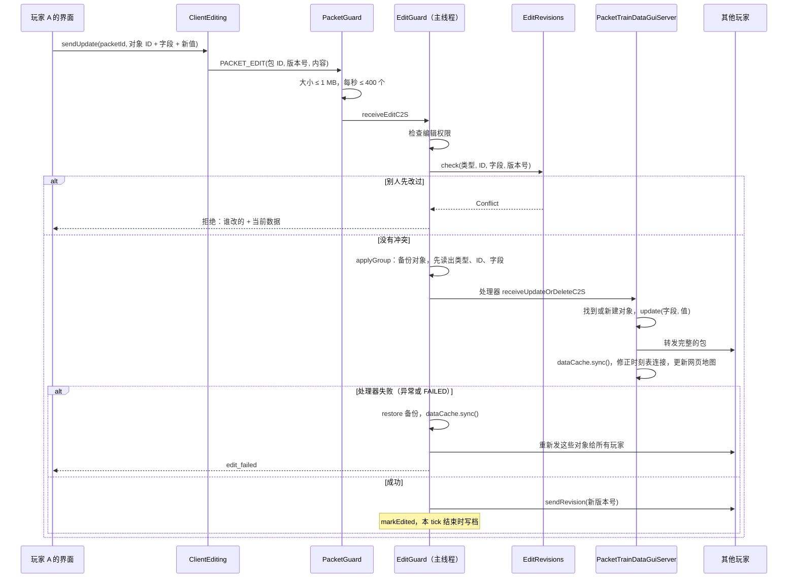

### 8.2 一组改动

网页编辑器的改动一次发一批（`PACKET_EDIT_BATCH`）。单个改动（8.1）也走同一个 `applyGroup`，只是组里只有一项。`applyGroup` 在同一个主线程任务里做这些事：

1. **备份**：组里涉及的每个对象先存一份序列化的字节（对象原来不存在就记为 null）。
2. **先读出每项改动是什么**：类型、对象 ID、字段，都在处理器读包**之前**读出来（`e7abbc7` 修复）。处理器会把包的读位置往后移，以前在处理器之后才读，读到的是错误的字节，会抛 `VarInt too big` 或 `IndexOutOfBounds`。结果是改动本身生效了，但版本号没记、没有即时写档、别的玩家不知道新版本号，网页编辑器的那一批也没有返回结果。
3. **依次执行**：每项执行前清掉 `PacketTrainDataBase.FAILED`，调用这种包注册的处理器。处理器抛异常或把 `FAILED` 设为 true 都算失败，后面的改动不再执行。
4. **失败**：**整组对象恢复成备份**（`restore`：有备份就还原，原来不存在就删掉），然后 `dataCache.sync()`。因为别的玩家可能已经收到了其中一部分，所以把这些对象重新发给所有玩家，给发起的玩家提示 `edit_failed`。版本号不变。
5. **成功**：按第 2 步读出的信息，逐项 `editRevisions.record` 记新版本号，`sendRevision` 广播，`markEdited` 让它在本 tick 结束时写档。

### 8.3 谁在编辑什么

玩家打开或关闭某个对象的编辑界面时发 `PACKET_EDITING`，服务器广播给所有人；玩家离开时 `EditGuard.onPlayerQuit` 清掉他的编辑状态。

### 8.4 改轨道

放节点、连轨道、删轨道走 `RailwayData` 的 `addRail`、`removeNode`、`removeRailConnection` 等方法，改完 `markRailsChanged`，本 tick 结束时写档。用旧路径的侧线会被标记为路径过期（`isPathStale`：路径上的轨道被删、类型、方向或长度变了），在车厂界面显示。`PathRegionSync` 发现指纹变了就在后台重算区域数据再同步给玩家。

### 8.5 网页模拟运行（`SandboxRuns`）

网页运行图的"模拟运行"是**调试功能**，一般用不到：服务端 `config/mtr_security.json` 的 `editorSimulation` 默认 `false`。开关随 `PACKET_EDIT_PERMISSION`（进服和打开主控面板时发）多带一个布尔值告诉客户端（`ClientData.editorSimulation`），编辑器数据里是 `simulation`。关着时页面不显示"模拟运行"按钮，"生成运用"后也不做内核验证；服务端收到请求直接回 `STATUS_DISABLED`。

开着时，`editor.js` `simulate()` 发 `api/simulate`，请求带星期、是否"从现在开始"、要报告的线路（当前线路的种别，加上要验证的车厂的线路）和草稿；客户端 `EditorSimulation` 把草稿做成组件格式，发 `PACKET_SIMULATE`。

服务端 `SandboxRuns.start`：

1. **服务端线程上**：检查权限，导出整个世界的 `SimDataset`（`SimExport.build`），放进草稿（`putDrafts`），为运用草稿准备找路径要的轨道和车厂副本。
2. **后台线程**（`MTR-Editor-Simulation`，单线程、最低优先级，排队最多 8 个，每个玩家同时一个）：
   - 先找草稿运用的路径（`findDutyPaths`）。
   - 再取子集 `SimScope.of(dataset, reportRoutes)`，只留下和所报线路有关的部分：
     - 跑这些线路的车厂；
     - 和它们共用线路的车厂（会分担班次），一直补到没有为止；
     - 别的车厂里，有车经过同样节点的存车线（存车线的路径或任一班次路径碰到上面这些车厂的车走过的节点）。只带这几条，不带整个车厂。代价是：这个车厂原来由别的存车线发的车改由带上的存车线发，邻线的车可能比实际多，结果偏保守。
     - 只扩这一圈。线路、闭塞分区全部保留；"从现在开始"的列车记录原样给，掉出去的存车线的车在恢复时找不到存车线，自动跳过。
     - 没有所报线路（空集合）时用整个世界。
   - 然后 `DayRun.run` 跑一天，超过 60 秒停下回"太忙"。
3. **回包** `PACKET_SIMULATE_RESULT`：请求号、状态、没用上的草稿数、找不到路径的运用数、**模拟的车厂数和全部车厂数**、分包序号和总数、报告字节（每包 512 KB 以内）。
   - 页面在问题列表下写"只模拟了有关的 X / Y 个车厂"。
   - 超时时状态行写"一分钟内没有模拟完（X / Y 个车厂）"。

子集里的列车编号和整个世界跑时不同（编号按车出现的先后发），其余的到发、问题都相同（`SimScopeTest`）。

### 8.6 网页的两个工作区（2026-11-09）

> **已删除（2026-11-13，清退旧逻辑第⑨步）**：本节的旧页面（`index.html`、`shell.js`、`editor.js`、`media.js`、`editor.css`、`audio.html`）已经删掉，编辑器只剩 8.7 的新页面，放在原来的根地址。下面保留作历史说明。

高级编辑器是一个页面 `index.html`，顶栏左边切换两个工作区：**运行编辑**（目录树、汇总时刻表 / 运行图 / 全网配线、检查器）和**媒体库**（报站音频，以后的图片等也放这里）。切换不重新加载页面，运行图的缩放、滚动、选中都保留。

1. **`shell.js`**（在 `editor.js` 之前加载）：从地址 `#key=…` 读出密钥（`EditorServer.getUrl` 给的，存进 sessionStorage），马上把地址换成工作区路由 `#/timetable` 或 `#/media/<类别>`；设 `body[data-ws]`，带 `data-ws` 属性的元素只在自己的工作区显示（`editor.css`）；切换用 `history.pushState`，浏览器后退能回去；每次切换发 `mtr:workspace` 事件。对外是 `MTREditor`（`key`、`ws`、`part`、`open`、`inTimetable`）。第一次进媒体库时才插入 `media.js`。
2. **`editor.js`**：密钥取 `MTREditor.key`。不在运行编辑时 `showsDiagram`、`drawNetwork` 不画，`poll` 按页面隐藏时的间隔（5 秒）问游戏，配线图和调度台的定时刷新、窗口大小变化、Esc 都不处理；收到回到运行编辑的 `mtr:workspace` 时 `renderAll` 并立即 `poll(true)`。`renderDraftState` 同时显示顶栏"运行编辑"标签上的草稿圆点（`ws-draft-dot`）。草稿本来就随改随存到 `api/draft`，切换不影响。
3. **`media.js`**：类别表 `KINDS`，每类一项（API、收哪些文件、列表的列、详情、上传 / 删除 / 改名的做法），现在只有音频（`api/audio`、`api/audio-file`，和原来的 `audio.js` 相同）。左边类别栏和"上传与消息"（本页拒收的文件、复制结果、游戏回的上传结果），中间搜索、上传者、只看本机没有和列表，右边详情（试听进度、引用名和 /playsound 名的复制、改声音 ID、删除）；文件可以拖到列表上上传，拖着时框子提示收不收。列表每 2 秒问一次，只在媒体库显示且页面可见时问；各块内容没变就不重写（`setHtml`），键盘焦点和悬停不丢。离开媒体库时停止试听。
4. **`audio.html`** 只剩一个跳转：把 `#key=` 存好后转到 `index.html#/media/audio`，旧链接和书签照样能用。

以后加图片：服务端加一组 API，`media.js` 的 `KINDS` 加一项（列表改成缩略图网格、详情显示大图和尺寸），类别栏有两类以上时自动出现"全部"。

### 8.7 新版网页编辑器 `next/`（2026-11-10，迁移第 0 步）

> **2026-11-13 起是唯一的编辑器**（清退旧逻辑第⑨步，见本节末"第⑨步"一条）：构建到 `assets/mtr/editor/` 根下（不再是 `next/`），`EditorServer` 打开的根地址就是它；`/next/…` 和 `/audio.html` 由 `EditorServer.RedirectServlet` 302 到根（浏览器保留 `#…`，UI 自动测试打开的 `/next/#/<层>` 照样能用）。下面第 1–12 条写的是当时两页并存的做法。

新版编辑器和旧版并存，按层一步步搬过去（步骤见 `MTR-网页编辑器规格.md` 第 11 节）。两个页面用同一套接口和同一份草稿（`api/draft`），在哪边改的草稿另一边都看得到。Java 不用改：`EditorServer` 把整个 `assets/mtr/editor/` 当静态文件，`next/` 是其中一个子目录。

1. **源码和构建**：源码在仓库根目录 `editor-web/`（React + TypeScript + Vite + Tailwind）。`bash editor-web/build.sh` 构建到 `common/src/main/resources/assets/mtr/editor/next/`（`index.html` 和 `assets/` 下带哈希的 js、css），**构建结果和源码一起提交**，所以 Gradle、`round.sh` 不需要 Node。`build.sh` 最后检查 `next/index.html` 里没有内联脚本：`EditorServer` 的 CSP 是 `script-src 'self'`，内联脚本会被拦。字体只用系统字体（CSP 不让加载外部字体）。
2. **页面启动**：`next/index.html` 先用普通 `<script>` 加载上一级的 `../i18n.js`（两个页面共用一份词典，新文字也加在那里），再加载自己的模块脚本。`src/api/client.ts` 读密钥：地址里有 `#key=` 就存进 sessionStorage 的 `mtr-editor-key`（和 `shell.js` 同一个名字），否则从 sessionStorage 取，所以从旧页面点"试用新版"、从新页面点"回到旧版"都不用重新进游戏打开。接口用根路径 `/api/…`。
3. **数据**：`src/state/useEditor.ts` 和旧页面一样每 1.5 秒（页面隐藏时 5 秒）问 `api/revision`，变了才读 `api/data`，并按数据里的 `language` 切换语言；每 5 秒读一次 `api/draft`（旧页面可能开在另一个标签里改草稿）。草稿的项数按旧页面 `draftCount` 的算法算。类型在 `src/api/types.ts`，只写了新页面已经读的字段，草稿的其它键原样保留。
4. **外框**（`src/App.tsx`）：顶栏（草稿项数、回到旧版）、左侧层级栏（配线、归属、线路、时刻、车厂，分隔线后调度、媒体；地址 `#/<层>`）、面包屑、状态栏（连接状态、数据读取了多久、没有编辑权限）、连接出错时的提示条（密钥不对 401、还没进世界 503、连不上）。颜色变量和旧页面 `editor.css` 同名同值，另加设计系统的 `--duty`、`--now`、`--connecting`、`--boundary`、`--late`。
5. **第 0 步各层的内容**（`src/views/Overview.tsx`）：线路和时刻层按线路组列出种别（停站数和起止站、时刻表张数、班次数、有草稿、寻路失败、环线、联络线、谁在编辑）；车厂层列出车厂（存车线数、车型、跑的线路、运用有草稿、没设置、寻路状态）；其余层只写"在迁移第 N 步搬过来"。每层都有"在旧版里编辑"。
6. **旧页面的入口**：`index.html` 顶栏工作区标签后面的"试用新版"（`.try-next`）链到 `next/#/timetable`。
7. **不进游戏的检查**：`cd editor-web && npm run dev` 用假接口（`mock/api.ts`、`mock/fixture.ts`）开发；`node editor-web/mock/serve-built.mjs` 像 `EditorServer` 一样提供整个编辑器目录（同样的 CSP，`/api/` 要密钥 `abc`），用来检查构建好的新页面。假的 `api/apply` 收下所有操作，只把种别 202 不带 `force` 的时刻表当作冲突（`CONFLICT`）退回；`GET /api/mock/applied` 看最后一次发来的操作。旧页面需要 `api/times` 等完整数据，这个假服务画不出它的运行图。
8. **对拍测试**（`editor-web/test/`，`npm test`，`build.sh` 里也跑）：`test/old.ts` 从 `editor.js` 原文里按名字切出顶层函数和常量（认得字符串、模板字符串、正则和注释），放进 Node 的沙盒，带上测试给的 `data`、`draft` 等变量和 `i18n.js` 运行；同一份数据和草稿再交给新模块，两边结果必须一样。这样搬过来的逻辑和旧版有出入时测试会失败。旧版里函数改了，测试跟着用新的。
9. **第 1 步：草稿、审阅、应用、同步状态**（2026-11-10）。
   - 逻辑在 `src/core/`：`model.ts`（`buildModel` 按旧版 `setData` 建 `routeById`、`lines`，加 `clock`、`daysText` 等）；`draft.ts`（`normalizeDraft`=`loadDraft`，`draftCount`，`tidy`，`draftOperations`，`settleApply`=`applyDraft` 收到回复以后的部分，`resolveConflict`，`drop`=改动列表里各种"放弃"，`gameTimetable`，`routeChanges`，`changeSections`=`draftChangesDialog` 的内容）；`depots.ts`（`dutiesOf`、`shortfallText`、`replanText`、`turnPairsOf`、`alarmReasonText` 等）；`sync.ts`（`syncProblems`，终点站折返的警告由时刻层传进来，第 2 步接上）。这些函数都不改参数，返回新的草稿。
   - 状态在 `src/state/store.tsx`：轮询游戏数据（同旧版），草稿改了 400 毫秒后存（同旧版）；每 5 秒读一次存着的草稿，和自己上次存的不同、自己又没有待存的改动时，说明旧版在别的标签里改过，就换成它的并清空撤销记录。撤销、重做最多 100 步（Ctrl+Z、Ctrl+Y / Ctrl+Shift+Z）。应用：`draftOperations` → `api/apply` → `settleApply`，应用掉的部分不算一步撤销；之后马上重读游戏数据。调度类的即时命令（收回列车、停用预案）走 `sendNow`，不进草稿。
   - 第 0 步的只读概览（`views/Overview.tsx`）在下一步被各层的工作区取代，已删除。
10. **各层接进新外壳：运行旧代码**（2026-11-10，迁移第 2–6 步的第一轮）。旧版运行编辑的逻辑约 9000 行，逐行手抄成 TS 既慢又会和别的会话对 `editor.js` 的改动走样，所以迁移期间新页面直接运行旧代码：
   - `editor-web/scripts/gen-legacy.mjs`（`npm run gen`，`build.sh` 先跑它）用对拍测试同一个切分器（`scripts/extract.mjs`）把 `editor.js` 的 IIFE 主体整段放进 `createLegacy(env)`，生成 `src/legacy/engine.generated.js`（提交，不手改）；启动代码（`// ---------- Start ----------` 之后，除了 `nowDay`）不要。由 `env` 接管的：菜单 `openMenu`/`openMenuAt`/`closeMenu`/`buildMenu`（新页面用 React 画同样的 `[文字, 动作]` 项，`legacy/Slot.tsx` 的 `LegacyMenu`）、`fetchJson`/`sendJson`（接口走根路径 `/api/`，存草稿交给 store）、`setTreeOpen`；`renderAll`、`renderViews`、`renderBanner`、`renderStatus`、`renderSyncButton`、`renderDraftState` 改成通知新页面重画。同时生成 `src/legacy/markup.generated.ts`（旧 `index.html` 的元素，去掉脚本）和 `public/legacy.css`（`editor.css` 包在 `.legacy { … }` 里，靠 CSS 嵌套只作用于装旧元素的框）。
   - `src/legacy/stage.ts`：模块加载时把旧页面的全部元素放进一个隐藏的舞台，再运行旧代码，所以旧代码按 ID 找的元素都在、事件监听也挂得上；对话框和提示框放在常显的 `.legacy-overlays` 里（隐藏元素里的对话框弹不出来）。`LegacySlot` 把要显示的旧元素（导航树、画布、汇总表、检查栏、全网配线、模拟状态）借到新布局里，卸下时还回舞台。
   - `src/legacy/engine.ts`：`legacy.fn` 按名字取旧函数（含箭头函数常量），`legacy.v` 读写旧变量。数据：store 每次读到新数据就把副本交给旧代码的 `setData`（旧代码会往里加 `lines`、`rows`、`services`）；第一次读到时按旧启动代码选今天、定横轴起点。草稿：store 的草稿一变（撤销、审阅面板、应用、旧版在别的标签里改了）就交给旧代码（`pushDraft`，随后 `buildServices`）；旧代码改了草稿（它会调 `renderDraftState`），等这一轮事件做完再比一次，变了就作为一步撤销交回 store，所以一个对话框同时改几个种别只算一步。`renderAll` 被调用时画旧代码自己的视图（树、全网配线、运行图、检查栏、汇总表、模拟状态），再让 React 重画。
   - 各层（`src/views/Layers.tsx`）：左边是旧导航树里本层那一节（CSS 按树的五节只显示第 N 节）；配线、归属层是全网配线（`setNetLayer` 切物理 / 归属图层），调度层是全网配线加调度台（`toggleConsole(true)`）；线路、时刻、车厂层是新工具栏（视图：运行图 / 汇总时刻表 / 上下显示；显示车厂、显示接入、没车的班次；模拟（服务端开了才有）；缩放；新建 ▾；删除种别）加旧的运行图、汇总表和检查栏。运行日在顶栏（旧 `setWeekday`）。媒体层运行旧的媒体库：生成器把 `media.js` 整个（含它的启动代码）包成 `createMedia(env)`（`src/legacy/media.generated.js`），工厂里用 `env.fetch` 遮住全局 `fetch`，把它写给根路径页面的 `api/audio` 等相对路径送到 `/api/`；`src/legacy/media.ts` 扮演旧 `shell.js` 的角色（`MTREditor.ws`、`part`，切换时发 `mtr:workspace` 事件），第一次进媒体层时才创建。上传按钮和用量借到新工具栏里。审阅面板和同步状态里点线路会切到时刻层并打开它的汇总时刻表（旧 `openView`）。
   - `i18n.js` 的 `const I18N`、`const tr` 是全局词法绑定，不是 `globalThis` 的属性：新页面（`src/i18n.ts`）和生成的代码都按名字读，不能写成 `globalThis.tr`。
   - 冒烟测试 `editor-web/test/legacy.test.ts`（happy-dom）：把旧页面的元素、词典和两个辅助脚本放好，喂示例数据，检查旧代码算出线路、车站行和班次，画出导航树、汇总表和检查栏，草稿改动作为一步交回，媒体库能启动；`build.sh` 每次都跑，别的会话改了 `editor.js` 而生成器或桥接接不上时在这里就会失败。
   - **换成新设计（逐块）**。导航树（`src/views/Navigator.tsx`，2026-11-10）：`renderTree` 进了生成器的接管列表，新导航用 React 画进旧的 `#tree` 元素（`createPortal`，元素的类名改成 `nav-tree`，不再套旧样式），每层只画自己那一节；每行保留旧节点的 `node` 类和 `data-line`、`data-route`、`data-view`、`data-depot`、`data-slot`、`data-siding`、`data-pool`、`data-of-depot`、`data-logical`、`data-layer`、`data-connecting`、`data-created`、`data-new-logical`、`data-generate-logical`、`data-new-line` 等属性，所以旧代码挂在 `#tree` 上的点击（`onTreeClick`）、回车和右键菜单不用改。时刻层把"汇总时刻表""运行图"两行改成并排的两个芯片；`problemDot`、`lockMark` 这两段旧代码给的 HTML 原样放进行里。冒烟测试里渲染新导航，点种别行和它的"汇总时刻表"芯片后旧代码的 `state.route`、`state.view` 要变，右键要拿到旧代码给的菜单项。
   - 汇总时刻表（同日）：格子输入是旧代码直接改 DOM（往格子里放输入框，回车后重画），交给 React 会两边抢 DOM，所以表格结构和交互仍是旧代码的，样式按设计系统重做：`editor-web/src/legacy-theme.css`，每条规则以 `.legacy.legacy-slot` 开头，比旧样式（`.legacy` 里）更具体、也不碰别处。按钮、输入框、下拉框统一成 28px 高、控件边框色；表、方向用深色实心芯片；站名列和"到/发"列用页面底色（设计系统第 6 条）；表头时刻加粗，选中的列蓝底加下划线，没车的班次表头红底，例外时刻蓝字浅蓝底，跑不到的红字。
   - 检查栏改成新组件（同日，`src/views/Inspector.tsx`）：`renderInspector` 进了接管列表，React 画进旧的 `#inspector`。选中的班次（线路色竖线串起各站，例外蓝字，停运、没车、例外、草稿用小标签，"在时刻表里看"打开它的汇总时刻表）、线路（每个种别的班次和"有车 / 没车"标签）、股道问题、折叠的"怎么操作"是新组件；运用编辑、选站、出入库选路、模拟问题、环线这几块仍是旧代码的 HTML（`dutyPanel` 等），原样放进去，旧版挂在 `#inspector` 上的点击和修改处理照常找到它们的 `data-*` 属性。全网配线上的出入库选路面板（`net-waypick`）照旧版 `renderInspector` 的做法同步。线路卡片里的"线路组配线图""配线图"文字链接去掉了（新旧两版都去掉，`editor.js`）；单个种别的配线图在导航里种别的右键菜单，线路组配线图移到导航里线路的右键菜单（"线路组配线图…"，有两个以上种别时才能点）。
   - 新版通知 React 重画改用 `setTimeout(0)` 合并同一轮的通知（以前用 `requestAnimationFrame`，后台标签页里会一直不重画）；测试里用 `flushLegacy()` 同步刷新。各层工作区外面包了错误边界（`src/ui/Boundary.tsx`），一层出错只在那一层显示错误和"重新载入页面"，顶栏、草稿、应用照常可用。
   - 检查栏（此前同日）：先只换样式（`legacy-theme.css` 的 Inspector 一节）：分节标题灰色中等字重、不加字距（设计系统第 7 条），各块是白底圆角卡片，键值、停站、运用列表、股道问题按设计系统的字号和颜色，问题分错误红、提醒棕。
   - 全网配线的工具行、调度台、旧对话框和悬停提示（同日）：同样只换样式（`legacy-theme.css` 后两节，对话框和提示在 `.legacy.legacy-overlays` 里）。调度台是浅底上的白色圆角表格，按下的开关深色实心；对话框是 8px 圆角、设计系统阴影、半透明墨色遮罩，按钮和输入框和其它地方一样。
   - 运行图配色（同日，改在 `editor.js` 的 `draw`/`drawDepotLegs` 和 `editor.css`，新旧两版一起变）：红色只表示问题（设计系统第 1 条）。"现在"竖线和时刻改用 `--now`（墨色虚线）；车厂里正在编辑的那列车（`state.slot`）的班次光晕、车与车之间的连线、"车 N"标签和它的出入库回送改用 `--duty`（琥珀色）；没车的班次、冲突仍是 `--warn`。`editor.css` 新加 `--duty`、`--now`（浅色、深色各一组），新版的 `styles.css` 本来就有。
   - 画法修复（同日，改在 `editor.js`、`editor.css`、`index.html`，新旧两版一起变），把设计系统列出、旧版一直没改的几项做掉：
     - **颜色都走变量**：`editor.css` 新加 `--connecting`（联络线）、`--boundary`（寻路边界）、`--late`（晚点 5 分钟以上）、`--siding`（存车线）、`--stabling`（留置位），浅色、深色各一组；全网配线、调度台、选站画面里写死的颜色（`#e8891a`、`#7a5fd0`、`#d33`、`#d9a520`、`#9a5b2c`、`#e8a33a`、`#d9534f`、`#3b82f6`、`#fff`、`#888`）和 CSS 里的 `#b7791f`、`#fff` 都换成变量，深色模式下对比度正确。寻路边界的节点原来是红色、线是紫色，图例却写"红"，现在节点和线都是 `--boundary`，图例改成"紫：寻路边界"（`index.html`、`i18n.js`）。调度台"有列车的区段"用 `--connecting`，"占用的区段"用 `--warn`。
     - **字体**：全网配线、调度台、选站画面里的 `"12px sans-serif"` 等改用 `--font-ui`。
     - **虚线收成四种**：点线 `[1,3]` 背景参考（车厂行、接入班次，接入画圆头）、短虚 `[3,3]` 非营业移动（出入库回送、出车指令、等候、运用连线）、中虚 `[5,4]` 换位置（跳行、换站台、模拟的实际运行线）、长虚 `[6,4]` 参考线（"现在"、区段分隔）。"还没有时刻"不再画虚线，改成线路色半透明；停运仍是灰色半透明，也不再虚线。
     - **拖柄和站名列**：选中班次的停站拖柄从 7px 放大到 9px（命中范围不变）；运行图左边的站名列改用页面底色 `--bg`，和画布区分开。
     - **控件和标题**：旧版按钮、下拉框、时刻表和对话框的输入框边框改用 `--control-line`（白底 3.2:1）；导航分节标题和检查栏标题去掉字距。
     - 自动检测 `editor-web/test/style.test.ts`：`editor.js` 里不许再出现写死的颜色（颜色选择框的默认值除外）和 `sans-serif` 字体，`editor.css` 里颜色只能出现在变量定义里，各绘图变量浅色深色都要有。
   - **配线图改成示意图**（同日，只在新版；旧版仍是旧的拉直图）。生成器把 `routeDiagramDialog`、`lineDiagramDialog` 也交给新页面（`env`），种别和线路右键菜单里的"线路配线图…""线路组配线图…"打开 `src/views/TrackDiagram.tsx`。数据仍是 `api/route-layout`（服务端 `RouteLayouts` 沿路径拉直的轨道：每段是"沿线距离 × 横向偏移"的折线，带两端节点号，加道岔、站台两端、各停站位置）和 `api/network`（各种别的路径节点，节点带同样的节点号字符串），没有改游戏数据和协议。整理在 `src/core/schematic.ts`：
     - **分股**：横向偏移不变的段（两端相差不超过 1.2 格）放在一股上，股号按离路径的顺序（路径是 0 股，左侧正、右侧负；4 格和 5 格远的都是旁边那一股，相距不到 1.6 格的算一股）；偏移变的段（道岔导曲线、渡线、离开线路的轨道）是两股之间的斜线，两端的股从相接的平直段经节点号找；离开线路、没有平直段相接的一端放到最外一股再往外一股。
     - **压缩**：道岔、站台两端、停站、斜线两端是"关键点"，相邻关键点间不超过 40 格时按原长，更长的按 40 + 3√(超出部分) 压短，超过 120 格的在 0 股上画 // 标记；关键点之间按比例插值，先后顺序不变。
     - **用途**：按 `api/network` 各种别的路径算出每段轨道（节点对）上走哪些种别（`usageOf`，本种别排第一）。
     - **画法**：每股一条横线，没人走的灰色细线，本种别（线路组时是停站最多的那个种别）走的用它的颜色粗线，别的种别在旁边画细彩线（最多 3 条）；站台画成贴在所在股外侧的短块，本线路的站台用线路色，写站台号；站名写在最上方（同一车站的站台取中点，靠近某个停站时写"第 N 站"，点站名打开停站编辑）；道岔是空心小圆，寻路边界节点紫色实心；隔离按草稿显示（寻路边界紫色点线、联络线独占橙色虚线、已放行灰色虚线），右键一段轨道是旧版同一个 `railMenu`，改动进草稿后图马上重画。缩放按钮和"全图"（第一次打开时整条线放进对话框宽度）。
     - 测试 `editor-web/test/schematic.test.ts`（双线、渡线、4/5 格同股、离开线路的分支、车站和站台的股、长区间压短且站台长度不变、先后顺序、按路径算用途和本种别）；示例轨道 `editor-web/mock/track.ts`（双线、渡线、待避线、往 2 号线的分岔、北湖站前渡线），假服务的 `api/route-layout`、`api/network` 用它。
     - 线路组目前沿停站最多的种别画，别的分支离开这条路径的部分只画一段引出线。若真实存档里分股不稳，下一步再让服务端直接给出股和道岔（要改网络包、升 `mtm_version`）。
   - **运用表**（同日，`src/views/DutyBoard.tsx`，车厂层默认显示，可以切回"运行图"）：选一个车厂，当天每列车一行（按车池编号，同旧版 `dutyNumber` 的顺序，旁边写出车存车线），横轴是一天的时刻；每班是种别颜色的色块，出库、回库回送是两端的虚线（写"出/回"编号，单独设过的蓝色），线上过夜的标"留"，有问题的标 !（悬停列出 `dutyProblems`）；最下面"没车"一行是车厂各种别当天没有车跑的班次，自动分多层排开不重叠。点左边一列车选中它（旧 `selectSlot`，整行琥珀色，右侧检查栏是旧版的运用详情面板），再点色块：这列车的就移出，"没车"一行或别的车的就加进这列车（旧 `toggleInSlot`，别的车跑的会移过来）；没选车时点色块是选中那一班。右键一列车：清空当天、删除库位、在它的存车线添加运用（旧 `editDuties`、`changeSlots`）。顶部：车厂、运用方式、星期和运用组、缩放（全天 / 标准 / 细看）、一键生成运用、重新排运用（自动运用时）、改运用方式、"更多"里是编辑车厂、出入库规则、摆放列车、运用组、出入库计划、丢掉运用草稿；缺车时写旧版 `shortfallText`。行每次重新算（旧代码在同一个草稿对象上原地改运用，缓存会漏掉第二次以后的改动，测试抓到过）。冒烟测试里选第 2 列车、点一班移出，看行和草稿都少一班（旧代码改某一天时会把运用按天拆成两份，按当天那份比）。示例数据给北湖车厂加了六份按运用图的运用和出入库时间。
   - **停站编辑器和新建线路**（`src/views/StopsEditor.tsx`，2026-11-10）：旧代码调 `stopsDialog` / `newLineDialog` 时（导航右键"编辑停站…"、配线图点车站、"新建 ▾ → 线路（按停站图）…"）由 env 转到新页面的右侧面板。生成器 `gen-legacy.mjs` 新增 `WRAPPED`：这两个函数照样从 env 取，旧的改名 `oldStopsDialog` / `oldNewLineDialog` 保留，面板里"站内配线…"仍打开旧对话框的车站配线图（咽喉、站前折返）。面板左边是线路颜色的竖线，每站一个点（实心停、空心过），每站横排它的股道（`orderByLayout` 的左右次序，`trackShort` 的名字），选中的用线路颜色描边；点一股 = 旧 `topologyClick` 的固定逻辑（`pinTrack`，调 `solveStops`），其他站自动换股，走不通的股道变淡；站与站之间写 `legCost` 的距离或"沿轨道走不通"，掉头的站标出。"放进草稿"同旧的确定：`draftEntry(r).platforms` + `editTimetable` 改 `pass`。"增删和排序停站…"切到列表，"发给游戏"照旧调 `sendStopList`（马上生效，二次确认）。新建线路：交通方式、线路组名、种别、颜色、起终点、起点股道、途经站、反方向一起建，用 `findCorridor` 排出车站，两个方向各一条站列可以分别改股道，"新建"照旧推进 `draft.created`。`engine.ts` 的 `fn` 代理找不到时再找 env 的函数。模拟数据 `mock/fixture.ts` 新增 `exampleTopology()`：1 号线双线（正线单向、两端渡线、中央广场一条两向可用的待避线），2 号线另一个轨道网、西行中央广场到会展中心断开。
   - **新建种别**（同在 `src/views/StopsEditor.tsx`，2026-11-10）：旧代码调 `newTypeDialog(lineKey, base)` 时（导航右键"照着它新建种别…"、"新建 ▾ → 种别…"）打开右侧面板，`newTypeDialog` 也加进 `WRAPPED`（旧的留作 `oldNewTypeDialog`）。和旧对话框规则相同：选"照着"的种别（给出时刻表、车厂、默认起终点），只列和它同一轨道网的车站；`findCorridor` 排车站后每站先用这条线路（反方向用 `counterpartOf` 那条）在那里的股道再 `solveStops`；种别名、颜色、线路名（空时 `typedName` 自动起名，反方向没有对应线路时加"返"）、班次模式（`parsePattern`，错时提示 `PATTERN_HINT`）、加入车厂；"新建"推进 `draft.created`（`source` 是照着的线路，`table` 取当天星期的表）。
   - **线路限速、直通关系、故障预案**（`src/views/LinePanels.tsx`，2026-11-10）：`speedLimitDialog` / `throughDialog` / `contingencyDialog` 也进了 `WRAPPED`，由 `engine.ts` 的 `panelHost` 打开右侧面板，规则照旧。限速：每个种别一行，输入时就检查 0–300 km/h 和不高于 `fastestRail`，"放进草稿"逐个 `setSpeedLimit`。直通：从哪个种别在末站或时刻边界接出、到哪个种别在首站或边界接入、时段、最少衔接和最多再等、是否替换原有直通，配对算法同旧版（每班接对方能赶上的第一班，不重复），**全部配对列成表，可以逐对取消**，按钮写"新建 N 对"，逐对 `setLink`。预案：每个预案一张卡片（名称、适用线路、晚点/等进路/锁死条件、启用方式、临时折返和折返站、折返以后、跳过的站、备车接替），新建和删除就地完成，"指定车站"没选站、没有任何条件时不让放进草稿；接通后的别的路网预案可以合成一套，同旧版。模拟数据加了 1 号线的路网（`contingencySystems`）和轨道限速 120 km/h。
   - **时刻表的星期**（同在 `LinePanels.tsx`，2026-11-10）：`tableDialog(r, index)` 也进了 `WRAPPED`。新建时刻表或改表名和星期在右侧面板：一周七个按钮，每个下面写这一天现在归哪张表，点一下归到这张表；下面"改完以后"实时列出每张表管哪几天；新建时可复制另一张表的班次（连同例外）、可给线路组的全部线路一起建；没勾任何一天时提示。规则同旧版（勾选的星期从别的表移走、最多 `MAX_TABLES` 张、完成后切到这张表的第一天）。
   - **编辑车厂**（`src/views/DepotPanel.tsx`，2026-11-10）：`depotDialog` 也进了 `WRAPPED`，由 `panelHost` 打开右侧面板。负责的线路按线路组排成可点的胶囊；车型配属车数；**存车线和线路是一张勾选表**（行是存车线和"最多停几列"，列是车厂当前勾选的线路，上面一改表格马上跟着变，旧版要放进草稿再打开一次）；实测余量的采用和秒数；全网的换端最短时间和等候分界。保存同旧版（`storeDepotEntry`，没变化就去掉草稿），但全网设置只改这两项，草稿里别的全网设置（逻辑线路、归属、等候分界按站）原样保留——旧版会整个重建 `draft.networkSettings`，把逻辑线路等草稿丢掉（`editor.js` 的旧对话框也一并改成只改这两项，两个页面都修好）。
   - **出入库规则和在图上选择**（`DepotPanel.tsx` 的 `DepotRules`、`Layers.tsx` 的 `FloatingMap`，2026-11-10）：`depotRulesDialog(depot, editing)` 也进了 `WRAPPED`，右侧面板里每条规则一张卡片（线路、星期是可点的按钮，出库/回库方式、早发秒数、回哪条存车线、出入库路径、等候分界），回送路径一行一条。规则对象就地修改并记在 `rulesEditing`，"在图上点轨道…"/"在图上画…"关掉面板调 `startWayPick`，选完或取消时旧代码 `finishWayPick` 再调 `depotRulesDialog(depot, value)`，面板带着编辑中的内容重新打开（面板按打开时间重建）。**在图上选择**（出入库路径、"在全网配线图上选站"新建线路）以前在新页面里不可用：旧代码切到 `state.view = "network"`，但车厂层、线路层、时刻层不显示全网图。现在只要 `picking` 或 `wayPick` 进行中，这些层上浮出一个全网图小窗口（标题栏拖动、右下角改大小、"取消"），选点面板在图里；结束后视图切回运行图。
   - **车型设置、运用组、出入库计划**（`src/views/DepotExtras.tsx`，2026-11-10）：`vehicleDialog` / `dutyGroupsDialog` / `releasePlanDialog` 也进了 `WRAPPED`，由 `panelHost` 打开右侧面板，规则照旧。车型设置边填边检查（加速度、转回自动、最高速度），不勾"统一设置"时参数变灰，不允许手动驾驶时手动的两项变灰，保存仍是 `depotEntryOf` + `storeDepotEntry`。运用组同旧版两张表（本规划单元的组可以"只重排这组"，发 `api/replan-duties`，结果写在面板底部；别的车厂同车型的组可以"套用到本车厂"，调 `applyDutyGroup`）。出入库计划多了面板里的星期切换（不用先改顶栏的运行日），每列车一行：出库、首班、末班到达、到库、班次数、之后回库还是留在线上。车厂层的旧对话框到这里全部换完。
   - **其余旧对话框和调度层**（2026-11-10）：还没换成 React 面板的旧对话框（右键单元格、批量平移、班次顺序、等候分界、删除种别、逻辑线路、归属线路等，都走 `openDialog`）在新页面里由 `legacy-theme.css` 统一改成右侧面板的样子：贴右边全高，标题固定在顶部，正文滚动，按钮固定在底部且确定在前，打开时从右滑入；逻辑不变。调度层改成 `DispatchWork`：左边"示意图 | 实际图"（默认示意图），右边一栏是旧调度台（`#net-console` 单独借出来，样式改成在栏里排开）；示意图用 `abstractNet` 新增的 `Schematic.spots`（每段轨道画在哪个区间第几股的什么位置，或哪个车站第几股；区间合并时两半按 0–0.5、0.5–1 换算）把 `consoleTrains()` 的列车按车头所在轨道（`consoleRail(train.head)`）标上去，晚点 5 分钟以上用 `--late`，点列车即在调度台选中它；调度台的数据由旧代码每 2 秒取，调度层每秒重画一次。调度层固定用物理图层（以前会停在归属着色上）。模拟服务加了 `api/console`（两列车）。运行图和汇总时刻表仍是旧代码画的画布和表格（已换成新配色和新工具栏），没有重写。
   - **运行图重写，第①步：几何**（`src/core/diagram.ts`，2026-11-10，断点标签 `pre-diagram-rewrite`）：运行图和汇总时刻表开始用 React 重写，规则（移动班次、改时刻、例外、运用编辑）仍调旧函数，只重写画法和交互。这一步把旧 `computeLayout` / `axisSteps` / `clampView` / `draw` 里的几何 / `hitService` / `hitHandle` 搬成纯函数：`layoutRows`（各行的 y）、`axisSteps` / `axisTicks`、`servicePath`（班次经过各站的点，跨区段的一跳标 true 画虚线）、`inView`、`serviceLook`（路线色 / 灰 / 红、粗细、透明度）、`hitPath`、`dwellHandles` / `hitHandle`、`clampView`。`test/diagram.test.ts` 让旧代码在测试环境里真画一遍（画布调用为空），逐项和新模块比：四种缩放和滚动下每个班次的点、行位置（有无车厂行）、时间轴、约 500 个点的点选、停站拖柄、视图范围，全部一致。
   - **运行图重写，第②步：新运行图**（`src/views/RunningDiagram.tsx`，2026-11-10）：新页面自己画运行图并处理鼠标。几何用第①步的 `core/diagram.ts`；画法按旧 `draw()` 的图层顺序移植（时间轴和现在时刻、车站行和区段分隔、别的线路的接入、班次及选中光晕、选中列车的运用光晕和连接、出入库指令、直通和回库标注、环线下一圈、停站拖柄、折返衔接、车厂行和出入库回送、模拟叠加、车站名列），记下画出的班次、拖柄、回送线和接入线供点选。鼠标交互逐条照旧：拖停站拖柄改停站时间（Alt 细调），拖出库回送线改出库时刻（这份运用的例外），拖班次或拖一组班次平移（`moveServices`），拖空白处平移视图，单击选中、两次单击选中整个种别、Shift 选一段、Ctrl 加选，选了列车时单击把班次加进/移出它的运用（Shift 连续加），右键"之后的班次"或回送线菜单，滚轮缩放、Shift 滚轮上下滚、横向滚动平移。改动全部调旧函数。旧的 `#canvas-wrap` 仍借进布局、旧画布隐藏（`centerOn` 等旧函数要量它、要用旧 `draw` 算的 `layout`，第①步已证明两边一致）；生成器新增 `NOTIFY`：旧 `draw()` 每次跑完调 `env.render("draw")`，新运行图随之重画。工具栏加"旧版画法"开关（记在 `localStorage` 的 `mtr-next-old-diagram`），可以切回旧画布对照。测试：新画法画整天和旧代码逐项相同（班次、回送线、接入线），拖动中的班次画在移动后的位置；在组件上模拟单击选中、拖动平移进草稿。
   - **运行图重写，第③步：汇总时刻表**（`src/views/SummaryTable.tsx`，2026-11-10）：新页面自己画汇总时刻表（单个种别的表，或整条线一个方向各种别合在一起）。每格按旧 `timeCell` / `terminalCell` / `serviceHead` 算出类名、文字、提示和 `data-*`，沿用旧类名所以样式不变；表头的回送注记读旧 `renderTable` 算的 `deadheadIndex`（旧表仍渲染在隐藏的 `#view-table` 里，"旧版画法"开关也切回它）。单元格编辑改成页面自己的输入框（回车只改这一班，Shift+回车连之后的班次，Tab 下一格，Esc 放弃），提交调旧 `typedTime` / `changeTime`；单击选中并居中（`centerOn`），表头 Ctrl 加选、Shift 选一段，右键调旧 `cellMenu`；表的切换、右键改名清空删除（删除改成页面内确认）、新建表、最低性能、添加班次（移植 `addServices`，`Batch.fitSpan` 要删班次时页面内确认）、清空、显示回送、管理权切换都在。测试：整条线和两个种别下新表和旧表逐格相同（类名、文字、`data-*`），编辑提交进草稿、Tab 跳到下一格。注意：格子不能写成函数里定义的组件，否则每次重画都是新类型、两千多格全部重建，输入框也会丢焦点。
   - **检查栏的运用详情、模拟问题、环线**（`src/views/DutyDetail.tsx`、`Inspector.tsx` 的 `SimProblems` / `LoopRuns`，2026-11-10）：选中一列车时检查栏里的运用改成新组件：车厂和存车线、运行日（和别的日子共用时提示改了会分开）、方式、回库计划（旧 `plannedReturnText` 的 dt/dd 原样放进）、每一班一行（路线色条、时间、起止站、"×"移出、换到哪一班、等候方式和例外标记、这一班的问题），已删除线路的班次一键移出，过夜、第二天接哪份运用、回库存车线、出车方式、出车存车线（移到别的存车线时编号不变，同旧逻辑）。全部调旧 `editDuties` / `dutyForEditing`。新元素不带旧的 `data-remove-segment` / `data-duty-*` 属性，免得 `#inspector` 上还挂着的旧处理再处理一遍。模拟问题和环线运行也改成新组件（点问题选中那一班并居中）。选站和出入库选点两个面板仍是旧 HTML。
   - **调度台**（`src/views/DispatchConsole.tsx`，2026-11-10）：调度层右栏改成新组件：路网选择和在线列车数，每列车一张卡片（晚点多的在前，晚点、扣停用标签），点卡片选中列车（示意图上同步）；扣停/放行、下一站清客、指定回库、下一站清客后回库（依次两条）、撤销直接发，延长停站和提前折返在卡片里展开填写（1–1800 秒，折返站是它路网的车站），按钮发出后显示"已发送"。发送照旧调 `consoleCommand`（`api/apply` 的 dispatch 操作）。旧调度台元素仍由旧代码每 2 秒取数据，但在新页面里隐藏（`legacy-theme.css`），实际图上也不再叠着它。
   - **在图上选择的面板**（`src/views/PickPanels.tsx`，2026-11-10）：新建线路选站（各站的顺序、通过、上下移、删掉，每段的路和途经点，"填线名和种别…"在每段都走得通时才可点）和出入库选口 / 画回送路径（出入口、运行图上发车或收车的站、经过的轨道、用时）改成新组件，放在浮动全网图小窗口里地图的右边；配线层、归属层本来就显示全网图，面板浮在地图右上角。动作全调旧函数（`refreshPreview`、`finishPicking`、`stopPicking`、`refreshWayPick`、`finishWayPick`）；检查栏和地图上旧的这两块不再显示。`DutyDetail` 没有选中列车时什么都不画（以前测试里会读空值报错）。
   - **媒体库**（`src/views/MediaLibrary.tsx`，2026-11-10，断点标签 `pre-media-rewrite`）：新页面的媒体库改为自己的 React 实现，不再托管旧 `media.js`（`src/legacy/media.ts`、`media.generated.js` 和生成器里那一段已删除；旧页面仍运行 `media.js`）。接口不变：`GET api/audio`（显示时每 2 秒读一次）、`POST api/audio`（upload / delete / soundId）、`GET api/audio-file?hash=`。功能同旧：搜索、按上传者筛选、只看本机没有的、键盘上下选择、试听和进度、各项信息、复制引用名和 `/playsound` 名、改声音 ID、删除、上传按钮和拖放（拖动时就提示收不收）、文件类型和大小检查、同名自己的文件直接更新、服务器用量条、最近的操作、连接问题。不同处：旧版用 `prompt` / `confirm` / `alert` 问声音 ID、确认删除，现在都在页面里（文件名不能当声音 ID 时列出待填的一行，填错标红；删除二次确认）。
   - **全网实际图：保留说明**（2026-11-10）：按游戏坐标画的全网实际图（旧 `drawNetwork` 及其点选、右键菜单、寻路边界、归属画笔的点轨道、出入库选口和新建线路选站的点选、调度的实际图）**暂不移植**，在新页面里仍由旧代码画在借来的 `#view-network` 里。用户决定以后对它**整体重新构想**，而不是像运行图那样逐行搬：届时以示意图（`core/abstractNet.ts`）和逻辑图为基础重新设计"在图上编辑"的方式，再决定实际图还保留哪些用途。在那之前不要在它上面做大的改动；小修照常改 `editor.js`（两个页面共用）。
   - **清退旧逻辑**（2026-11-10 起，断点标签 `pre-legacy-retire`）：新页面按逻辑分九步不再依赖旧 `editor.js`（构建时生成的旧引擎）：① 停站与股道求解，② 格式与时间工具，③ 数据模型和班次构建，④ 时刻编辑规则，⑤ 运用规则，⑥ 网络设置，⑦ 调度与模拟，⑧ 剩下的旧对话框换新组件，⑨ 拆掉隐藏的旧运行图、旧表格、旧调度台取数和"旧版画法"开关（等游戏里测过）。每步：有类型的 TS 模块 → 和旧代码并排对拍（`test/old.ts` 从 `editor.js` 按名字切出旧函数在沙箱里跑）→ 新页面改用新模块 → 提交，每步前打断点标签。旧页面冻结：只修严重问题，新规则只进新页面。全网实际图留待重新构想，所以旧引擎最后只剩实际图那一块。
     - **第①步：停站与股道求解**（`src/core/topology.ts`，标签 `pre-retire-1-topology`）：`Topology` 类（每份 `data.topology` 一个，`topologyOf` 用 WeakMap 缓存，连同可达表和线路问题的缓存）搬了旧 `buildTopology` / `isUsable` / `trackInfo` / `trackLabel` / `trackShort` / `platformLabel` / `stationLabel` / `stationTracks` / `reachFrom` / `legCost` / `solveStops` / `findCorridor` / `orderByLayout` / `topologyModel`（`model`）/ `stopsSummaryOf`（`stopsSummary`）/ `routeProblems`（站台由调用方给，草稿相关的 `platformsOf` 留到第④步）。`test/topology.test.ts` 在模拟线网上逐项对拍：所有站台的名称和分组、两两之间的路程和可达表、五种固定股道下的求解、任意两站之间排出的车站和选股模型、六条线路的问题检查，全部一致。新页面的停站编辑器、新建线路和种别、导航的问题小圆点（原来插旧 `problemDot` 的 HTML，现在是组件）、检查栏的线路问题、配线图的股道名都改用它。旧引擎里的这些函数暂留，给还没换掉的旧对话框（站内配线、在全网图上选站等）用，第⑧步后删。
     - **第②步：格式与时间工具**（`src/core/format.ts`、`src/views/now.ts`，标签 `pre-retire-2-format`）：旧 `clock` / `durationText` / `parseClock` / `typedTime` / `parsePattern` / `formatDuration` / `daysText` / `tableName` / `routeTitle` / `stopName` / `orderDepotName` / `systemTitle` 和星期名搬进 `core/format.ts`；要换算运营日的几个改成显式传入 `Day`（运营日起点和时区偏移），车厂名、路网名传入数据。`views/now.ts` 按页面当前数据把它们包好给视图用（第③步把数据模型搬过来后改成新模型的）。`test/format.test.ts` 在三种运营日起点和时区下逐项对拍：一天里每隔 37 分 13 秒的时刻显示、14 种写法的时刻解析和就近换算、7 种班次模式、时长、星期、种别标题、站名、表名、车厂名、路网名，全部一致。15 个视图文件里对这些旧函数的调用全部换掉（`fn.WEEKDAY_NAMES` / `v.WEEKDAY_SHORT` / `v.DAY` 也换掉）。
     - **第③步：数据模型和班次构建**（`src/core/services.ts`，标签 `pre-retire-3-model`）：旧 `setData` 里的线路分组（`groupLines`）、`revisits`、`buildStations`（车站行：分支、两站之间的另一条路、环线、回到同一站台或另一站台的 Q 形线路、往返、折返）、`toPlans` / `gameSource` / `plansFor`、`buildServices`（`routeServices`：按星期取表、例外、停运、出入库指令、直通、回库、运营日内的开始时刻）、`findService`、`timesOf`、`currentLine` 搬进新模块。新做法：这几个定义列进生成器的 `FROM_ENV`，旧引擎改为调用新模块，所以全页面只有一套车站行和班次对象，还没搬过来的旧规则（改时刻、运用编辑）照常改这些对象；向游戏要草稿时刻的 `timesSource` / `sendTimes` 暂留旧的（属于草稿同步，第④步）。折返衔接 `terminalNow`、有车没车 `coverageNow` / `dutyAssignments` 依赖运用，放到第⑤步。`test/services.test.ts` 用 9 种专门构造的线路形状和模拟数据的两条线对拍车站行，在模拟数据上加了例外、停运、出入库指令、直通、回库后逐个星期对拍班次，全部一致；参照的是从 `editor.js` 原文切出的旧函数，不受接线影响。视图里的 `timesOf` / `findService` / `currentLine` 改用 `views/now.ts` 的。
     - **第④步：时刻编辑规则**（`src/core/timetable.ts`、`src/core/draftTimes.ts`、`src/legacy/retired.ts`，标签 `pre-retire-4-timetable`）：草稿条目（`draftOf` / `draftEntry` / `timetableOf` / `tidyDraft` / `gameTimetable`）、`editTimetable` 的规则部分（`applyEdit`：改草稿、返回表下提示）、表内操作（停站例外、例外同步、改发车时刻、停运、删除、出入库指令）、改时刻（`changeTimeEdit`，Shift 连之后的班次，改始发时刻后选中跟着走 `selectMoved`）、拖动平移（`moveServicesEdit`，挪到留下的班次上会拒绝）、之后班次平移（`parseShift` / `shiftLaterEdit`）、一段等间隔（`respaceEdit`）、接续（`setLinkEdit`）、清空表、添加班次（`servicesToAdd`）、改停站后的重新编号（`renumberTimetable` / `renumberLinksInto`）、选择（`inRange` / `rangeServices` / `chooseRange` / `toggleChosen` / `chooseLater` / `servicesToMove`）搬进 `core/timetable.ts`，函数只改传入的草稿和状态。向游戏要草稿时刻（旧 `timesSource` / `sendTimes`：草稿改动 150 ms 后把所有待算的线路一次发给 `api/times`，回答前显示游戏原有时刻，失败的下次改动再问）搬进 `core/draftTimes.ts`。`legacy/retired.ts` 把这些包成旧函数名（存草稿、重建班次、清掉不存在的选中、表下提示、重画，三处旧的 prompt/confirm 留到第⑧步换成页面组件），列进生成器 `FROM_ENV`，旧引擎和新视图都走新规则。`test/timetable.test.ts` 对同一份模拟数据分别用 `editor.js` 原文切出的旧函数和新模块做同一改动，比较整个草稿和选择状态：五种改时刻、三种拖动平移（含被拒绝的）、之后平移、等间隔、接续、清空、表内五种操作、14 种平移写法、6 种添加班次写法、重新编号、7 步连续选择，全部一致；`test/draftTimes.test.ts` 测请求时机、缓存和失败重问。
     - **第⑤步：运用规则**（`src/core/duties.ts`，标签 `pre-retire-5-duties`）：运用的查找和编号（`dutiesOf` / `dutyOn` / `dutyIdOf` / `findDutySlot` / `dutyNumber` / `startOf` / `newDutyId` / `poolSidings`）、编辑（`applyDutyEdit`：首次编辑复制一份进草稿、班次按时刻排序、重连过夜 `relinkOvernight`、和游戏的一样时丢掉草稿，返回提示）、运行日组（`dayGroup`）和按组拆分（`dutyForEditing`）、班次的服务和起止时刻（`segmentService` / `segmentStart` / `segmentEnd` / `lastStopOf`）、当天哪班有车（`dutyAssignments` / `coverage`）、折返衔接（`terminalPairs`，调 `terminal.js`）、运用问题（`dutyProblems`：班次不在、停运、出车指令、重复分配、衔接不够、站台对不上、同站台折返不够（环线续跑除外）、换站台没路或时间不够、过夜接车）、换端最短时间（`minReverseMillis`）、停站的牵挂（`stopHangers`）和改停站后的重新编号（`renumberDuties` / `stopListChange`）搬进新模块，函数只读写传入的数据、草稿和星期。`legacy/retired.ts` 的 `dutyRules` 包成旧函数名；`coverageNow` / `terminalNow` 的缓存仍用旧代码的 `coverage` / `terminal` 变量，所以旧 `setData` / `saveDraft` 清缓存的时机不变；`editDuties` 写 `dutyNotice`、存草稿、重画；`sendStopList` 发 `api/apply` 后刷新。`test/duties.test.ts` 在模拟数据、故意做错的运用（重复、重叠、站台对不上、换站台没路和不够、过夜接的运用不在或站台不对、两列过夜接同一列、停运班次）、环线（标了环线、回到起点站台、两条线路首尾相接）三种数据上逐个星期对拍覆盖、分配、折返衔接、每份运用的问题、编号、运行日组，再对拍五步连续编辑后的草稿和提示、停站牵挂和改停站发出的操作及草稿；用故意改坏新代码的方法确认每条对拍都能发现差异。
     - **第⑥步：网络设置**（`src/core/settings.ts`，标签 `pre-retire-6-network`）：草稿里的网络设置（`draftSettings` / `savedSettings` / `setSettingsPart`：改一部分，和游戏一样的项去掉，空了整个设置去掉）、逻辑线路（显示、区段归入逻辑线路、新建和修改、删除时连同区段和运营线路的勾选、运营线路走的逻辑线路）、手改的区段归属（`sectionOwnersShown` / `setSectionOwners`）、等候分界（`waitThresholdMillis` / `setStationWait`）、站台的通过速度、停车位置和所属车站（`platformSetting` / `setPlatformSetting`）、车厂的出入库规则（`rulesOf`）和车厂条目（`depotEntryOf` / `storeDepotEntry` / `sameVehicle`）、寻路边界（`setBoundary`）搬进新模块。区段改成以它各段轨道的键传入（旧代码按实际图的轨道序号取区段），所以新模块不依赖实际图；`legacy/retired.ts` 的 `settingsRules` 用旧实际图的 `sectionOf` / `netRailKey` 把序号换成键，再包成旧函数名（存草稿、重画、重画线网，删除逻辑线路的确认框和站台菜单的文字照旧）。`test/settings.test.ts` 在存有逻辑线路、区段线路、运营线路勾选、手改归属的设置上，对拍十步逻辑线路编辑和八步归属编辑后的草稿和每段的显示，三种站台菜单的每个选项、等候分界、六步车厂条目修改（含改回原样）、出入库规则、四种寻路边界；用故意改坏新代码的方法确认每条都能发现差异。
     - **第⑦步：调度与模拟**（`src/core/dispatch.ts`，标签 `pre-retire-7-dispatch`）：模拟一天（`startSimulation` 发 `api/simulate`、`pollSimulation` 每半秒问一次直到有结果、别的页面后发的请求让这次作废、`setSimResult`、状态文字 `simStatusText`、一班的模拟结果 `simServiceText`、车厂运用的内核验证 `dutyCheckText`、问题列表和说明 `simProblems`，`simLate`）、调度台（按路网筛列车 `consoleTrains`、车名、状态文字、调度命令 `dispatchOperation`）、环线运行（`isLoop` / `loopEntryStop` / `loopRuns`）搬进新模块。状态仍放在旧代码的 `sim` / `consoleState` 对象里，`legacy/retired.ts` 的 `dispatchRules` 负责请求游戏、定时、重画（`setSimulation` / `scheduleSimulation` / `simulate` / `toggleConsole` / `loadConsole` / `consoleCommand`）；检查器的模拟问题改用 `simProblems`。实际图上画调度台的 `drawConsole` / `consoleRail` 属于实际图，留着。`test/dispatch.test.ts` 用同一串游戏回答（先是别的请求、运行中、完成；被拒；断线；中途断线；忙；带车厂验证）对拍发出的请求和整个模拟状态，对拍三种车厂验证下每班的提示、车厂验证文字、问题列表和说明，三种路网筛选下的列车、车名、各种调度标记的状态文字、命令，以及四种环线设置（车厂留车、指定接入站、接入站是通过站）的接续；用故意改坏新代码的方法确认都能发现。顺带修了新汇总表"添加班次"按间隔添加时用错全局名（`Batch` 应为 `TimetableBatch`）导致没反应的问题，并在 `test/diagram.test.ts` 加了这一步。
     - **第⑧步：剩下的小对话框换成侧面板**（`src/views/AskPanels.tsx`、`src/legacy/dialogs.ts`，标签 `pre-retire-8-dialogs`）：一个通用的提问面板（问题、要知道的事、可选的一个输入值、答复按钮；答复不对时在面板里说哪里不对，不关面板）取代旧的 `prompt` / `confirm` / 小对话框：这一班和之后的平移、选中一段调整间隔、清空时刻表、删除逻辑线路、一键生成运用（替换已有运用前先问）、重新排运用、按时刻表摆车、删除种别（列出车厂、运用、直通会受的影响）、车站等候分界、按归属生成逻辑线路初稿、出库提前量（运行图上回送线的右键菜单 `deadheadMenu` 整个搬过来）。另有专门面板：出车/回库的车厂（`serviceOrderDialog`）、逻辑线路的名称颜色和联络线、区段归属、运营线路走的逻辑线路、地图上选完站后填线路组名和种别名（`finishPicking`）。这些名字列进生成器的 `FROM_ENV`，旧代码里调用它们的地方（右键菜单、按钮）都打开新面板；规则仍调 `src/core` 的模块。新页面里已没有旧的 `prompt` / `confirm` 和旧小对话框；还剩旧的“站内配线”（`oldStopsDialog`：车站自己的配线图、咽喉和折返站台），它连着车站配线图的画法和交互，单独作为下一块；临时处置 `adhocDialog`、同步状态、草稿改动、旧表格的添加班次只在旧页面用（新页面有自己的）。`test/legacy.test.ts` 加了一条：平移（先填错再填对）、清空（先取消再确定）、出车车厂、新建逻辑线路（先空名再填）、删除种别（看影响列表）、等候分界（先超范围再改对），都检查进了草稿的内容。新字符串的英文加进 `i18n.js`。
     - **站内配线重写**（`src/core/stationLayout.ts`、`src/views/StationTracks.tsx`，标签 `pre-station-tracks-new`）：停站编辑器里点某站的“站内配线…”不再关掉编辑器去开旧对话框，而是在同一个侧面板里显示这一站的配线图：向游戏要这一站周围的轨道（`api/layout`，游戏还在读地图时每 0.6 秒再问，最多 8 次），按选中股道的行车方向转成从左往右开（`stationView`，几何和旧 `stationDiagramHtml` 一样），本线能停的股道可以点、和车站列表里点股道一样固定或取消（`pinTrack`，同一个模型），别的站台灰色；拖动平移，＋/− 改显示范围，‹ › 换上一站下一站，“← 车站列表”回去。下面是这一站的咽喉（进出站道岔、联锁区、交叉进路，咽喉锁没启用时说明原因）和首末站的优先股道 / 折返轮用站台（`turnOf` / `toggleTurnPlatform`，勾选进草稿）。和旧对话框不同的一处：取景按本线在这一站能停的股道，不再按这一站全部站台，换乘站另一条线的站台离得远时不会把本线的股道挤成一小段（旧取景方式保留为 `frame: "station"`，对拍用它）。新页面已不用任何旧对话框，生成器把十二个旧对话框（停站、新建线路、种别、限速、直通、应急、时刻表、车厂、出入库规则、车型、运用组、发车计划）从 `WRAPPED` 移进 `FROM_ENV`，旧对话框的代码不再进旧引擎。`test/stationLayout.test.ts` 用旧 `stationDiagramHtml` 原文画模拟数据的五个车站（三种范围、平移、两个方向），逐个比对 SVG 里的视框、每条轨道的点、道岔、站台两端和标签位置，再对拍六步折返站台勾选；故意改坏新代码的六处都能发现。`test/legacy.test.ts` 加了一条：从旧代码的 `stopsDialog(r, 2)` 直接打开中央广场的配线图（第一次“没读好”、再问一次）、看咽喉、在图上点待避线固定、缩小时多要一圈、翻到北湖勾折返轮用站台进草稿、回到列表放进草稿。模拟服务新增 `api/layout`。
     - **第⑨步：拆掉旧运行图、旧表格、旧调度台和"旧版画法"，删除旧页面**（2026-11-13，用户决定"⑨ + 旧页面直接删除"，断点标签 `pre-retire-9-cleanup`）：
       - **旧引擎转成源码**：生成器 `scripts/gen-legacy.mjs`、切分器 `scripts/extract.mjs`、`npm run gen` 都删了；最后一次生成的 `engine.generated.js` 改名为 `src/legacy/oldEditor.js`（源码，`// @ts-nocheck`，说明见 `oldEditor.js.md`），用一次性脚本做了三件事：去掉生成器留下的 `/* x: from env */` 占位及其上的旧注释；删掉旧运行图的绘制（`drawBefore`、`canvas` 上的指针处理；`draw()` 只剩算 `layout` 并 `env.render("draw")`）、旧汇总表（`renderTable` 只剩算 `deadheadIndex`，`renderLineTable`/`timeCell`… 和 `#view-table` 上的处理删掉）、旧调度台面板（`renderConsole` 只剩 `env.render`）、旧页面顶栏/标签/勾选框/`#dialog` 上的处理；再按引用关系剪掉没人引用的声明（108 个，根是剩下的顶层语句、`env` 和 `src`/`test` 里出现的 `fn.x`/`v.x`）。从 6761 行到约 3100 行，tsc 的"找不到名字"检查只剩页面全局 `tr`、`I18N`、`TerminalPairs`。`setWeekday` 不再写 `#day`，`renderSimStatus` 不再管 `#btn-sim-now`。
       - **旧元素**：`markup.generated.ts`（旧 `index.html` 切出）换成手写的 `src/legacy/markup.ts`，只有旧代码还按 ID 找的：`#tree`、`#inspector`、`#canvas-wrap`（没有画布了）、`#sim-status`、`#view-network`（实际图和工具栏）、`#tooltip`。`public/legacy.css`（旧 `editor.css` 包进 `.legacy {}`）留作源码；`legacy-theme.css` 去掉旧调度台、旧对话框的规则，`styles.css` 去掉 `.new-diagram`、`.table-view`。
       - **新页面**：`Layers.tsx` 去掉"旧版画法"开关（`mtr-next-old-diagram`）和 `LegacySlot id="view-table"`，运行图和汇总表只有新的；`engine.ts` 不再读该开关；`retired.ts` 的 `toggleConsole` 不再管 `#net-console`；顶栏去掉"新版预览"和"回到旧版"，`shell/layers.ts` 去掉 `old` 地址。同步状态里的"临时处置…"原来链回旧页面，现在是 `shell/Sync.tsx` 的 `AdhocForm`（同旧 `adhocDialog`：临时折返/折返站/折返以后/跳过的站/备车接替，立即 `api/apply` 发 `{type:"contingency", action:"adhoc"}`，不进草稿）。
       - **删除旧页面**：`assets/mtr/editor/` 下的 `editor.js`、`index.html`、`editor.css`、`media.js`、`shell.js`、`audio.html` 和它们的 `.md`，以及 `next/` 构建目录。留下页面仍加载的普通脚本 `i18n.js`、`batch.js`、`terminal.js`（新文字照旧加进 `i18n.js`）。`vite.config.ts` 构建到 `assets/mtr/editor/` 本身（`emptyOutDir: false`，插件 `clearLastBuild` 只删上次构建的 `index.html`、`assets/`、`next/` 和 `public/` 里的文件名），`index.html` 改为 `./i18n.js` 等同目录路径，`build.sh` 检查根下的 `index.html`。`EditorServer` 加 `RedirectServlet`：`/next/*` → `/`，`/audio.html` → `/#/media`。
       - **测试**：对拍测试里旧的一边（`test/old.ts` 从 `editor.js` 原文切函数）随旧代码删除。为了不丢这些覆盖，十一个对拍测试（`format`、`topology`、`services`、`draft`、`sync`、`timetable`、`duties`、`settings`、`dispatch`、`stationLayout`、`diagram`）改成只跑新模块、结果存快照（`test/__snapshots__/`）：快照是在新旧仍一致（改之前整套测试通过）时由新模块写出的，所以仍然锁住旧页面的行为；大的结果（全部班次、站内配线、运行图的点、运用问题等）只存长度和 sha256（`test/fingerprint.ts`），一变就失败，但看不出变在哪，要看时临时改回存原值。`style.test.ts` 改查 `oldEditor.js` 和 `public/legacy.css`；`legacy.test.ts` 改为检查旧运行图、旧表格、`#dialog`、`#net-console`、旧顶栏按钮都已不存在而 `draw`/`renderTable` 仍算出布局和回送；新增 `test/adhoc.test.tsx`（临时处置表单：读出现有设置、空处置被拒、发出一条操作）。`npm run build`：26 个测试文件 136 个测试通过（跳过 1 个），包从 854 KB 降到 727 KB。
       - **全网实际图仍是旧代码**（`oldEditor.js` 的 `drawNetwork` 一族），按保留说明等以后整体重新构想。
   - **归属画笔**（`src/views/OwnershipPanel.tsx`，2026-11-10）：归属层全网配线图右边的面板（窄屏在下面）。有逻辑线路时每条逻辑线路是一支画笔（颜色、区段数、草稿点、只看这条、改名改色、删除），另有"橡皮"；选好画笔后在图上点轨道，在旧代码的点击处理之前（capture）用 `netRailAt` 找到轨道，`setRailLogicalLine` 把它所在的整段划进去，平移拖动（`net.dragged`）不算点；Esc 或再点画笔放下。下面是"运营线路走哪些逻辑线路"的勾选表（行是这种运输方式的运营线路，列是非联络线的逻辑线路，改 `lineTracks`，都不勾时写"按站台"）。没有逻辑线路时画笔是各运营线路（`setOwnerOverride(index, [line])`）、"对所有线路开放"（`[]`）和"恢复自动归属"（`null`），外加"按现在的归属生成初稿…"（`logicalDraftDialog`）。删除逻辑线路用页面内二次确认（`removeLogicalLine`，同旧 `deleteLogicalLine` 但不用 `confirm()`，运营线路的勾选删空时整项去掉，等于"按站台"）。右键菜单照旧。
   - **全网示意配线图**（`src/core/abstractNet.ts` + `src/views/NetworkSchematic.tsx`，2026-11-10）："配线"层默认显示示意图，"实际图"切回旧的按坐标画的全网配线（设寻路边界还在那里），选择记在 `localStorage` 的 `mtr-next-net-view`。算法只用 `api/network`（轨道两端、种类、各线路走过的节点、车站中心）和 `api/data` 的站台坐标（取站台号）：① 每个站台轨道归最近的车站（200 格内），以最长站台的方向为轴，站台两端外延 80 格（`THROAT`，咽喉）、两侧 8 格的框里的节点都算车站；框内沿轴向的轨道按横向位置聚成股（相距 2.5 格内算一股），有站台的标站台号，各股记下走它的线路颜色。② 车站外的轨道从锚点（车站、度数不为 2 的节点）走成链；30 格内的道岔并成一个道岔点。③ 两端相同的链合成一个区间，股数是链数；只连着两个地方的道岔点（区间里的渡线）并进穿过它的区间并计数。④ 排版：每个区间要它的地理方向取整到 45°、长度 `40 + 5√实际长度`（90–280 像素），先 400 轮同时把不相连的地方推开到 70 像素，再 200 轮只调方向。⑤ 画法：区间几股就几条平行线（线路颜色，没线路走的灰色），渡线画 ×；车站是固定像素大小的框，按轴向转到 45° 的倍数，框里一行一股（站台粗、颜色是停靠线路，其他细虚线）；点车站显示股道卡片，"在实际图上看"把实际图移到那里。旧代码读到新线网只重画画布，示意图每 0.4 秒看一次 `net.data` 有没有换。模拟服务的 `api/network` 现在有真实坐标的轨道、车站和归属（`mock/track.ts`），`exampleTopology()` 的站台坐标和它对得上。
     - **两种画法**（2026-11-10 按用户的草图改）：配线层的示意图改成和线路配线图同一种画法（`NetworkSchematic` 的 `mode="tracks"`）：每股道一条线连续穿过车站，站台是贴在股道外侧的长条，车站咽喉里的道岔（`Place.turnouts`：两端横向位置相差 1.5 格以上的站内轨道，从哪股到哪股、在站的哪一头）画成股道之间的斜线，区间里折进来的渡线画成 ×；区间的每一股接到两头车站各自的那一股（`Corridor.lines`，由链两端节点最近的股算出；车站轴向调成 -90°…90° 时股的次序和道岔一起翻过来）。原来的"车站方框 + 区间连线"保留为归属层的**全网逻辑图**（`mode="logical"`，归属层"逻辑图 | 实际图"切换，默认逻辑图）：区间按它的轨道属于的逻辑线路着色（`railLogicalLine`，没有逻辑线路时按 `railOwnersShown` 的归属线路），拿着画笔点一段区间，就对它经过的每个区段各画一次（`paintCorridor`）。画笔状态从 `OwnershipPanel` 抽成共享的 `setBrushNow` / `useBrush`，实际图和逻辑图共用。车站框加宽后区间最短 140 像素、地方之间至少 100 像素。
   - **道岔端口和尽头线修复**（2026-11-10，Q 盘测试线网）：原先步骤③把只连两个地方的道岔组整个并入区间，再按两侧股数排序配对，只留下一个通用的 `crossovers` 计数；这会把交叉渡线画成平行线，把三股并两股补成虚构的贯通股，也会吞掉中间折返线和车厂接入。现在不再折掉道岔组：30 格内同一横断面的道岔节点各保留一个 `port`，每条 `Corridor.lines` 记录它在两端实际接的是哪个端口；`TrackDrawing.endOf` 按端口落点，所以直股、两条对角线、单侧分岔和不等股汇合都由真实连接自然画出来。车站股另记 `negative` / `positive`（这一端是否真的有轨道离开车站区域），没有出口的折返股在该端收口；轨道种类也跟着链进入 `Track.kind`，存车线和留置位不再因折叠丢失，尽头节点画端点。含道岔或尽头的局部区间只取 42–130 像素，避免保留细节后把咽喉拉成站间长区间。`abstractNet.test.ts` 用四连接交叉渡线 + 车厂支线、单端接入中间折返股做回归。
   - **0.65.6 实际配线优先**：上述独立区间排版仍会把正线拉成大三角形，因此配线层改用 `trackSchematic.ts` 和 `TrackMapDrawing.tsx`。全网共用单调坐标压缩，每条真实轨道、形状采样和共享节点保留；投影折点补采样以保持交叉关系。站台装饰实际轨道，不用推测的咽喉替换；远处不相连的测试轨道另排。`abstractNet` 仅保留逻辑图和车站卡片。Q 世界只读几何快照的 96 条轨道、两处交叉渡线、两条存车线进入回归测试，开发预览也使用正式绘制组件。
   - **0.65.6 媒体界面与线路图**：音频选择器以行对象映射到选项，不能把 `NameColorDataBase` 的随机 ID 当数组下标（传入 0 也会随机化）。图片和音频输入框先填值再布局，宽度确定后复位文字光标，避免文字被零宽视口滚出。`RouteMapText` 使用 Minecraft 自带 ICU 转繁体，只保留中文和英语；方向牌的环线模板独立于游戏语言，原有三参数目标文字接口保留兼容。无包和存档格式变化。
   - 以后逐个视图换成新设计时，从 `LegacySlot` 里拿掉对应的一块，用新组件和 `legacy.fn` 的函数代替；旧页面已在第⑨步删除，`engine.generated.js` 已转成源码 `src/legacy/oldEditor.js`，剩下的主要是全网实际图。
   - 界面：顶栏"同步状态 · N"、"草稿 N 项"、"应用"；审阅面板 `src/shell/Review.tsx`（右侧滑出，按旧版对话框的分节，冲突两个按钮，每节"放弃这项草稿"，撤销、重做、清空全部要再点一次确认，底部"应用"）；同步状态 `src/shell/Sync.tsx`（错误红、提醒黄、说明灰，收回列车要再确认，临时处置暂时去旧版做）；提示条 `src/shell/Banner.tsx`（同旧版 `renderBanner` 的连接、没有权限、冲突、应用结果几种）。Ctrl+Enter 打开审阅面板。

## 9. 车厂生成路径

**时序图**：

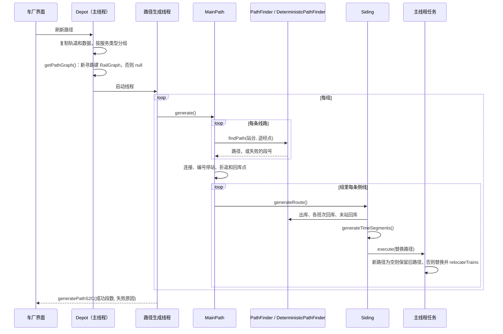

### 9.0 线路路径：`RoutePaths`（L1）

用时刻表的车厂不再自己寻每条线路，而是从线路拿路径（`RailwayData.routePaths`，只在服务端，不存档）：

| 类 | 做什么 |
|---|---|
| `RoutePaths` | 每条线路一份 `RoutePath`，按线路加锁，`get` 不存在或过期才找，`getFound` 只读不找；`getVehicles` 在主线程上收集跑每条线路的车型；`timesByPath` 判断线路是否按自己的路径算时刻（不是手画路径、飞机、连续运动） |
| `RoutePaths.Search` | 一个路径生成线程看到的线路路径：它那份轨道副本，要找时才建一次 `RailGraph`；`getFastestTimes(route)` |
| `RoutePaths.RoutePath` | 原始路径（每站用站台自己的停站时间，第 k 站在第一个 `stopIndex == k+1` 且有站台 ID 的轨道上，第 0 段停站为 0）；`getPath(停站设置)`、`getSlice(首站, 末站)`（第一段停站为 0，像从那站重新找的一样）、`getFastestTimes(route, 车型)`（逐站取最慢，按车型和停站设置缓存） |
| 逻辑线路（2026-11-09，0.64.0） | 存在 `NetworkSettings`：`logicalLines`（ID → 名称、颜色、是否联络线，存档键 `logical_lines`）、`railLines`（轨道键 → 逻辑线路，`rail_lines`，一段轨道最多一条）、`lineTracks`（运营线路键 → 勾选的逻辑线路，`line_tracks`），网络包末尾三项。`usesLogicalLines()`（有任何逻辑线路）时 `RoutePaths.computeOwners` 不再找联络线路径、不再按边界和站台算归属，改调组件 `LogicalLines.compute`：区段按轨道键归到逻辑线路（同一区段几条轨道设了，取键最小的），运营线路能走的逻辑线路是勾选的，没勾时是它的站台所在区段的逻辑线路；非联络线的逻辑线路区段的归属 = 能走它的运营线路（可能为空，谁都不能走），联络线逻辑线路和不属于任何逻辑线路的区段谁都能走。结果仍是区段 → 运营线路集合，寻路照旧用 `TrackOwnership.mayRun`。没有逻辑线路时一切照旧（自动归属 + `ownerOverrides`），旧存档行为不变。`RoutePaths` 的 `Logical` 把这三项复制给后台线程并进指纹；`getSectionLogicalLines()` 给出各区段的逻辑线路，`TrackOwnersPackets` 按区段发给玩家（`Owners.logicalLine`），`EditorNetwork` 的归属轨道数组变成 `[轨道, 手改, 区段, 逻辑线路或空, 归属…]`；`EditorData` 发三项给网页，`EditorActions` 的 `networkSettings` 操作收 `logicalLines`（null 删除，连同它的轨道和勾选）、`railLines`（null 移出）、`lineTracks`（null 改回按站台）。 |
| 手改区段归属（网页分层第 2 步，0.63.0） | 存在 `NetworkSettings.ownerOverrides`（存档键 `owner_overrides`，网络包末尾），按轨道键（两个节点）存线路列表，空列表是"对所有线路开放"。`RoutePaths.updateOwners` 把它复制进指纹和后台线程，`TrackOwnership.compute(..., overrides)` 算完自动归属后按区段覆盖（一个区段里几条轨道手改了，取它们的并集），`getOverrides` 给出手改过的区段（`RoutePaths.getManualSections`）。归属每算一次 `ownersVersion` 加一；`RailwayData` 每 40 tick 检查后由 `TrackOwnersPackets.sendAllIfChanged` 发给全部玩家，玩家要全网配线（`sendMapRails`）时也单独发一次；包按区段写（归属名表、各区段的归属序号、是否手改、各轨道两个节点），大线网分几个包（约 768 KB 一个），客户端收齐才整体替换 `railOwners`，`version` 加一。`EditorNetwork.build` 在 `api/network` 里加 `owners: {ready, names, rails: [[轨道序号, 手改, 区段序号, 归属…]]}`，版本号含 `TrackOwnersPackets.version`。网页改动走 `networkSettings` 操作的 `ownerOverrides: {"节点,节点": [线路] / [] / null}`（`EditorActions`），`EditorData` 把已存的手改发给网页。 |
| `RoutePaths.updateOwners` | 配属层（优化第二轮）：主线程只复制输入，在后台线程找出联络线的路径、算出每条联络线自己那一段（`getOwnRange`，减去手动放行的轨道）占的轨道段，加上"站台 → 线路组"（`LineDuties.getLineKey`），交给组件 `TrackOwnership.compute`，回到主线程 `GraphRecords.setOwners`；第一次算好之前车厂不寻路（`isOwnersReady`）。原来的 `Exclusion` 去掉了 |
| `PathTiming` | 车厂和线路共用的计时：`Vehicle`（存车线长、编组、车距、加减速、速度曲线、运输方式）和 `generateTimeSegments`，从 `Siding` 搬出来，规则不变 |

**找一条线路**（`RoutePaths.get`）：

1. 手画路径的线路返回 null，调用的人照旧处理。
2. 键 = 线路限速、线路组（联络线记"connecting"）、站台和站台停站时间、途经点。和已有的相同、**它查过的每个站间段都还是缓存里那一个**（`RoutePath.holds` → `LegCache.holds`，包括动态规划查过但没选中的），且路径上的轨道没变，就直接用。
3. 否则由站间段拼（优化第二轮）：每个站台取它所在的轨道段，`RouteLegs.plan(站台段, 途经关键节点, 线路组或 null, GraphRecords.Legs)`；缺的站间段在当前线程用 `LegRouter.find` 在只读快照上找，放进 `LegCache`（同一段两个线程同时找到时保留先放进去的）；拼好后 `expand` 把轨道段展开成 `PathData`，规则和 `DeterministicPathFinder` 相同（首站、停站、折返停留）。
4. 以下是第二轮之前的做法：`DeterministicPathFinder.findPath(..., exclusion::avoids)`。找不到时照常 `PathFailure.diagnose`；有联络线时再不避开地找一次，如果那条路经过联络线，失败原因改成 `CONNECTING_LINE`（位置字段是联络线的 ID）。

**存车线界面只管名称、颜色和车型**（0.38.0，5c 存车线这一步）：`SidingScreen` 只能改编号（名称）、颜色和车型；车数、加减速、最高速度、手动驾驶、手动驾驶最高速度、手动转自动时间、种别都只显示实际生效的值（`Depot.getVehicleSettings`：车池设了用车池的，没设用车池第一条存车线原来的），底下一行提示去网页改（`gui.mtr.siding_set_on_web`）。关界面只发名称颜色包（`NameColorDataBase.setNameColor`），不再发 `unlimited_trains`、`max_speed`、`deceleration_constant`，所以网页设的车数和配属不会被盖掉；服务端照旧接受这些包。网页车厂对话框车型一栏补上"手动驾驶最高速度"（按本体速度挡位的序号，`EditorData` 给车厂带 `manualSpeeds`，超出的序号保留成"其他"）、"多久不操作转回自动"（秒，存半秒）和"种别"（同一车型的几种编组共用，只在第一栏显示；操作 `depot` 的 `serviceTypes`，车型 → 文本，`EditorActions.applyDepot` 只发改了的，走 `Depot.setVehicleServiceTypes`）。网页设存车线车数（`Siding.setOperation` 和 `readOperation`）时也把上限（`unlimitedTrains`、`maxTrains`）设成一样（`limitToFleet`），不按运用跑的运输方式（飞机）还看上限。缆车照旧没有这些项。测试 `SidingSettingsTest`。

以下是 0.38.0 之前的做法。**存车线界面和车型设置不再重复**（2026-11-07 复查）：车厂给这个车型设了加减速和手动驾驶（`VehicleSettings`，R1）时，`SidingScreen` 不再显示存车线自己的那几项（本来就不起作用），只留一行提示去网页车厂对话框设；没设时照旧显示，存车线的值仍是车池第一条存车线的后备。按时刻表跑的运输方式，"侧轨车辆总数上限"改叫"最多停几列"（`gui.mtr.siding_capacity`），和网页一致：两者本来就是同一个值（`setUnlimitedTrains` 写 `fleetSize = getTrainLimit()`）。

**确定性寻路对按时刻表跑的车厂总是开**（2026-11-07 复查）：`Depot.getPathGraph` 对 `supportsTimetable` 的运输方式不看 `useDeterministicPath`，总用 `DeterministicPathFinder`，和线路路径、最快时刻、运用路径一致；游戏车厂界面不再显示这个勾选（`EditDepotScreen.showDeterministicPath`）。存档字段不变，老存档里关着的也照样按确定性寻路。

**寻路边界只约束计算**（2026-11-07，用户定的；**线路路径部分已由 2026-11-08 的配属层取代**：寻路边界划出的区域就是线路配属，线路只走配属本线的轨道，见 9.0 和 7.4）：寻路边界只决定"先在哪里找"，不决定"能不能走"；不让正线车走某段轨道是联络线的事。
- `RailRouter.route` 先按 `getLegRegions` 在每段两端所在的区域里找；找不到完整的路，**而且这次搜索确实因为区域剪掉过分支**（`Result.prunedByRegions`），才在整个路网里再找一次（联络线的 `avoid` 两次都照样生效）。区域里根本没碰到边界就失败的（被联络线挡住、方向不对），不再全网重找一遍，失败的搜索不会因此变成两次、范围也不会扩大到全网。第二次才找到的，`Result.crossedRegions` 为 true。区域内有路时照旧用区域内的路，所以大路网上还是快，也不会绕进无关的区域。
- `PlatformGraph` 不再用区域判断站台之间能不能到（`isAllowed` 总是 true），站台之间的连通只看轨道。每条分支本来只走到遇到的第一个站台，用不着区域限制计算量。
- `PathFailure.diagnose` 不再给出 `BOUNDARY`；枚举值保留，因为包里按序号写。
- 跟着变的：车厂和线路的寻路、最快时刻、沙箱和预览寻路都用同一个 `RailRouter`；咽喉锁的网络（`LockNetworks`）由运用路径拼成，路径不再被边界隔开，就跟着连在一起。
- 显示上和联络线分开：边界在网页配线图、全网配线里画成紫色细点线，仪表盘地图上是紫色，提示写"只划分先在哪里找路，不挡车"；联络线照旧是橙色和灰色虚线。

**隔离（寻路边界和联络线画在同一层，分开画法）**：

- 联络线自己的那一段（2026-11-07）：以前首末站台之间不是站台的轨道全算联络线的，联络线从一条线的站台出发、沿正线走一段再分岔时，正线那段也被挡住，这条线自己的线路就找不到路（压力测试线网上查出）。现在 `RoutePaths.getOwnRange` 只取联络线自己的那一段：设了关键节点（`waypoints`）时从第一个关键节点起，到它之后最后一个关键节点止（只有一个时到进末站前的最后一个分岔）；没设时从离开首站后的第一个分岔（连着三段以上轨道的节点，`isFork`）到进末站前的最后一个分岔；一个分岔都没有的照旧全算。客户端地图（`MapIsolation.getOwnRange`）按同一规则画。站内咽喉有渡线时，没设关键节点会从渡线算起，这时在离开正线处设关键节点。
- `RoutePaths.getConnectingRails` 给出联络线的轨道：`RAIL_TAKEN` 是独占，`RAIL_RELEASED` 是放行（`Route.connectingReleased`）。`RailwayData.sendRouteLayout` 再加上寻路边界的轨道段（`RAIL_BOUNDARY`）和边界节点，一起交给 `RouteLayouts.write`。
- 配线图的包里，每段轨道带上它的两个节点和隔离状态（`Layout.keys`），后面跟边界节点的位置（`Layout.boundaryNodes`）。`EditorLayout` 把它们转成 `railKeys`、`boundaryNodes` 给网页。
- 网页上右键一段轨道打开菜单（`railMenu`）：边界放进草稿 `draft.boundaries`，应用时是操作 `pathBoundary`，客户端用 `sendPathBoundaryC2S` 发出；放行是操作 `connectingRelease`，客户端用 `Route.setExtraData` 发出。
- 仪表盘地图（`WidgetMap.drawIsolation`）用客户端已有的数据画同一层，状态由 `MapIsolation.getStatuses` 给出（网页的全网配线也用它）：边界来自 `ClientData.PATH_REGIONS.boundaries`，联络线来自它在地图上的路径（`MAP_ROUTES`），去掉站台轨道。

**车站股道**（L2，`transitsim.network.StationTracks`）：输入每个站台（车站、轨道网、两端、名字、手动的待避线）和每条线路的各站（站台、沿站台的方向、是否通过）；输出每个站台的方向（`up`/`down`/`both`/空）、种类（`main`/`passing`/空）和在车站里的顺序。客户端 `ClientStationTracks.compute` 从 `ClientData` 取输入：沿站台的方向看线路在地图上的路径（`MAP_ROUTES`）里站台两端的先后。`EditorData.buildTopology` 把结果放在每个站台的 `track` 里，网页用 `trackLabel`/`trackShort` 统一写出；站台界面（`PlatformScreen`）也调它。

**咽喉进路**（L2，`transitsim.network.ThroatRoutes`）：输入路径的节点、各站站台所在的轨道序号和每个节点相交的轨道数，输出每站的进站、出站进路（道岔节点和两侧节点）。服务端在时刻表冲突检查里用 `RoutePath.getThroats`（按线路路径和当前轨道）给每条线路 `RouteTimes.setThroats`，`TimetableConflicts.checkThroats` 按到站前、开车后各 30 秒（`THROAT_MILLIS`）找冲突，`Conflict.turnoutNode` 随冲突包发回，游戏时刻表界面用 `gui.mtr.timetable_conflicts_found_throat` 显示。客户端 `ClientThroats` 用地图数据算同样的进路和静态交叉，`EditorData` 放在每个停站的 `throat` 里，网页 `throatHtml` 显示在停站编辑的车站配线图下面。

**地图上的弯道和全网配线**（MTM_Logic 0.5.0）：

- 地图同步原来每段轨道只有两个端点，长弯道画成一条斜直线。现在多了一类 `MapSyncData.KIND_RAIL_SHAPES`，按和轨道相同的 128 格区块分组，只放弯道：两个节点、点数、各点（`RailShapes.pack`，四分之一格精度）。
  - 点由 `Rail.getMapShape` 给出（`RailShapes.of`，每条轨道算一次留在对象里）：每 2 格取一个点，再用 Douglas–Peucker 化简到离真实曲线不超过 0.5 格，最多 64 个点，直的轨道没有。
  - 和其他几类一样走摘要和本地缓存（`MapDataCache`），只重发变了的区块。客户端放进 `ClientData.MAP_RAIL_SHAPES`，按轨道键，从较小的节点起。
  - 仪表盘地图的轨道、隔离层和线路路径都经 `WidgetMap.drawRailShape` 沿这些点画。
- 网页"全网配线"页签：`api/network` 由 `EditorNetwork.build` 从客户端的地图数据给出：
  - 节点表；
  - 每段轨道：两个节点、种类（站台、存车线、普通）、隔离状态、弯道点；
  - 边界节点、车站（各站台中点）、各线路在地图上的路径；
  - 一个版本号，没变时只回版本。
  - 打开时向服务端要一次最新地图（`requestMapRailsC2S`），之后每 3 秒问一次有没有变化。
  - 页面用 canvas 画，拖动平移，滚轮按光标缩放，按运输方式切换，放大后显示站名；树里选中的线路按颜色画出路径，其余变淡。
  - **示意图画法**（用户画的样子）：缩小到每格不到 2 像素时画成示意图。
    - 先把两个道岔之间的轨道连成一段（`netChains`）：只穿过连着两条轨道的节点，种类和隔离状态不同就断开，所以站台、存车线和隔离段各自成段，车站位置不变。
    - 每段按屏幕 10 像素化简（`simplifyPoints`，Douglas–Peucker），再把每一小段改成横、竖或 45°（`octilinear`：已接近这些方向的不动，否则先直走一半、再斜走、再直走），同方向相连的合成一段，所以大弯变成一条 45° 斜线、小弯拉直。相邻两小段的直走部分在拐角处会拼出一个凸起的直角台阶，或在两段斜线之间留一小段横竖的错台：`cutSteps` 把两条腿长短相近、又比两边短的直角切成斜线，把比两边短一半以上的错台去掉，再合并同方向的段。
    - 结果按缩放档（每档半个 2 的幂）缓存。放大后按实际轨道画。
    - 选中线路、隔离层、悬停高亮都画在这些段上；光标先找画出来的段，再取段里离光标最近的实际轨道，所以右键菜单仍是对一条轨道。
  - 按网格找光标下的轨道，悬停显示种类和隔离，右键弹出和配线图相同的隔离菜单（`railMenu`，参数是 `{a, b, status}`）。
- 地图上的线路路径（`RailwayData.MapRouteQuery`）：先取线路自己的路径（`RoutePath.getNodes`），找不到再沿轨道追。单条线路的地图请求，用的地图图可能比轨道旧，所以只取已经找好的路径（`getFound`），不在旧图里找。
- 失败原因（`PathFailure`）多了挡住的那段轨道（`node1`/`node2`，只有 `CONNECTING_LINE` 填），整体用 `writePacket`/`readPacket` 收发。车厂包和时刻回包都带上它，客户端存进 `ClientData.ROUTE_PATH_FAILURES`，文字由 `PathFailureText` 给出。

**最快时刻**：编辑器（`PacketTrainDataGuiServer.getKnownTimes` / `TimeSearch`，在复制的轨道和数据上另开线程找）、自动运用（`MainPath.generateAutoDuties`）和组件的数据集（`SimExport`，`RouteData.fastestTimes`）都用 `RoutePath.getFastestTimes`。车型来自 `RoutePaths.getVehicles`：跑这条线路的车厂的所有存车线（`Siding.getTimingVehicle(车厂.speedCurves)`），没有就用 `getDefaultVehicle`（8 × 20 m，0.8 m/s²，开速度曲线）。

### 9.1 发起：`Depot.generateMainRoute`

**几个车厂同时寻路**（2026-11-07，压力测试线网上量出：64 份黄线、128 个车厂从开服到排完 18 分钟，单个车厂只要 1 至 2 秒）：

- 一次寻路做的事：主线程上拍快照、定规划单元和可回的车厂、按车型分存车线组、作废轨道改过的存车线的实测出入库用时；后台线程里量终点折返用时（`turnTimesFor`）、给整个规划单元排运用（`Unit.plan`）、给每条存车线拼"出库 + 营业段 + 回库"的路径和各种变体、量出实际的出入库用时（差 15 秒以上记下，会改变单元的键，单元再寻一轮）。
- `RailwayDataPathGenerationModule.MAX_THREADS`：同时寻路的车厂数 = 核数减 1，至少 2、至多 8（以前固定 4）。`RailwayData` 每 100 tick 检查时把空闲线程填满（以前每次只启动一个就 `break`，实际上是串行）。
- 同一 tick 启动的车厂共用一份快照（`RailwayDataPathGenerationModule.Snapshot`：数据索引的副本、轨道的副本、各线路的车型，寻路图第一次用时在主线程上编一次）；数据版本或轨道数在 tick 内变了就另拍一份。以前每个车厂在主线程上各复制一次轨道、各编一次寻路图。
- 排运用按输入共用（`LineDuties.PlanCache`，`RailwayData.linePlans`）：键是单元的键、运营日起点和换站台用时；同一单元同时寻路的几个车厂，第一个排，其余的等它的结果；排的那个被新请求打断时，等着的自己排。最多留 64 份。"planned the duties of" 只在真正排的时候写日志。

**车厂的线路没有先后，派线路的单位是存车线**（MTM_Logic 0.13.0，2026-11-06）：

- 按运用跑的车厂（`Depot.runsByDutiesWith`：设了运用图，或线路里任意一条有启用的时刻表）不再把线路首尾相接成一条主路径。`MainPath.generateDutiesOnly` 只逐条检查各线路自己的路径（找不到的第一条报原因），再给每条存车线算运用路径（`Siding.generateDutyRoute`：存车线本身作为 `path`，运用路径总是应用，不会因为两条线路接不上而保留旧的），返回 `Depot.DUTIES_ONLY_FOUND`。线路之间的连接、"不回库"的绕回、`depotReturns`、`tripTails` 只给按频率发车的旧车厂用。
- 以前只看第一条线路的判断（`findTimetable`、`getTimetable`、`getDepotAutoDutiesKey`、`hasTimetable`、`generateAutoDuties` 的 `byTimetable`、`usesRoutePaths`、组件的 `DepotBoard.getTimetable`）改成"任意一条有启用的时刻表"（`findTimetabledRoute`），排在第一位的线路不再悄悄改变车厂的行为。
- 游戏内选线路的界面对按时刻表跑的车厂不显示排序、不能重复（`DashboardListSelectorScreen` 的 `canSort`）。"不回库"在这种车厂里显示成"允许长时间停在线上"（`gui.mtr.stay_on_line`），只放宽两班之间的等待（`MAX_STAY_MILLIS`）。模拟器比较车厂时按集合比较线路（`LiveSimulation`）。
- **存车线的线路和配属车数**（`Siding.routeIds`、`fleetSize`，存档键 `route_ids`、`fleet_size`，网络包末尾和更新键 `siding_operation`）：
  - 存车线的车跑的线路 = 车厂的线路 ∩ 存车线给的线路（空表示全部），再按车型的服务类型过滤（`Depot.getSidingRoutes`）。车厂寻路、`findDutyPaths`、`LineDuties` 建组都按"服务类型 + 存车线线路"分组（`Depot.getSidingGroupKey`），模拟器导出用 `getSidingRouteIds`。
  - 配属车数是这条存车线能派出的列车数（相当于车厂的配属），不受轨道长度限制；-1 表示按需要。按运用跑时，规划（`SidingInput.maxTrains`）、生成列车（`Siding.simulateTrain`）、回库选存车线（`chooseReturnSiding`）和模拟器导出都用它；按频率的旧车厂仍用 `max_trains`。旧存档没有这个键时取原来的上限，规划结果不变；游戏里改上限时配属车数跟着改。新建的存车线默认"无限车辆"。
  - 按长期目标（游戏内只管物理层），这两项只在网页"编辑车厂…"里改。

不回库（`cycleRoutes`）时，主路径从最后一条线路的终点接回第一条线路的起点（`closesPath`）。两站之间找不到路时记 `PathFailure.Type.CYCLE_BACK`（出发站台、要到的站台），车厂界面写明是哪两个站台接不上（`gui.mtr.path_failure_cycle_back`），不再只说"未创建路径"。

1. **复制数据**：`dataCache.copyIdMaps()` 和 `DataCache.copyRails(rails)`，后台线程只用这份副本，玩家同时改轨道不会影响它，也不会让它找到改了一半的线网。
2. **按服务类型分组**：车厂区域内、运输方式相同的侧线，按车辆能跑的服务类型（`getServiceTypes`）分组，每组只用它能跑的线路（`filterRoutes`），各生成一条主路径（`MainPath`）。
3. **建图**（在服务器主线程上）：`getPathGraph(rails, pathBoundaries)`。车厂开了新寻路（`useDeterministicPath`）、不是飞机、不是连续运动时，用 `DeterministicPathFinder.compile` 建组件的 `RailGraph`（按路径分界限定区域）；否则返回 null，用旧寻路。
4. **线路路径**：建一个 `RoutePaths.Search`（这份轨道副本、上面的图、主线程上读好的车型），给每个 `MainPath`。
5. **开线程**：逐组 `MainPath.generate`，完成后 `generatePathS2C` 把成功的段数和失败原因发给客户端。新的请求会让正在跑的旧线程以 `CancellationException` 停下，由新线程报告结果。

### 9.2 主路径：`MainPath.generate`

1. 逐条线路：
   - 和上一条线路的终点站不同时，`addConnection` 找两条线路之间的连接路径（可能包括折返）。
   - **用时刻表的车厂**（`usesRoutePaths`：有时刻表、不是连续运动、不是飞机）：拿 `routeSearch.get(线路)` 的路径，套这条线路的停站设置；线路找不到路径时用它的失败原因停止，下面的寻路不做。手画路径的线路仍用手画的。其他车厂照旧往下：
   - `PathFinder.findPath(...)` 按线路的站台顺序和途经点找路径：有 `RailGraph` 就走 `DeterministicPathFinder.findPath`（组件的 `RailRouter`，同样的线网和线路总是得到同样的路径）；没有就用旧的 `PathFinder`，旧寻路不支持途经点，有途经点的段直接判失败，而不是悄悄走另一条路。
   - 找不到时 `PathFailure.diagnose` 给出原因（哪两站之间、为什么），停止。
   - `applyStopSettings` 应用线路的停站设置（通过站、每站停站时间）。
   - 和上一段首尾相接：同一段轨道去掉重复的一段；反向的同一段（掉头）把那一段的停站去掉。
2. 留在线上的车厂（`closesPath`）：再找从最后一条线路回到第一条的连接，一圈的终点就是第一站。
3. **编号停站**：路径上每遇到一个新站台（站台轨道且有站台 ID，前一段不是站台），`stopIndex` 加 1；通过的站也算，因为线路的车站序号包括它们。
4. 折返段、回库点、环线入口、各班次的尾部（`TripTail`，在中途离开主路径回库的服务）都在这里找好。
5. 对组里每条侧线调 `siding.generateRoute(...)`。

### 9.3 侧线的完整路径：`Siding.generateRoute`

在路径生成线程上算：

1. 侧线 → 第一个站台的出库路径；找不到就算失败。
2. 环线连接路径接在后面；`repeatIndex1` 记下重复起点。
3. 接上主路径。
4. 每个班次尾部：找从它最后一站回侧线的路径，找到才加这个班次的路径（`addTripPath`），找不到这个班次就留在主路径上。
5. 最后一站 → 侧线的回库路径；找不到算失败。`repeatIndex2` 记下重复终点。
6. 有折返段就加折返路径（`addTurnBackPaths`），再加中途回库的路径（`addDepotReturnPaths`）。运用的折返段见 9.4 节"折返方式"。
7. `generateTimeSegments`：按速度算出每段轨道的时间段、各站台的到站时间和停站时间。
8. 按运用运行的车厂还要给每个运用找路径（`addDutyPath`），找不到的在日志里列出。

然后回到**服务器主线程**（`minecraftServer.execute`）替换：

- 新路径为空、而侧线原来有路径时，**保留旧路径和所有列车**，只报告失败。
- 否则替换路径、时间段、停站时间、站台时间、重复点、班次路径、折返；`relocateTrains` 按轨道把线上的列车放到新路径上对应的位置，列车不会跳走。
- 新路径为空且原来也没有时，用默认路径（侧线自己）。

### 9.4 运用路径和自动运用（用时刻表的车厂）

- **自动运用按运营线路排**（`LineDuties`，MTM_Logic 0.6.0）：车厂用时刻表、又没设运用时，运用不再按车厂各自排，而是按运营线路一起排。
  - **运营线路**是线路组（`LineDuties.getLineKey`：运输方式加 `Route.getLineKey`，和网页的 `lineKey` 相同），包括上下行、各种别和支线。
  - **规划单元**（`LineDuties.Unit`，`LineDuties.of` 在主线程上建）：从这个车厂出发，经它列的线路找到这些线路的所有线路组，再找列了这些线路组的其他按线路排的车厂（`plansByLine`：用时刻表、没设运用、不是连续运动或飞机），直通关系连着的线路组也算进来，一直连下去。
  - **班次**：单元里所有线路组的、启用时刻表的线路的全部班次（`DutyGenerator.servicesOf`），最快时刻用线路自己的（`RoutePaths.Search.getFastestTimes`）；设了运用的车厂已经在跑的班次先去掉。
  - **存车线**：单元里各车厂区域内的存车线，按车辆能跑的服务类型分组（`getServiceTypes`、`filterRoutes`），各组按先后排，前面的组用掉的班次后面的组不再排。
  - **车不够时均匀抽班**（`DutyGenerator.generateSpread`，游戏的自动运用 `LineDuties.Unit.plan`、网页一键生成 `EditorDuties`、组件的 `AutoDuties` 和 `PlanCheck` 都用它）：先照常 `generate`；有班次没车、存车线都有上限时，每条线路每种星期组合的班次按发车先后每 k 班留 1 班，k 从 2 起往上试（16 以内一次加 1，再大每次加八分之一），每个 k 再试其他线路留哪几班（错开 0 至 7 班，第一条线路不动），取第一个让留下的班次全部有车的；以前 k 从"跑满需要 ÷ 现有"起，折返时间差一点时"需要"被算得很大（VH 线 11 列），1 列车一小时才跑一个来回；没留下的班次计入没车。这样现有的车间隔相同、全天均匀，不会像贪心那样几列车挨着开（每分钟一班、3 列车时贪心排成 1 分钟、22 分钟交替，抽班后是每 24 分钟一班）。一直排不满时退回贪心的结果。车够时结果不变。
  - **从哪里出车**：一条存车线的车只从它自己车厂所列线路的首站出发（`DutyGenerator.SidingInput.links`），代价按存车线到站台的直线距离（每格 50 毫秒），规划器优先用最近的存车线；出发以后可以跑这条运营线路的任何线路，在同一车站折返接下一班。所以只列了单方向线路的车厂，车也能跑另一个方向。回库仍回自己车厂的车池。
  - **怎么分给车厂**：每个车厂在自己的寻路线程里取整个单元的排法（`Unit.plan`，同样的输入只排一次，`LineDuties.PlanCache`），只留下自己存车线的槽位；同样的单元总是排出同样的结果，所以各车厂一致。`MainPath.generateAutoDuties` 把这些槽位存进 `Depot.autoDuties` 并发给客户端。
  - **车够不够**（`LineDuties.Plan`、`Depot.Shortfall`）：有班次没车时，取离线路最近的存车线，用折半查找求出它最少再加几列，能让没车的班次降到车再多也降不下去的数（`Unit.extraTrains`，约 8 次规划），跑满需要的车数就是现有的加上这些。随自动运用发给客户端（`PACKET_AUTO_DUTIES` 和车厂整包末尾），车厂界面和网页（车厂一行、时刻表上方）显示"跑满需要 N 列，现有 M 列，每天 K 班没有车，建议加到 …"。日志每次排单元写一行 `planned the duties of line …`。
  - **一天的班次上限**（MTM_Logic 0.12.0）：一份运用一天最多 4096 班（`DepotDuties.MAX_SEGMENTS`，和一张时刻表的班次上限相同）。以前是 128，超出的部分在 `assignSlots` 里被直接截掉，1 列车跑密集班次时跑到第 128 班就停在线上。存档格式不变，只是允许更长；网络包也一样，旧客户端会截断，所以升了版本。
  - **运用数可以多于存车线放的车**：车回库再出来就是一份新运用，存车线的车跑完一份、回库后可以接着跑下一份（`DepotDispatcher` 放准备好的车），所以网页应用运用时只限制每条存车线最多 256 份（`MAX_SLOTS`），不再要求运用数不超过车数。游戏里出车的车数仍按存车线上限（`Siding` 生成列车时）。
  - **折返太短**（`DutyPlanner.findTrainInService`）：一班找不到线上的车时，如果同一站台有一列车在发车前就到了、只是到站加最短折返（`MIN_TURNAROUND_MILLIS`）来不及，记一条 `SHORT_TURNAROUND <站台> <有的毫秒> <要的毫秒>`，每个站台只留时间最紧的一次。它经 `DutyGenerator.Result.issues`、`LineDuties.Plan.issues` 传给网页（一键生成后提示"在某站折返时间不够……"，`shortTurnaroundText`）和日志（`turnaround too short at platform …`）。单站台的终点站折返不够时，车也不能在站台上等下一班（`isPlatformFree`），每列车只跑一个来回就回库。
  - **网页编辑车厂和同步状态**（0.13.0）：
    - 右键车厂"编辑车厂…"：勾负责的线路（按线路组）、"允许长时间停在线上"、每条存车线的配属车数和只跑哪些线路；放进草稿（`draft.depots`），应用时是一项 `depot` 操作（`EditorActions.applyDepot`：比对 `EditorData.getRevision(Depot)`，`depot.setData` 和 `siding.setOperation` 发更新包，然后刷新车厂路径）。树里存车线显示成车池（配属几列、几份运用），运用叫"运用 N"；"在线预约"改叫"自动排班"。
    - 选着一份运用时，在运行图上 Shift 点第二班，把两班之间这列车接得上的班次一次加进来（`chainBetween`：从上一班终点站找最早赶得上的下一班），两班都已在运用里时一起移出。
    - 顶栏"同步状态"（`syncProblems`）：连接、没应用的草稿和原因、车厂没选线路、路径生成中/失败（`EditorData` 的 `path`，来自 `generatePathS2C` 的失败原因）、运用找不到路的份数和键（服务端现在随结果发来，`Depot.clientFailedDuties`）、运用里有已删除线路、车不够、线路还没有时刻。网页每 1.5 秒查一次游戏的变化（页面在后台时 5 秒）。
    - **运用记下等候、出库提前量、出入口、回库存车线**（运用补完第 1 步，0.58.0）：规划 `DutyPlanner.findTrainInService` → `OpenDuty.waits` → `OperationPlan.Duty.waits/leaveMillis` → `DutyGenerator.assignSlots`（`Piece.waits/outLeadMillis/returnSidingId`）→ `DepotDuties.DayDuty`（第 5 版：`waits`、`outLeadMillis`、`outEntrance`、`backEntrance`）。运行：`DepotDispatcher.findDutyDeploy` 按 `outLeadMillis(duty, 出库用时)` 放车，`TickRunner.placeDutyTrains` 同；`TrainService.chooseTurnBack` 按 `getDutyDay().getWait(dutyIndex)` 只选站台路或折返线路；回库按 `returnSidingId`（规划定）。游戏：`LineDuties.Plan` 记录第 6 版，`beforeItems` 的旧记录不沿用（`Unit.keep`）；`EditorDuties` JSON 带这几项。
    - **资源和逻辑两个模组**（2026-11-09）：`build.gradle` 的 `assets_jar_includes` → `fabric/forge` 的 `assetsJar`（加 `resources/fabric|forge/mtm_assets` 元数据，Forge 带 `mtm.assets.MTMAssetsForge`）、`logicJar`（排除它们）→ `moveFabricBuilds`/`moveForgeBuilds` 发布为 `MTR3-MTM-…` 和 `MTR3-MTM-Assets-…`。缺资源提示：`PacketTrainDataGuiClient.receiveEditPermissionS2C` → `warnIfAssetsMissing`。
    - **车站和车厂的 3D 范围**（2026-11-09）：仪表盘 `DashboardScreen`（`getEditingHeights` 锁定、`removeStationAreaAt` → `removeStationArea(index)` → `Station.removeRectangle`，`onDrawCornersMouseRelease` 里 `Station.clearHeight`）↔ `WidgetMap`（`setAreaEditing`：左键画框、点一下复原、右键删除；`setAreaInfo` 第二行提示；悬停文字和 `drawOutlineFromWorldCoords` 黄框）。车站范围工具 `ItemStationAreaTool` → `StationAreaToolScreen`（车站选块；车厂 `applyDepot` → `Depot.setAreaHeights`/`sendAreaHeights`）。归属：`DataCache.mapSavedRailIdToStation` → `getFirstMatch(…, atHeight)`；排运用 `LineDuties.isOwnSiding`。
    - **运用归车池**（运用补完第 5 步）：`RailwayData.tick` 建好车池（`Depot.clearPools`/`addToPool`）→ `Depot.rehomeDuties`（签名不变跳过；有搬动发 `duties` 更新包、写日志）→ `DepotDuties.rehome(存车线→车池)`（`sidingPools`、`unplaced`、`moves`；`findSiding` 取同池运用最少的存车线）。客户端 `Depot.update("duties")`。玩家改运用 `DepotDuties.setSlot` 清掉 `moves`。网页：`EditorDuties.toJson` 带 `unplaced`、`moves` → `editor.js` `syncProblems`；`dutyNumber(depot, siding, index)` 车池内连续编号。
    - **留置位**（运用补完第 4 步）：`SecurityConfig.stablingColor` → `RailwayDataPathGenerationModule.getSnapshot`（`SignalBlocks.getZones(stablingColor)` 放进快照的 `DataCache.stablingRails`）→ `Depot.MainPath.findNearbyTurnBackNodes`（留置位分区按块取 `stablingNode`，排在附近折返线后面，`nearbyStablingNodes`）/ `withStabling`（线路列了折返点时接在后面；`findConnectionTimed`、`turnTimesFor`、`addConnection`）→ `findTurnBackSection` 每个点一条掉头路线 → `turnTimesFor` 写 `HOLD_COUNT_KEY`（能用的路线数）→ `DutyGenerator.networkOf` → `OperationNetwork.setTurnBackHold(…, count)` → `DutyPlanner.isHoldFree`/`holdsAt`、`DutyCheck`（同时进来已满报 `TURN_BACK_RAIL_TAKEN`）。网页：`EditorData` 的 `holdCounts` → `editor.js` → `terminal.js` `placesFree`；配线图 `EditorNetwork.KIND_STABLING`（客户端留置色 `ClientData.stablingColor`，来自 `PacketTrainDataGuiServer.editPermissionS2C`）→ `editor.js` 棕色。
    - **回送和等候在网页上**（运用补完第 3 步）：`editor.js` `deadheadTimes(siding, day)`（出库按 `day.outLead`、不少于 `siding.legs.out`；车次 `出`/`回` + 时分；例外位 `EXCEPTION`）→ `drawDepotLegs`（蓝色例外、车次、拖动中的位移）、`legTimes`（出入库计划）、`deadheadsByService`/`deadheadNotes`（时刻表"显示回送"，`showDeadheads`）。改：画布 `pointerdown` 命中出库回送 → `drag.deadhead` → `pointerup` `editDutyException`；画布右键回送 → `deadheadMenu`；运用面板 `data-duty-wait` / `data-duty-return` 记例外；`dutyForEditing` 分开日组时带上这些字段。运行：`DutyShapes.getSlotKey` 带路径编号、`getPathId`；`Siding.addDutyPath` / `getReturnTail` → `DepotWays.find(…, pathId)` → `Depot` 的 `DEPOT_WAYS` → `RoutePaths.findDepotWay(…, waypoints)`。调度：时刻表菜单去掉出车 / 回送，控制台 `data-console-clear-return`。运行图"显示车厂"勾选框 `chk-depots` → `showDepots`（`localStorage` `mtr-editor-show-depots`），不勾时 `computeLayout` 不留车厂行、`draw` 不调 `drawDepotLegs`。
    - **出入库规则和例外**（运用补完第 2 步，0.59.0）：规则 `Depot.rules`（组件 `DepotRules`）。规划：`LineDuties.Unit` 构造算 `waitThresholdsOf` → `inputsOf` → `DutyPlanner` 用 `network.waitThreshold(站台)`；规划后 `Depot.generateAutoDuties` → `applyRules`（规则写入运用、保留例外 `DayDuty.keepExceptions`）。路线：`Depot` 的 `DEPOT_WAYS` 和 `measureDepotWays`（每条存车线按所属车厂的规则，查不到车厂时按测量的车厂）建 `RoutePaths.DepotLine(…, rules, entrancesUnset)` → `findDepotWay` → `wayRuleFor`（出入口 / 命名路径）→ 有多个出入口而没规则时 `reportEntranceUnset`、不给路；`entrancesOf` 算出入口。网页：`EditorData` 车厂带 `rules`（`EditorRules.toJson`）、`shortfall.entrancesUnset`、全网设置带 `waitThresholdMillis`、`stationWaitThresholds`；`EditorActions` 操作 `depotRules`（`EditorRules.fromJson` → `Depot.setRules`）和 `networkSettings` 的等候分界；`EditorServer` 的 `api/depot-way-preview` → 包 `DepotWayPreview`（服务端 `RoutePaths.findEntrances`、`previewDepotWay`，`DepotLine.withWay`）。`editor.js`：`depotRulesDialog`、`readRulesForm`、`startWayPick`、`refreshWayPick`、`wayPickAt`、`drawWayPick`、`wayPickPanel`、`finishWayPick`、`stationWaitDialog`、`waitThresholdMillis`。
    - **运用表复用和索引**（运用补完第 1 步）：存盘 `RailwayDataFileSaveModule.toPendingWrite` → 车厂 `addDutyLayers`（`duties` 和 `autoDuties` 字节的指纹和 `dutyFingerprints` 不同才拆层）→ `writeMessagePackToFile`（有层要写的车厂即使条目没变也写）→ 事务里 `writeDutyLayers`（`RailwayDataStore.writeDutyLayers`、`deleteDutyLayers`、`sweepDutyLayers`）→ 提交后 `committedDutyLayers` 记指纹。读档时 `loadDutyFingerprints`。SQLite 表 `duty_bodies`、`duty_groups`、`duty_group_bodies`、`duty_assignments`、`duty_body_services`、`duty_depots`；查询 `findDutiesRunning`、`findDepotsUsingGroup`。`DutyLayers.Body/Group/Assignment.toBytes`、`Assignment.getBodyKey`。
    - **运行图放大、拖线、按秒改到后续**（2026-11-09）：`ZOOMS` 从 0.25 到 64 像素每分钟（最大约 1 秒 1 像素）；`axisSteps()` 按缩放取时间轴刻度（线至少 10 像素一根，最细 10 秒；时刻至少 44 像素一个，不到一分钟的带秒）。拖线：`servicesToMove` 对没选中的线也返回这一班（不用先单击选中，拖空白处才平移视图）；选中的一段 / 双击选中的整个种别照旧一起拖；`moveShift(dx, fine)` 32 像素每分钟以上或按住 Alt 按 1 秒取整，`dragDwell` 同理（`dragFine`）；拖动时 `showDragTip` 在光标旁写"N 班，+1 分 30 秒"；`moveServices` 只把实际移动的班次的编号换成新时刻（以前把整个选择都换，拖别的线会把选择弄乱）。选择：`toggleChosen(s, span)`——Ctrl/⌘ 单击把一班加入或移出已选（已选可以是 Shift 选的一段、双击选的整个种别或单选的一班），Ctrl+Shift 从上次 Ctrl 点的一班（或段的起点）到这一班一起加入或剔除（点的这班已选就是剔除）；`state.range.ids` 可以不连续。`chooseLater(s)` 选中这一班和之后的全部；`shiftLaterDialog(s)` "一起平移…"，`parseShift` 认分钟（5、-2.5、5m、5分）、秒（90s、90秒）、m:ss（1:30、-0:45）和 1m30s / 1分30秒；`durationText` 写"1 分 30 秒"。运行图线条右键（canvas `contextmenu`）：选中这一班和之后的 N 班、一起平移…、取消选择。时刻表：`editCell` 回车只改这一班，Shift+回车 `changeTime(…, toLater)`：首站发车把这一班和之后的全部平移同样的秒数，中间站的到 / 发把同样的运行秒数 / 停站秒数设成这一班和之后每一班的例外。
    - **逻辑归属层**（2026-11-09，0.64.0）：左侧"区段归属"一栏改为"逻辑归属"：归属图、逻辑线路列表（`data-logical`，点开在归属层上突出显示 `net.focusLogical`，右键改名和颜色、设为/取消联络线、删除）、"＋ 新建逻辑线路…"；还没有逻辑线路时显示"按现在的归属生成初稿…"（`logicalDraftDialog`：按服务端发来的归属，把归同一组运营线路的区段放进同一条逻辑线路、联络线自己的区段成为联络线逻辑线路，每条运营线路勾上它现在归属的逻辑线路，所以寻路和现在一样）和旧的联络线列表。归属层有逻辑线路时按逻辑线路着色（`railLogicalLine`：草稿合上已存的，取键最小的轨道；联络线画虚线，草稿里改过的加深色虚边），悬停写"逻辑线路：X；能走：A、B"，右键 `logicalMenu`：划入逻辑线路 ▸、新建逻辑线路并划入…、移出逻辑线路，以及联络线的放行。运营线路右键"能走的逻辑线路…"（`lineTracksDialog`）。三项草稿都放在 `draft.networkSettings` 里，由 `draftSettingsPart` 改（和已存一样的去掉，空了就去掉）；`setRailLogicalLine` 把改动记在点的那条轨道上、同区段其他轨道已存的置 null。草稿列表逐条列出。
    - **左侧树按层排、车型设置**（网页分层第 4 步，0.63.3）：`renderTree` 分五栏——物理线路（`data-layer="physical"`，打开全网配线的物理层）、区段归属（`data-layer="owners"` 打开归属层，下列联络线 `data-connecting`，点开在归属层上画出这条线路，右键取消联络线）、运营线路（线路组 `data-section="lines"` 展开种别，开合记在 `openNodes` 的 `oline:`；点种别选中它并打开 `stopsDialog`）、时刻表和交路（线路组下有整条线的汇总时刻表和运行图 `data-line` + `data-view`，种别下各自的两项，和以前一样）、车厂。车厂下的"车型"行（`data-pool`）右键"车型设置…" → `vehicleDialog`：加减速、最高速度、手动驾驶及其最高速度、多久转回自动、能跑的种别，仍按这个车厂的车池存在车厂草稿里（`vehicleSettings[池]`、`serviceTypes[车型]`）。车厂草稿的读写抽成 `depotEntryOf`（草稿，或按游戏现状拼一份）和 `storeDepotEntry`（和游戏一样就删掉草稿），车厂对话框和车型对话框都用；车厂对话框不再有车型设置，只显示一行摘要（`vehicleSummary`），保存时原样带上车型草稿。图层切换统一走 `setNetLayer`。修好：车厂对话框保存时把 `draft.networkSettings` 换成自己的几项，会丢掉草稿里的手改归属（`ownerOverrides`），现在保留。
    - **运行图里的接入班次**（网页分层第 3 步，0.63.1）：`EditorNetwork.build` 的每条线路多 `stopNodes`（各停站站台轨道在路径节点里的位置，按站序往后找，找不到 -1）。运行图 `draw` 在本线路班次之前调 `drawAccess`：`accessLegs` 需要全网配线数据（`ensureNetworkFor` 没有就按这条线路的运输方式读一次 `api/network`，最多 5 秒一次），`findAccessLegs` 找别的线路相邻两停站之间的轨道（两站台之间的轨道；两站台直接相连时就是站台本身）是否有本线路各线路路径用到的轨道，并且两站在本线路运行图里是同一段相邻的两行；结果按线路、配线版本缓存。符合的段按那条线路的班次时刻画细虚线（线路色，选中某条线路时更淡），连续的段连成一条，在站停站也画出。悬停 `hitAccess`，提示"接入 · 线路 时刻（只读，在某线里改）"；点击、拖动、右键都不作用于接入班次。工具栏"显示接入"（`#chk-access`，记在 localStorage）。
    - **全网配线图的图层**（网页分层第 2 步，0.63.0）：工具栏"图层"下拉（`#net-layer`，记在 localStorage）：物理线路照旧画隔离层，右键只有寻路边界（`railMenu` 不再传联络线）；区段归属层逐条轨道按归属着色（`ownerColor`：线路色，联络线橙色），几条线路共用画成交替的条纹，手改的加深色边（草稿是虚边），手改为对所有线路开放的画灰虚线，没有归属的不着色。`railOwnersShown` 把草稿（`draft.networkSettings.ownerOverrides`）和服务端结果合起来：同一区段里有草稿就按草稿和其余已存的手改取并集，全部恢复自动就写"应用后重新算"。右键 `ownersMenu`：归属线路…（`ownersDialog`，勾这种运输方式的线路，至少一条）、对所有线路开放、恢复自动归属、联络线的放行和设为/取消联络线（从物理层搬过来）。`setOwnerOverride` 把改动记在点的那条轨道上，同区段其他轨道已存的手改置 null，和已存一样的改动不进草稿。悬停写"归属：A、B（自动/手改/草稿…）"。草稿列表"全网设置"里逐条列出。
    - **整列同步到之后的班次**（2026-11-09，0.62.14）：时刻表右键班次表头"把这一班各站的时刻改动同步到之后的 N 班"（选了一段班次时另有"同步到选中的另外 N 班"）→ `syncExceptions(table, 这一班, 那些班)`：把这一班的全部例外（各站自己的区间时分 `run`、停站时间 `dwell`、通过 `pass`、待避 `overtake`）按站序原样复制给每一班，那些班原来自己的例外换掉；这一班没有例外时，就是把那些班的例外都清掉，回到按表。例外按"从上一站出发起算"存，所以每班都从自己的发车时刻起照这一班的样子跑。只改草稿，"应用"后发给游戏。
    - **右键行为统一**（2026-11-09）：`editor.js` 四处右键（全网配线图的轨道、线路配线图对话框的轨道、左侧树的节点、时刻表的表头和班次格）各自处理并 `preventDefault`；document 上最后一个 `contextmenu` 处理：没被处理的地方先 `closeMenu`，文字输入框（`browserMenuFields`）和右键在选中文字上时留给浏览器菜单（复制粘贴），其余一律不弹菜单。有菜单的地方总弹自己的：`openMenu` 收到空列表时显示灰色"这里没有可用的操作"，没编辑权限的轨道显示"没有编辑权限"（线路配线图的轨道无论有无权限都带 `data-rail`）。`openMenuAt(e, items)`：有坐标开在光标处，键盘菜单键/Shift+F10 没坐标时开在元素下方。菜单挂到 `menuHost()`（打开着的模态对话框，否则 body）：以前挂在 body，线路配线图对话框里的轨道菜单被压在对话框下面看不见。Esc、滚动（菜单自己滚动除外）、改窗口大小、窗口失焦都关菜单。
    - **清空草稿**（2026-11-09）：顶栏"草稿 N 项"打开的"草稿的改动"对话框（`draftChangesDialog`）最上面"清空全部草稿…"，确认后 `clearDraft` 把 `draft` 换成空的（各类都清：线路、新建种别、运用、车厂、隔离、站台归属、过站限速、停车位置、全网设置、故障预案），清掉一键生成留下的回库预测（`plannedReturns`），照常 `saveDraft` 把空草稿存回（`api/draft`），重建班次、重画；游戏里的数据不动。以前没有放弃按钮的各类（新建种别、故障预案、车厂设置、运用、过站限速、全网设置、停车位置、站台归属）也各加"放弃这项草稿"（`data-diff-part`、`data-diff-key`）。
  - **运用里两班之间的空车走行**（0.15.0）：`getDutyPlan` 接两段时，前一条线路没列折返线，就在终站附近 200 格内找折返线（`RailType.TURN_BACK` 的尽头，`getNearbyTurnBackNodes`），绕折返线比直接找到的路短就走折返线（站后折返）。以前没列折返线时只按不换向的最短路找，12 站后面有折返线也会绕到 South Village 再回来。接起来的路比两个站台的距离长 5 倍以上且超过 300 格的，记进 `pathDetours`，随寻路结果发给客户端（`Depot.clientDetours`），网页"同步状态"写明从哪个站台到哪个、走多远、怎么改。
  - **换站台后的首站要停**（`getDutyPlan`）：从另一个站台开过来接下一条线路时（例如 12 站进折返线换向后进 B 站台发上行），那条线路自己路径里的首站没有停站时间，接上后车会直接通过 B 站台、空跑一趟再从另一头接时刻表。现在首站的停站时间取开过来那段路上的停站时间或站台的停站时间，车在 B 站台停下等发车。`DutyTurnBackTest`（common）搭了一个同样的终点站：两个并排站台、两头道岔、远端一段折返线，检查运用路径从 A 进折返线到 B、不离开车站、在 B 停站。
  - **规划用轨道上实测的数据**（0.16.0）：以前规划里同站换站台一律当作走得通、用时 2 分钟，回库用出库用时（终点站不在出库表里时按 0），出库按直线距离估，网页按车厂排时出库按 0。现在：
    - 接续的走法抽成 `MainPath.findConnection`（运用路径的 `getDutyPlan` 和下面的用时计算共用）：先走前一条线路列的折返线，没列就取直接找到的路和附近折返线里短的那条。
    - `MainPath.turnTimesFor(routes)`：规划单元（或车厂自己的线路）里每条线路的终点站台到同一车站别的线路的首站站台，用 `findConnection` 找路，按两条线路的车型里最慢的（`RoutePaths.Search.getVehicles`）用 `PathTiming.generateTimeSegments` 算用时，车头从停着的站台末端起步，不是从存车线中间。第四轮第 2 步起在折返点切开（`legMillis`）：进段 = 起步到停在折返点，出段 = 再起步到到站，在折返点站着的时间不算，表里存进段 + 出段，不再加 30 秒余量（原来的 `TURN_MARGIN_MILLIS` 去掉）；换端由规划按全网的"换端最短时间"另加。站台到它自己（绕折返线回来）的一项照旧是来回总用时，另在同一张表里用 `DutyGenerator.HOLD_IN_KEY`（`Long.MIN_VALUE`，没有站台用这个 ID）记进段，出段 = 总用时 − 进段，所以包和合并都不用改；网页数据里这一项单独给成 `holdIns`。`-Dmtr.debugTurnTimes=true` 时每量一对就写一行日志，列出改前（30 秒 + 整段 + 30 秒）和现在（换端 + 进 + 出）的计划用时。找不到路的一对不写进表。寻路线程里在排运用前算好，存进 `Depot.clientTurnTimes`（`turnTimesMeasured` 标明量过），随 `generatePathS2C` 发给客户端（最多 4096 对，三元组：从、到、毫秒）。`Depot.measureTurnTimes` 给测试用。
    - 交给规划：`DutyGenerator.PlanInputs(turnTimes, backLinks)`。`turnTimes` 不为 null 时同站换站台的接续只按表里的用时，表里没有的一对当作走不通；为 null（车厂还没寻过路，例如网页在寻路之前一键生成）时照旧估 2 分钟（`TURN_BACK_MILLIS`）。最短折返（就绪 = 到站 + 它）取 `PlanInputs.minReverseMillis`，即全网设置的换端最短时间，所以换站台共要换端 + 进段 + 出段；在折返线上等的车按量出的进、出段（没有进段记录的旧数据仍对半分）。`backLinks` 是各存车线从各站台回库的实测用时（`DepotLegs.backMillis`），进 `OperationNetwork.addDepotBackLink`；`Depot.backMillis` 先查它，查不到用这个站台的出库用时，再查不到用这个车厂最长的出库用时，不再按 0。
    - 出库链接（`LineDuties.sidingLinks`）：量过的用 `DepotLegs.outMillis`，没量过的按直线距离 × 50 毫秒 × 1.5 + 30 秒。`LineDuties.Unit.plan(…, turnTimes)`、`generateAutoDuties`（车厂单独排）、网页"一键生成运用"（`EditorDuties.prepareGeneration` 两个分支，`LineDuties.turnTimesOf` 合并单元里各车厂的表）都用同一份数据，网页预览和游戏一致。
    - 过夜不换站台（`DutyPlanner.findTrainInService`）：跨过运营日起点的接续必须是同一站台，和运行时 `TrainService.updateOvernight` 一致。
    - **留在线上的车等多久**（2026-11-07）：留在线上的规划单元（`LineDuties.Unit.staysOnLine`）最长停留是 `MAX_STAY_MILLIS`（8 天）。以前没活的车在终点一停就是几天：上下行班次数不等时（yel 的黄线下行比上行每天多 10 班），多出来的车停在一端，第二天又因为过夜不换站台用不上，车厂每天再出新车，逐周重放越积越多（黄线算出要 140 至 200 列，实际 12 列左右）。现在 `DutyPlanner.retireIdleTrains` 在最长停留之外再看 `waitFrom`：这列车按 `findTrainInService` 的规则（含过夜不换站台）最早能接哪一趟，从那时起再等 `MAX_LAYOVER_MILLIS`（30 分钟）还没被用上就回库；一趟也接不上的，到站 30 分钟后回库。各首站的发车时刻在 `expandTrips` 里排好（`startsByFirstPlatform`，下周的也算，周日晚上过夜的车照样等周一早上）。最长停留就是 30 分钟的单元行为不变。
    - 在折返轨上过夜：原来的开关 `DutyPlanner.NIGHT_ON_RAIL` 一直关着、运行时也没做，第四轮第 2 步连同规划分支一起删掉；以后要做时按进、出两段重新做。
    - 车数算不出：逐周重放 16 周还不收敛（`NOT_PERIODIC`）时，`LineDuties.Unit.plan` 把 `Plan.needed` 记成 -1；日志、车厂界面（`gui.mtr.line_shortfall_unsettled`）和网页（`shortfallText`、车厂树上的"缺车"）都写"运用排不成每周一样，算不出需要几列"，不再给一个没有意义的数。
  - **出库、回库按运行时的规则排**（0.18.0，检查意见 P1-A、P1-B）：
    - 出车指令指定的车厂 D 在这次规划里没有存车线时，这一班没车（`startDepots` 留空），只记 `DEPLOY_DEPOT`，不再放开给所有存车线；回送指令同理，记 `RETURN_DEPOT`（`TimetableService.returnDepots`）。网页一键生成后写成句子（`orderIssueText`）；手工运用里有出车指令的一班不在运用开头，或运用不在指定车厂，`dutyProblems` 报出来。
    - 车池回库：`SidingInput.poolKey`（`Siding.getPoolKey()`，同一规划单元同车型）进 `OperationNetwork.addDepot(…, poolKey)`。`DutyPlanner.retire` 不再直接放回出发的存车线，而是记一条"在途回库"（`Returning`）；同车池下一次出车（`takeFromDepot`）时，在那之前到终站的在途车都算回到出车的这条存车线（和运行时"回到今天下一份运用最早的那条"一样，要有空位，自己的和不限车数的总有），当天没有存车线要车就在那天结束时回自己的（有回送指令的回 D 里第一条同车型的）。各存车线一周开头停着几列从上一周结尾带过来（`WeekStart.stock`），周签名带上它。结果 `Duty.returnDepotId`、`DutyGenerator.Result.returnSidings`（存车线/槽位/星期 → 回到哪条），`LineDuties.Plan.returnSidings`，网页一键生成后运用面板写"预计回 X"（`plannedReturns`，只是预测，运行时仍自己选）。
    - **调度台带上车站位置**（0.57.0，网页运行监视的数据，界面待做）：调度台快照（`DispatchConsole.write`）每列车末尾多写 `TrainServer.getLastStopId`（下一站之前最近的停站站台）和 `getStopState`（0 在两站之间、1 停在下一站、2 停在上一站）；`EditorConsole` 给网页 `nextStation`、`lastStation`、`lastName`、`stopState`，可以按"停在某站 / 在某两站之间"显示。
    - **车厂在线路中间的出入库路线**（2026-11-09）：`RoutePaths.findDepotWay(from, to, rails, out, platformEnd, DepotLine)` → 取离存车线最近的 4 个站台 → 组件 `LineDepotWays.planOut`/`planBack`（存车线到最近车站任意方向、需要时站台折返；之后在交路站图上只顺线路方向走，交路终点到首站按线路折返；存车线和车站之间的段 `Graph.freeCost`：逆向穿过别的站台的不要，逆行区段按 `AGAINST_WEIGHT` 加权，折返段 `Graph.weighted` 同样加权）→ `expand` → 途中掉头的站台改成折返停车（`savedRailBaseId = 0`、`getTurnBackDwellTime`）→ `timeDepotWay`（有途中停的按整段时间段算）。`RoutePaths.DepotLine`：车厂交路（不含联络线）按区段快照缓存的交路计划和站台区段；`Depot` 的 `DEPOT_WAYS` 和 `measureDepotWays` 都传它。调试 `-Dmtr.debugDepotWays=true`。
    - **加车也跑不了的班次**（0.57.0）：`DutyGenerator.unrunnable`（车数和车池都不限时仍没车的班次）；`generateSpread` 只在没车的多于它时按"每 k 班留一班"分配。`LineDuties.build` 有没车的班次时记问题 `UNRUNNABLE n`，全是跑不了的就按实际车数算需要几列、不给加车建议；`Plan.getUnrunnable`，`Depot.Shortfall.unrunnablePerDay`（包末尾），`EditorData` 的 `shortfall.unrunnable`，`editor.js` `shortfallText`、`EditDepotScreen`（`gui.mtr.line_shortfall_unrunnable`）。调试 `-Dmtr.debugPlanInputs=true`：`LineDuties.build` 每组打出交给规划器的班次数、日类型、线路站台、各存车线的车数/车池/出库/回库、折返时间和站台所属车站。
    - **网页的运用组**（运用组第 4 步，0.56.0）：`Depot.Shortfall.groups`（`Depot.DutyGroup`，`getLabel`、`getWeekdays` 从键里取），包在 `pools` 之后；`EditorData` 车厂 `shortfall.groups`。`editor.js` 车厂右键"运用组…"（`dutyGroupsDialog`）：本单元的组（"只重排这组"发 `api/replan-duties` 带 `group`）和别的车厂同车型的组（`dutyGroupsOf` 按车型、星期分；"套用到本车厂"→`applyDutyGroup` 改本车厂运用草稿）。`EditorServer.ReplanDutiesServlet` → `PacketTrainDataGuiClient.replanDutiesC2S(depotId, group)` → `PacketTrainDataGuiServer.receiveReplanDutiesC2S`：有组键时 `Depot.replanGroup`，否则 `forgetAutoPlan`；`Depot.generateMainRoute` 把单元各车厂的 `replanGroups` 取进 `forcedGroups`，交给 `LineDuties.Unit.keep`。
    - **按时刻表分组排、只重排一部分**（运用组第 2 步，0.55.0）：组件 `DutyGenerator.dayTypes`（开行服务相同的日子）、`onDays`、`generateDayType`（一个日类型，留在线上不跨过整天）、`generateByDayType`（逐类型排再按库位合并）。游戏 `LineDuties.Unit.build` 逐组（`Group` × 日类型）排，每组一个 `LineDuties.Part`（`partKey`、`partBasis`），记在 `Plan.parts`、规划记录第 5 版；沿用的组从现有运用里按日子取（`slotsOn`），按库位位置合并（`mergeSlots`）。`keep` 在单元结构键变了或约束破了时调 `keepParts`：可沿用的组（结构键相同、运用落在一个日类型内、没破约束、前面没有同天同线路的组重排）交给 `build` 沿用，其余重排，合起来用 `DutyCheck` 再查；`Plan.kept` 为假、`keptParts`/`plannedParts` 列出各组，`Depot` 日志写"planned the duties … (kept N of M duty groups …)"。`extraTrains`、`EditorDuties` 也按日类型。
    - **运用组的三层**（运用组第 1 步）：组件 `transitsim.plan.DutyLayers` 把 `DepotDuties` 拆成运用主体（`Body`）、运用组（`Group`，按车池和星期几分，键不含星期几）、分配（`Assignment`），`toDuties` 合回、逐字节相同；工具 `transitsim.tools.CheckDutyLayers`（`checkDutyLayers` 任务）对一个世界全部车厂做拆合检查和统计。游戏还没用它（第 2、3 步接入）。
    - **需要几列按车池分开**（0.54.0）：`LineDuties.Unit.plan` 对每个组（`Group`，同种别、同线路范围的存车线，以车型名 `vehicles` 命名）记一个 `LineDuties.Pool`（需要、现有、每周没车的班次），放在 `Plan.pools`，规划记录第 4 版写在末尾（`fromBytes` 也认第 3 版，没有这部分）；`Depot.Shortfall` 带 `pools`（每天班数），网络包在 `replanHint` 之后写组数和各组；`getMissingTrains` 按组各自算缺几列再相加。显示：`EditDepotScreen`（`gui.mtr.line_shortfall_pool`）、`EditorData` 车厂的 `shortfall.pools`、`shortfall.missing`，`editor.js` 的 `shortfallText`、`missingTrains`；日志 `Plan.toString` 在组多于一个时括号列出各组。
    - **车厂寻路在共用线程池上**（第五轮第 5 步）：`Depot.generateMainRoute` 把寻路作为 `WorkPool.submit` 的长任务（回调拿到 `Future`），`RailwayDataPathGenerationModule.generatingPathThreads` 记各车厂的任务，`isDone` 算空出，重启寻路时 `cancel(true)`。`WorkPool` 的队列是 `PriorityBlockingQueue`（`Queued`：`forEach` 的小活在前，同类按先后），线程数可由 `-Dmtr.workThreads` 指定。`Depot.MainPath.findConnection` 按"起站台>到站台>前一条线路>useFastSpeed"缓存一次寻路里找到的段间连接（`Connection`），每次给深拷贝。
    - **主线程减负**（第五轮第 4 步）：`transitsim.sim.WorkPool.forEach`（全服共用，`THREADS` = 核数减 1、至多 8，守护线程、优先级低于主线程，池内再调用就地做）。`Siding(Map)` 读档不计时运用路径，记 `tripTimesPending`；`setSidingData` 在速度曲线、车型变了或 `tripTimesPending` 时用 `WorkPool` 给全部运用路径计时。`SimDataset.buildRunner` 同样。`LiveSimulation.start` 另生成一份 `startedDataset`，`digestOf` 在单独线程 `MTR simulator comparing` 上写字节、算 SHA-256；`hasChanged` 到期时生成 `checkingDataset` 交给后台，之后的 tick 结果出来再比较（不同就照旧重启模拟器）。`RailwayDataFileSaveModule.finishSave` 只在关服（`fullSave` 设 `stopping`）或距上次 30 分钟以上时 `SimExport.build`；`RailwayDataBackups.TABLES` 不含 `sim_data`。`PathPieces.remember`（`Siding` 读档时）和 `Reader.seed`（读完存车线后）把读到的段引用交给 `Writer`；`PathPieces.precut`（`Siding` 生成路径的线程交给主线程之前）先切好，`Writer.add` 依次查本轮、上轮、预切。读档完日志一行写各部分用时（`markLoaded`），组件模拟器启动也写用时。
    - **车厂寻路排队**（第五轮第 3 步）：`RailwayData` 每 100 tick 检查一次哪些车厂要重新寻路（`Depot.takeAutoDutiesChange`），全部 `RailwayDataPathGenerationModule.queue`（按排队的 tick 记）；每个 tick `startQueued` 在线程有空时（`canGenerate`，至多 `MAX_THREADS`）按排队顺序启动。`getSnapshot` 对排队的车厂接受排队那个 tick 之后复制的快照，数据版本或轨道数变了才重新复制，所以同一 tick 启动的仍共用一份。`Depot.MainPath.getNearbyTurnBackNodes` 在一次寻路里只列一次折返轨（`turnBackRails`，按轨道表对象判断是否换了），每个站台的结果记在 `nearbyTurnBackNodes`。调试 `-Dmtr.debugConnections=true`（`ConnectionStats`）在每个车厂寻路完成时打印段间连接、附近折返节点、站前折返的累计调用数、不重复数和用时。
    - **运用路径按共享段存**（第五轮第 2 步）：`Siding` 写 `trip_paths` 时路径经 `PathPieces.writePath`：存档线程设了 `PathPieces.Writer` 就按停站（及每 `MAX_PIECE_RAILS` = 256 段）切段，写段的键和起始站序（`path_pieces`），否则照旧整条写；读时 `PathPieces.readPath` 两种都认，段缺了返回 null，这份路径不读（重新生成）。`Writer` 按路径对象记住切好的段，同一份路径每次存档不重切；已在库里的段不再留字节。`RailwayDataFileSaveModule`：读存车线前 `PathPieces.Store.load` 读出全部段和引用，交给 `PathPieces.Reader`（每段解析一次）；`toPendingWrite` 对存车线设 `Writer`，`PendingWrite.pathPieces` 带上它引用的段和库里还没有的段；`finishSave`、`saveNow` 提交前调 `writePathPieces` → `PathPieces.Store.write`：写新段、换掉写入的存车线的引用（`path_piece_refs`）、删掉删除的存车线的引用、清掉没人引用的段（`saveNow` 时正在进行的存档已算出的引用也算在内），提交后 `committed`，失败 `rolledBack`。表 `path_pieces`、`path_piece_refs` 在 `RailwayDataSqliteStore`（`storesPathPieces`），也进增量备份（`RailwayDataBackups.TABLES`）。`RailwayDataSqliteStore.compactIfMostlyFree`：开服时空闲页过半且多于 64 MB 就 `VACUUM` 一次。
    - **站间段和归属写库**（`GraphRecords.flush`，每个 tick 由 `RailwayDataFileSaveModule.autoSaveTick` 调用）：只在 `LegCache.getModifications()`（存入、丢掉站间段的次数）或归属表的引用变了时才逐项比较、写库；`flushCommitted` 之后才记为已写，`flushFailed` 下次重比（第五轮第 1 步，以前每 tick 全量比较，大线网上占主线程三成以上）。
    - **按线路截取的模拟**（`SimScope`）：复制线路、车厂、存车线、列车、信号区段，以及联锁区标记、站台停车位置和早到阈值（后三样 2026-11-08 补上，以前截取后都丢了）。
    - **D1 实测余量改为建议**（第四轮第 6 步）：车厂的 `BufferRecorder` 照旧记（`measured_buffers`、`Depot.getBuffers`，照旧发给客户端），但规划不再读它；规划读车厂上"采用的附加时间" `Depot.addedBuffers`（`getAddedBuffers`/`setAddedBuffers`，存档键 `added_buffers`，全量包和 `update(key, packet)` 一起改；每项 0 到 20 分钟、最多 1024 项，`limitAdded`）。`LineDuties.Unit` 的 `buffers` 和键里的 `buffers:` 改用采用的值，实测怎么变都不触发寻路和重排；规划记录第 3 版多记 `buffersKey`（采用的值的摘要），沿用时和现在的不同就在 `replanHint` 里加 `buffers`，网页提示"采用的实测余量变了"。不按线路排的车厂（`MainPath.generateAutoDuties`）和网页一键生成（`EditorDuties`）同样用采用的值。网页车厂对话框的"实测余量"表把实测和采用的并在一起（`EditorData` 每项给 `key`、实测秒数 `seconds`、采用的 `added`），每行"采用"勾选框和秒数，放进草稿的 `addedBuffers`（全部采用的，按键给秒数），`EditorActions` 应用时 `setAddedBuffers`；"清空实测余量"只清实测。旧档记下的实测不自动采用（用户 2026-11-08 定）。
    - **早到在站台消化**（第四轮第 5 步）：`TrainRules.getCruiseCap`（两个宿主共用）求巡航上限时，到下一站的可用时间先减去早到阈值（`TrainRules.getTargetTicks`）：全速跑也早不到阈值的不限速，全速跑、到站多停（到站后照旧等计划发车）；会早于阈值的放慢到"计划到站 − 阈值"到站；阈值 0 就是以前的按点到。阈值是线网设置 `NetworkSettings.earlyThresholdMillis`（默认 30 秒，网页可改），游戏 `TrainServer.RulesTrain.getEarlyThresholdMillis` 读 `DataCache.networkSettings`，组件 `TrainRules.Train.getEarlyThresholdMillis`（默认 0）、`TickRunner.setEarlyThresholdMillis`，`SimDataset` 17 版带 `earlyThresholdMillis`（旧数据按默认 30 秒），`SimExport` 填写。日模拟工具 `-Pmtr.earlyThreshold=毫秒` 可换阈值对比，并输出站间平均运行时间和平均停站时间。`EventSimulator.collectEvents` 的死锁列表改按下标遍历：完整构建的高负载下 JDK 17 C2 曾让这个新建列表的迭代器读到空数组（`ArrayList$Itr.next` 空指针，关掉逃逸分析就没有）。
    - **约束破了才重排**（第四轮第 4 步）：规划单元除了触发寻路的键 `key`，还有结构键 `basis`（`LineDuties.Unit`，`key` 里的时刻表和停站、存车线和车队、别人已占的班次，加上各车厂的车池车数和运营日起点，取 SHA-256 前 16 字节；不含任何用时：运行时分、换站台、出入库、换端最短时间、D1 余量、联络线放行）。车厂按单元的运用排好后，`generateAutoDuties` 把 `Plan.toBytes()`（结构键和规划统计：需要几列、有几列、缺几班、问题、回其他存车线、建议加车的存车线；问题和回其他存车线最多 4096 条）记在车厂上，存档键 `auto_duties_basis`（只在服务端，不进包）。`generateMainRoute` 在服务器线程上取下单元各车厂（手动设了运用的除外）的记录和自动运用，寻路线程在 `linePlans` 的规划回调里先调 `Unit.keep`：单元里有存车线的每个车厂都有记录且结构键等于现在的，就用组件 `DutyCheck.check` 按这次的规划输入（和 `plan` 同一个 `inputsOf`）检查现有运用；通过就沿用（`Plan.kept`，日志"kept the duties of … as they still hold (checked in N ms)"），否则重排，日志写明原因（没有记录、结构变了、或前 5 条破了的约束）。设置变了（现在是换端最短时间，记录第 2 版里存着排运用时的值）而现有运用照样接得上时，不自动重排（用户 2026-11-08 定：只提示，不主动改变运用），`Plan.replanHint`（`minReverse:旧:新`）随 `Depot.Shortfall` 发给客户端，网页车厂树标"建议重排"、问题列表写原因，车厂右键菜单"重新排运用…"经 `api/replan-duties` → `PACKET_REPLAN_DUTIES` → `PacketTrainDataGuiServer.receiveReplanDutiesC2S`（核对权限）让单元各车厂 `forgetAutoPlan` 后一起重新寻路。检查按规划器的组分开查站台和折返线占用（规划器一组一组地排，各组只知道自己的车；跨组的站台冲突是规划器本身的局限，待以后处理）。`-Dmtr.debugPlanBasis=true` 时打印结构键的原文。时刻表的单班例外按班次、站排序后再写（`ServiceExceptions.toInts`），以前按 HashMap 顺序写，同样的例外读档后可能写成不同的字节，键每次开服都变。不按线路排的车厂照旧每次重排。
    - **出入库用时直接算**（第四轮第 3 步，取代下面"先估计、偏了才记下"）：车厂寻路线程在排运用之前，`Depot.measureDepotWays` 对规划单元（不按线路排的车厂就是它自己）的每条存车线，用 `RoutePaths.findDepotWay` 在轨道段上找出库到各首站、从各末站回库的路（按线路在这个站台的运行方向，起点不掉头；运行方向取自线路路径），`RoutePaths.timeDepotWay` 按存车线的车型计时；回库取同车厂同车池存车线里最短的（用户定），再加末站停站时间，和运用路径量的口径一样；找不到路记为走不通。结果直接交给 `LineDuties.Unit.plan(…, measured)` 排运用（`withMeasured` 换掉单元里的出库链接，回库链接同样），同时有变化就 `Siding.setRecordedLegs` 存档并发给客户端，网页一键生成也用它。单元的键不再带出入库链接（每次寻路都重新算），`linePlans` 的缓存键带上这次算出的值（`describeWays`）。`DepotLegs.record` 和 15 秒容差删掉。调试对比（`-Dmtr.debugDepotLegs`，`RoutePaths.measureDepotLeg`）找的路不进缓存，否则 64 份线网上会把内存用光。运用路径的出库段和回库段也是这同一条路：寻路线程设 `Siding.DEPOT_WAYS`，`addDutyPath` 和 `getReturnTail` 有它就用它（按运用主体在首站、末站的行车方向，`runningEnd`），没有（网页草稿试算、测试、站间段层还没好）才照旧整条搜索。所以规划用时和运用路径量出的用时一致（黄线 8 对全部一致）。估计值只剩站间段层还没好时用。
    - （以前）**出入库用时先估计、偏了才记下**（0.17.0）：规划用的出库和回库用时是 `Siding.getRecordedLegs()` 里记下的，没记的按估计（`LineDuties.estimateMillis`：直线距离 × 50 毫秒 × 1.5 + 30 秒；`sidingLinks`、`sidingBackLinks`）。每次寻路量出 `DepotLegs` 后，`DepotLegs.record` 把和规划所用值（记下的或估计）相差超过 15 秒（`RECORD_TOLERANCE_MILLIS`）的那几项换成实测值；有变化时 `Siding.setRecordedLegs` 存起来并发 `PACKET_UPDATE_SIDING` 给客户端，日志写一行。记下的值存档（`recorded_depot_legs`：入口站台，出库对数和各对，回库对数和各对；旧档没有就全按估计）、随存车线的包和 `update` 走。规划单元的键带着出库和回库链接，所以记下新值后单元重排一次；之后实测还在 15 秒内就不再变，不会每次寻路都重排，重启后也不用先多寻一轮。网页的"一键生成运用"用同一份记下的值；运行图上的出入库虚线仍画本次实测。车厂单独排（不按线路）的没有单元键，记下的值等下次刷新路径才用上。
    - 寻路开始和失败时发的短结果包不带换站台表（个数写 -1），客户端保留上一次的表，不再把它当成"量过、全都走不通"。
    - 网页（`dutyProblems`）：同一站台两班之间不到换端最短时间报"折返时间不够"；换站台和规划一样按换端最短时间加 `depot.path.turnTimes` 的用时检查时间够不够（`minReverseMillis()`：草稿里改了的值，否则全网设置，没有就 30 秒；终点配对 `terminal.js` 也传 `minTurn` 和 `holdIns`），表里没有这一对报"这两个站台之间没有路"（`turnTimeOf`，没量过不报）；过夜比较站台（`dutyEndPlatform`、`dutyStartPlatform`），下拉框标"不从这个站台出发"。回库虚线从终站发车时刻起算。同步状态列出走不通的换站台（`turnPairsOf`），对话框里另列各换站台的实测用时。
  - **没车的班次不占站台**（`DutyPlanner.isPlatformFree`、`occupy`）：判断一列车能不能停在站台上等下一班时，只算已经派了车的班次（排的过程中逐班记进 `platformStops`）。以前所有班次都算，车不够时那些没车的班次也"占着"站台，车一班都等不了，只能跑一趟就回库（VH 线 1 列车、两头折返差 2 秒时，一整周只排出 1 班或只在周六有运用）。车够时结果不变。
  - **每周对不上的运用**（`DutyPlanner.solve`）：16 周内没有一周和上一周一样时（例如车一直不回库，每周结束在线路的另一头），改为把这一周单独排：周一所有车从车厂出，周末还在外的车当晚回库，每天都有运用、每周相同。以前用最后一周的结果，有的日子没有运用。
  - **车厂行和出入库**（0.14.0，解耦文档 5d 第一步，只读）：车厂寻路时每条存车线从运用路径算出 `DepotLegs`（第一个经过的站台 = 接轨站，各首站站台的出库用时 `getLeadMillis`，各终站站台回到存车线的用时），随 `generatePathS2C` 发给客户端，`EditorData` 存车线带 `legs`。运行图在接轨站行外侧画一行"▤ 车厂"，按运用画出库虚线（首站到达 − 出库用时 − 15 秒，和 `DepotDispatcher` 一样）和回库虚线（终站到达 + 回库用时），点它选中那份运用；出入库计划加"出库""到库"两列。运行规则不变。
  - **新建线路在全网配线图上选站**：“新建 ▾ → 线路（在全网配线图上选站）…”进入选站模式（`picking`）：点车站（多站台时选一个）加进停站表，经过已选车站的线路高亮；每次变化问服务端 `api/route-preview`（客户端发 `PACKET_ROUTE_PREVIEW`，服务端 `RoutePreview` 用 `PathFinder` 和寻路图逐段找，返回节点或 `PathFailure`），找到的段画成线路色，走不通的画红色虚线并写原因；选一段后点节点作为途经点。最后填线名、种别、颜色，草稿 `stops` 带 `waypoints`，`EditorActions.createRoute` 写进 `RoutePlatform.waypoints`（第 i 站的途经点是去第 i+1 站的路）。原来的停站图新建保留。
  - **时刻表批量编辑**（`batch.js` 的纯函数，`common/src/test/js/batch.test.js` 用 node 检查）：Shift 点表头（或运行图上没选运用时 Shift 点线）选同一张表里连续的一段（`state.range`）；右键表头"调整选中 N 班的间隔…""删除选中的 N 班""在左边/右边新建一列"（相邻两班的中点，边上按另一侧的间隔外推）；"添加班次"改成起始、结束、期望间隔三栏（`stepTimes`：从起始时刻起每隔这么久一班，到结束时刻为止，正好落在结束时刻的也算；间隔写分钟或 `04:30`；只填起始仍可写 `07:10 + 10 * 00:03`），添加后不清空并记在 `localStorage`。运行图上按住选中的线左右拖（`servicesToMove`：选中的一段、选中的一班，或双击选中的整个种别；选了多班时，单独编辑过、有例外的班次不动，除非拖的就是它）整体平移发车时刻，停站和区间时分不变，拖动时预览、松手后进草稿（`moveServices`，有一班落在不动的班次上就整体不移动）；步长随缩放从 5 秒到 5 分钟。"清空"按钮和表名右键"清空这张表的班次"（`clearTable`）删掉这张表的全部班次和直通、回库、指令、例外，表本身、停站时分和星期保留，进草稿。
  - **网页上哪班没车**（`editor.js` 的 `coverageNow`，按数据、草稿和星期缓存）：按运用跑（含自动运用）的车厂负责的线路里，不在任何槽位运用里的班次算没车。运行图上有车的画线路色、稍粗，没车的画灰色细线（不再用点线，线密时也分得清）；顶栏"没车的班次"开关（存在 `localStorage`）把没车的标成红色、有车的变淡。线路卡片写"有车 N · 没车 M"，悬停看缺车的车厂；车厂不按运用跑时写"看不出哪班有车"。时刻表里没车的班次表头时刻变灰加删除线。
  - 原来的"共用线路的车厂让班次"（`getSharedTaken`、`autoTaken`）对按线路排的车厂不再用：一个班次在单元里只排一次。设了运用的车厂仍然先占它们的班次。
- **自动重算**：`RailwayData` 每 100 tick 检查一次，车厂的 `getAutoDutiesKey` 现在是整个规划单元的键（各线路的时刻表、站台和停站设置，各存车线的上限、车型和出车站台，设了运用的车厂占的班次，联络线），单元里任何一处变了，单元里每个车厂都会重新寻路，有几个空闲线程就同时启动几个（9.1"几个车厂同时寻路"）；读档后也会算一次。各车厂的规划单元每次检查只建一遍（`LineDuties.unitsOf`：全服的线路和车场只扫一次，同一单元的车厂共用一个 `Unit`，再交给 `Depot.takeAutoDutiesChange(Unit)`），以前每个车厂各扫一遍全服，64 份黄线上每 5 秒卡 2 至 3 秒，现在约 30 毫秒。车厂不再按线路排时（线路删了、时刻表停用了，`getAutoDutiesKey` 为空），如果还留着自动运用，就再寻路一次（`takeAutoDutiesChange` 记 `NOT_BY_LINE`，之后不再重复），`generateAutoDuties` 去掉这些存车线的自动运用并发给客户端（以前只在服务端去掉，不发，网页一直显示已删除线路的运用）。网页运用面板里，已删除线路的班次不再逐行列出"--:-- ?"，而是合成一句"有 N 班属于已经删除的线路"：自动运用说明会重排，设好的运用给"全部移出"；线路还在但时刻表里没有这一班时，写明星期和时刻。
- **网页"一键生成运用"**（MTM_Logic 0.8.1）：`EditorDuties.prepareGeneration` 在客户端线程上取 `LineDuties.of(depot, ClientData.DATA_CACHE, ClientData.SIDINGS, true)`（`forDraft`：车厂设了运用也算进单元，它自己的运用不算 `taken`），复制一份最快时刻，在后台 `unit.plan(...)`，只把这个车厂存车线的槽位放进结果，另带 `byLine`、`lineNames`、`lineDepots`、`needed`、`available`、`suggestedSiding` 给页面提示；不能按线路排的车厂照旧单独调 `DutyGenerator`。组件测试用的对照是 `PlanCheck.generateByLine` / `checkByLine`（线路组来自 `SimDataset.RouteData.lineKey`，格式 8）。
- **故障预案和报警**（0.29.0，晚点调度 D2）：晚点不自动处理，由故障预案决定；没有预案只报警。这一步只做预案、状态和报警，具体手段在 D3–D5 接上（跳站、临时折返、备车接替都已接上，见下面）。
  - **归属**：预案属于**路网**（用户定的），不属于车厂：一片连通的轨道是一个路网，路网里所有线路的车不管来自哪个车厂，都用同一套预案。
    - 路网 id 在轨道每次改动后都会重算，所以路网用它的一个站台来认，叫锚点（`mtr.data.ContingencySystems`，锚点站台 → `Contingencies`）。
    - 线路属于哪个路网，看它首站所在的网络（`RailwayData.getPlatformGraph()`，即 `PathRegionSync.getLatest()` 的 `platformGraph`）里有哪些锚点（`anchorsForRoute`）。
    - 还没有预案的路网，锚点取网络里 id 最小的站台（`anchorOf`）。
    - **轨道接通、两个路网合成一个时不丢数据**（用户要求）：两套都照旧存着、都生效。`DelayRules.evaluate(List<Contingencies>, …)` 先看各套里给这列车的临时处置，再按锚点从小到大逐套看预案；结果带 `systemIndex`，报警记下是哪一套的锚点，命令发给那一套。网页把同一网络里锚点较大的几套列为 `others`：同步状态提示"由 N 套预案接在一起"；"路网故障预案…"列出它们，勾"合成一套"后把它们的预案并进主套、重新编号，那几套在草稿里清空。
    - **锚点站台被删时换锚点**：服务端每 100 tick 调 `ContingencySystems.keepAnchors`：锚点还在时记下同一网络里另外最多 8 个站台（`backups`，跟着存档和同步）；锚点不在了就搬到其中第一个还在、又不是别的锚点的站台，写日志并重发。一个都不在时原样留着，不删。
  - **数据**：组件 `transitsim.plan.Contingency`：
    - 适用线路（空为路网的全部线路）；
    - 触发条件：晚点分钟、等进路分钟（0 为不看），以及锁死开关；
    - 启用方式：自动或手动；
    - 手段：折返（不折返 / 最近站 / 指定站，折返后接线运营或回送回库）、跳过的车站、备车接替。
    - `Contingencies` 存预案（按 id）、已启用的手动预案、调度员给单列车的临时处置（按车）。
  - **判断**：组件 `transitsim.sim.DelayRules.evaluate`，两个宿主共用：
    - 列车有临时处置时，临时处置生效；
    - 否则按 id 从小到大，取第一个适用于当前线路、条件满足、并且是自动或已启用的预案；
    - 条件满足但预案只能手动启用（且没启用）时报警，并给出这个预案；
    - 路网没有适用于这条线路的预案时，按默认条件报警（晚点 5 分、等进路 10 分、锁死）。
  - **输入**：
    - 晚点：`TrainService.getLateMillis()`，等于当前时间减去下一站（或所在站）的计划发车时间，不小于 0；
    - 等进路：`TickRunner.HeadlessTrain.getWaitingMillis()` 和 `TrainServer.getWaitingMillis()`，从申请走行没批下开始计，批下或换路径时清零，不存档；
    - 锁死：`RailwayData.deadlockedTrains`，由 `takeDeadlocks` 加入，列车不再等进路时移出。
  - **报警**：`RailwayData` 每 100 tick 对每个车厂调 `mtr.packet.DelayAlarms.collect`，按列车所在线路的路网取预案。
    - 结果分两段，中间用 `|` 隔开：前一段是报警的车，后一段是预案或临时处置正在生效的车；每条末尾带路网锚点。
    - 每条写的是**从什么时刻起**晚点、等进路（`TrainService.getLateSinceMillis` 是下一站计划发车时刻，`TrainServer.getWaitingSinceMillis`），不是晚了几秒，所以车的情况不变时内容不变，不会每 5 秒重发（0.30.0）。包头带服务端时钟，客户端记下和本机的差（`Depot.clientAlarmClockOffset`），网页显示时自己算晚了多久。
    - 每列车的原因变了才写日志。
    - 内容变了，或每分钟有内容时，发 `PACKET_DELAY_ALARMS`，客户端存进 `Depot.clientAlarms`。
    - **省的地方**：一次检查先把存车线按车厂分好组（原来每个车厂都把全部存车线筛一遍，`HeldTrains.collect` 一起改）；路网锚点只给要列出的车算，同一条线路在一次检查里只查一次（`DelayAlarms.Lookups`）。
  - **存放和同步**：
    - 新的存档类别 `contingency-systems`，每个路网一条（锚点、二进制的预案和状态、备用站台），每次存档都整份写；
    - `PACKET_CONTINGENCIES`：服务端在玩家进入时发全部路网，有人改了就再发给所有人，客户端存进 `ClientData.CONTINGENCY_SYSTEMS`；
    - 客户端改预案（`sendPlansC2S`）或状态（`sendStateC2S`）也用这个包，服务端检查编辑权限、锚点站台存在和路网数上限（64）后才改；删掉的预案同时停用，改到空的路网就删掉。
  - **网页**：
    - 数据多一项 `contingencySystems`（`EditorContingencies.systemsToJson`），每个有线路的路网一项：锚点、线路、经过的车站、预案（带是否已启用）、临时处置。
    - 线路和种别的右键菜单"路网故障预案…"编辑所在路网的预案，进草稿 `draft.contingencies[锚点]`，应用时用操作 `contingencies`（`system` 为锚点）整份替换。路网按它的线路名称称呼。
    - "同步状态"列出车厂的报警：每条可以"启用预案「X」"或"临时处置…"，已生效的可以"解除"或"停用预案"；各路网已启用的手动预案也列出来。这些命令都用操作 `contingency`（`activate` / `deactivate` / `adhoc` / `release`，`system` 为锚点）立即发出，不进草稿。
- **跳站**（0.31.0，晚点调度 D3）：预案或临时处置里勾了"跳过的车站"，生效时列车从下一站起在这些车站通过不停，追回到晚点 1 分钟以内、预案停用或临时处置解除后，从下一站起恢复停站。只对按运用跑的车。
  - **决定跳哪些站台**：`DelayAlarms.collect` 每 100 tick 给每列运用车算 `DelayRules.getSkipPlatforms`：生效的预案（或临时处置）的车站换成站台（`Lookups` 按 `dataCache.platformIdToStation` 反查，一次检查建一次）。
    - 已经在跳站的车，只要晚点还有 1 分钟以上（`KEEP_SKIPPING_MILLIS`），就按"假如还像原来那么晚"再判断一次，同一个预案仍会生效就接着跳，免得在触发阈值附近来回切换；预案停用、临时处置解除时立刻不跳。
    - 车不在运用上时，告诉它的站台清空。
    - 和车现在的不同才放进 `Lookups.skips`；`RailwayData` 在报警那一轮里逐个告诉列车：组件跑的车经 `LiveSimulation.submitSkip` → `HostInput.Skip`（下一 tick 由 `EventSimulator.apply` 设到组件列车的 `TrainService`），游戏自己跑的车直接 `TrainService.setSkipPlatforms`。
  - **列车换路径**：`TrainService.chooseSkip`，在 `TrainRules.isHeldAtStop` 的选择链最后（回库、运用回别的存车线、折返之后），每站准备发车时选一次。
    - 从当前站之后、运用最后一站之前，找本来停站、站台在告诉的集合里、又不是运用某一段首站或末站的轨道；已经过去的站在继续跳站时保留，所以键不会每站变一次。
    - 换上的是同一条路径的**跳站变体**：键是原路径键加 `~skip:轨道下标,…`（`TripPath.getSkipKey` / `getSkipBase` / `getSkipRails`），轨道下标、站序号都和原路径相同，只是这些站台的停站时间为 0（`PathTimes.isPassingPlatform` 就当它通过），并重算时刻（`TripPath.withSkips`）。`vehicle.changePath(变体, 同一站)`。
    - 告诉的集合空了就换回原路径。
    - 变体不预先生成、也不放进存车线的路径表：宿主给 `TrainService.setPathVariants`（`PathVariants`：把一条轨道复制成停站 0，以及宿主的计时器；游戏是 `Siding.pathVariants`，组件是 `SimDataset` 给 `TickRunner.Siding.pathVariants`），列车按键现建、留一份（`TrainService.findPath`）。存档恢复（`restoreTripPath`）、游戏照组件显示（`TrainServer.showSimulated`）都走 `findPath`，从键重建。
    - 别的按键找路径的地方用原路径的键：`chooseDutyReturn` 回别的存车线、`chooseTurnBack` 照常的折返方向（不算换路径）、`TripPath.getReturnSidingId`、`TrainServer.isReturningTo`。折返或回库换了路径后，如果还在跳站，下一站再换上那条路径的变体。
  - **计划时刻**：`StopTimes.matchRouteStops` 按站台对线路的站，变体里没有的站自动略过，后面各站的计划时刻不变，所以跳站的车变成"不那么晚"，巡航限速仍按计划到站时刻，不会早到。站台 PIDS 由变体的时间段（带 `pass`）写，显示通过。
  - **存档**：`TrainService` 多存 `skip_platforms`（`SAVED_KEYS` 16）。顺手修了一个旧错：0.2x 加 `duty_id` 时 `SAVED_KEYS` 没跟着加，存档里每列车的 map 头少算一项，最后一项（巡航限速）会被读成同一存车线的下一列车；现在有测试数写出的项数（`DutyRunTest.aServiceWritesAsManyValuesAsItSays`、`TrainIdentityTest`）。
  - **网页**：报警条目末尾多一个字段，1 表示正在跳站（`EditorContingencies` 读成 `skipping`），同步状态里原因后面加"，跳站中"。
- **临时折返**（0.32.0，晚点调度 D4）：预案或临时处置设了"最近站"或"指定站"折返时，运用车在第 k 段中途的一站清客，空车绕到同站对向站台：接线运营就从那里接上第 k+1 段（中途加入，早到就等计划时刻），回送就空车回本存车线、这份运用剩下的放弃。一份运用只折返一次。
  - **折返能力在路径生成时测**（游戏）：`Depot.MainPath.setTurnLinks`，在生成每条存车线的运用路径前调用。
    - 对每份运用的每对相邻段 k、k+1：第 k 段除末站外的每个停站 p，和第 k+1 段除末站外、同一车站的停站 p'，用 `findConnection(p, p', null)` 找绕过去的路（和段与段之间折返同一种找法）。
    - 超过 `MAX_TURN_LINK_BLOCKS`（1000 格）的不要。同一对站台在一轮生成里只找一次。
    - 结果交给存车线（`Siding.setTurnLinks`），存车线在生成时再对每个 p' 找回本存车线的路（`findTurnReturns`，和回库尾巴共用缓存），换路径时一起换上（`turnLinks`、`turnReturns`）。
    - 随存车线存档（`turn_links`、`turn_returns`，先读这两项再恢复列车），随 `SimDataset` 第 13 版发给组件（`SidingData.turnLinks`、`turnReturns`）。
  - **折返路径按需拼**（组件 `TripPath.withTurn`）：键是 `原键~turn:段:p 的轨道:p 在线路上的站号:目标:p' 在线路上的站号:r|d`（目标在接线运营时是 p' 在原路径上的轨道，回送时是 p' 的站台），`~skip:` 仍在最后。
    - 接线运营：原路径到 p + 连接中间的轨道 + 原路径从 p' 起的全部；第 k+1 段的起点改成 p' 的新轨道，后面各段平移。
    - 回送：原路径到 p + 连接 + p' 的回库路；运用只剩到第 k 段为止。p 之后的站台一律停站 0，只在存车线停。
    - 宿主经 `PathVariants.getTurnTargets` / `getTurnLink` / `getTurnReturn` 提供连接；和跳站一样从键重建（`TrainService.findPath`，跳站变体的底路径也可以是折返路径）。
    - 路径上记 `turnRail`（清客的站）和 `turnResumeRail`（接线的站，回送为 -1）。
  - **每段的切点和入点**（组件 `StopTimes`）：原来 `cutStops`、`entryStops` 按线路存，同一条线路在一份运用里出现几次就分不开。现在运用路径另存按段的 `segmentCuts`、`segmentEntries`、`segmentEntryTimes`（`segmentsKnown` 时用它们，老路径照旧按线路），`matchRouteStops` 带上段号，`RouteStop` 记下是哪一段的站。`Depot.getDutyPlan` 生成时填好（`DutyPlan.segmentCuts` 等）。
    - 折返路径的第 k+1 段从 p' 中途加入，它从线路首站到 p' 的最快时刻，在做计划时由原路径同一段的停站时刻算出（`segmentLeadSources`，`getSegmentLead`），所以拼路径时不需要线路数据，存档恢复时也能重建。
    - `TripPath` 多写四项（`WRITTEN_VALUES` 20，有测试数项数）。
  - **列车选择**（组件 `TrainService.chooseEarlyTurn`）：在 `TrainRules.isHeldAtStop` 的选择链里排在 `chooseTurnBack` 之后、`chooseSkip` 之前，每站发车前选一次。
    - 从当前站起，第 k 段里第一个（最近站）或属于指定车站的（指定站）、不是末站、有连接的站 p；接线运营还要第 k+1 段有对应的 p'（不是末站），回送要 p' 有回库路。
    - 指定站折不回去时记下（`getTurnState` 为 3），报警里写出来。
    - 换到折返路径以后，其他方向的折返选择（`chooseTurnBack`）不再做，因为那会换回原路径；回别的存车线时按原路径的回库路径、在它的末站换上。
  - **清客和不运营**：`TrainService.isClearingOut`（停在 p）、`isOutOfService`（离开 p 之后，到接上第 k+1 段为止；回送一直到库）。游戏的列车在不运营时把骑乘者放下（`TrainServer.simulateTrain`，和回库时一样），所以在 p 下车的人留在站台，之后也上不了车。
  - **宿主下发**：和跳站一样在报警那一轮里，`DelayRules.getTurnBack` 从生效的预案或临时处置取方式、车站（换成站台）和之后怎么走；正在折返的车晚点 1 分钟以上继续算生效。不同才发：组件的车经 `LiveSimulation.submitTurnBack` → `HostInput.TurnBack`，游戏的车直接 `setTurnBack`。车不在运用上时清掉。
  - **存档和报警**：`TrainService` 多存 `turn_back`（`SAVED_KEYS` 17）。报警条目末尾再加折返状态（0 无、1 将折返、2 已折返、3 指定站折不回去），网页在原因后面写出来。
- **调度控制台**（0.35.0，晚点调度 D6）：网页全网配线视图上的"调度台"，按信号区段看列车，并对单列车下命令。管的是物理层：一个维度里所有运用车，可以按路网（D2 的锚点）筛选。
  - **命令**（组件 `TrainService.dispatch`，存档键 `dispatch`，`SAVED_KEYS` 19）：扣停（`DISPATCH_HOLD`）、放行、延长停站 N 秒（先记 `extraDwellMillis`，到站发车前 `isDispatchHeld` 换成 `holdUntilMillis`）、提前折返到某站（`dispatchTurnPlatforms`，比预案优先）、下一站清客（`DISPATCH_CLEAR_OUT`）、本段跑完回库（`DISPATCH_RETURN`）、撤销。`TrainRules.isHeldAtStop` 最先看扣停和延长停站。
  - **选择链**：`chooseDutyReturn` → `chooseTurnBack` → `chooseDispatch` → `chooseHandOver` → `chooseEarlyTurn` → `chooseSkip`。
    - `chooseEarlyTurn` 的核心抽成 `turnAt(mode, platforms, resume, onlyRail, stopIndex)`；调度员给的车站优先于预案，有"下一站清客"时折返后回送。
    - `chooseDispatch`：下一站清客时，有折返要做就交给 `chooseEarlyTurn`；否则下一站能回送就在那里折返回送（`turnAt` 只看那一站）；都不行就换到 `~end` 路径：键可多带一个"清客站"（`TripPath.getEndKey(base, k, 末站, 清客站)`），清客站之后的站都不停，`turnRail` 设成清客站，所以从那里起就不运营。本段跑完回库同样用 `~end`，不派备车。最后一段的 `~end` 沿用运用自己的回库路。
  - **宿主**：组件跑的车经 `HostInput.Dispatch`（`LiveSimulation.submitDispatch`），游戏的车直接 `dispatch`；`RailwayData.dispatch` 按 id 找车。
  - **数据**：`mtr.packet.DispatchConsole`，`PACKET_CONSOLE`（网页每 2 秒经 `api/console` 让客户端请求，每秒最多一次；服务端只回给请求的玩家）：占用的信号区段 id，和每列运用车的存车线、线路、槽位、车头轨道（`TrainServer.getHeadRail`）、下一站、晚点和等进路起点、跳站、不运营、折返、接替和调度状态。`PACKET_DISPATCH` 带命令，服务端查编辑权限后执行并写日志。
  - **网页**：`EditorConsole.build` 用客户端的 `SIGNAL_BLOCKS` 把车头轨道换成所在区段（按颜色取第一个），只给占用的和有车的区段带上轨道；`applyCommand` 处理操作 `dispatch`。全网配线视图加"调度台"按钮：区段按轨道画（占用红、有车橙，缩小时跟着示意图走），车次标在车头轨道中间，右侧列车表带命令按钮（没有编辑权限只能看）。报警条目末尾多一个调度状态，同步状态里写"有调度命令"。
- **速度设置**（0.34.0）：一条轨道上列车实际能跑的速度 = min(轨道限速, 线路限速, 列车最高速度)，都不设时和以前一样。信号闭塞按什么速度切分（`BlockSections`、`TrainServer.cutSpeed`）和寻路代价（`DeterministicPathFinder`）仍只看轨道，不受这两个设置影响。
  - **45 km/h 轨道**：`RailType.COPPER(45, 赤陶橙)`，加在枚举**最后**。轨道存档按名字存，但手动驾驶最高速度按序号存（`Train.convertMaxManualSpeed`），附属模组也可能按序号用，所以不插在 40 和 60 之间；手动驾驶可选挡位不变。物品 `rail_connector_45`、`rail_connector_45_one_way`（`Items`、`MTR.registerItem`、`MTRClient` 的选中模型），配方用铜锭，贴图和配方在 `resources/common/normal`，模型在 `common/src/main/resources`，名称在 `common/src/main/lang`。颜色常量 `TERRACOTTA_ORANGE` 加在 `common/src/main/compat/legacy|modern/MaterialColor.java`（`mtr/compat` 下的那份是构建时从这里复制的）。
  - **25 和 35 km/h**（0.36.0）：木制轨道 `RailType.WOODEN` 从 20 改成 25 km/h（存档按名字存，已铺的木制轨道一起变成 25；它也是 `getDefaultMaxBlocksPerTick` 的默认速度）。新加 `RailType.SANDSTONE(35, 沙色)`，排在 `COPPER` 后面，理由同上；物品 `rail_connector_35`、`rail_connector_35_one_way`，配方用砂岩，颜色常量 `SAND`。贴图：木制的数字改成 25，35 的由 40 的石头色调成砂岩色再画数字。ANTE 的 `RailTypeMixin` 把 P 系列速度接在原有类型后面，所以 P 系列的序号又往后挪了一位（只影响按序号存的手动驾驶最高速度选到 P 系列的情况）。
  - **线路限速写进路径**：`Route.speedLimit`（km/h，0 不限；存档键 `speed_limit`、整包、`setExtraData` 的更新里都有，改了就 `timetable.revision++` 让车厂重新生成路径）。`PathData.speedCap`（每 tick 格数，0 无；存档里只有设了才写 `speed_cap`，网络包里总写）和 `PathData.getMaxSpeed()` = min(轨道, 上限)；`PathData.copy` 复制时带上它，原来各处 `new PathData(x.rail, …)` 的复制都改用它。写入点：
    - `RoutePaths.find` 给线路自己的路径全程设上（路径缓存的键带上限速，改了就重找），所以线路最快时刻和按这条路径切出的运用段都带上限；
    - `Depot.getDutyPlan` 给每一段 `segmentPath`（线路两站之间）设上，段间连接、出入库、D4/D5 的折返连接和出库路都不设；
    - 老车厂主路径在没有线路自己路径时找到的那段也设上。
  - **读速度的地方**改成读 `PathData.getMaxSpeed()`：`Train.getRailSpeed`、`Train` 的 `MotionTrack.getMaxSpeed`、`PathTiming`、`TrackViews`、`SimExport`（导出给组件的 `DataTrack.maxSpeed`，所以组件不用改就拿到线路限速）。
  - **列车最高速度跟着车**：`VehicleSettings.maxSpeed`（km/h，车厂统一设置的车型；存档数组第 6 项、包、网页）和 `Siding` 自己的 `maxSpeed`（存档键 `max_speed`、整包、更新键）。`Siding.getMaxSpeed()` 有车厂统一设置时用车厂的。生效：
    - 游戏：`Siding` 每 tick 设 `Train.vehicleMaxSpeed`，`getRailSpeed`、`getMaxSpeed(rail)`、`getDefaultMaxSpeed` 和速度曲线（`TrackViews.of(path, mode, maxSpeed)`，最高速度变了曲线重建）都取 min；计时用 `Siding.getTimingVehicle` → `PathTiming.Vehicle.maxSpeed`。
    - 组件：`SimDataset` 第 15 版 `SidingData.vehicleMaxSpeed` → `TickRunner.Siding.vehicleMaxSpeed`，`HeadlessTrain.getMaxSpeed`、`getDefaultMaxSpeed`、`RunTrack.toTrackView(path, minSpeed, vehicleMaxSpeed)` 都取 min（不加速的轨道上用的最低巡航速度也不超过它）。
  - **网页**：线路和种别右键"线路限速…"，对话框按线路列出输入框，上限是沿途最快的轨道限速（地图轨道数据第三个数的高位带上轨道限速，`MapRail.speedLimit`；`EditorData` 按 `MAP_ROUTES` 的节点求每条线路的 `fastestRail`），放进草稿，应用时发操作 `speedLimit`；时刻表面板标题旁显示"限速 X km/h"。车厂对话框车型那一栏加"最高速度"。游戏存车线界面在"手动驾驶"旁加"最高速度"滑条（5 km/h 一挡，车厂统一设置时不显示）。
- **备车接替**（0.33.0，晚点调度 D5）：预案或临时处置勾了"备车接替"时，晚点车跑完某一段在末站清客、空车回本存车线；运用后面的段由车厂里一列备车从存车线开出去接上。列车不凭空出现或消失（用户定的规则，见解耦文档）。
  - **出库路和回库路**（游戏）：`Depot.MainPath.setTurnLinks`（D4 那一处）同时列出每份运用除第一段外每段首站的站台（段首是在站台上折返的，取到达的那条站台），和除最后一段外每段末站的站台，交给存车线（`Siding.setTurnLinks(links, targets, wayOutTargets)`）。存车线在生成路径时找"存车线 → 段首站"的出库路（`findWayOuts`，存 `wayOuts`，存档键 `way_outs`），段末站的回库路和 D4 的回送路一起存在 `turnReturns`。`SimDataset` 第 14 版带 `wayOuts`。
  - **两种按需拼的路径**（组件 `TripPath`）：
    - `withFrom`（键 `原键~from:j`）：出库路 + 原路径从第 j 段首站起。段首是在站台上折返的（停站在到达那条，反向那条停站 0、没有站台），出库路就停在反向那条上，或者出库路从到达方向进站时停在出库路的最后一条、再按原路径折返（`PathVariants.withStop`）。前面各段的 `dutyStarts` 都指向新的首站，`segmentCuts` 记 -1，不对任何站的计划。
    - `withEnd`（键 `原键~end:k:末站轨道`）：原路径到第 k 段末站 + 回库路（之后不停站）。复用 D4 的 `turnRail`（末站）、`turnResumeRail` = -1，所以清客、不运营、不再选回别的存车线都和回送一样。
    - 都从键重建（`TrainService.findPath`）。`getTurnBase` 去掉 `~turn`、`~from`、`~end` 中最前的一个；`isChangedKey` 判断是否改过。
  - **交出**（组件 `TrainService.chooseHandOver`，选择链里排在 `chooseTurnBack` 之后、`chooseEarlyTurn` 之前）：每站发车前，从当前段起找第一个能交出的段 m：车还要跑到第 m 段末站；向车厂要第 m+1 段的备车（`Board.requestTakeover`），带上**受影响的轨道**：本车从这里到交出站还要走的轨道，加上占着其中任何一条的别的车所占的轨道（`Vehicle.getAffectedRails`，组件里从 `RunReservations` 取）。车厂答应了就换到 `~end` 路径；都不行时记下原因（`getTakeoverState` 3 没有备车，4 备车出场要经过受影响区段）。
  - **车厂派备车**（组件 `DepotDispatcher`）：
    - `requestTakeover`：在上一次看到的、有车待发的存车线里（运用本来的存车线优先，再同车池的），找出库路不经过受影响轨道（交出站本身不算，那是备车等原车走后才进的）、按出库用时来得及的，登记到 `takeovers`（`"dutySiding slot dayStart fromSegment"`，存进 `RunRecord` 第 4 版和车厂存档键 `duty_takeovers`）。
    - `findDutyDeploy` 先看登记：到出发时间（首站发车 − 出库用时 − 余量）就派出 `DutyDeploy.startSegment` = j，`deployDuty(…, startSegment)`；赶不上第 j 段就改接下一段；车池里哪条存车线都赶不上剩下的任何一段时删掉登记并写日志。
    - **晚发车不再放到线上**：原来判为 `late` 的运用用 `joinDutyLate` 直接放到中途能赶上的站。现在改成找第一个还赶得上的段，用"从这一段开始"的路径从存车线开出去；一段都赶不上就当天不跑并写日志。`joinDutyLate` 只留给人工的"按时刻表放车"。
    - `alignDuty`（重启后对时刻）对 `~from` 路径从它开始的那一段算起。
  - **宿主下发**：和跳站、折返一样在报警那一轮里，`DelayRules.getTakeover`；组件的车经 `LiveSimulation.submitHandOver` → `HostInput.HandOver`（不叫 Takeover，因为 Windows 上和手动驾驶的 `HostInput.TakeOver` 只差大小写，类文件会冲突），游戏的车直接 `setTakeover`。报警条目末尾再加接替状态，网页在原因后面写出来。
  - **存档**：`TrainService` 多存 `takeover`（`SAVED_KEYS` 18）。
- **实测余量**（0.28.0，晚点调度 D1）：列车实际比计划多用的时间记下来，下次生成运用时加上，时刻表不变。
  - **记录**：组件 `transitsim.sim.BufferRecorder` 按列车的 `MotionEvent` 量三种用时：
    - 出库：存车线 `DEPARTED`（第 0 条轨道）→ 第一个站台 `STOPPED`，计划用时 `stopTimes.getLeadMillis()`；
    - 折返：第 k 段末站 `DEPARTED` → 第 k+1 段首站 `STOPPED`，计划用时 `StopTimes.getMovingMillis`（中间停车点的停站时间不算）；
    - 回库：最后一站 `DEPARTED` → `RETURNED`，计划用时 `TripPath.getBackMillis()`，去别的存车线时按回库路径键里的存车线记。
  - 实际用时扣掉在中间停车点（折返线）站着的时间；在轨道中途被前车挡住停下的时间算进去，因为这正是晚点的来源。多用超过 20 分钟的一次当成被别的事卡住，不记。
  - 每个键（`Buffers.key(类别, 从, 到)`）留最近 20 次，余量取 85% 分位，低于 15 秒不记；和上次的差不超过 15 秒就不改，免得反复重排运用。
  - 一份运用的信息在一段开始时取好，所以游戏在 tick 结束后才处理事件也一样。
  - 组件：`TickRunner.recordBuffers(recorder)`（`addTrainListener`，原来的 `setTrainListener` 仍只有一个，给 `DayRun` 用）。
  - 游戏：`Siding.simulateTrain` 每列车跑完后把它这个 tick 的事件交给所属车厂的 `Depot.bufferRecorder`，再放进全局事件列表。去别的存车线的车（`returnedTo`）也先交事件再转走。
  - **存放**：车厂存档键 `measured_buffers` 存各键的测量值（不是余量），读档后重算。`RailwayData` 每 tick 在 `keepArrived` 之后调 `Depot.sendBuffersIfChanged`，余量变了才发 `PACKET_UPDATE_DEPOT`（键 `measured_buffers`），整包也带余量。
  - **清空**：网页车厂对话框"清空实测余量"，操作带 `clearBuffers`，`EditorActions` 调 `Depot.clearBuffers` 发空的余量。服务端收到空的就清掉测量；收到非空的、自己又有测量时仍用自己的，玩家发不进余量。
  - **使用**：`DutyGenerator.PlanInputs.buffers`，`generate` 里出库链接加 `out(存车线, 站台)`、回库链接加 `back(站台, 存车线)`（走不通的不加）、同站台最短折返和换站台的用时加 `turn(站台, 站台)`。游戏三处都传：`LineDuties.Unit`（单元里各车厂取较大的，并写进单元的键，余量变了会重排）、`Depot` 的自动运用、网页 `EditorDuties`。
  - 网页车厂对话框"实测余量"一节列出各项（出库 / 折返 / 回库，从哪到哪，多几秒），`EditorData` 给车厂 JSON 加 `buffers`。
- **运用归车池，存车线只是出车地点**（0.27.0，S8）：运用仍按存车线分组存放，那条存车线就是它的出车存车线；`DepotDuties.Slot.start`（格式 4，老数据为 `START_PREFER`）定出车方式，`DepotDispatcher.findDutyDeploy` 照它选：`PREFER` 自己有车就出、否则车池里第一条有车有路径的替（原来的做法）；`ONLY` 只从自己出，没车就等；`ANY` 车池里有车、有这份运用路径的存车线里取出库到首站最快的（`stopTimes.getLeadMillis()`），一样快取 id 小的。各存车线本来就为整个车池的运用生成路径（`MainPath.getDutyPlans`）。网页：运用 JSON 每天带 `start`；树状图按车型（车池）列运用，每份注明出车存车线，存车线另列一组只显示容量；运用面板"出车方式""出车存车线"两个下拉（改出车存车线就是原来的"移到存车线"，编号不变）。重新生成运用时出车方式按生成结果重来（`PREFER`）。
- **车池规则只留一份**（S7，协议不变）：组件 `transitsim.sim.FleetRules` 是车池和存车线规则的唯一一份，游戏和组件都调它：`whatToMake`（存车线这一 tick 不动、从库内取还是新造）、`hasRoom`（回库位置）、`sumFleets`（车池总数相加）、`keepsSecondStanding`（第二列停着的进库内队列）、`linePool`（哪些存车线是一个车池：本车厂同车池键的，加上同一线路规划单元里别的车厂同车池的）。游戏端 `Siding.simulateTrain` 的造车、`Depot` 的 `getLinePool`/`getPoolFleet`/`getLinePoolFleet` 和两处回库位置检查、`LineDuties.poolFleetsOf`，组件 `TickRunner` 的造车、`getLinePool`、`hasRoom`、`chooseReturnSiding` 都改成调它；宿主只负责把自己手上的数据（候选存车线、车数、容量、正在回来的车）交给它。
- **站台归属和车站立体范围**（0.26.0，R6）：
  - 归属（`DataCache.mapPlatformsToStations`，服务端和客户端同一段）：站台设了 `Platform.stationId` 且车站存在，就归那个车站，不管在不在它的范围里；否则看范围包含它的车站——先按车站各块范围的高度（`Station.inArea(x, y, z)`），还剩几个时取"有站台离它最近"的那个（立体距离，高度差按 `HEIGHT_WEIGHT` = 4 倍算，只拿手动设的和只在一个车站范围里的站台作参照，避免循环）；都没有参照时取 id 小的，记进 `platformsByIdAlone`。重叠里自动归属的站台记在 `overlappingPlatforms`（仪表盘提示、网页同步面板 hint）。结果和集合顺序无关。
  - 按位置找车站（站名方块、站牌、PIDS、闸机、ANTE 脚本，`RailwayData.getStation` → `DataCache.getStationAt`，按位置缓存到 `blockPosToStation`）：旁边有站台（`getClosePlatformId`）就跟那个站台的车站；否则范围包含它的车站里按高度、再按最近的站台选。
  - 车站立体范围：`Station.areaHeights`（按矩形 `rectangleKey` 记 {最低, 最高}，存档 `area_heights`、包、`update`，只写现存矩形的）。仪表盘重画一块范围时高度跟着走（`moveHeight`），范围按钮显示 "Y 低-高"。车站范围工具 `ItemStationAreaTool`（`ItemBlockClickingBase`，点两个方块）→ `PACKET_OPEN_STATION_AREA_TOOL` → `StationAreaToolScreen`（选车站：范围包含框中心的在前，再按距离；选主范围、第几块或新增），用 `setCorners`/`setExtraAreas`/`setAreaHeights` 发出；手持时 `RenderStationAreas` 画附近车站的框（设了高度的画立体框，没设的在脚下画框线）。合成：刷 + 纸。
  - 站台界面"所属车站"一直显示，可选：自动、范围里的、最近 8 个、已设的；不在范围内时按钮上注明。网页：时刻表格子右键"站台 X 归属车站 ▸"（自动 + 最近 8 个），草稿 `platformStations`，应用 `platformStation`（`EditorActions` 调 `setStationId`）；`EditorData` 拓扑带 `stations`、`overlapping` 和站台的 `stationSet`、坐标。
- **原版行为替换完毕**（R1–R5，2026-11-06）：列车类车厂（`Depot.supportsTimetable`：不是连续运行、不是飞机）的发车、造车、运行都只走新逻辑——时刻表 → 运用 → 车池和库内队列 → 组件代跑（速度曲线）。原版逻辑只剩一块，留给缆车（连续运行）和飞机：`Depot.deployTrain` 里的频率轮流和按时刻表依次跑、`Depot.generateTempDepartures`/`getDeployTimes`、`Siding.simulateTrain` 的非运用造车分支（`maxTrains`、`unlimitedTrains`、`MAX_UNLIMITED_TRAINS`）、车厂界面的游戏时间频率和"速度曲线"勾选框，组件 `SimDataset` 的频率发车（`DepotData.departures`）和 `TickRunner.deploy` 的非运用分支（`dutiesOnly` 为假时）。R5 删掉了 ANTE 的空注入 `SidingMixin`（注入早已注释掉）、代跑里走不到的"对比"代码（`LiveSimulation.compare` 等）、不再用的翻译键和两个运动设置包的 id。
- **运行规则只留一种**（0.25.0，R4）：列车只按组件的规则（`TrainMotion`）跑，组件代跑一直开着。
  - `MotionConfig` 只剩读旧的 `mtr_motion.json`：里面设了旧运动规则或代跑关、对比时，日志说一声已经不起作用。`useLegacyMotion`、`COMPONENT_DRIVE_*`、`set`/`setClient` 删掉；运动设置的包（`PACKET_MOTION_CONFIG`、`PACKET_USE_LEGACY_MOTION` 的收发）和设置界面里的两个选项删掉。
  - `LegacyTrainMotion` 挪到组件的测试源码（`transit-sim/src/test/java/transitsim/motion/legacy`），只给 `TrainMotionEquivalenceTest` 等对照测试用；`TrainRules.Train.usesLegacyMotion` 和旧的巡航上限算法删掉。
  - `LiveSimulation.tick` 只按"代跑"走，出错后停 5 分钟再试（以前要改设置才再开），这期间游戏自己按共享规则推车。
  - 速度曲线：列车类车厂一律开（`Depot` 读档、包、更新时 `speedCurves || supportsTimetable`），车厂界面不再显示这个勾选框；缆车、飞机照旧可选。
- **存车线只按运用**（R3，协议不变）：列车类车厂的存车线（`Siding.simulateTrain` 的 `runsByDuties`、组件 `SidingRun.tick` 的 `dutiesOnly`）即使还没有运用也走运用分支：车池按总数造车，"按需要"时车池总数等于运用份数、每条存车线至少有一列停着，第二列停着的进库内队列。原来每条存车线自己造车删车（`maxTrains`、`unlimitedTrains`）只留给缆车和飞机；老存档的 `maxTrains` 只作为没有 `fleet_size` 时的容量来源。
  - 咽喉锁：列车类车厂不再算"旧逻辑车厂"（`RailwayData.updateLockNetworks`、`SimDataset.getLockNetworks`、`EditorData`），只有飞机可能是；网页上没有运用的列车类车厂显示为"还没设置"，不再显示"旧逻辑"。
  - 规划：`DutyGenerator.PlanInputs.poolFleets`（`LineDuties.poolFleetsOf`：车厂设了按设的，没设按各存车线配属相加，有按需要的就不限）；`OperationNetwork.setPoolFleet`、`getStartingTrains` 让车池的车在一周开始时按存车线 id 顺序分给各存车线（每条不超过它的容量），`DutyPlanner` 按这个数起步并算出车数。
- **按频率、按发车表换成时刻表**（0.24.0，R2）：列车类车厂（`Depot.supportsTimetable`，缆车和飞机除外）只按运用发车。
  - 迁移：`Depot.generateMainRoute` 开头 `migrateFrequencies`，每个车厂一次（存档 `frequencies_migrated`，包、`update` 也带）。已有启用时刻表的线路或手工运用的车厂不动；否则把"每小时每 n 分钟一班"（现实时间，`Depot.headways`，存档 `headway_minutes`、包、车厂设置包都带；`FrequencyTimetable.departuresOfHeadways`：每个现实小时从整点起每 n 分钟一班）或真实时间发车表（`cleaned`）写成第一条线路的班次。老存档没有 `headway_minutes` 时由原来的游戏时间频率换算（`headwayOf`：频率 N 原来每 200/N 秒一班，取最接近的整分钟、至少 1 分钟，放到同号的现实小时），原来的 `frequencies` 保留，只给缆车和飞机用，后面每条线路按上一条到终点后再过 60 秒排（`chain`，用 `RoutePaths.Search.getFastestTimes`；某条线路时间不知道就停在那里），最多 4096 班；写进 `route.timetable` 并发给所有玩家。之后按时刻表的自动运用（`autoDuties`）照常生成。
  - 发车：`Depot.deployTrain` 对列车类车厂没有运用就不发车，原来的频率轮流、按时刻表依次跑只留给缆车和飞机。组件：`SimDataset` 12 的 `DepotData.dutiesOnly`，`DepotBoard.dutiesOnly` 时 `TickRunner.deploy` 只按运用；`SimExport` 对列车类车厂不再导出频率发车时刻。
  - 网页"添加班次"填了起始、结束和间隔时，这段时间里已有的班次按新时刻调整（`TimetableBatch.fitSpan`）：正好在新时刻上的保留，其余按先后挪到剩下的新时刻（`retimeService`，接续、回库、停运、指令、例外跟着走），新时刻多了就补，旧班次多了就删（`removeService`，先确认）；只填起始时刻或写 `07:10 + 10 * 00:03` 时照旧只加不重复的。
  - 车厂界面：列车类车厂的滑块改成每个现实小时"每 n 分钟一班"（0 到 60，0 为不发车），多一个"按这些发车填进时刻表"（`setFrequenciesToMigrate` + 生成路径），这时连已有时刻表的线路也加进去（`fillRequested`，不存档）。
- **列车身份和车型设置**（0.23.0，R1）：
  - 列车的身份 `TrainIdentity`：乘客、货物，以及别的部分按键存的数据（`getAttachment`；ANTE 的自定义设置、配置响应器存成 `TrainAnteState`，`TrainMixin` 不再自带字段）。车转到车池里别的存车线时，`Siding.adopt` 用 `new TrainServer(same, …)` 给新存车线新建列车，接过同一个身份，行程状态是新的（不逐个重置旧字段）。P2-C 的 `carryFrom` 删掉。组件代跑时 `showSimulatedTrains`/`showSimulatedShed` 也这样接身份。
  - 客户端：`Train.sidingId` 去掉 final，`TrainClient.copyFromTrain` 发现换了存车线就改 `sidingId` 并重查车厂和线路，同一个客户端对象接着用（ANTE 渲染和脚本状态不断）。
  - 车型设置 `VehicleSettings`（加速度、减速度、是否允许手动、手动最高速度、手动转自动时间）：`Depot.vehicleSettings` 按车池键存（存档 `vehicle_settings`、包、`update`、`setVehicleSettings`）；没设的取车池里 id 最小的存车线自己的设置（`getVehicleSettings`、`Siding.getOwnVehicleSettings`）。服务端 `Siding.setSidingData` 每 tick 取车池的设置，变了就重算时间段；`Siding` 的 `getAccelerationConstant` 等在服务端返回车池的值，客户端（界面）仍是存车线自己的；列车每 tick `Train.setVehicle` 跟上（这几个字段去掉 final）。缆车（连续运行）照旧用存车线自己的。存车线界面在车厂设了时提示设置不起作用；网页车厂对话框的车型栏可以统一设置加减速和手动驾驶。
- **车池配属和库内队列**（0.22.0，检查意见 P2-C）：按运用跑时车是车池的（同线路、同车型的存车线，`Depot.getLinePool`）。
  - 总数：`Depot.poolFleets`（车池键 → 这个车厂配给它的车数，存档 `pool_fleets`、包、`update` 键 `pool_fleets`，`setPoolFleets`）；没设的按该车厂这个车池各存车线配属数相加（`getPoolFleet`），线路车池的总数是各车厂之和（`getLinePoolFleet`），-1 为按需要。存车线的配属数（`fleetSize`）改作容量：停着的加库内的加正在回来的不超过它（`Siding.getHeldCount`，`Depot` 选回库存车线的两处）。
  - 库内队列：`Siding.shed`（存档 `shed`，和 `trains` 一样存列车）。`simulateTrain` 里车回到别的存车线时进那边的 `arriving`（`adopt`：同车号新建这条存车线的车，`TrainServer.carryFrom` 抄货物、乘客和 ANTE 的自定义设置），回到已有车停着的本存车线也进 `arriving`；`RailwayData` 在所有存车线跑完后 `keepArrived` 把 `arriving` 并进 `shed`，下一 tick 才可用（和组件一样，与存车线顺序无关）。没有停着的车时先从 `shed` 取最早的，车池少于总数才新造。
  - 组件：`TickRunner.Siding.poolFleet`（`SimDataset` 11）、`SidingRun.shed`/`arriving`（车号）、`shedIds`（新车号避开），`RunRecord.sheds`（版本 3）；`placeDutyTrains` 先用车池库内的车。组件代跑时 `LiveSimulation.show` 先按车号给游戏里的车建索引（`Siding.indexTrains`），`showSimulatedTrains` 和 `showSimulatedShed` 用同一车号的车。
  - 客户端：同一车号换了存车线时整列替换（`ClientData.updateTrains`）。规划：`LineDuties` 的可用车数用车池配属。网页：车厂对话框按车型填"配属车数"（空着按存车线相加），存车线的数字改名"最多停几列"；树状图显示车池配属。
- **运用编号**（0.21.0，检查意见 P2-D）：每份运用（`DepotDuties.Slot`）有自己的编号 `id`，挪存车线、调顺序都不变。
  - 格式版本 3：槽位先写编号，每天加 `nextDutyId`（过夜后按编号接的运用，可以在本车厂别的存车线；0 照旧用同一存车线的 `nextSlot`）、`returnSidingId`（A 出 B 入，回同车池的哪条存车线；0 照旧按车池规则）、`fromOvernight`（被别的存车线的车过夜接走，当天不从存车线出车，路径从线上开始）。旧数据读入时按"存车线、序号"算出确定的编号（`DepotDuties.defaultId`），读几次都一样。`findSlot(id)` 按编号找。`DayDuty.toText` 加这三项，旧文本照读。
  - 运行时：`DepotDispatcher.slotsOf` 让"跑过没有"按编号记（`runKey`），调用方不变；`TrainService` 存 `duty_id`，`readDutyDay` 按编号重新找到运用（挪过存车线也认得）；`updateOvernight` 按 `nextDutyId` 找下一份运用，改记那条存车线，找不到就停在原地（`NO_DUTY`）；`chooseDutyReturn` 先看 `returnSidingId`，有路径就回那里，没有就记"回库没能执行"（`Board.noteReturnMissed`）再按车池规则回。`DutyShapes.getOvernightSlot` 认 `fromOvernight`。`Board.findDuty` 由 `Depot`（运行运用）和 `DepotBoard` 实现。
  - 网页：运用 JSON 每天带 `duty`、`nextDuty`、`returnSiding`、`fromOvernight`（`EditorDuties.read` 读回，回库存车线必须同车池）；运用面板"第二天接着跑"列出同车池各存车线的运用、"回库存车线"下拉、"移到存车线 ▸"（先把本存车线按序号的过夜接续换成按编号，再挪，编号不变）；`editDuties` 之后 `relinkOvernight` 重算 `fromOvernight`。
  - 只允许回到同车池的存车线：这样回库路径已经由 `Siding.addDutyPath` 给车池里每条存车线生成，不用另外生成。
- **出入库路径三种状态**（0.20.0，检查意见 P2-A）：每条存车线对每个站台的出库和回库是"走得通（量到了）/ 走不通 / 没量过（按估计）"。
  - 走不通：`Siding.addDutyPath` 找不到出库段（存车线 → 首站）或回库段（末站 → 存车线）时，记下首站或末站（`foundNoWayOut` / `foundNoWayBack`，只在正式寻路时记，网页草稿试算不记），进这次的 `DepotLegs.unreachableOut` / `unreachableBack`。`DepotLegs.record` 以这次寻路的结果为准，量到了路的站台就不算走不通。存档在 `recorded_depot_legs` 列表后面加两组（旧档没有就是没有），包也加两组。
  - 作废：开始寻路前（`Depot.generateMainRoute`），存车线保存的运用路径上有轨道没了或变了（`Siding.areTripPathsStale`，同 `RoutePaths.isStale`），记下的出入库值整个清掉，按估计排，这次寻路后重新量、重新记。
  - 规划：`LineDuties.sidingLinks` 不给走不通的站台出库链接；`sidingBackLinks` 把回库走不通的站台标成 `OperationNetwork.UNREACHABLE`。组件里 `Depot.canGoBack` 判断，`DutyPlanner` 的车池在途回库不选回不去的存车线，当天没人要车时回自己的；自己的也回不去，就回车池里第一条回得去的；都回不去时仍回自己的，并报 `NO_WAY_BACK <存车线> <站台>`。
  - 网页：`EditorData` 存车线带 `noWayOut`、`noWayBack`、`measuredOut`；同步状态列出走不通的出库和回库（警告），以及还没量过、按估计排的出库（提示，不算进按钮上的计数）。
- **终点站的到发和接续**（2026-11-06）：一列车跑完一条线路后接哪一班，依次按：玩家指定（时刻表的接续 `ServiceLink`，终点 `fromStop = -1` → 起点 `toStop = 0`，和直通同一份数据），运用里前后相接，同站最近赶得上的一班（推测）。
  - 组件 `TerminalPairs.fixedNext` 从接续和运用读出确定的配对；`TimetableConflicts.RouteTimes.fixedNext` 先按它们把终点站台占到下一班发车（`linkFixedTurnBacks` → `addTurnBackStay`，有轮用站台的取第一个空的），剩下的再按 `nextRouteId` 就近配。所以一列车在站台上长时间等着时，后面的车会被分到别的站台，没有空站台就报冲突。调用方 `PacketTrainDataGuiServer.checkTimetableConflicts` 从各车厂的运行运用（`getRunDuties`）和时刻表的接续填 `fixedNext`。
  - 折返线上等（混合折返）：`MainPath.turnTimesFor` 顺带量"从终点站台进折返线再回到它"的用时，存成换站台用时表里站台到它自己的一项（不改包）。规划（`DutyPlanner.findTrainInService` → `isHoldFree`）在站台被占、或要等 5 分钟以上（`TrainService.LONG_TURN_BACK_WAIT_MILLIS`）时，让车停到折返线上等，折返线同一时间只停一列（`holds`）。运行时：`TrainService.chooseTurnBack` 在既有站台折返、又有折返线可选时，要等 5 分钟以上的车（从车能就绪到运用下一段的班次时刻，`getNextSegmentServiceMillis`）先找空着、赶得上的折返线（`isRailWay`），全是折返线的终点照旧按顺序选；在折返线上，`getTurnBackLeaveMillis` 算出"下一班的时刻减去从折返线开到发车站台的用时"（`StopTimes.getRunMillis`），`TrainRules.isHeldAtStop` 在那之前把车留在折返线上，站台空出来给别的车。
  - 网页 `terminal.js`（`TerminalPairs.pair`，纯函数，`common/src/test/js/terminal.test.js` 用 node 测）按同样的顺序配对，并分配终点站台（自己的、轮用站台、折返线），报 `HOLDS_PLATFORM`（停太久挤走后车）和 `NO_FREE_PLATFORM`（没处停）。`editor.js` 的 `terminalNow` 按当天的班次、运用、接续和各车厂的实测用时算一次（数据、草稿、星期变了就重算）：时刻表起点多"到"、终点多"发"（`terminalCell`，斜体，跟着上一班或下一班，不能直接改）；运行图上同站台折返画横线、换站台画虚线、折返线等候画到旁边一条细线再回来（`drawTerminalLinks`，指定的粗、推测的淡、站台被占的红）；运用面板写每两班之间怎么折返；同步状态列出警告；表头右键和终点"发"格右键"接下一班 ▸"列出赶得上的 8 班，选了就设成接续（`nextServiceItems`），表头写"接 hh:mm"（和跨线直通的"直通"分开）。站台名从全网配线图的站台表读（`platformById`；页面数据里没有 `data.platforms`，以前"折返时间不够"的提示读它会出错，一并改了）。
  - **环线同方向接续**（2026-11-10）。网页用与 `Route.isLoop` 相同的首末站台条件。同一方向用同一线路 ID，顺逆方向共用站台也分别计算。接续优先级为指定、运用、推测。推测跳过停运、指定出库和已接走的班次，回库或另有直通的上一圈结束续跑。同方向续跑以末站到达和下一圈首站发车作比较，零等待有效。运行图和环线侧栏共用配对，运行图在末端行画水平等候，在下一圈发车时刻垂直跨行。指定接续时刻重叠时标记冲突，跳过跨行连线。组件的 `TrainService.findLapService` 同样从当前环线线路的时刻表找下一班。
  - 站台显示没改：车停在终点站台等下一班时，到站显示取的是下一班的计划时刻（起点的计划到达就是班次时刻），只差停站时间。
- **停运的班次**（0.19.0）：每张表的 `RouteTimetable.suspended`（班次时刻的集合）是停运的班次：留在表里，时刻、例外、直通和指令都在，可以恢复。
  - 运行时：`getServicesBetween`、`getNextService`、`getLatestService` 经 `runsAt` 跳过它们，所以不出车、站台不显示。`isSuspended(serviceMillis)` 按那天的表查。
  - 规划和检查：`DutyGenerator.servicesOf` 不生成它们；时刻表冲突检查（`PacketTrainDataGuiServer` 里 `TimetableConflicts.addTable` 的调用）只传照常运行的班次，所以停运的班次和别的班次重合也不报，恢复后才按平常检查。
  - 存档：`Route` 的 `timetable_suspended`（每张表一个，和 `timetable_returns` 一样，`writeReturns` 一起写）；时刻表包在回库班次之后写个数和各班次；`TimetableBinary` 写在所有表和指令之后，读时还有字节才读。`sanitize` 去掉表里已经没有的班次。
  - 网页：表头右键"停运这一班 / 恢复这一班"，Shift 选一段后"停运 / 恢复选中的 N 班"（`setSuspended`）；表头时刻划掉并写"停运"，运行图上画成淡的虚线；"有车 / 没车"不算它们，卡片另写"（停运 N）"；平移和改间隔经 `retimeService` 带着停运标记走。手工运用里排了停运的班次，`dutyProblems` 报出来；运行时按运用跑的车仍按运用里写的班次跑，要从运用里移出。游戏的时刻表界面在指令按钮上显示"停运"（只看）。
- **出车和回送指令**（MTM_Logic 0.8.0）：时刻表每张表有 `deployOrders` 和 `returnOrders`，按班次记"第 j 站由车厂 D 出车接上""第 k 站转回送回车厂 D"（`RouteTimetable.ServiceOrder`，D 为 0 是自动），在网页汇总时刻表右键某格设。
  - **存档**：线路的 `timetable_orders`，每项四个数（班次、种类 0 出车 / 1 回送、站、车厂），旧档没有就是空。线路的包在回库班次之后带两组。`TimetableBinary` 把它们写在所有表之后，读的时候还有字节才读（`BinaryReader.hasMore`），所以旧的组件数据照常读。
  - **含义**：班次只在 j 到 k 之间载客（`RouteTimetable.getFirstStop`、`getLastStop`、`servesStop`）。时刻表冲突检查把这之外的站当作没到（`TimetableConflicts.RouteTimes.addTable` 多两个参数），站台时刻和到站显示跟着列车的运用路径走，本来就不含这些站。
  - **规划**：`DutyGenerator.servicesOf` 把指令放进 `ServiceInput`（`deployStop`、`deployDepot`、`returnStop`、`returnDepot`）。连成趟时，有出车指令的班次总是开一趟新的（不被前一班直通接上），从 j 站起；有回送指令的班次在 k 站截断，之后不再直通。`TimetableService.startDepots` 是只能从这些存车线新出库（D 的存车线，`SidingInput.depotId` 对上；D 没有存车线时报 `DEPLOY_DEPOT` 并放开），`endsDuty` 是跑完马上回库。`DutyPlanner.runWeek` 照这两条：前者不接在线上的车、只从这些存车线取车（存车线的 `links` 里没有 j 站时，按它到最近首站的时间补一条），后者跑完就让这列车回库。
  - **游戏界面**：时刻表界面的"跑完本趟回库"按钮上显示指令（`gui.mtr.timetable_deploy_order`、`timetable_return_order`），只看不改。
- **运用路径**：`MainPath.getDutyPlans` 读整个车池所有存车线的槽位，每个运用形状一个 `DutyPlan`（主体，整个车厂共用）。主体从线路路径上按站切出来（`getSlice`），中途接入的引导段也一样；网页草稿的路径（`findDutyPaths`）没有 `routeSearch`，仍各自寻路。`Siding.addDutyPath` 给每个形状生成"出库 + 主体 + 回本存车线"的路径，再给车池里每条别的存车线（加上同一规划单元别的车厂、和本车厂线路回送指令所指车厂的同键存车线）生成回那里的版本（键 `<运用键>#<存车线>`，末站到各存车线的路径只找一次）；留线过夜的运用没有回库段。网页草稿的路径（`findDutyPaths`）只有回本存车线的版本。

### 9.5 折返方式（MTM_Logic 0.9.0）

- **设置**：线路终点的折返方式由设置推出。
  - **站后**：末站途经点里的折返节点，`Depot.getTurnBackNodes`，原来就有。
  - **站前**：线路新字段 `Route.terminalPlatforms`，终点站的其他站台，按次序轮用。
  - **种别优先**：线路新字段 `Route.startPlatforms`，首站想从哪几个站台发车。
  - 两个字段都实现成组件的 `PlanRoute.getTerminalPlatforms` / `getStartPlatforms`，网页从 `EditorData`（`terminalPlatforms`、`startPlatforms`，停站的 `waypoints` 个数）读，用操作 `turnPlatforms` 改（`EditorActions`，经 `setExtraData` 发出）。
  - 页面在停站编辑的车站配线图下面画"折返方式"和"优先股道"两栏（`turnHtml`、`toggleTurnPlatform`）。
  - 存档键 `terminal_platforms`、`start_platforms`，旧档没有就是空。线路整包和 `setExtraData` 包在联络线放行之后带上两组。
- **运用的路径**：
  - `Depot.getDutyPlan` 拼运用主体时，把有几种走法的地方记成 `DutyPlan.turnBackSections`，起点是走法开始的停站在主体里的轨道。
    - 站后：连接两条线路时 `findTurnBackSection` 找到的各股，起点是末站。
    - 站前：`addFrontTurnBack`，起点是倒数第二站，每种走法从这一站经一个轮用站台（`findFrontWay`：进站台、在站台掉头，掉头的那段去掉停站和站台 ID）到下一条线路的第二站。
    - 次序：先按下一条线路的 `startPlatforms`，再按终点的次序；平常就在站台掉头时，原终点站台也是其中一种。平常走站后的，站后作为最后一种，所以先站前、后站后。
  - `Siding.addDutyPath` 把每个运用的这些地方编成存车线的折返点，接在主路径的点后面（`TurnBacks.with`）。
    - 每个运用先生成平常的路径（带 `turnBackStops`），再对每个点的每种别的走法生成一条回本存车线的路径，键 `TripPath.getTurnBackKey(运用键, 点, 走法)`。
    - 主体由 `Siding.DutyBody` 拼出：停站和下一站用主体自己的（保留停站设置），中间换成那种走法，后面的段起点和别的点顺移；落在换掉的那段里的点（站前走法里的站后点）不经过，记 -1。
    - 回库换存车线的路径（`#存车线`）只挂在平常路径上。走了别的走法的车在最后一站选回库时，换到平常路径的那条，按它自己的最后一站对位（`TrainService.chooseDutyReturn`）。
  - 网页草稿的运用路径（`findDutyPaths`）不生成这些走法。
  - 车厂主路径（按频率发车）的站后多股照旧，没有站前轮用；直通班次尾部的折返仍只走第一股。
- **怎么选**（组件 `TrainService.chooseTurnBack`，两边宿主一样）：在折返点前的那一站出发时选一次，记在 `turnBackStop`。
  1. 只看能用的：有这条路径，掉头的轨道没被别的车占着或留着（`isTurnBackFree`）。
  2. 每种走法用它自己路径上的计划（`getWayTimes`）算：现在出发、按最快时刻到下一条线路的那一站能发车的时刻，和下一班的计划发车时刻（按运用跑的车取运用的计划；环线取已预约的下一班）。
  3. 走法经过的轨道（`TurnBackPoint.getWayRails`）没有别的车占着、也没被别的车预约（`Vehicle.isWayClear`，游戏和组件都用 `RunReservations.isHeldByOther`：别的车持有其中一段，或持有两段之间节点上的道岔）。
  4. 按次序取第一种赶得上而且进路空着的；都不行就取进路空着的里面最早的，再不行取最早的；没有计划时刻的车（按频率发车）取第一种能用的。
  5. 次序（站后双折返，0.73.2，用户定"轮流用"）：能用的走法都是同一类（都是折返线，或都是站台）时轮流，从"列车当前班次在本线路当天的序号 % 能用走法数"那一种开始（`getServiceOrdinal` → `RouteTimetable.getServiceOrdinal`，`getWayOrder`），相邻两班先试不同的折返线；轮到的那股被占或赶不上计划，照第 4 步取下一种。序号从班次算出，不存状态，所以跳 tick、读档和直接跑结果一样。站台和折返线混合（混合折返）时仍从第一种开始。
- **计划对位**：组件 `StopTimes.matchRouteStops` 按站台 ID 把路径上的停站对到线路的站。车停在终点的轮用站台时，算作线路末站；下一条线路从同一车站开始的，同时算作它的首站。所以这一班的计划、发车时刻和后面各站照常。
- **冲突检查**：`TimetableConflicts.RouteTimes.terminalPlatforms`（服务端从线路填）。同站台折返时，各列车按到达先后取第一个在这段时间里空着的站台，都不空才在第一个站台上报冲突。
- **组件数据**：`SimDataset` 格式 9 在线路后面带两组站台 ID。`TurnBackPoint` 的数值在原来的各股之后加上每种走法的全部轨道，旧数据读出时全部轨道就是掉头的轨道。

## 10. ANTE 脚本

### 10.1 加载：`ScriptHolderBase.load`

1. 建一个 GraalJS 上下文，所有脚本共用一个引擎（`SharedEngine`）：
   - nashorn 兼容模式，ECMAScript 最新版；脚本开头先加载 `nashorn:mozilla_compat.js`。
   - 不允许本地代码和启动进程；允许建线程。
   - 文件访问只限 `./ante/script_data/` 目录（相对路径也按这个目录解析，不能跳出去），JS 引擎自己需要的内部资源除外。
   - Java 类访问：**加载阶段**（`loading[0]` 为真）允许所有类；加载完以后只允许 `ALLOWED_PACKAGES`（`java.awt`、`java.util`、`mtr`）下的类和 `ALLOWED_CLASSES` 里的少数 `java.lang` 类。
2. `appendImporter` 把工具类注入成全局变量，例如 `Executors`（`ScriptExecutors`）。
3. 依次执行脚本文件，把全局的 `create`、`render`、`dispose` 等函数收集起来（多个文件可以各有一个，按顺序都调用），然后从全局里删掉。

### 10.2 调用

- 所有对脚本的调用都提交到唯一的 `SCRIPT_THREAD`（单线程执行器），因为同一个 Graal 上下文不能同时被两个线程进入。
- `tryCallFunctionAsync`：这个对象（一列车或一个装饰物）的上一次调用还没结束、或对象已销毁时，**跳过这次**，不排队。
- `tryCallRenderFunctionAsync`：还没创建过就调 `create`，之后每帧调 `render`。调用参数是脚本上下文、状态对象（`state`）和包装对象（列车是 `TrainWrapper`）。
- 脚本抛异常时记日志，之后 4 秒内这个脚本的所有调用都跳过，避免每帧刷错误。
- 脚本自己用 `Executors` 开的定时任务，`ScriptExecutors` 包装成在 `SCRIPT_THREAD` 上执行。

**时序图**：

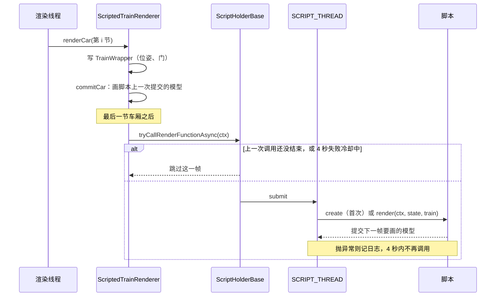

### 10.3 重置

资源重载时 `ScriptHolderClient.resetRunner()`：停掉 `SCRIPT_THREAD`（`shutdownNow`）并新建一个，`ScriptExecutors.shutdownAll()` 停掉脚本开的所有线程池，然后重新加载脚本。

## 11. 报站音频

玩家上传的录音存在服务器上，同步到各客户端缓存，由报站方块播放。设计和限制的细节见改造记录 6.11 节；还没测过游戏内，测试项是测试清单 U47 至 U54、S07、S08。

### 11.1 涉及的类

| 类 | 在哪一边 | 做什么 |
|---|---|---|
| `audio/AudioFiles` | 两边 | 校验和命名：按字节的 SHA-256；只收 Ogg Vorbis（单条音轨，每页校验和正确，开头三个 Vorbis 头齐全）；不解码 |
| `audio/AudioDatabase` | 两边 | 一个 SQLite 文件：名字索引（命名空间、文件名、上传者、哈希、声音 ID `sound_id`）和按哈希存的音频，同一个录音只存一份；`replace` 换录音并删掉没人用的旧录音 |
| `audio/AnnouncementSound` | 两边 | 报站方块"音频文件"一栏的三种写法：上传的文件（`steve:下一站.ogg`）、游戏或资源包声音（`mtr:ticket_barrier`）、网址（`https://...`）；上传文件的声音 ID 规则和游戏里的声音名 `mtr_audio:<上传者>/<声音 ID>` |
| `audio/AudioServer` | 服务端 | 存档的 `mtr/announce.db`，所有维度共用；收上传、删除、下载请求，按块发文件；`/mtr deleteaudio` 命令 |
| `client/AudioCache` | 客户端 | 本机缓存 `mtr_audio_cache`，按哈希存，所有世界和服务器共用；收列表后在后台下载缺的（`audio_download_all`、`audio_prefetch_max_kilobytes` 以内），被更新的文件马上下载；也替网页编辑器的音频页上传、删除、改声音 ID，等不到回复的请求超时标成失败 |
| `client/editor/EditorAudio` | 客户端 | 高级编辑器媒体库里的音频接口 `api/audio`、`api/audio-file`：列表和实际限制、上传、试听、删除、改声音 ID；新版页面是 `editor-web/src/views/MediaLibrary.tsx`，旧页面是 `index.html#/media/audio` 的 `media.js` |
| `client/AnnouncementPlayer` | 客户端 | 播放：上传的文件作为游戏声音播放（`UploadedSounds`），只有它没生效时才自己解码、用 Java 的音频输出播放；游戏声音走游戏的声音系统；网址只在 `config/mtr.json` 允许的网站下载 |
| `client/UploadedSounds` | 客户端 | 把服务器的音频登记成游戏声音 `mtr_audio:<上传者>/<声音 ID>`，`/playsound` 也能播；游戏要这个声音的数据时从缓存取出解码。由 mixin `SoundManagerMixin`（每次加载声音后重新登记）、`SoundBufferLibraryMixin`（取声音数据）调用，Fabric 和 Forge 各一份 |

### 11.2 上传限制和旧配置迁移

上传时长的唯一服务端配置是 `config/mtr_security.json` 的 `audioMaxSeconds`，由 `SecurityConfig.load` 读取：

| 配置内容 | 实际限制 |
|---|---|
| 没有 `audioMaxSeconds`（含新配置） | 300 秒 |
| `audioMaxSeconds: 60` | 300 秒；60 是旧版本写进文件的默认值，加载时自动迁移 |
| 其他值 | 保留管理员设置，并限制在 1 至 3600 秒 |

因此旧服务器升级后不需要手改原来的 60；如果管理员确实要限制为约 1 分钟，应显式改成 59 或 61 等非旧默认值。配置文件本身不在加载时重写，运行中的值已是 300，下次启动会再次做同样迁移。

`AudioServer.sendList` 把实际的 `audioMaxSeconds` 和 `audioMaxFileKilobytes` 下发给 `AudioCache`，`EditorAudio` 再通过 `api/audio` 给媒体库页面。客户端在发送前拒绝 `durationMillis > maxSeconds * 1000` 的文件；等号不拒绝，所以恰好 `5:00.000` 可以上传。服务端收齐全部分块、重新用 `AudioFiles.check` 验证 Ogg 后，再用自己的当前配置做同一个判断，客户端不能绕过。

时长、文件大小和解码保护是三个独立限制：默认单文件仍是 2 MB，因此高码率的 5 分钟录音可能先因大小被拒；`AnnouncementPlayer.MAX_DECODED_MILLIS` 是播放端 10 分钟的内存保护，不决定上传额度。改成 5 分钟不改包字段、数据库或存档格式，也不用提升协议版本。

**新版媒体库的 WAV 转换（2026-11-10）**：`MediaLibrary.tsx` 接收 `.wav` 和 `.ogg`，按文件顺序处理。WAV 先交给 `core/audioConversion.ts`：限制源文件 128 MB，读取 RIFF 的 `fmt` / `data` 块，检查单/双声道、采样率及是否超过服务端时长，截断或畸形文件直接报错。网页转换另有 10 分钟上限。通过后用 Web Audio 离线解码、默认混为单声道并重采样到 24 kHz，供游戏的声音系统计算声源方向和距离衰减；不播放声音，不使用麦克风。

随后用同源经典 Worker `audio/convert-worker.js`（2026-11-13 前在 `next/audio/`） 调用随包的 `OggVorbisEncoder.js`（libogg/libvorbis，Vorbis quality 0.3）分块编码，页面显示进度；取消、离开媒体库、超时或失败时终止 Worker。成功后按服务端 `maxFileBytes` 检查转换后的大小，把 `name.wav` 换为 `name.ogg`，再按转换后的名字匹配同名更新和生成声音 ID，进入原有 `EditorAudio` 上传链路。原 WAV 不发给游戏或远程网站；源 WAV 可以超过上传大小，只要转换结果符合限制。编码器及 MIT/BSD 许可证位于 `editor-web/public/audio/`，Vite 原样打包到 `next/audio/`，无需 CDN 或更改 CSP。旧版 `media.js` 兼容页面仍只接收预先转换好的 Ogg。

**MP3 输入（2026-11-10）**：新版上传也接收 `.mp3` / `audio/mpeg`，和 WAV 共用 `convertAudio`。MP3 先用本地 Blob URL 和音频元素读取元数据时长（20 秒超时），拒绝超过服务端时长或网页 10 分钟上限的文件；随后 Web Audio 解码，再以实际解码时长复核，按实际样本长度创建离线混音上下文，避免 MP3 元数据估算造成截断。默认仍是 24 kHz 单声道 Vorbis，名字从 `.mp3` 换为 `.ogg`；支持相同的进度、取消、同名更新和输出大小检查。损坏或浏览器不支持的 MP3 显示专门错误。元数据读取完成、出错、超时、取消都会清理音频元素和 Blob URL，原 MP3 不上传。

### 11.3 生命周期

1. **开服**：先由 `SecurityConfig.load` 读取安全配置，把缺少或恰好为旧默认值 60 的 `audioMaxSeconds` 变成运行值 300；其他值保留。`MTR.init` 注册的服务器启动事件再由 `AudioServer.open` 打开 `mtr/announce.db`、读入索引；同时收集模组的命名空间（`minecraft`、`mtr` 和数据包里的），玩家名和它们重名时上传的命名空间加 `_player` 后缀，不会盖掉模组的声音。关服时 `AudioServer.close`。
2. **玩家进服**：`AudioServer.sendList` 发 `PACKET_AUDIO_LIST`（先发实际的上传/管理权限、最大字节数和最大秒数，再发每个名字及其哈希、大小、时长、上传者；所有名字之后再跟一段声音 ID，旧版本读不到这一段时按没有处理）。`AudioCache.receiveListS2C` 保存这些限制并对比本机缓存，把缺的哈希用 `PACKET_AUDIO_WANTED` 请求：`audio_download_all` 开着时下 `audio_prefetch_max_kilobytes`（默认 1 MB）以内的；名字换了录音（被更新）而本机有旧录音的，不论大小马上下。然后 `UploadedSounds.refresh` 把每个名字登记成游戏声音。网页读取 `api/audio` 时，`EditorAudio` 把 `AudioCache` 中同一组限制返回给媒体库。
3. **下载**：`AudioServer.receiveWantedC2S` 记下请求；`AudioServer.tick`（每个服务端 tick，由 `MTR.init` 的 tick 事件调用）给每个玩家发两块，每块 32 KB（`PACKET_AUDIO_DATA`，约 1.3 MB/s），大列表不会堵住连接。客户端 `receiveDataS2C` 收齐后**哈希不符就丢弃**，相符才存进缓存。
4. **上传**（网页编辑器的音频页 → `EditorAudio` → `AudioCache.upload`）：
   - 新版页面若选中 WAV，先按上节流程在浏览器转换成 Ogg，并检查输出大小；Ogg 直接进入后续流程。
   - 客户端先用 `AudioFiles` 检查一遍，并按服务端下发的 `audioMaxSeconds` 拒绝过长文件，再按顺序分块发 `PACKET_AUDIO_UPLOAD`。该配置默认 300 秒（5 分钟）；已有配置里的旧默认值 60 秒在加载时也迁移成 300 秒，其他显式值继续生效。
   - 服务端 `receiveUploadC2S`：第一块时 `checkUploadStart` 检查权限等级、单个文件大小、总容量、每小时次数（`config/mtr_security.json`，单人存档的主人不受限）；每个玩家同时只能有一份在传，块必须按顺序。
   - 声音 ID 跟在每块数据后面，空的由服务端按文件名或哈希生成（`AnnouncementSound.getDefaultSoundId`）。
   - 收齐后 `finishUpload` 再校验一次，并由服务端按同一个 `audioMaxSeconds` 做最终时长裁决；随后按"上传者命名空间 : 文件名"存索引，同一个哈希的音频已有就不再存；同一个上传者已有同名但内容不同的文件时算作更新：换成新录音，声音 ID 不变，旧录音没有别的名字用时删掉；本机有旧录音的客户端收到新列表后马上下载新录音。服务端出错时也一定回结果，客户端等不到回复会超时标成失败。成功后 `sendListToAll` 把新列表发给所有人，各客户端照第 2 步下载。结果用 `PACKET_AUDIO_RESULT` 回给上传者。
   - 改声音 ID：音频页"改声音 ID" → `AudioCache.setSoundId` → `PACKET_AUDIO_SOUND_ID` → `AudioServer.receiveSoundIdC2S`，上传者和管理员能改，同一个上传者内不能重复，然后 `sendListToAll`。
5. **删除**（音频页 `PACKET_AUDIO_DELETE`，或 `/mtr deleteaudio <名字>`）：任何人能删自己上传的，达到管理权限等级的能删别人的。删掉名字后，没有别的名字再用这份音频才删音频本身，然后同样 `sendListToAll`。删除和上传都写进服务端日志。
6. **播放**：列车车头经过报站方块时，`TrainServer.handlePositions` 对车上每位乘客调 `TileEntityTrainAnnouncer.announce`（同一玩家有冷却时间），服务端 `announceS2C` 把文字和"音频文件"一栏发给他。客户端 `AnnouncementPlayer.play`：
   - 先当作上传的文件，在服务器列表里按名字找到它的游戏声音，用 `playLocalSound` 播放，和游戏声音一样。游戏第一次要这个声音的数据时，`UploadedSounds.getBuffer` 从缓存读出、在后台线程解码；缓存里还没有时这次不响，顺便请求下载，下次就有了。
   - `/playsound mtr_audio:<上传者>/<声音 ID>` 走的是同一条路：服务端把名字发给附近的玩家，客户端在声音表里找到它。
   - 不是上传的文件，就当作游戏或资源包的声音，在方块处播放。
   - 是网址时，只有 `config/mtr.json` 允许的网站才下载播放，否则只记一行日志。
   - 报站方块的设置界面（`TrainAnnouncerScreen`）里可以试听，走同一个 `play`。

**时序图**：

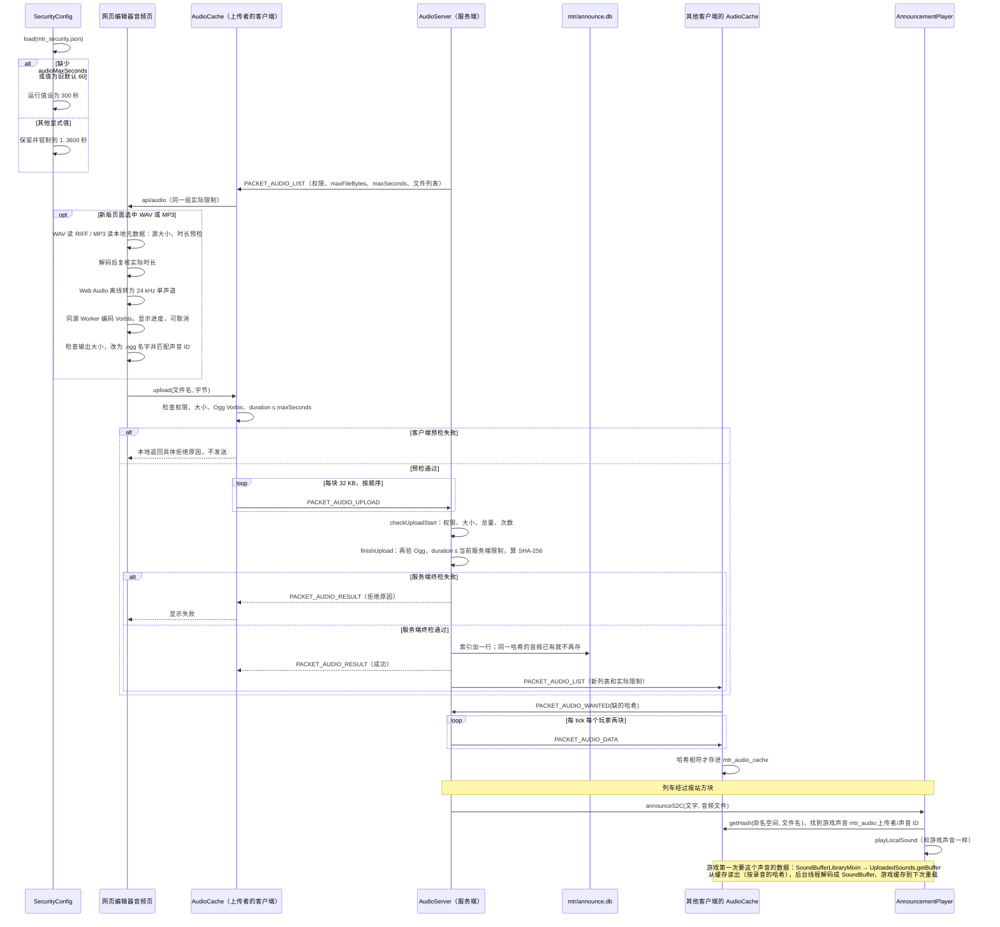

### 11.4 还没做的

线路、车站和时刻事件引用上传的音频（自动报站用它）；客户端缓存的容量上限和清理。按位置播放已经有了：上传的音频是游戏声音，单声道的录音按位置衰减（2026-11-05）。

### 运行层（0.40.0，`transitsim.run`）

规则见 `MTR-模拟组件与解耦.md` 5.5 节。组件里的列车类由它跑（`TickRunner.RUN_LAYER`，缆车仍走 `TrainMotion`）。
- `PathClaims`：路径上一段换成按顺序的资源组：普通区段每段一组（`BlockSections` 的段，涂色信号区段整块），连续的单线区间连同方向一组，要原地掉头的站台连同两个方向一组（掉头车优先）；方向是单独的资源键（`directionOf`）。`attach` 把咽喉道岔和联锁区并进经过其节点的那一组。
- `Authority`：每列车的移动授权。每 tick：车身和已批的组照常保持（`RunReservations.holdClaims`），前方没批的组按顺序一起申请（`requestGroups`），仲裁器结算时批最长可用前缀（`Arbiter.requestGroups` / `takeGrantedGroups`，批准的并进已有占用）；授权终点到下一组的起点为止，后面没有要申请的就到目标。已批的组被外部东西站上就收回到它之前。换路径时当场占上能占的；续跑时用记录里的终点（`restore`）。
- `RunMotion`：每 tick 的运动。下一站每 tick 从位置推出（`findNextStop`，车在动时不算刚离开的那站）；按运行段开到"下一站"和"授权终点"较近的一个；停在授权终点只等不开门；到站记在车停在站上的第一个 tick；在库和回库同原来。
- `TickRunner.HeadlessTrain.runLayerTick`：目标是在站时再下一站、在路上下一站、在库里第一个站台；先更新授权，再推进；`isRunGranted` 直接看授权是否已超过车头。`publishOccupied` 每 tick 结算前把外部占用、外部列车、被接管的车和已拆除的轨道报给仲裁器（`Arbiter.setOccupied`）。新内核下 `getQuietTicks` 返回 0。
- `RunRecord` 第 5 版：`authorityEnd`、`segment`（`RunSegment.Spec`），续跑时在第一个 tick 重建运行段（重建位置和列车对不上就不用）。
- 游戏（0.41.0）：`TrainServer` 的 `authority_end`、`run_segment` 两个存档键（`showSimulated` 从 `HeadlessTrain.getRecordAuthorityEnd` / `getRecordSegment` 抄，`toRecord` 交回）；手动驾驶的车 `updateManualAuthority`（在推进前）和 `limitToAuthority`（推进后）；`holdRun` 对有授权的手动车不再放掉占用。客户端 `Train.standsForRunLayer`：服务端新运行层跑的车，没有运行段时客户端原地不动、门按服务端状态，不跑 `TrainMotion`。

### 端到端检查（0.39.0）

- `transitsim.sim.RunInvariants`：只读的不变量检查，宿主或测试每 tick（或每秒）调 `check()`；违规在 `getViolations()`，想走走不了太久的在 `getStuck()`。规则见 `MTR-模拟组件与解耦.md` 2.4 节。
- `WholeDayTest`（组件，`-Dbenchmark=true` 才跑）、`GameChainTest`（common）、`RunInvariantsTest`（组件）。
- `SimulateDay --check`；`C:/gtmp/fast/e2e.sh` 跑本机存档的副本。
- 为了不开服务器也能生成运用路径：`Siding.generateDutyRoute(Executor, …)`（原来取 `MinecraftServer` 的那个调它）和 `Depot.generateDutyPathsNow`（照 `generateDutiesOnly` 给每条存车线找运用路径，结果立刻应用）。
- 修复的位置：`TickRunner.HeadlessTrain.canDeploy` 和 `TrainServer.canDeploy`（按运用跑、路径只有存车线时也请求出库）；两边的 `followPath`（回到存车线路径时归零下一个停车点）；`TrainMotion` 前方被占的分支（闭塞区段停车点不越过下一个站台）；`DepotDispatcher.findDutyDeploy`（`MAX_LEAD_MILLIS`、`getSlotKey` 按分钟缓存）；`RunReservations.toClaims` 和 `Arbiter.Claim.singleTrackBothWays`（同一列车两个方向合成双向占用），两边的 `getRunMoves`（到要掉头的站台为止时加上反方向）。

### 11.5 音频方块

音频方块 `mtr:audio_speaker` 由唱片机和红石粉合成。用刷子右键打开 `AudioSpeakerScreen`，可搜索并选择媒体库音频，也可搜索方块名称和注册 ID 来选择外观。默认外观为唱片机。渲染器绘制所选方块的默认模型，碰撞和交互采用音频方块本身的规则。

物品栏图标改用 `models/block/audio_speaker_icon.json` 的扬声器模型（双单元、绿色指示灯），物品模型引用它；使用原版混凝土材质，无新增贴图，资源包版本为 1.0.1。放置后的外观仍由方块设置决定。

`BlockAudioSpeaker` 向同维度、同时满足收听方向和球形半径的玩家发送播放包，半径为 1–128 格。刷子界面可独立勾选上、下、东、西、南、北，任一已选扇区内的玩家都能收听。扇区内，从方块中心沿所选面法线的距离须大于或等于另外两轴的绝对偏移。六面全选为全方向，全部取消为静音。读档时优先读取 `audience_mask`，旧的 `audience_direction` 单选会映射到对应一面，缺省为全方向。

- 循环模式在无信号时播放，每秒刷新一次循环状态。`SpeakerListeners` 保留同维度曾经收听的玩家，走出范围或方向扇区后仍续租；客户端 `SpeakerSound` 只把音量设为零，流继续推进，回来恢复当前片段。单次播放同样保留到自然结束。通电、音频删除、设置变化或方块卸载时停止循环，客户端换世界、收到停止包或租约超时也会清理。最多保留 32 个声音；达到上限时，新进入收听范围的声音可以淘汰最远的静音实例，被淘汰的流不保证进度连续。
- 红石模式在信号上升沿向收听范围播放一次。持续通电只触发一次。
- 位置模式在指定球形区域由空变为有玩家时播放一次。触发球心用世界方块坐标，触发半径为 1–128 格。区域内持续有人时要等清空才会重新触发。旁观者不计入区域占用。

`SpeakerSettings` 管理方块实体 NBT 与配置包。服务端在保存前检查编辑权限、刷子、8 格内距离、目标方块、范围、外观和音源。外观通过方块实体更新包同步。`SpeakerPlayback` 校对服务端发送的音频哈希并复用 `AudioCache` 与 `UploadedSounds`，缺失文件会先下载。客户端逐 tick 检查玩家是否仍在范围和方向内，并按 `1 - 距离 / 半径` 更新声音增益，半径边缘为零。声音仍受游戏方块音量控制。配置和播放包使用协议版本 `0.65.4`，以单字节同步六个方向。

## 12. 导入图片和原版画（2026-11-10）

高级编辑器“媒体 → 图片”由 `editor-web/src/views/ImagesLibrary.tsx` 管理导入、多选拖放、筛选、搜索、预览和删除。JPG/PNG 在浏览器转成 PNG，GIF 保留原始文件。源文件最多 16 MB，图片宽高最多 2048 像素，实际上传的 PNG 或 GIF 最多 5 MB。`EditorImages` 提供 `api/images`（列表、上传、删除）和 `api/image-file`（本机预览）。预览接口按文件头返回 PNG 或 GIF 的 MIME 类型。

### 12.1 存储、识别和权限

`ImageDatabase` 在世界的 `mtr/pictures.db` 建两张表。`picture_index` 按命名空间和文件名的全小写键索引，记录文件名、哈希、宽高、字节数、上传者 UUID 和名字及上传时间。`picture_data` 按 SHA-256 保存 PNG 和 GIF。PNG 和 GIF 分别用 `.png` 和 `.gif` 内部引用，例如 `steve:站内导向.png` 和 `steve:发车提示.gif`。不同上传者可同名，同一内容只存一份。自己同名重新上传会更新现有引用，最后一个引用删除后才回收内容。索引、二进制和孤立数据回收在同一事务提交。玩家名与模组命名空间重名时加 `_player`。

`config/mtr_security.json` 的 `imageUploadPermissionLevel` / `imageManagePermissionLevel` 默认均为 2，分别控制导入及管理他人图片；音频对应的 `audioUploadPermissionLevel` / `audioManagePermissionLevel` 仍独立配置。资源所有者按 UUID 判断，即使失去上传权限也能删自己的；OP 默认能删其他人的图片和音频。两类服务端删除共用 `MediaPermissions.canDelete`，不会只靠网页隐藏按钮。`ImageServer.tick` 每秒检查权限变化，变化时刷新图片和音频列表，在线授予/撤销 OP 后按钮随之更新。

### 12.2 上传和同步流程

1. `ImagesLibrary` 把 PNG 或 GIF 交给 `EditorImages.upload`。`ImportedImages` 先校验，再用 `PACKET_IMAGE_ACTION` 按 30 KB 分块上传，每名玩家同时上传一份。
2. `ImageServer` 在主线程核对上传权限、分块顺序、大小、30 秒接收超时及每小时 30 次上限。`ImageFiles` 检查文件头和尺寸再解码，GIF 还会检查每帧的位置、尺寸及动画总量。图片库最多 256 个名称和 默认 256 MB 不重复内容（imageMaxTotalMegabytes 可配置）。
3. 完成后事务更新 `pictures.db`，向上传者返回结果并广播名称列表（含每项的删除权限）。同名更新不能覆盖 UUID 属于别人的名称。
4. 画或网页需要图片时，`ImportedImages` 把内部引用解析为哈希，请求服务端文件，每 tick 每名玩家最多两块。收齐后核对 SHA-256 并验证图片，按哈希存进本机 `mtr_image_cache/pictures.db`。缓存由所有世界和服务器共用。切换连接会清理名称和临时接收状态。客户端最多保留 16 张动态纹理，绘制后提交顶点再允许缓存淘汰纹理。
5. 删除只删所选名字；仍被别的名字引用的内容保留。删除后画暂时显示原版内容，重新上传同一内部名字后自动恢复图片。

### 12.3 刷子配置与渲染流程

Fabric/Forge 各有三处 mixin：`PaintingBrushMixin` 拦截刷子右键原版 `Painting` 并打开 `ImportedPaintingScreen`；`PaintingImageMixin` 为画增加同步字符串及 NBT 键 `mtr_image`；`ImportedPaintingRendererMixin` 在图片可用时改画导入内容。

界面可循环选图片或“原版画”，设置宽、高和右/上/前三个偏移。尺寸范围为 0.0625–16 方块，偏移范围为 -16–16 方块。画继续使用原版的挂墙锚点、朝向、碰撞和掉落规则。应用包带实体 ID 和配置。服务端再次检查编辑权限、手持刷子、距离不超过 8 格、实体类型、名称存在以及所有数字有限且在范围内。配置使用 `玩家:文件.png` 或 `玩家:文件.gif` 内部引用。

渲染器按原版画的朝向旋转，应用本地坐标偏移，0.65.9 起绕图片中心应用 XYZ 旋转，按最多一方块的格子绘制双面图片并按变换后的位置取世界亮度，不再绘制木板背面和侧边。GIF 由 `AnimatedGif` 合成逻辑画布上的局部帧，处理透明、帧处置和循环次数。单个 GIF 最多 256 帧且所有帧的画布像素总数不超过 16,777,216。客户端按经过时间选择帧，帧变化时更新同一张动态纹理，动画缓存总量另有 33,554,432 像素上限。自定义图片未下载或已删除时暂不画图片，拿刷子仍可见原版锚点；只有选择“原版画”才恢复原版外观。图片设置随实体 NBT 保存并同步给追踪玩家。支持 `.gif` 引用的版本为 `0.65.1`，已有 `.png` 引用可直接读取。

## 13. 读代码的几点提示

- **一份数据，服务端和客户端各有一份**：`Station`、`Route`、`Depot` 等在两边都有，都能用 msgpack（存档）和 `FriendlyByteBuf`（网络）读写。改字段时，存档读写、网络读写、`update(key, packet)` 三处都要改。
- **`DataCache` 是索引**：`RailwayData` 里的数据是集合，按 ID 查找和"站台属于哪个站"这类关系都在 `DataCache` 里；数据结构变了要 `sync()`。
- **新规则在组件里**：列车运动、时刻表、运用、寻路的新规则都在 `transit-sim`，MTR 里对应的是适配器（`advanced/` 和 `PlanAdapters` 等）。改规则先改组件并写组件测试。
- **注释里的编号**：代码注释里的 F1、G1、S1、R03 等是设计文档和架构审查里的步骤或问题编号，到 `MTR-模拟组件与解耦.md` 和 `MTR-设计与架构审查评估-2026-11-03.md` 里查。
- **找不到的行为先查 mixin**：见 3.4 节。
- **不参与编译的文件**：`scripting/ScriptHolderBase copy` 是旧版的副本（没有 `.java` 后缀），读代码时以 `ScriptHolderBase.java` 为准。


## 用户提供的端门模型（0.65.21，2026-11-11）

低款使用 models/platform_edge_door_low.bbmodel，高款两种型号使用 models/platform_edge_door.bbmodel。模型均为 13 个原始元素，提取各自内嵌 256×256 贴图；按文件 uv_width/uv_height=128 将 UV 转为 Minecraft 的 0–16 坐标。模型高度分别为 25/32 像素，保持原把手、玻璃、横杆和旋转支撑。

models/export_platform_edge_doors.py 将直立部件在 y=16 拆分，插值竖向 UV 并去掉内部切面；倾斜支撑保持完整，避免旋转部件接缝。生成文件放在 resources/common/normal/assets/mtr，构建统一复制。物品模型使用完整门模型及源文件 display 参数；闭合模型朝北，开门状态与碰撞同向旋转。方块 ID、配方、手动开关、两半同步及高款顶框逻辑不变。

### 隧道墙装饰

两种墙面共用贴图资源路径约定，完整方块四侧显示墙面，上下显示普通混凝土。装饰片以支撑方向保存水平朝向，模型与选取轮廓随朝向旋转，拆除支撑后掉落。
