# MTR 代码说明与主要流程

- **最后更新**：2026-11-05，折返方式（9.5 节，MTM_Logic 0.9.0）；之前 2026-11-04，对应提交 `4f880df`。这次补进了按时刻表就位（`7dc4d97`、`58cf977`，4.8 节）、共用线路的车厂共享班次（`a1ed043`，4.6 节）、改动在处理器之前读出（`e7abbc7`，8.2 节）。
  - 另一个会话正在做的 `transitsim.planning.AutoDuties`（从时刻表自动生成运用）还没有接进游戏，等它合并后再写进来。
- **写给谁**：第一次读这个仓库代码的人。先看第 1、2 节知道东西在哪，再按要改的功能看第 3 至 9 节的流程。
- **和别的文档的关系**：
  - 这份只讲"代码在哪、怎么跑起来"。为什么这样设计、改过什么，看 `MTR-3.x改造记录与寻路方案.md`。
  - 运行模拟组件（`transit-sim`）的分离情况看 `MTR-模拟组件与解耦.md`，对外接口看 `MTR-模拟组件契约.md`。
  - MTR 4 资源包和转向架看 `MTR-加载MTR4资源包设计.md`。
- **维护规则**：新增一个主要的类或改了某个流程的调用顺序，就更新这里对应的一节。行号会变，这里只写类名和方法名。
- **类说明**：第 2 节表里的核心类在源码里都有类级 Javadoc，讲这个类管什么、在流程里的位置；这里讲类之间怎么串起来。
- **UML 图**：用 Mermaid 写在 ` ```mermaid ` 代码块里，GitHub、VS Code（装 Markdown Preview Mermaid Support）、Typora、IDEA 都能直接显示。类图在 2.4 节，时序图、活动图、状态图在各流程小节的末尾。改流程时同时改图。

## 1. 仓库结构

| 目录 | 内容 |
|---|---|
| `common/src/main/java/mtr/` | MTR 3.2.2 本体和本分支的改造，Fabric 和 Forge 共用 |
| `common/src/main/java/cn/zbx1425/mtrsteamloco/` | 合并进来的 ANTE（mtrsteamloco）：OBJ/bbmodel 模型、JS 脚本、装饰物、3D 轨道 |
| `transit-sim/` | 运行模拟组件，不依赖 Minecraft；有自己的单元测试 |
| `fabric/`、`forge/` | 两个加载器的入口类、mixin 和平台相关代码 |
| `resources/common/` | 共用资源：`normal`（MTR 本体，含网页 `website`）、`ante`、`lifts` |
| `resources/fabric/`、`resources/forge/` | 加载器专用资源；`no-ante` 是不带 ANTE 的构建用的；`resources/fabric/mtm_logic` 是嵌在 Fabric jar 里的 MTM_Logic 小 jar（`fabric.mod.json` 和图标 `assets/mtm_logic/icon.png`），Forge 的 MTM_Logic 图标是 `resources/forge/normal/mtm_logic_icon.png`（`mods.toml` 第三个 `[[mods]]` 的 `logoFile`） |
| `examples/` | 自定义资源包示例 |

**主线程上每 tick 都会调到的地方不要每次重算**（2026-11-05、11-07 量过，见解耦文档 L3；11-07 的结果：平时每 tick 约 10 毫秒，三分之二在 `Siding.simulateTrain` 照组件结果更新列车；组件重建 `LiveSimulation.start` 一次约 0.5 秒、整段在主线程上，是下一个要移到后台的地方）：`SavedRailBase` 的端点和中点算一次就留着（`positionArray`、`midPos`，端点不会变）；列车写时刻时，时间段在路径上的位置留在 `TimeSegment` 上（`Train.getSegmentIndex`，路径的距离表换了或变长变短才重算）；按频率发车的车厂的存车线列表留着（`Depot.getSidingsInDepot`）；上游路线查找没有请求时十个 tick 才搜一次（`RailwayDataRouteFinderModule`，只供网站地图的连接密度）。

**本项目新加的游戏内文字要放在 `common/src/main/lang/*.json`**：构建前的准备步骤用 Crowdin 的翻译包覆盖 `common/src/main/resources/assets/mtr/lang`，再把 `common/src/main/lang` 里没有的键合并进去（根目录 `build.gradle`）。写在 `assets/mtr/lang` 里的中文会被覆盖，游戏退回显示英文。只合并缺的键，所以改上游已有的文字要改 Crowdin 那边；值里不能有英文双引号，因为合并时不转义。
  - **文件名一律小写**（2026-11-06）：Minecraft 按小写的语言代码找 `lang/zh_cn.json`，jar 里的文件名区分大小写，而 Crowdin 包里是 `zh_CN.json`，以前正式 jar 里 MTR 的非英文翻译都找不到，退回英文（开发环境的 Windows 目录不分大小写，看不出来）。准备步骤先删掉 `assets/mtr/lang` 里旧的翻译文件（`en_us.json` 不在包里，保留），解包时改成小写，合并时也按小写文件名找。
  - Crowdin 包缺中文的 MTR 界面文字（资源包创建器、车厂"正在生成路径"、几项设置等）和 ANTE 缺文字的键，都在 `common/src/main/lang` 里补上；语言键全局通用，`gui.mtrsteamloco.*` 也可以放这里。PIDS 和指示牌上的非 `_cjk` 键（如 `terminates_here_1..3`、`sign.mtr.*`）是双语显示里的英文那一半，故意不翻。ANTE 界面里写死的中文和英文（轨道修改器、路线路径创建器、选择界面的标题和按钮、物品提示）改成语言键。

**网页新建线路**（L4）：`newRoute` 操作的 `route` 为空时，`EditorActions.applyOperation` 不找来源线路，直接调 `createRoute(null, …)`：按 `mode` 建 `new Route(mode)`，线路组名取 `line`，颜色同时作线路组颜色和线路自己的颜色；不带班次、不加入车厂（即使操作里写了也不用）。网页那边是 `newLineDialog`。

**新物品的贴图和配方要放在 `resources/common/normal`**：构建前的准备步骤会删掉 `common/src/main/resources` 下的 `assets/mtr/textures`、`assets/mtr/sounds`、`data/mtr/recipes`、`data/mtr/loot_tables` 等，再从 `resources/common/` 复制回来（根目录 `build.gradle`）。只放在 `common/src` 里的贴图不会进 jar，游戏里显示紫黑格；圆形隧道创建器就是这样漏掉的（2026-11-05 补上）。物品模型（`models/item`）不在删除之列，所以模型在、贴图不在。

代码用 Manifold 预处理（`#if MC_VERSION >= "12000"`）同时支持多个 Minecraft 版本；目前只构建 1.20.1。`mtr/mappings/` 是各版本之间的兼容层，写新代码时调 Minecraft 的接口优先找这里有没有包装。

## 2. 包的分工

### 2.1 `mtr/`（本体）

| 包 | 负责什么 | 重要的类 |
|---|---|---|
| 根目录 | 注册和入口 | `MTR`（服务端初始化、tick、玩家进出）、`MTRClient`（客户端初始化）、`Registry`/`RegistryClient`（注册的封装）、`Blocks`、`Items`、`SecurityConfig` |
| `data/` | 铁路数据和列车运行，服务端的核心 | `RailwayData`（一个维度的全部数据）、`Rail`、`Station`、`Platform`、`Siding`、`Depot`、`Route`、`Train`/`TrainServer`/`TrainClient`、`DataCache`、`SignalBlocks`、`Lift` |
| `data/` 里的模块 | 从 `RailwayData` 拆出去的功能 | `RailwayDataFileSaveModule`（存档）、`RailwayDataDriveTrainModule`（手动驾驶）、`RailwayDataRouteFinderModule`（乘客寻路）、`RailwayDataCoolDownModule`、`RailwayDataRailActionsModule`（造桥造隧道）、`RailwayDataBackups` |
| `path/` | 车厂的路径 | `DeterministicPathFinder`（新寻路，用组件的 `RailRouter`）、`PathFinder`（旧寻路）、`PathData`（路径上的一段轨道）、`PathFailure` |
| `advanced/` | 本分支加的功能和组件的适配器 | `LiveSimulation`（组件模拟器跑列车）、`PathRegionSync`、`RouteLayouts`、`StationLayouts`、`GraphRecords`、`TrackViews`、`SandboxRuns` |
| `packet/` | 网络包 | `IPacket`（包 ID）、`PacketTrainDataGuiServer`/`PacketTrainDataGuiClient`（收发）、`PacketGuard`（大小和频率限制）、`EditGuard`（多人编辑冲突） |
| `client/` | 客户端数据和资源 | `ClientData`（客户端看到的数据）、`ClientCache`、`CustomResources`（读资源包）、`TrainClientRegistry`/`TrainProperties`（车型）、`DynamicTrainModel`、`MapDataCache`/`MapCacheDatabase`（地图缓存） |
| `client/editor/` | 高级编辑器（文中的"网页编辑器"） | `EditorServer`：客户端自己在本机开一个网页服务，只监听本机、随机端口，只认本次会话生成的密钥，用系统浏览器打开。它读客户端已知的数据，单人和服务器上用法一样；改动仍然通过游戏的网络包发给服务器检查（8.2 节）。页面在 `common/src/main/resources/assets/mtr/editor/`（`editor.js`、`i18n.js`）。它和服务器给所有人开的地图网页服务（`servlet/`）是两回事 |
| `render/` | 绘制 | `RenderTrains`（列车、电梯和轨道的总入口）、`TrainRendererBase`/`JonModelTrainRenderer`（画车厢）、各种站牌和信号 |
| `screen/` | 界面 | 车厂、线路、站台、仪表盘等界面 |
| `block/`、`item/`、`entity/` | 方块、物品、实体 | `EntitySeat`（玩家坐的座位实体，也是画车的触发点） |
| `model/` | 内置车型的 Java 模型 | |
| `sound/`、`audio/` | 列车声音、报站和上传的音频 | `AudioServer` |
| `servlet/` | 内置网页服务（Jetty） | `Webserver`，路径 `/data`、`/info`、`/arrivals`、`/delays`、`/route` |
| `compat/` | 和 Dynmap、BlueMap、Squaremap 等的兼容 | |

### 2.2 `cn/zbx1425/mtrsteamloco/`（ANTE）

| 包 | 负责什么 |
|---|---|
| 根目录 | `Main`（注册装饰物、直线节点、各种创建器和网络包）、`MainClient`（渲染器和资源重载）、`ClientConfig`（客户端设置）、`CustomResources`（读 ANTE 的模型和脚本资源） |
| `mixin/` | 改 MTR 本体行为的地方，见 3.4 节 |
| `scripting/` | JS 脚本：`ScriptHolderBase`（加载和沙箱）、`train/`（列车脚本）、`eyecandy/`（装饰物脚本）、`util/`（注入给脚本的工具类） |
| `render/` | 模型绘制、3D 轨道（`rail/`）、`RailDistanceRenderer`、光影兼容 `ShadersModHandler` |
| `data/` | 3D 轨道形状、装饰物和轨道模型的注册表、车身侧倾 `Rolling` |
| `gui/`、`item/`、`block/`、`network/` | 界面、工具物品、方块、网络包 |

### 2.3 `transit-sim/`（运行模拟组件）

不引用 Minecraft，由 MTR 通过适配器喂数据。

| 包 | 负责什么 |
|---|---|
| `network` | 线网图 `RailGraph`、寻路 `RailRouter`、区域和站台图、线网快照 `Network` |
| `motion` | 列车运动：`TrainMotion`（现在的规则）、`legacy/LegacyTrainMotion`（旧规则，用来对比）、速度曲线 `SpeedCurves`/`SpeedProfile` |
| `plan` | 时刻表、运用、折返、停站规则 |
| `planning` | 运用计划的生成和检查 |
| `sim` | 无头模拟器 `Simulator`、事件模拟 `EventSimulator`、占用 `Occupancy`、走行预约 `RunReservations` |
| `io` | 二进制读写 |

### 2.4 核心类的关系（UML 类图）

服务端的数据模型。客户端有同样的数据类（`ClientData` 里的集合），列车换成 `TrainClient`。


## 3. 启动和注册

### 3.1 入口

```
Fabric: MTRFabric / MTRFabricClient      Forge: MTRForge
        │                                        │
        └──────────────┬─────────────────────────┘
                       ▼
        MTR.init(...)              注册方块、物品、实体、网络包、事件
        cn.zbx1425.mtrsteamloco.Main.init(...)   注册 ANTE 的内容
                       │（客户端另外）
                       ▼
        MTRClient.init()           注册渲染器、客户端网络包、按键、客户端 tick
        cn.zbx1425.mtrsteamloco.MainClient.init()
```

### 3.2 `MTR.init` 里注册的事件

网页服务（`Webserver`，默认 8888 端口）和高级编辑器的本地服务（`EditorServer`）的线程池是守护线程。以前端口被占时 `webServer.start()` 失败，已经启动的线程池不会停（`stop()` 只停"已启动"的），服务器 `/stop` 后进程一直不退出；现在启动失败会立刻停掉，`stop()` 只要没停就停。

- **网络包**：客户端发上来的包都经过 `PacketGuard.register` 注册，先检查大小（1 MB）和频率（每秒 400 个），再交给 `PacketTrainDataGuiServer.receiveXxxC2S`。
- **服务端 tick**（`Registry.registerTickEvent`）：每个维度调一次 `RailwayData.simulateTrains()`，见第 4 节；然后 `AudioServer.tick`，每隔一段时间给所有玩家发服务器时间。
- **玩家加入**：发版本检查、线路用语、时刻表和运动设置、服务器时间、编辑版本号、编辑权限、音频列表，再调 `RailwayData.onPlayerJoin`。
  - **版本检查**（2026-11-05 起）：`PacketTrainDataGuiServer.versionCheckS2C` 发 `IPacket.getNetworkVersion()`，即 `MTM_Logic <版本>`（`gradle.properties` 的 `mtm_version`，构建时写进 `Keys.MTM_VERSION`）。客户端 `PacketTrainDataGuiClient.openVersionCheckS2C` 和自己的比，不完全一样就断开连接，显示双方的版本。网络包或存档有任何变化都把 `mtm_version` 加一。以前比的是 MTR 版本加协议号（`IPacket.PROTOCOL_VERSION`，已去掉）；ANTE 原来另有一套检查（`PacketVersionCheck`），合并进同一个 jar 后也去掉了。
- **玩家离开**：清掉这个玩家的同步状态、包计数、编辑状态。
- **服务器启动**：读 `config/` 下的 `mtr_security.json`、线路用语、时刻表设置、`mtr_motion.json`，启动网页服务和音频服务。

### 3.3 `RailwayData` 的创建和读档

`RailwayData.getInstance(level)` 按维度取实例，第一次取时创建，`load` 时由 `RailwayDataFileSaveModule.load()` 从维度存档目录下的 `mtr.db`（SQLite，经 `RailwayDataFileStore.open`）读出全部数据，再 `dataCache.sync()` 建好各种 ID 索引。

### 3.4 ANTE 怎么接到本体上

ANTE 不改本体的源码，靠 `mixin/` 里的注入改行为。读代码时看到本体某个方法的行为和源码不一致，先查这里。

构建时 `MixinLintTest`（common 的测试）扫 `mixin/` 的源码，找三种会悄悄换掉本体代码的写法：
- 带初始化的 `@Shadow` 字段：初始化会被合并进目标的构造函数，覆盖本体的值（占用表崩溃就是这个）；
- 和目标类某个方法同名同参数、又没有注解的方法：它会直接覆盖目标的方法；
- 会取消的 HEAD 注入，取消是一条独立语句，或者方法体超过 4 条语句：等于用自己的一份代替目标方法。只在 if 后面短短取消一下的不算。

后两种看过、确认不会盖掉本体改动的，写在测试的 `ALLOWED` 里并注明原因。新出现的、或者写在 `ALLOWED` 里却已经没有的，测试失败。改了 mixin 或者改了被注入的本体方法时，按失败信息检查。

**运行钩子暂时隔离**（0.37.0，用户定的"暂时隔离 ANTE 有关部分"，只隔离影响列车运行的 mixin）：服务端 `config/mtr_security.json` 的 `anteRunHooks`（`SecurityConfig.anteRunHooks`）默认 `false`，文件里没有这一项也是关。关着时下面几个钩子一开头就返回，走本体自己的逻辑；改成 `true` 重启恢复 ANTE 原来的行为。
- `TrainMixin.onScanDoors`：不再在 ANTE 装饰物（当站台用的 eye candy）和 Metropolis 的站台方块旁开门，只认本体的站台、屏蔽门和安全门。
- `TrainMixin.convertMaxManualSpeed`：手动驾驶最高速度按本体的规则（只到钻石轨道，超出按铁轨速度）。
- `SidingScreenMixin`：0.38.0 起删掉了，存车线界面不再有手动驾驶速度滑块（5c，见下）。客户端仍从 `PACKET_EDIT_PERMISSION` 末尾多出的布尔值知道开关（`ClientData.anteRunHooks`），旧包没有这一位时当作关，目前没有界面用到它。
- `RailwayDataMixin.simulateTrains()`：调本体的方框判断 `RailwayData.isRailNearInBox`（原来 `simulateTrains()` 里的 lambda 抽出来的），不改 `RAIL_UPDATE_DISTANCE`。

不隔离的：P 类型速度轨道（`RailTypeMixin`，按名字存档，关掉会读成铁轨再存就丢了）、`RailMixin` 的竖曲线和侧倾（是形状，和绘制配套）、列车和轨道上 ANTE 的存档和网络包字段、渲染和骑乘这些客户端 mixin、模型和 JS 脚本。组件本来就不依赖 ANTE。测试 `AnteRunHooksTest`。


| mixin | 改了什么 |
|---|---|
| `RailwayDataMixin` | 替换 `simulateTrains()`，用 ANTE 自己的"轨道是否在玩家附近"调 `simulateTrains(RailNearPlayer)`（3D 轨道的形状不同）。只影子 `world` 和 `RAIL_UPDATE_DISTANCE`，**都不带初始化**：Mixin 会把 mixin 里字段的初始化合并进目标的构造函数，以前这里的 `trainPositions = new ArrayList<>(2)` 把本体的占用表换成了空表，列车在游戏里一直没占轨道，2026-11-05 读占用表时崩溃（和 ANTE-advanced `2f3921c8` 同一个修法） |
| `CustomResourcesMixin` | 在本体读资源包前后插入 ANTE 的资源读取；记住最近读到的贴图，给接下来的 OBJ/bbmodel 用 |
| `TrainClientRegistryMixin` | 取车型时先找 ANTE 注册的脚本车型 |
| `RenderTrainsMixin` | 列车绘制前后的准备和收尾、拿着轨道工具时的显示 |
| `JonModelTrainRendererMixin` | 在车厢绘制的第一次 `rotateX` 处加车身侧倾 |
| `TrainClientMixin` | 构造和 `copyFromTrain` 后带上 ANTE 的数据；`handlePositions` 是 ANTE 的版本（多了车身侧倾）。以前它还整个替换 `TrainClient.simulateTrain`，用的是一份旧代码，本体后来加的直通班次线路（`tripRouteIds`）因此不生效；2026-11-05 去掉了，`simulateTrain` 是本体自己的 |
| `TrainMixin`、`VehicleRidingClientMixin` | 给列车和乘客加额外数据（`TrainExtraSupplier`、`VehicleRidingClientExtraSupplier`），并改乘客的位置计算 |
| `RailMixin` | 3D 轨道的模型、侧倾、竖曲线（`getPositionY`）、开门方向、自定义配置和带侧倾的绘制（`RailExtraSupplier`）。轨道的形状、长度和角度是本体自己的：2026-11-05 去掉了 ANTE 的贝塞尔模式和对 `getLength`、`getPosition`、`getRailAngle`、`isValid` 的重写，读档时也不再用 ANTE 存的弧度角覆盖本体的角度。ANTE 存成贝塞尔的旧轨道由 `Rail(Map)`（`fromAnteBezier`）按两端位置和方向算成本体的形状，算不出有效轨道的保留原样。以前它还把 `goodRadius()` 改成总是成立，2026-11-05 去掉了，新连的轨道又要满足本体的最小半径（2 格） |
| `RailTypeMixin` | ANTE 的 P 类型速度轨道（P-1 至 P600、P1000 至 P10000）。原来配套的 `SidingScreenMixin`（存车线界面手动驾驶速度滑块的范围）0.38.0 随滑块一起删了 |
| 已去掉的 | 2026-11-05：`ItemNodeModifierBaseMixin` 整个替换连轨工具的 `onEndClick`，本体自己的连轨（0.1° 角度、不能折回的检查）从没跑过；`ItemRailModifierMixin` 切换贝塞尔路径模式。全向节点只剩方块注册名 `mtrsteamloco:direct_node`（`BlockDirectNode` 是普通的本体节点，保留是为了已有存档里的这些方块和它们的轨道），物品、设角度的界面、方块实体、绘制和换节点的包都删了；贝塞尔路径编辑器（`RailPathEditor`）也删了 |
| `FQ*`、`FQGraalServices` | 让 GraalJS 在模组环境里能加载 |
| `ItemWithCreativeTabBaseMixin` | 刷子点节点时打开 ANTE 的轨道编辑界面（模型、侧倾等）；它和本体"刷子右键节点输入精确角度"的关系还要在游戏里看 |

## 4. 服务端每个 tick（列车运行）

入口是 `RailwayData.simulateTrains(RailNearPlayer)`。不带 ANTE 时由 `simulateTrains()` 调用，"轨道在玩家附近"的判断是轨道两端点的包围盒向外扩 128 格（`RAIL_UPDATE_DISTANCE`）后包含玩家；带 ANTE 时 `RailwayDataMixin` 换成按 3D 轨道形状判断，其余步骤相同。

### 4.1 一个 tick 的步骤

| 步骤 | 做什么 | 具体实现 |
|---|---|---|
| 1 发附近轨道 | 玩家离上次发轨道的位置超过 16 格（曼哈顿距离，`PLAYER_MOVE_UPDATE_THRESHOLD`）就重发 | 把附近的轨道写进一个 `PACKET_WRITE_RAILS` 包；超过 1 MB（`MAX_PACKET_BYTES`）就不发。客户端 `ClientData.writeRails` 整个替换 `ClientData.RAILS` |
| 2 清本 tick 状态 | `updateNearbyTrains.startTick()`、`occupancy.nextTick()`、`signalBlocks.resetOccupied()` | 上一 tick 的站台时刻表移到 `lastSchedulesForPlatform`（列车本 tick 要读），`schedulesForPlatform` 清空等列车重新填 |
| 3 算经过的 tick 数 | `tickCompensator.nextTick(当前毫秒)` | 按真实时间折算成 tick（50 毫秒一个），每 tick 最少 1、最多 4；舍入的余数留到以后的 tick（上限 8，下限 -1），服务器卡顿时列车不落后于真实时间 |
| 4 侧线排序 | 按侧线 ID 排序 | 保证每次 tick 的处理顺序一样，结果可复现（架构审查 R03） |
| 5 侧线取车厂设置 | `siding.setSidingData(world, depot, rails)` | 速度曲线、减速度等从所属车厂拷到侧线 |
| 6 组件模拟器 | `liveSimulation.tick(this, trainPositions)` | 见 4.4。它先走，看到的是上一 tick 结束时游戏里列车的位置 |
| 7 侧线和列车 | 每条侧线 `siding.simulateTrain(...)` | 见 4.2 |
| 8 运动事件 | `handleMotionEvents()` | 列车运动产生的事件（出发、到站、通过、折返、回库）在这里统一处理 |
| 9 分配走行 | `runReservations.resolve(当前毫秒)` | 见 4.5。本 tick 所有列车申请的走行一起分配，结果和列车处理顺序无关 |
| 10 车厂发车 | 每个车厂 `depot.deployTrain(this, world)` | 见 4.6。用 try/catch 包住，一个车厂出错只在日志里报一次，不影响别的车厂 |
| 11 电梯 | `lift.tickServer(...)`，再 `updateNearbyLifts` | |
| 12 模块 | 冷却、手动驾驶、造桥造隧道、乘客寻路、`pathRegionSync.tick` | `PathRegionSync` 每隔几秒算一次轨道、分界、站台、线路的指纹，变了才在后台线程重算区域数据 |
| 13 同步列车 | `updateNearbyTrains.tick()` | 见 4.7 |
| 14 时刻表和信号 | 每 60 tick（`SCHEDULE_UPDATE_TICKS`）把所有玩家排进队列，每 tick 只给队首一个玩家发 | 发给这个玩家的：附近 16 格内站台或所在车站的时刻表、附近轨道的信号区段状态和轨道占用，打成一个 `PACKET_UPDATE_SCHEDULE` |
| 15 索引 | 站台或侧线数量变了就 `dataCache.sync()` | |
| 16 修节点和存档 | `railNodeRepair.tick`、`saveNow`、`autoSaveTick` | `railNodeRepair` 补回服务器在存世界前停掉而丢失的轨道节点方块；存档见第 7 节 |

**时序图**（一个 tick）：

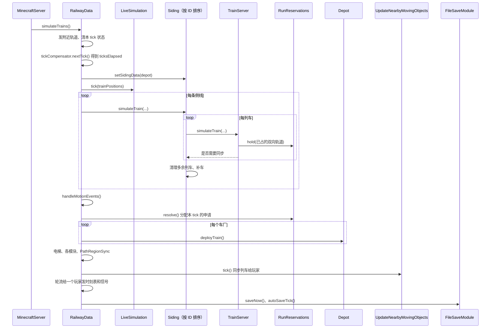

### 4.2 侧线：`Siding.simulateTrain`

1. 侧线没有所属车厂（`depot == null`）就什么都不做。
2. **读档后第 2 个 tick**：不由组件模拟器接管的侧线，把需要对齐的列车（`needsAlignment`）按位置从前到后 `alignToTimetable`，放到时刻表上它此刻该在的位置，再全部标记同步。要等第 2 个 tick 是因为所有侧线跑过一次之后列车位置和车厂的线路才都知道。
3. **逐列车**：
   - 手动驾驶的列车先由 `RailwayDataDriveTrainModule.drive` 处理按键。
   - 给列车设好停站时间（`setStopTimes`）、速度曲线（`setSpeedCurve`）、上一 tick 的站台时刻表，然后 `train.simulateTrain(...)`（见 4.3），返回 true 表示要同步给客户端。
   - 取走列车的运动事件（`drainMotionEvents`）。
   - 非连续运动的列车把自己占的轨道写进 `trainPositions` 并占用信号区段（`writeTrainPositions`）。
4. **清理和补车**（组件模拟器接管的侧线跳过这一步）：
   - 车厂里（不在线上）的列车只留一列，多的删掉；两列车位置（`railProgress` 取到 0.1 格）完全相同时删掉后一列。
   - 有列车还在侧线附近（`closeToDepot`）就不补车。
   - 回到车池里另一条存车线的列车（`takeReturnedElsewhereSiding`，见 4.6 的回库）从这条侧线清掉，并在目标存车线上记一列"待到"（`Siding.pendingArrivals`），那条存车线下一次补车时先补这一列，不受车池计数限制（只看自己的上限）。目标可以是同一运营线路别的车厂的存车线。
   - 需要时新建一列 `TrainServer` 放在侧线上：
     - 按运用跑的车厂（`depot.getRunDuties() != null`，用时刻表的车厂都是）：按**车池**计数。车池是同一车厂里车型和编组都相同的存车线（`Siding.getPoolKey`），每个 tick 开始时 `RailwayData` 重新分组（`Depot.clearPools`、`addToPool`）。按运营线路排运用的车厂，计数用**线路车池**（`Depot.getLinePool`）：本车厂的车池加上同一规划单元里别的车厂同键的存车线；每条存车线的槽位按它自己车厂的运用算，列车数加上"待到"的。侧线没有车时补一列；否则车池的车少于车池的槽位数（`Depot.getPoolTrains`、`getPoolSlots`）、这条侧线也没到自己的上限（`getTrainLimit`）时才补。
     - 其余车厂按"无限列车"或最大列车数。
     - 不限数量或最大数大于 0 时列车 ID 随机，否则用侧线 ID。
     - 组件模拟器（`TickRunner.SidingRun.tick`）用同样的规则。

### 4.3 一列车：`TrainServer.simulateTrain` 和 `Train.simulateTrain`

`TrainServer.simulateTrain` 的顺序：

1. 记下旧状态（下一停车点、乘客数、手动、是否停着、门），用来最后判断要不要同步。
2. **移动**：
   - 组件模拟器接管时（`simulated != null`）：`showSimulated` 把模拟器里那列车的位置和状态抄过来，再调 `Train.simulateTrain` 只做车厢、乘客、开门这些要世界的事。
   - 否则：`service.updateOvernight()`（跨天的班次处理），`Train.simulateTrain` 按规则移动，`holdRun()` 更新自己在走行预约里占着的轨道（4.5），`service.update(isOnRoute)`。
3. **站台时刻表**：沿 `timeSegments`（生成路径时按速度算好的每段轨道的时间）往前推算这列车到后面每个站台的时间，取"推算时间"和"计划到达时间"中较晚的一个，写进 `schedulesForPlatform`。环线跑完一圈后接着推第二圈。
4. **手动和自动切换**：允许手动的列车在车厂里总是手动；上线后手动操作冷却够 `manualToAutomaticTime` 就转回自动，并按门的状态补算已停时间。
5. 返回是否需要同步：走行段版本变了、有乘客下车、下一停车点变了、手动状态变了、从停着变成走、门的目标变了，任一成立就同步。

`Train.simulateTrain(world, ticksElapsed, depot)` 是服务端和客户端共用的部分：

1. **算运动**，三选一：
   - `movedBySimulator`：模拟器已经移动过，只取停站时间。
   - `followSegment`：客户端按服务端发来的走行段走（速度曲线列车，G2）。
   - 否则按 `mtr_motion.json`：`LegacyTrainMotion.tick`（旧规则）或 `TrainMotion.tick`（组件规则，见下）。返回 -1 表示已经在路径末尾，不再处理。
2. **算车厢端点**：`positions[0..trainCars]`，第 i 个端点在路径上的进度是 `railProgress - i × spacing`（反向时倒过来），用 `Rail.getPosition` 求出坐标，再加上运输方式的轨道高度 `railOffset`。
3. **`handlePositions`**（服务端）：
   - 列车包围盒外扩 128 格内的玩家或正在坐车的玩家，记进 `trainsInPlayerRange`，用来决定同步给谁。
   - 车头下方要检查的方块：列车红石感应器、货物装卸器（和相邻容器交换物品）、报站器（对车上乘客报站）。只查已加载的区块。
   - 附近没有玩家时返回 false，后面不再逐车厢处理。
4. **逐车厢 `calculateCar`**：车厢中心取两端点的平均再加 1 格高；`yaw = atan2(Δx, Δz)`，`pitch = asin(Δy / 车厢实际长度)`；左右各扫一次门旁边的方块（`scanDoors`），有站台或屏蔽门且门在开才算这一侧开门。结果交给子类的 `simulateCar`：服务端处理乘客上下车和座位，客户端画车（第 5 节）。

**活动图**（`Train.simulateTrain`）：

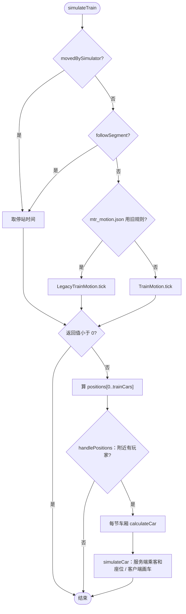

### 4.4 组件的运动规则：`TrainMotion.tick`

在 `transit-sim` 的 `transitsim.motion`，不依赖 Minecraft。`Train` 把自己实现成 `MotionState`（速度、位置、门、下一停车点）、`MotionTrack`（路径和每段的累计距离）、`MotionVehicle`（车厢数、间距、加减速度）、`MotionHooks`（能否发车、轨道是否被占、开门、到站回调）交进去。

- **在车厂里**（`!isOnRoute`）：位置固定在侧线中间，速度 0。自动列车 `canDeploy()` 为真（车厂允许发车，按运用的还要拿到出库走行），或手动列车推了牵引，就 `startUp` 上线，发 `DEPARTED` 事件。
- **到路径末尾**且不留在线上：回库，清乘客，发 `RETURNED`。
- **停着**：
  - 前方一段轨道（车头所在段 +1，掉头时 +2）被占就算 blocked。
  - 环线到了重复点就跳回重复起点（掉头的环线同时反向），发 `LAP`。
  - 刚停下时调 `onStopReached`（扣车、到站记录在这里）。
  - 已停时间累加，但到"总停站时间 - 关门 64 tick - 延迟 20 tick"之后，如果被扣车或前方被占就不再累加，门保持开着。
  - 服务端停够时间、前方不占、（手动时推了牵引）就 `startUp` 出发。
- **走着**（服务端）：
  - 制动距离 = `v² / 2a`（用速度曲线的列车用减速度）+ 本 tick 走的距离 + 2 格余量。在制动距离内找第一段被占的轨道，找到就把停车点设在它前一段；否则停车点是下一个站台。
  - 速度：用速度曲线的列车服务端按走行段（`followRunSegment`）、客户端按速度曲线（`followSpeedCurve`）；不用曲线的，进入制动距离且必须停就按匀减速降速，否则向这段轨道的限速加速或减速（加速度 × 经过的 tick）。手动列车按档位加减速，不超过手动最高速度。
  - 前进 `速度 × ticksElapsed`（或曲线给出的距离）；越过停车点时，必须停就停在停车点上并发 `STOPPED`，不停的站（通过站）发 `PASSED` 继续走。
- **门**：门的值每 tick 变化 `ticksElapsed / 64`，开着或在动时不允许牵引。

旧规则 `LegacyTrainMotion` 是改造前的同一套流程，留着对比用。

**状态图**（`TrainMotion.tick` 里列车的状态）：

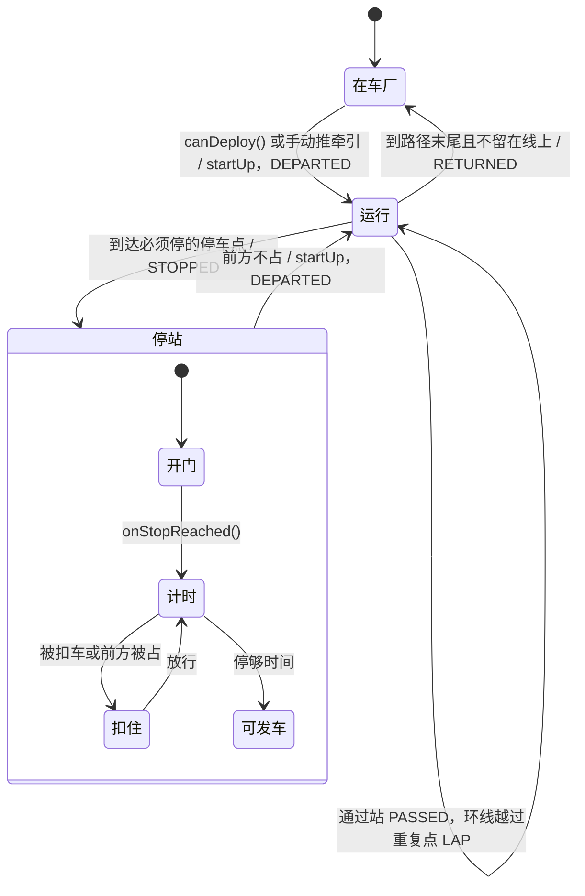

### 4.5 单线走行预约：`RunReservations`

在组件的 `transitsim.sim`，防止按运用运行的列车在单线上对向相遇。

- 只管"双向轨道"：反方向也有轨道的那一段（`getRunMoves` 用 `rails.get(end).get(start)` 判断）。同向的列车由信号区段管，不在这里互相等。
- **持有**：在线、自动、按运用运行的列车，每 tick 调 `hold`，持有从车尾到"本段走行终点"之间所有双向轨道（带方向）。车尾离开一段轨道才放掉；回库、手动或不按运用的列车 `release` 全部放掉。没有再调 `hold` 的列车在 tick 结束时自动放掉。
- **申请**：准备离站的列车 `request` 下一段走行的轨道，带计划发车时间。`resolve` 在 tick 结束后统一分配，顺序固定：已等了 `AGING_MILLIS` 以上的按等待时间最长的优先，其余按计划发车时间，再按列车 ID。有等太久的申请没能满足时，还没进入那段轨道的反向列车也不放进去，避免一直被对向车流挡住。
- 下一 tick 列车 `takeGrant` 拿到结果才发车（`isRunGranted`）；出库也一样要先拿到走行。

**时序图**：

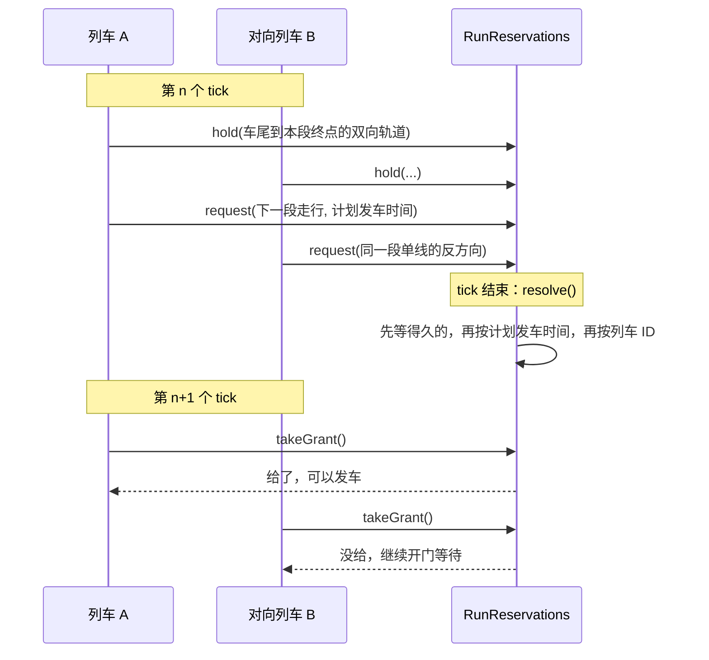

#### 咽喉进路锁（L2，`ThroatLocks`）

和单线预约用同一个 `RunReservations`：`Move` 可以是一个道岔（节点和经过方式，`Move.turnout`），在仲裁器里是道岔资源，同一方式共用、方式不同互斥。每列按运用运行的车有一个 `ThroatLocks`（路径变了重建），由宿主（游戏的 `TrainServer`、组件的 `TickRunner.HeadlessTrain`）这样用：

- **离站**（`isRunGranted`）：申请的走行里加上这一站出站进路的道岔（`getExit`）和已经持有、车尾还没过的道岔（`getHeld`），给了以后 `onGranted` 记下。
- **每 tick**（`holdRun`）：不在等离站时调 `approach`：下一站进站进路还没给、车头离停车点（驶入咽喉那段轨道的起点）不超过制动距离加 32 格，就带上已持有的一起申请；然后持有单线加 `getHeld`。
- **轨道被占**（`isRailBlocked`）：`isBlocked` 为真时那段轨道算被占，运动规则让车停在它前面。
- 节点相交的轨道数：游戏按轨道表，组件按所有存车线路径的轨道（没有路径用的轨道挡不着谁）。开关 `ThroatLocks.enabled`，由 `SecurityConfig.throatLocks` 设。
- 新旧隔离：车厂列车走的轨道（存车线路径和运用路径的节点）连成网（`transitsim.network.LockNetworks`），一张网上同时有按运用的车厂和不按运用的车厂（按频率发车等）时，这张网上按运用的车不锁咽喉。游戏由 `RailwayData.updateLockNetworks` 每 100 tick 重算（`isThroatLocksOff`，变化时写日志），组件在 `SimDataset.buildRunner` 设 `DepotBoard.throatLocksAllowed`，网页编辑器数据里车厂带 `oldLogic` 和 `throatLocksOffBy`。没有运用、也不会发车的车厂（没有线路，或按实时时刻没有发车时刻、按频率各小时都是 0，例如刚新建的）带 `notConfigured`，网页显示"未配置"而不是"旧逻辑"；它没有路径时也不和别的车厂连成网。
- **联锁区**（MTM_Logic 0.10.0）：联锁色（`SecurityConfig.interlockColor`，默认品红）的信号闭塞分区是整块锁的联锁区。
  - 游戏用 `SignalBlocks.getZones(颜色)` 得到"轨道 → 分区 ID"表，信号闭塞版本或颜色变了才重建，给出的表不再改动，所以别的线程也能用。客户端用 `ClientData.SIGNAL_BLOCKS` 和随 `PACKET_EDIT_PERMISSION` 发来的 `ClientData.interlockColor` 算同样的表（`ClientThroats`）。
  - `ThroatRoutes.of` 多一个轨道到区的查询：走进站、出站进路时，经过的轨道在区里就记下这个区（`Item.zone`，`index` 是进区的第一条轨道，`endIndex` 是出区后的那条），并像道岔一样清零"64 格没有道岔"的计数。区对区同 ID 就冲突，不分方式；区和道岔不冲突。`getPlace` 给出显示用的节点（道岔的节点，或进区的节点）。
  - `RunReservations.Move.zone(id)` 在仲裁器里是 `Kind.TRACK`，一次只给一列车。`ThroatLocks` 按 `endIndex` 放开（车尾离开区的最后一条轨道），`granted` 按 `index * 2 + 是否区` 记，道岔和区从同一个节点开始也不互相覆盖。`TrainServer` 在区的表换了时重建 `ThroatLocks`。
  - 时刻表检查 `checkThroats` 按"道岔节点"或"区"分组（`useKey`），冲突的位置用 `getPlace`。网页的咽喉提示另写联锁区个数（`EditorData` 的 `throat.zones`），交叉列表里区的冲突写"在联锁区"。
  - 组件：`SimDataset` 格式 10 在每个信号闭塞分区后带"是联锁区"（`interlockBlocks`，`SimExport` 从 `SignalBlocks.getInterlockFlags` 填），`TickRunner.setInterlockZones` 给区编号（在列表里的位置加 1）。
  - 联锁区仍是普通的信号闭塞，占用照旧；按频率和手动驾驶的车不办进路。
- **闭塞区段**（MTM_Logic 0.11.0，`transitsim.network.BlockSections`）：没涂色的长轨道切成区段，占用、追踪停车和信号灯色都按区段。
  - **长度**：每条轨道按自己的限速算常用制动距离 `v²/(2a)`，`a` 是 `BlockSections.deceleration`（`SecurityConfig.blockDeceleration`，默认 1.0 m/s²），不小于 `minLength`（`blockMinLength`，默认 400 格，比大多数列车长，停着的车只占一两段）。
  - **轨道**：比区段长的平均切成 `ceil(长度/区段长)` 段，从节点小的那一端编号，第 0 段用轨道自己的键，其余段的键由轨道键和段号算出（`getPieceKey`）。不能加速的轨道（站台、存车线、折返线）不切：宿主传限速 -1（组件 `TickRunner.cutSpeed`，游戏 `TrainServer.cutSpeed`）。
  - **分区不切**（用户 2026-11-05 定）：玩家涂的信号闭塞分区不论多长都整块是一个区段，里面长轨道的每一段都算进去；一条轨道在几种颜色的分区里时取它们的并（`getSection`）。原来计划超长分区也切，yel 实测切开后两列车会各占一段、互相挡住（占用死锁，仲裁器看不到），2 小时少 5%–20% 的到站，所以改成不切。游戏由 `SignalBlocks.updateSections` 在每 tick 列车跑之前、分区变了时重算（轨道长度和限速来自 `RailwayData.railInfo`）；组件在 `TickRunner.getBlockSections` 用存车线和运用路径上的轨道算。
  - **占用**：列车占它车身覆盖的每个区段（`getCoveredUnits`：整条轨道的键，或长轨道上覆盖到的段），再带上所在分区区段的其余部分（游戏 `SignalBlocks.occupy(轨道, 区段, …)`，组件 `writePositions`）。一条轨道"被占"是它有任何一段被别的车占着。
  - **停车**：运动内核多一个钩子 `MotionHooks.getSectionBlockedPosition(轨道, 位置)`，给出这条轨道上从这个位置往前第一个被别人占的区段的起点，默认没有。`TrainMotion.tick` 先看车头所在轨道往前的区段，再看前方被占的轨道：被占的区段从轨道中间开始时，车停在区段起点（`sectionStop`，越过时拉回并停下），否则照旧停在前一条轨道的终点。停着的车只要下一条轨道开头的那段空着就能起动（`isTakenAtStart`），车头前方 1 格内的区段被占时不起动（`isSectionTakenJustAhead`）。没有切开的轨道行为不变。
  - **查卡车**：日跑工具加 `-Pmtr.debugStuck=true`，跑完列出停在两站之间的车、车头所在轨道的段数、前方是否被占和挡住它的车。`-Pmtr.blockMinLength=1000000` 相当于不切，用来对比。
  - **跳 tick**：`getMovingQuietTicks` 的边界加上车头、车尾所在轨道的下一个区段起点（`getNextSectionStart`），车头所在轨道前方有被占区段时不跳；`Standing` 判断被挡和运动内核一样。
  - **客户端**：服务端同步时发所有分区的占用标记（不再只发附近的）和全网被占的区段，每个写成"轨道键 + 第几段"（`SignalBlocks.getPiece`），客户端存进 `ClientData.OCCUPIED_SECTIONS`。信号灯色由 `SignalAspects.getAspect` 算：从信号机的节点沿朝向走客户端有的轨道，按同样的切法数区段，第 j 个区段被占就是第 j 档（1 红）；道岔后每一支都看，取最限制的；地图上有、客户端没有的轨道按被占。客户端按它知道的轨道长度切，远处轨道长度不知道时区段数可能和服务端不同，只会让灯色更限制。铁路检查对切开的轨道写出段数、每段多长和哪几段被占（`gui.mtr.rail_sections`）。
- 卡死：仲裁器发现列车在单线或道岔上互相等成一圈时，冻住相关资源、每圈报一次。游戏每 tick 给出预约（`RailwayData` 里 `runReservations.resolve`）之后取出这些报告，在服务端日志写一行 `Minecraft Transit Railway: trains waiting on each other for their runs [列车…]`。以前只有组件的模拟器读它们，按速度曲线跑的车厂和模拟器共用预约，报告被模拟器取走后就丢了，服务端日志看不到。

### 4.6 车厂发车：`Depot.deployTrain`

- 组件模拟器接管的车厂直接返回，由模拟器发车。
- **按运用**：用时刻表的车厂一律按运用跑（`getRunDuties`：设了运用用自己的，否则用寻路时按时刻表自动生成的 `autoDuties`，见 9.4）。车厂只负责放车，车出库后带着自己的运用跑（`duty_day`）。`Depot.deployDutyTrain` → `DepotDispatcher.findDutyDeploy`：
  - **什么时候放**：运用首班的时刻减去出库用时（存车线到首站的最快时间）再减 15 秒。每 tick 最多放一列，准点的先放，同样准点时最早到点的先放。放了就记下这一天这个槽位已经跑过（`dutyRunDays`，按"槽位所属的存车线:槽位"）。
  - **出库间隔**：车厂设了 `releaseInterval`（秒，游戏的车厂界面）时，两次放车至少隔这么久；被压住的车不算晚点。
  - **出库进路**：车要先拿到出库线到首站的进路（`TrainServer.canDeploy` 里的 `isRunGranted(1)`，含正线方向预约，计划发车时刻作优先级）才算准备好，拿不到就在库里等。
  - **晚了**：错过超过 `MAX_DEPLOY_DELAY`（10 分钟）、运用还没跑完（或留线过夜）时照样放（`DutyDeploy.late`），放出后 `joinDutyLate` 把车放到运用里还赶得上的第一站，只放在站上。
  - **车池替补**：槽位自己的存车线没有准备好的车时，由同一车池里另一条有车、也有这个运用路径的存车线放车（`pools` 参数）。`DutyDeploy.dutySidingId` 记下槽位属于哪条存车线，车存成 `duty_siding`，过夜接班和"今天已跑"都按它算。
  - **回库**：车在运用最后一站准备回库时选一次去哪（`TrainService.chooseDutyReturn` → `Depot.chooseReturnSiding` → `DepotDispatcher.chooseReturnSiding`）：在还有空位（自己的车加上正赶去的车、待到的车少于上限）的**线路车池**存车线里，选今天下一个还没出库的运用最早的那条，没有就回自己的。线路车池见 4.2，可以是同一运营线路别的车厂的存车线；每条候选的槽位和"今天跑过没有"按它自己车厂读（`DepotDispatcher.chooseReturnSiding` 的静态重载，参数 `slotsOf`、`DutyRuns`）。换到同一运用、终点不同的路径（键 `<运用键>#<存车线>`，`TripPath.getReturnSidingId` 从键读出存车线）。进了别的存车线，原存车线清掉它，那条存车线补一列（4.2）。
    - （0.18.0，P1-B）候选只算这份运用有回库路径的存车线（`Board.chooseReturnSiding(sidingId, depotId, canGoBack)`，`canGoBack` 由 `TrainService` 查 `tripPaths` 里有没有 `<运用键>#<存车线>`），不再选中回不去的再退回原处。回送指令的车厂 D 没有同车型、有空位又有路的存车线时，车仍按平常回库（车总得回到某处），但写日志并记进 `Depot.returnOrderMisses`（模拟器是 `DepotBoard.returnOrderMisses`），网页"同步状态"提示。
  - **过夜接不上：停在原地等处理**（0.18.0，P1-C）：`TrainService.updateOvernight` 找不到第二天从所在站台出发、还没跑过的运用时，不再 `returnToDepot()`（车从站台消失回到存车线），而是记下原因（`HoldReason`：`NO_DUTY` / `OTHER_PLATFORM` / `ALREADY_RUN`，只在原因变了时写一次日志），车停在原地；之后每次更新都再查，有了合适的运用就接着跑。`RailwayData` 每 100 tick 收集各车厂停着的车（`HeldTrains.collect` → `Siding.forEachHeldTrain`）和回送指令没能执行的记录，有变化（或每分钟一次，只要还有）就发 `PACKET_HELD_TRAINS`；客户端存进 `Depot.clientHeldTrains`、`returnOrderMisses`，`EditorData` 放进车厂的 `held`、`returnMisses`。网页"同步状态"对每列停着的车给"直接收回"，发 `recall` 操作 → `PACKET_RECALL_TRAIN`（`HeldTrains.receiveRecallC2S`，要编辑权限）→ `Siding.recallHeldTrain` → `TrainService.recallHeld`，日志写是谁收回的。停着的状态不存档，读档后会重新查一遍。
  - **回送指令**：运用最后一段的班次在时刻表里设了回送车厂（`RouteTimetable.returnOrders`，见 9.4），就改用 `Board.chooseReturnSiding(sidingId, depotId)`：只在那个车厂同车型、编组、有空位的存车线里选（下一班最早要车的），那个车厂没有合适的存车线时照上面自动选。车厂寻路时把这些车厂的存车线也算进回库变体（`Depot.generateMainRoute` 的 `lineSidings`）。
- **共用线路的车厂**：按运用跑时车不预约班次。自动运用生成前先让出共用线路的其他车厂已在跑的班次（`Depot.getSharedTaken`：它们自己设的运用，以及 ID 更小的车厂的自动运用），见 9.4。下面"共享班次"那一段只对按频率、按时刻表在线预约的车厂起作用。
- **按时刻表或频率**：本 tick 请求发车的侧线（列车在 `canDeploy` 里调 `requestDeploy`，只有出库的第一段轨道没被占才请求）按侧线顺序从 `deployIndex` 开始轮流找：
  - 有时刻表的线路：`findDeployService` 找下一个还没发出的班次，找到就记下这个班次（`lastDeployedTrips`、`reserveTrip`）并 `deployTrain(班次时间, 线路)`。
  - 没有时刻表：到了发车间隔（`getMillisUntilDeploy(1) == 0`）就 `deployTrain()`。
  - 每 tick 最多发一列，发完 `deployIndex` 往后移，下次从下一条侧线开始，保证各侧线轮流。
- 发不出去的列车不排队，跳过这个班次，时刻表不会越积越晚。
- **共用线路的车厂共享班次**（`a1ed043`）：`DataCache.sync()` 时先 `clearSharedServices()`，再把每两个 `routeIds` 有交集的车厂互相 `shareServicesWith`（各自的 `DepotDispatcher` 记为 peer）。之后：
  - 判断某个班次是否已被占（`isReserved`）时，自己和所有 peer 的预留都算。
  - `getLastDeployedTrip(线路)` 取自己和 peer 最后发出班次中最晚的一个，所以比它早的班次两边都不会再发。
  - 结果：两个车厂按同一张时刻表跑同一条线路时，每个班次只由一列车跑。一个车厂占用或放掉班次，也会唤醒另一个车厂里等着的列车。组件的模拟器里做法相同（同一个数据集里共用线路的 `DepotBoard` 互相连接），由 `SharedServicesTest` 检查。

### 4.7 列车同步到客户端：`UpdateNearbyMovingObjects.tick`

每个玩家记着上一 tick 范围内有哪些列车（`dataSetInPlayerRange`）和本 tick 的（`newDataSetInPlayerRange`，由 `handlePositions` 填）。

1. 有列车离开某玩家范围（或被删除），给他发一个 `PACKET_DELETE_TRAINS`，内容是**还要保留**的列车 ID 列表；客户端把不在列表里的列车标为 `isRemoved`，下一帧移除。
2. 对范围内要同步的列车（本 tick `simulateTrain` 返回 true，或刚进入范围）：
   - 玩家已经有这列车，且路径没变（`getSyncKey` 相同）：只发状态包（`writeStatePacket`，G2），合并到 `PACKET_UPDATE_TRAIN_STATES`。
   - 否则发完整数据（`writePacket`，含整条路径），记下 sync key。
3. 完整数据按 1 MB 一个包拼起来发 `PACKET_UPDATE_TRAINS`；单列车超过 1 MB 的不发。

客户端在网络线程读包、在主线程（`client.execute`）改数据：`updateTrains` 新的列车加进 `ClientData.TRAINS`，已有的 `copyFromTrain`；`updateTrainStates` 对已有列车 `applyState`。两次更新之间客户端用同样的运动规则自己推算位置。

**时序图**：

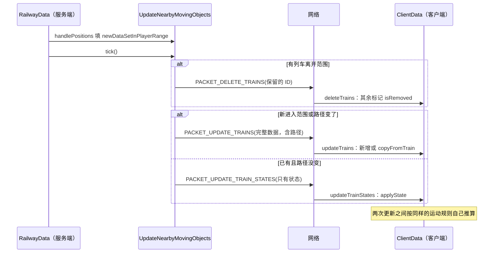

### 4.8 组件模拟器接管：`LiveSimulation`

由 `mtr_motion.json` 的 `componentDrive` 决定：关（0）、对比（1）、开（2）；用旧规则时总是关。

- **能接管的车厂**：用速度曲线、不是连续运动的车厂（按时刻表、运用或频率都可以）。别的车厂的列车作为外部列车告诉模拟器。
- **启动**：等读档后侧线都知道所属车厂、列车都已对齐（`hasSettled`）才第一次启动，从游戏里列车的当前位置开始。没有能接管的侧线时每秒重试一次。
- **开**：模拟器每 tick 推进到当前时间，游戏里这些侧线的列车只显示模拟器的列车（`setSimulated`），自己做车厢、乘客、开门、占轨道和信号。轨道或计划变了（编辑后等 2 秒再看，或每 5 分钟检查一次），或服务器停了超过恢复时间，就从游戏列车的当前位置重新启动。模拟器的列车同样在游戏的 `RunReservations` 里持有和申请走行，和游戏自己的列车互相等待。
- **对比**：模拟器在旁边独立跑，游戏照常移动所有列车；每 60 秒在日志里报两边差多远（1 格内算一致），然后从游戏列车重新开始。
- **手动驾驶**：手动的列车由模拟器交给游戏（`TakeOver`），回到自动时把位置和速度还给模拟器（`Release`）。
- **出错**：任何异常都不会打断游戏的 tick；模拟器关掉，直到设置被改，游戏从模拟器留下的位置接着跑。

#### 按时刻表就位（`placeByTimetable`，协议 42）

模拟器接管的车厂本来只能一列一列发车，白天才应用的时刻表要几个小时才能把线路排满。现在可以让车厂的列车直接出现在时刻表此刻安排的位置：

1. **发起**：在网页编辑器里右键车厂 → `EditorServer` → `PacketTrainDataGuiClient.placeTrainsC2S(depotId)` 发 `PACKET_PLACE_TRAINS`。服务端 `receivePlaceTrainsC2S` 在主线程上检查权限，调 `RailwayData.placeTrainsByTimetable` → `LiveSimulation.placeByTimetable`。
2. **检查**：模拟器必须正在**接管**这个车厂，否则在聊天栏提示"不是组件运行的车厂"；上一次就位还没算完时提示"正在计算"。
3. **选车厂**：从这个车厂开始反复扩展，把和已选车厂共用线路的车厂都加进来，直到不再增加。共用线路的车厂跑同一条线和同一张时刻表，分开算会把列车叠在一起。
4. **准备数据**（主线程）：复制模拟器的数据集，去掉列车，只留选中车厂的侧线，序列化成字节。聊天栏提示正在计算哪些车厂。
5. **计算**（主线程，下一个 tick 里 `LiveSimulation` 重新 `start` 时，`Placement.takeInto`）：
   - **车厂都按运用跑时**（用时刻表的车厂都是）：用这份数据建一个 `TickRunner`，`placeDutyTrains` 给此刻在外的每个运用放一列车，直接放到运用此刻的位置（在站就在站，在区间按最快曲线拉伸到计划运行时间算出位置和速度，`TrainService.placeOnRun`），不用从运营日开始推演，几毫秒就算完。
   - **否则**（还有按频率跑的车厂）：从运营日开始（`DutyShapes.getDayStart`）建一个 `EventSimulator`，按组件的规则推进到当前时间。
6. **接回**：拍下当前列车的记录后：
   - 从记录里删掉这些侧线上的列车，**玩家正在手动驾驶的除外**，换上算出来的列车。
   - 这些侧线已发出的班次、运用已跑过的日期、最后发车时间、发车轮转位置也一起换掉，已经发出的班次不会再发一遍。
   - 模拟器从这份记录启动，聊天栏报告每个车厂现在有几列车；计算失败也会提示。

**时序图**：

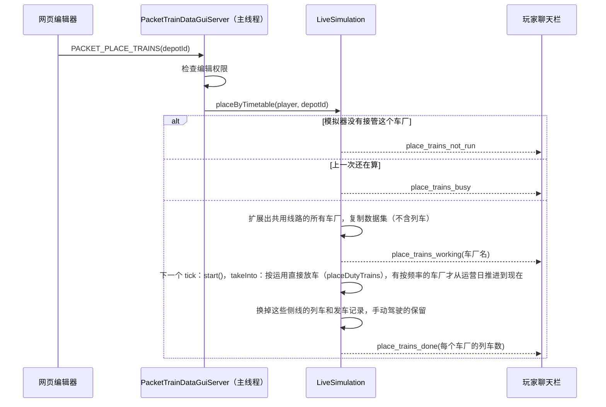

**状态图**（`componentDrive` 和模拟器）：

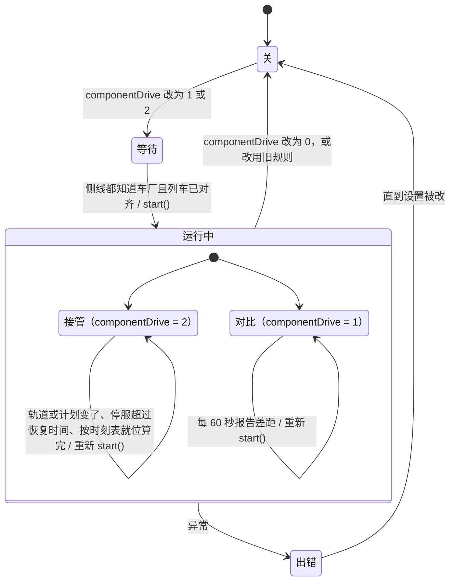

## 5. 客户端每帧（画列车）

### 5.1 谁触发绘制

列车不是实体，没有自己的渲染器。`RenderTrains` 注册成座位实体 `EntitySeat` 的渲染器，借它每帧被调用：

- 有座位实体时，第一个被画的座位触发 `RenderTrains.render(entity, ...)`，记下它的 UUID（`renderedUuid`），同一帧其他座位直接返回。
- 没有座位实体时，Fabric 的 `MTRFabricClient`（世界渲染事件）和 Forge 的 `LevelRendererMixin` 调 `render(null, ...)` 作为后备。
- 装了 Pehkui 时只走后备路径。

### 5.2 `RenderTrains.render` 的步骤

1. **帧时长**：暂停或本游戏 tick 已经画过时为 0（列车不动），否则是上一帧时长（以 tick 计）。
2. **列车可见距离**：开了动态帧率时，帧时长大于 0.5 tick 就把最大距离往 `DETAIL_RADIUS`（32 格）收一半，小于 0.4 就加 1；否则固定为渲染距离 × (`trainRenderDistanceRatio` + 1)。
3. `TrainRendererBase.setupStaticInfo`：保存本帧的相机、世界、矩阵、缓冲区。
4. **不透明批次**（`setBatch(false)`）：`ClientData.TRAINS` 每列车 `train.simulateTrain(world, 帧时长, ...)`，回调里显示速度或站名提示、播报站。
5. **半透明批次**（`setBatch(true)`）：重放各车厢记下的半透明绘制（`trainTranslucentRenders`）。
6. 画电梯、轨道和节点，最后按贴图分批提交（`scheduleRender`）。

**时序图**：

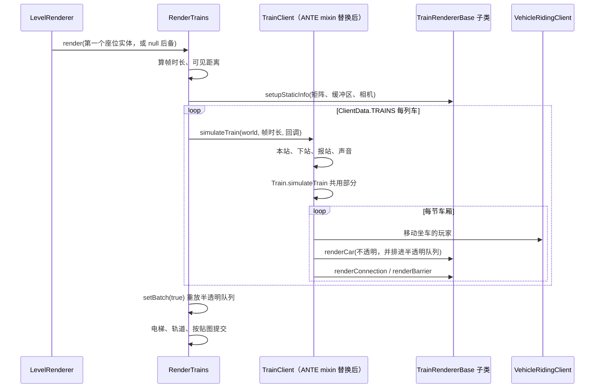

**坐标约定**（`27d96cf` 起）：渲染矩阵以摄像机为原点，避免离世界原点很远时浮点精度不够、列车抖动。`renderCar` 等拿到的 x、y、z 是**世界坐标**，渲染器要用 `TrainRendererBase.translateToWorld(viewOffset, x, y, z)` 平移（没有视角偏移时减去摄像机位置），不能直接 `matrices.translate(x, y, z)`。ANTE 合并进来时它的列车渲染器（DK3、D51、脚本车型）还是直接平移，车被画到了别处，`91bb3a1` 改正。ANTE 的 3D 铁轨在 `RenderTrainsMixin.renderTail` 里先减去摄像机位置，再按世界坐标画。

### 5.3 一列车：`TrainClient`

- 带 ANTE 时 `TrainClientMixin` 替换 `TrainClient.simulateTrain`：先清掉上一帧的半透明队列，按当前停站算出本站、下站、终点站和线路，处理报站和声音，再调 `Train.simulateTrain(world, 帧时长, null)`（4.3 的共用部分，客户端不检查方块），最后取消原方法。
- `TrainClient.simulateCar`（每节车厢）：
  - `vehicleRidingClient` 移动坐车的玩家，算出视角偏移。
  - `trainRenderer.renderCar(...)` 马上画不透明部分，同时把同一调用加进半透明队列。
  - 有前一节车厢时按两节车厢的四个角算出连接处，`renderConnection` 画风挡，或 `renderBarrier` 画护栏。

### 5.4 车厢：`JonModelTrainRenderer.renderCar`

1. 先保存两端点中心（`endsX/Y/Z`，转向架贴轨道时从这里算）。
2. 资源包定义了自定义转向架、又不是雅可比转向架时，`getPlacementOnBogies` 按 MTR 4 的方式由两个转向架的位置重新算车体的位置、yaw、pitch。
3. 半透明批次且没有模型就返回；`applyAverageTransform` 判断超出可见距离也返回。
4. 平移到车厢位置，`rotateY(π + yaw)`、`rotateX(π + pitch)`（运输方式不允许俯仰时 pitch 取 0）。ANTE 的 `JonModelTrainRendererMixin` 在第一次 `rotateX` 处插入车身侧倾。
5. 光照取车厢中心方块的方块光和天空光。
6. 画模型：
   - 没有模型时画原版矿车或船。
   - 有模型时，距相机 32 格（`DETAIL_RADIUS`）内或 Replay Mod 下画细节（内饰、门、灯）。
7. 转向架：
   - 自定义转向架：近处的车厢在车体画完后按轨道放（`renderBogieOnTrack`，各自取转向架前后 ±1 格的轨道点定方向）；远处的固定在车体上（`renderBogieOnBody`）。
   - 内置转向架：设置里开了"沿轨道转向"、在细节距离内、不是雅可比转向架时同样按轨道放；否则在 ±`bogiePosition` 处固定在车体上；雅可比转向架只在首尾车厢的端部画。
8. 缆车另外画抓索器。

### 5.5 脚本车型：`ScriptedTrainRenderer.renderCar`

1. 有基础车型（`baseRenderer`）时先照常画它。
2. 半透明批次直接返回。
3. 算出车厢的位姿矩阵（`translateToWorld` 平移到车厢位置，再加乘客视角偏移、yaw、pitch、侧倾），连同左右门状态写进 `TrainWrapper`（脚本里的 `train` 对象），给脚本读。交给脚本的 `worldPose` 是世界原点的矩阵（`translateToWorld(viewOffset, 0, 0, 0)`），脚本按世界坐标画的东西照旧在原位。
4. 把脚本**上一次** `render` 提交的模型按这个位姿画出来（`commitCar`）。
5. 最后一节车厢处理完后 `extraFinished`，并 `tryCallRenderFunctionAsync` 让脚本在脚本线程上算下一帧要画什么（第 10 节）。所以脚本画出来的东西比列车位置晚一帧。

## 6. 资源包加载（客户端）

资源重载时 `mtr.client.CustomResources.reload(manager)` 的顺序：

1. **[ANTE `CustomResourcesMixin` HEAD]**：检查 OpenGL 版本，保存 GL 状态，清空 ANTE 的模型和贴图图集（`CustomResources.reset`），预加载列车模型（`TrainModelPreloader`），开始延迟上传模型（`DeferredModelUpload.begin`）。
2. **清空**：`TrainClientRegistry.reset()`（只剩内置车型）、贴图可用性缓存、字体、自定义站牌。
3. **读 `mtr:mtr_custom_resources.json`**：`readResource` 读所有资源包里同名的文件（每个包一次）。带 ANTE 时 `readResource` 整个由 mixin 接管：`.obj` 或带 `|` 的路径不读文件，直接生成一个假的 bbmodel 数据交给回调；`.bbmodel` 文件在 JSON 里附上假数据；其余照常解析 JSON。
4. **每个车型**（`custom_trains` 里的每一项）：
   - 车型 ID 是 `mtr_custom_train_` 加键名；从 `base_train_type` 找基础车型，没写的属性都继承它（名称、描述、渲染器、声音、转向架……）。
   - 先读两个转向架（`readBogie`），再用 `getOrDefault` 读车厢贴图。顺序不能换：ANTE 的 mixin 会记住最近一次 `getOrDefault(texture_id)` 读到的贴图和是否翻转 V，用在接下来加载的 OBJ 或 bbmodel 上。
   - 声音：写了 `bve_sound_base_id` 用 BVE 声音，写了 `speed_sound_base_id` 用 MTR 声音，都没写跟随基础车型。
   - 有基础车型时，用基础车型的 Java 模型（换上门动画类型）注册一次。
   - 写了 `model` 和 `model_properties` 时，再读这两个文件：有 `parts_normal` 的是旧格式（`DynamicTrainModelLegacy`），否则 `DynamicTrainModel`；基础车型改为 `<运输方式>_<长度>_<宽度>`，用这个模型覆盖注册。
   - 单个车型出错只记日志；加载超过阈值的车型在日志里警告。
5. 读自定义站牌等。
6. **reload listeners**：依次调用注册过的监听器。ANTE 在 `MainClient.init` 里注册了 `cn.zbx1425.mtrsteamloco.CustomResources.init`，它在这里运行：重载装饰物（`EyeCandyRegistry`）、轨道模型（`RailModelRegistry`）、重置脚本线程（`ScriptHolderClient.resetRunner`）、加载脚本车型（`ScriptedCustomTrains.init`）、上传内置蒸汽机车的模型，并注册 ANTE 内置车型（DK3 等）。
7. **[ANTE mixin TAIL]**：结束延迟上传、清掉预加载的 OBJ、报告节省的共享几何内存、做一次完整 GC、报告各阶段耗时、重建列车的渲染和声音组件（`resetComponents`）；有加载错误时弹出错误界面；恢复 GL 状态。

**时序图**：

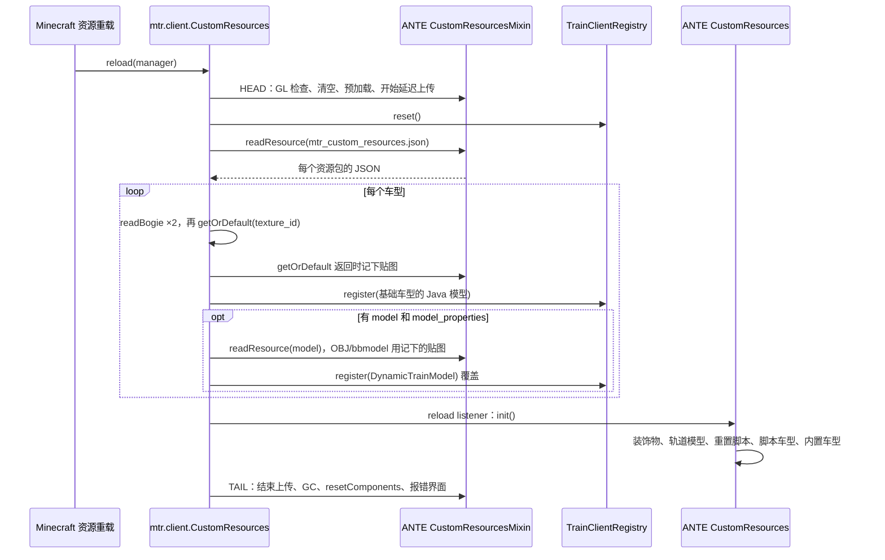

## 7. 存档

### 7.1 存在哪

| 内容 | 位置 | 格式 |
|---|---|---|
| 铁路数据 | 维度存档目录下的 `mtr.db` | SQLite，每类数据一张表，每个对象一行，值是 msgpack（`toBytes`：`messagePackLength` 写表头，`toMessagePack` 写内容） |
| 备份 | 同目录 `mtr-<时间>-base.db`、`mtr-<时间>-inc.db` | 每批一个完整备份加若干差异备份（`RailwayDataBackups`） |
| 地图缓存 | 客户端本地 SQLite | `MapCacheDatabase`、`MapDataCache`，服务端只发摘要不同的部分 |
| 服务端设置 | `config/mtr_security.json`、`mtr_motion.json`、时刻表设置、线路用语 | JSON，服务器启动时读 |
| 客户端设置 | MTR 的 `Config`、ANTE 的 `ClientConfig` | 设置界面保存时写 |

`RailwayDataFileStore.open` 打开数据库；它本身不引用 SQLite 的类，这样 SQLite 加载失败时能在这里处理。

### 7.2 读档

`RailwayDataFileSaveModule.load()` 读出每张表，逐行还原对象。读不出来的行跳过并计数（`skippedEntries`）：

- 有跳过的行时，本次运行期间不删除数据库里的任何行，读不出来的数据和依赖它的数据都原样保留。
- 读档开始了但没有读完（`loadStarted` 且 `!dataLoaded`）时，`autoSave` 什么都不写，避免内存里不完整的数据覆盖存档。

### 7.3 写档

有三条路径：

**活动图**：

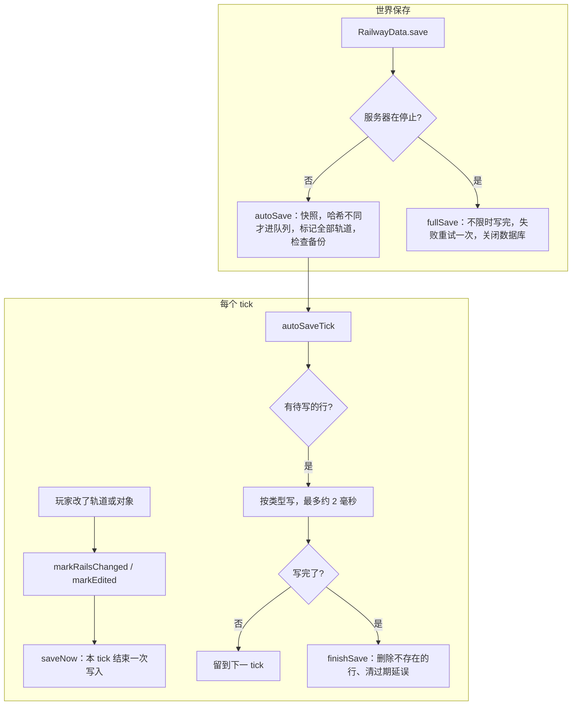

1. **本 tick 结束立即写**（`saveNow`，每 tick 调）：玩家刚改的轨道（`markRailsChanged`）和对象（`markObjectChanged`，由 `markEdited` 调），以及编辑版本号，一次写入。轨道改动因此不会因为服务器崩溃而丢失。
2. **自动存档**（世界保存时 `RailwayData.save` → `autoSave`）：
   - 在同一时刻给除轨道外的所有对象拍快照（`stage`），保证存下的数据彼此一致。
   - 每个对象序列化后算哈希，和数据库里已有的比，**只有变了的才进待写队列**。列车位置、车厂最后发出的班次也算在对象内容里，所以会每次更新。
   - 轨道数量多，不拍快照，标记全部轨道位置，之后每 tick 处理一点。
   - 同时检查要不要做备份（`dataStore.backup()`，在单独的线程里做）。
   - 之后每 tick `autoSaveTick` 按类型依次写，每次最多用约 2 毫秒，超时就留到下一 tick。全部写完后 `finishSave` 删除已经不存在的对象的行，清理过期的延误记录，在日志里报告改了几行、删了几行。
3. **停服完整存档**（服务器停止时 `fullSave`）：清空所有队列，`autoSave` 后不限时一口气写完；失败的话再试一次，还失败就在日志里明确报告丢失了哪些（轨道已经即时写过，不受影响），最后关闭数据库。

存档格式只能加内容，不能改已有的内容。

### 7.4 轨道段层（优化第一轮）

存档里最底层的多级结构（`MTR-优化实施阶段.md` 第一轮）：轨道在"发生事情的节点"切成轨道段，每段用内容的 64 位哈希当 ID，随轨道增量维护，按版本写进 `mtr.db`。

- **组件**：`transitsim.network.TrackSections`（切段、哈希、增量维护、读档核对修复）、`SpeedLimits`（限速两值：60 及以上物理 +5、计划按标的值；60 以下物理按标的值、计划 −5；这一轮只存不用）、`SignalOverlay`（每个轨道段上的信号区段切分和所属信号区段，规则同 `BlockSections`）。
- **切点**：分岔或尽头（连着的轨道不是两条）、关键节点、寻路边界节点、站台/存车线/折返线的两端（它们各自成段）；没有切点的环从最小的节点开始。
- **哈希**：节点序列，加每条轨道的长度、形状（两端朝向）、限速标的值、能否加速、类型、可走方向、站台或存车线，加两端的标记。碰撞时同一哈希下的几段按内容字节序排，第一段用原哈希，其余用"原哈希 + 序号"，所以哈希只取决于现有的段，与顺序无关。
- **游戏**：`advanced/GraphRecords` 持有这一层。`RailwayData` 每 40 tick 调 `GraphRecords.update`：先算轨道、关键节点、边界节点、站台和存车线位置的廉价指纹，变了才把全部轨道转成 `TrackSections.Rail`（`toTrackRails`，单向轨道按能走的方向取类型）交给 `TrackSections.sync`，它比对出增删、只重切受影响的段；轨道段或信号区段变了就重算信号层，只记下不同的项。第一次检查时用读档读出的段做 `TrackSections.restore`：和现有轨道对照，不一致的连同邻段重切并写日志，旧存档（没有这一层）全部生成。
- **写档**：保存循环之后、图数据自己的事务里，`GraphRecords.flush` 写一个新版本（`RailwayDataStore.publishTrackSections`）：新增的行（`added_in` = 新版本）、删掉的行只标 `removed_in`、信号层的增删，最后写根记录（`meta` 的 `track_version`、`track_fingerprint`、`track_count`）。提交成功（`flushCommitted`）后，下一次保存才真正删掉被标记的行（`sweepTrackSections`）；提交失败（`flushFailed`）就把这一版的增删放回待写。
- **读档**：`RailwayDataStore.loadTrackSections` 只读根记录发布的版本：`added_in` 大于它的行（没发布完的版本）删掉，`removed_in` 大于它的行恢复。
- 表：`track_sections (id, data, added_in, removed_in)`、`signal_overlay (id, data)`，都进备份。旧的 `graph_sections` 不再写；`graph_paths` 改为记轨道段哈希序列（`TrackSections.toSectionPath`），带这一层的指纹。`PathRegionSync` 不再压缩整张线网（原来只为写 `graph_sections`）。
- 64 份黄线（19,696 条轨道，7,738 个轨道段）：首次生成 205 ms，重启读回核对 124 ms（都只在开服时一次）；预热后每次有改动的检查约 17 ms（两万条轨道，`GraphRecordsTest`）。

### 7.5 站间段层和配属层（优化第二轮）

- **组件**：`TrackSections.snapshot()` 给出不可变的段图（节点 → 轨道段）；`LegRouter` 在段图上找一个站间段（从一个站台按一个方向出发，经过途经关键节点，到下一个站台的两个方向），规则同 `RailRouter`（过节点看两端朝向能否接续，折返线末端可以任意接，停站后可以立即折返、加罚分，经过别的站台加罚分），并记下搜索域：碰过的全部轨道段和展开过的节点；`RouteLegs.plan` 对每个站台的两个方向做动态规划拼出整条线路，用时和整条 `RailRouter` 相同；`LegCache` 按搜索域建反查索引，轨道段增删、在展开过的节点上接了新段、配属变化（只影响受配属约束的站间段）时丢掉相关站间段，旧版本快照上算出的站间段如果碰过之后改动的部分就不收；`TrackOwnership` 由寻路边界节点和边界轨道划区域，区域里有哪些线路组的站台就配属哪些，边界轨道属于两侧，联络线自己那一段只属于它，没有站台的区域谁都能走。
  - **搜索范围**（第四轮第 3 步前修的第二轮遗留问题）：以前要等终点两个方向都找到才收工，终点有一个方向到不了时会把整张线网搜完（64 份线网上 316 条线路站间段、全部出入库路都是这样，每条存档约 116 KB，读档时放回缓存要 60 秒以上，被看门狗停服）。现在：终点所在轨道段的某一端没有别的轨道段（线路尽头）时不找那个方向（`canEnter`）；存车线找到一个方向就收工；找到一个方向（代价 c）后，另一个方向只找到 c + 终点段代价 + 掉头罚分为止（`bound`，队列头的估计值超过它就停），因为再贵的话下一段从这一站掉头出发更便宜，DP 永远不会用它，所以找出的线路不变；这条只对允许起点掉头的请求。站间段格式 `VERSION` 3（多存 `turnAtStart`），旧版本的读档时丢掉，并按行号记进"已写入"表、值为空，下次写库时删掉（`GraphRecords.updateLegs`）。64 份线网：线路站间段 4474 条共 1.0 MB（原 50 MB），最大 739 字节，`mtm_version` 0.49.0；重启读回 4474 条在同一秒内完成，不再卡。
  - **出入库路**（第四轮第 3 步，先量后换）：`LegRouter.Request` 加 `turnAtStart`（出入库为 false，不在起点掉头）；`RouteLegs.planBetween(起点段, 出发方向或 null, 终点段, 到达方向或 null)`，出库到首站、回库离开末站都按线路在这个站台的运行方向（用户 2026-11-08 定：回送方向和运行方向一致）。宿主 `RoutePaths.measureDepotLeg` 用它找路并计时，暂不进缓存（`GraphRecords.Legs.withoutKeeping`）；`-Dmtr.debugDepotLegs=true` 时车厂寻路后逐对和现有运用路径量出的出入库用时比较（回库取同车厂同车池的存车线里最短的，和现有口径一样）并打印路线和搜索域。
- **切点补充**：两条轨道朝同一方向离开节点（尖角）时切开；边界轨道和手动放行的联络线轨道两端切开（`MARK_BOUNDARY_RAIL`、`MARK_RELEASED`），让它们自成一段。
- **游戏**：`GraphRecords` 在轨道段变化时先换快照，再通知 `LegCache`；`getLegs()` 先取版本号再取快照和配属，所以在别的线程上算出的站间段只会"比改动旧"而被拒，不会被错收。`RoutePaths.updateOwners` 每 40 tick 检查配属的输入，变了在后台重算。
- **存档**：`track_legs`（站间段：请求、两个方向的用时和步骤、搜索域）、`track_ownership`（轨道段 → 配属集合编号）、`track_owner_sets`（每种配属集合存一次）；读档时读回的站间段只要碰过的轨道段都还在就收下，再按读档修复的变化丢掉相关的。都进备份。
- **找不到路的原因**：途经点不再是关键节点（`NOT_KEY_NODE`）；只能走别的线配属的轨道（`OTHER_LINE`，给出第一段的两端）；只能走联络线（`CONNECTING_LINE`，照旧）；其余照旧由 `PathFailure.diagnose` 判断。
- **数字**：黄线 4 条线路和第一轮版本的轨道条数一致（138、97、100、119）；64 份黄线从头算全部站间段时 128 个车厂寻路 47 s（第一轮 71 s），重启读回 4,717 个站间段，线路寻路每条最多 6 ms；配属表 62 KB。

### 7.6 限速两值、最低性能、去掉余量（优化第三轮 3a）

- **限速两值进运行层**：标的值（轨道类型、线路限速、车速上限）按 60 为界分出物理最高和计划速度（组件 `SpeedLimits`，游戏 `SpeedRules`，缆车和飞机不适用）。
  - 列车按物理最高跑：游戏 `Train.getRailSpeed`、`limitToVehicle`、运动用的 `TrackViews.of(..., plan = false)`；组件 `RunTrack.runSpeed`（`toTrackView`、`TickRunner` 的限速和巡航上限）。
  - 时刻表按计划速度排：`PathTiming`（速度曲线用 `TrackViews.of(..., plan = true)`，逐 tick 的旧算法用 `PathData.getPlanSpeed`，车速上限用计划值）。
  - `PathData.getMaxSpeed()` 和组件 `RunTrack.getMaxSpeed()` 仍是标的值，信号区段照旧按它切（`PathClaims`、`BlockSections`）。
- **去掉余量**：`RouteTimetable.addMargin` 不再加时间；`marginPercent` 照旧读写存档和包，不再使用；游戏时刻表界面和网页"余裕"输入框去掉。
- **最低性能**：每张表 `RouteTimetable.minAcceleration`、`minDeceleration`、`minMaxSpeed`（存档键 `timetable_min_performance`，包里在表头的余量后面，组件二进制 `TimetableBinary` 追加在末尾，旧数据读出为未设）。
  - 默认值：`RailwayData` 每 100 tick 调 `RoutePaths.fillMinPerformance`，给有效时刻表里还没设的表填上这条线路组（同一营运线的各方向）所有车型里最慢的（加速度、减速度、最高速度各取最小；都没有就用默认车型），`revision++` 并发给玩家，之后固定。
  - 使用：`RoutePath.getFastestTimes` 先用 `withMinPerformance` 把各车型的性能换成表的（车长照旧各取各的），所以换车型时刻不变。现在取第一张表的性能，各表分别生效要等最快时刻按表算。
  - 跑这条线的车比要求慢（`RoutePaths.getSlowerVehicles`）时服务端日志提示，恢复时也提示。
  - 网页时刻表面板"最低性能：加速、减速（m/s²）、最高（km/h）"可改（`perfText`、`data-perf`，JSON 字段 `minAcceleration` 等，`EditorData`、`EditorActions`）。
- **停车点轨道按自己的限速**（3b 第 1 步）：站台、存车线、折返线不再继承前一条轨道的限速（`SpeedRules.keepsLimitBefore` 只对缆车、飞机为真），游戏 `Train.getRailSpeed`、运动接口的 `canAccelerate`、`TrackViews`、`PathTiming`，组件 `RunTrack.toTrackView` 和 `TickRunner` 运动接口的 `canAccelerate` 都按自己的限速；`RailType.canAccelerate` 只留给信号区段"不切"（`TrainServer.cutSpeed`、`PathClaims`、`SignalOverlay`）。存车线标的值 25、折返线 65（`SpeedRules.labelKmh`，`PathData.getMaxSpeed` 和轨道段层都用它），站台暂按 80，第 2 步改为站台自己的过站限速。所以运行时分可以在停车点切开：从停车点、车头在站台末端静止出发算的一段，等于整条算出的同一段（`RoutePathsTest`）。
- **站台的过站限速**（3b 第 2 步）：`Platform.passSpeed`（km/h，0 为默认 80；存档键 `pass_speed`，包里在通过线后面，`update` 键同名，`setPassSpeed`）。`DataCache.sync` 把各数据缓存（服务端每个维度、客户端）设了非默认值的站台交给 `PlatformSpeeds`，合在一起按站台轨道查；`SpeedRules.label(..., node1, node2)` 对站台轨道取它，所以 `PathData.getMaxSpeed` 和轨道段层随之变，改了立即生效，不用重新寻路（轨道段层的指纹含 `PlatformSpeeds.fingerprint()`，站台段的哈希变，经过它的站间段重算）。游戏站台界面第三个按钮在 80、100、120、160、200、300 之间切换；网页停站右键菜单"站台 … 过站限速"进草稿（`draft.platformSpeeds`，应用时 `platformSpeed` 操作）。
- **编纂停靠站时检查车长**（3b 第 3 步）：`StopLengths`：线路最长的车（跑它的车厂各存车线的 `Siding.getTrainLength` = 编组 × 每节长度），和每个停靠站站台能停的长度（两端节点直线距离 + 1，节点是两端方块的中心）比，长出 1.5 格以上、不是通过、也没标"允许超长"（`RoutePlatform.allowLonger`，存档键 `allow_longer`，包里在停站设置末尾，换站台和复制线路时带上）的就提示。服务端每 100 tick 检查，变了才写日志（列出车长和各站台长度）；网页停靠站名后显示 ⚠（`EditorData` 的 `tooShort`、`platformLength`），停靠站右键"允许比站台长的车停靠"写进时刻表草稿的 `allowLonger`，应用时由 `EditorActions.readTimetable` 写回。顺带修好：网页把游戏的时刻表转成编辑对象时（`fromGame`）没带各表的最低性能，面板上一直显示为空。
- **全网设置**（第四轮第 2 步）：`NetworkSettings`（换端最短时间 `minReverseMillis`，默认 30 秒；早到阈值 `earlyThresholdMillis`，默认 30 秒，第 5 步用），每个维度一份，挂在数据缓存上（`DataCache.networkSettings`，服务端是自己的，客户端是服务端发来的）。存档类型 `network-settings`（一条，ID 0，每次保存都写）；进服时和有人修改后由 `NetworkSettingsPackets` 发给所有玩家（`PACKET_NETWORK_SETTINGS`）；网页车厂对话框"全网设置"一栏改换端最短时间，进草稿（`draft.networkSettings`），应用时操作 `networkSettings`，客户端发给服务端，服务端查编辑权限后改、写日志、再发给所有人。规划单元的键带上它（`reverse:`），改了以后 5 秒一次的检查发现单元变了就重排；车厂自己排和网页一键生成也都传给 `PlanInputs`。`mtm_version` 0.48.0。
- **停车点：停车位置和出发位置**（第四轮第 1 步，原 3b 第 4 步）：站台可以设列车停在哪：出站端（默认，和以前一样）、按车长居中、离出站端 N 格（`Platform.stopPosition`：0、-1、N；存档键 `stop_position`，包里在过站限速后面，`update` 键同名，`setStopPosition`）。偏移由组件 `transitsim.plan.StopPositions.getOffset(设置, 站台轨道长, 车长)` 算：居中 = (站台长 − 车长) / 2，N 格不超过站台长 − 车长，车不比站台短就是 0。
  - **两个位置**：停车位置 = 轨道末端 − 偏移（`MotionTrack.getStopDistance`，偏移由 `getStopOffset` 给，只对有停站时间的轨道）；掉头时车头去车尾原来的位置，出发位置 = 末端 + 偏移 + 车长（`MotionConstants.getReversalAdvance`，两边宿主的 `startUp` 都用它）。偏移为 0 时就是以前的"末端"和"末端 + 车长"。
  - **"停车位置"和"轨道末端"的分法**：运动规则里问"车停在哪""是不是到站了""站在站上"的都改成停车位置：`TrainMotion` 的停车目标、越过停车点时停下、站台掉头的判断；`RunMotion` 找下一站、到站、停车目标；`TrainRules.findNextStop`（按位置找前方第一个停车位置，代替"从车头所在轨道的下一条找"，否则停在轨道中间的车出发后又把同一站当下一站）；运行器 `TickRunner` 的到站判断、跳 tick 的上限、换路径和移到某站、行车许可的终点；`TrainService.placeOnRun`；`PathTimes` 和游戏 `PathTiming` 两种排表算法的停站点。问"车头在哪条轨道上""轨道占用""信号区段""环线续圈""回库"的照旧用轨道末端。
  - **行驶中贴近停车点**：车离停车点不到 1 毫米时可能还带一点速度，下一 tick 按"行驶中"找下一站会把这一站跳过。以前停车点和行车许可的终点都在轨道末端，许可终点把车截住，看不出来；现在许可终点改为停车位置（`TickRunner` 的 `authority.update`），`RunMotion` 也保留原定的下一站（行驶中、还没过它 1 毫米以上）。
  - **数据**：游戏 `PlatformStops`（和 `PlatformSpeeds` 一样由各数据缓存 `sync` 时交来，按站台 ID 查），`PathData.getStopOffset(车长)` 查它。列车拿到路径时按当时的设置记下各停车点的偏移（`Train.getStopOffset`，速度曲线用同一份，`TrackViews.of(…, IntToDoubleFunction)`），所以改了设置，线路的最快时刻立即重算（`RoutePaths` 时刻缓存的键带 `PlatformStops.fingerprint()`），列车要等车厂重新生成路径才按新位置停，和改停站时间一样。组件 `SimDataset` 第 16 版在最后带"站台 ID → 设置"表（`stopPositions`），读入后 `applyStopPositions` 写到各存车线路径、折返和出库路的 `DataTrack` 上，`SimExport` 填写；`RunTrack.toTrackView(…, 车长)`、`TripPath.getStopDistance`、`TrainService.Vehicle.getTrainLength`。
  - **界面**：游戏站台界面第四个按钮在出站端、居中、2、5、10、20 格之间切换；网页停靠站右键"站台 … 停车位置"进草稿（`draft.platformStops`，应用时 `platformStop` 操作）。`mtm_version` 0.47.0。
- **组件模拟器的列车找不到它的运用路径时原地等**（`TrainServer.showSimulated`）：时刻表改动让车厂重新生成路径，模拟器还没换上新数据时，模拟器里某列车的运用路径在游戏这边已经没有了。以前会退到车厂路径、用旧的停站序号，越界报错（64 份黄线上一次 5,296 条）；现在这列车停在原处，等模拟器换上新路径再读一次。

## 8. 玩家编辑数据

### 8.1 普通的改动

选线路的列表（车厂、站台等用的 `DashboardListSelectorScreen`）和仪表盘一样，把一条线的几条线路折成一行 `[+] 线名 (条数)`（`LineRows`），点这一行展开或收起。点击由界面的 `mouseClicked` 交给 `DashboardList.mouseClicked`；2026-11-06 以前选择界面没有转交，这一行点了没反应，多条线路的线选不了。

以在界面里改一条线路为例：

1. **客户端**：界面调 `PacketTrainDataGuiClient.sendUpdate(packetId, packet)`。包的内容是对象 ID、改的字段名（"part"）和新值；`ClientEditing.send` 在外面再包一层 `PACKET_EDIT`，带上这个玩家看到的这部分数据的版本号（不归它管的包照原样发出）。发完客户端立即 `DATA_CACHE.sync()`，界面马上看到自己的改动。
2. **`PacketGuard`**：同一玩家同一种包每秒超过 400 个，或包大于 1 MB，直接拒收并记日志；处理时的异常也在这里接住，不会传到网络线程。
3. **`EditGuard.handle`**（在服务器主线程上执行，所以同一对象的改动按到达顺序逐个检查）：
   - 没有编辑权限（`RailwayData.hasNoPermission`）就忽略。
   - `editRevisions.check(类型, ID, 字段, 版本号, 是否删除)`：这个对象的这个字段在玩家拿到之后被别人改过（或对象被删了），就**拒绝**：告诉玩家是谁改的，并把对象当前的数据发回给他。没有带版本号的旧式改动（`UNCHECKED`）也会过这一关，不能把运行中已删除的对象改回来。
   - 通过后 `applyGroup` 执行改动。
4. **执行**（`PacketTrainDataGuiServer.receiveUpdateOrDeleteC2S`）：
   - 再检查一次权限；ID 为 0 的新建请求拒绝（服务端和各客户端会各自随机出不同的 ID）。
   - 在 `RailwayData` 里找到或新建对象，调它的 `update(字段, packet)` 改值。
   - 把完整的包转发给同一维度的其他玩家，`dataCache.sync()`。
   - 改的是线路时，按时刻表分界修正跨线路的连接，修正了就再广播一次。
   - 改车站或车厂时更新 Dynmap、BlueMap、Squaremap（没装就跳过）。
5. 改动成功后版本号加 1 并广播（`sendRevision`），对象在本 tick 结束时写档。

**时序图**：

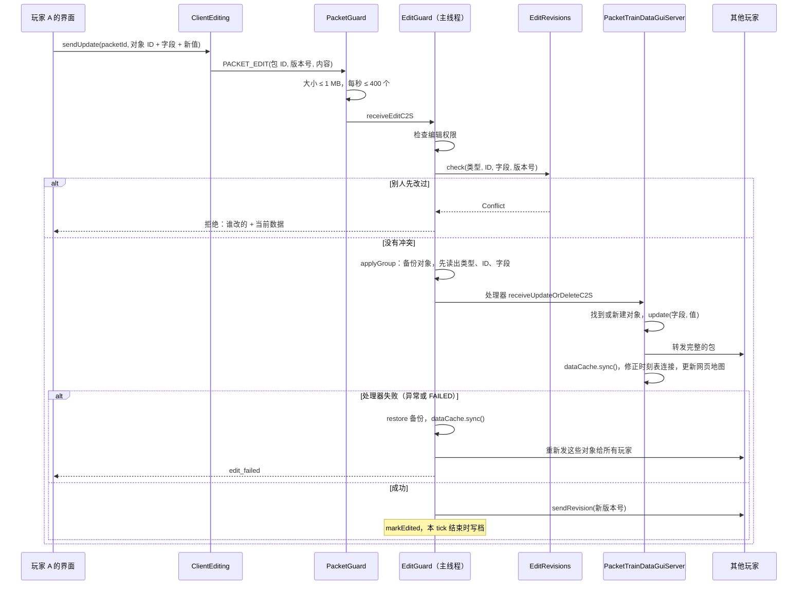

### 8.2 一组改动

网页编辑器的改动一次发一批（`PACKET_EDIT_BATCH`）。单个改动（8.1）也走同一个 `applyGroup`，只是组里只有一项。`applyGroup` 在同一个主线程任务里做这些事：

1. **备份**：组里涉及的每个对象先存一份序列化的字节（对象原来不存在就记为 null）。
2. **先读出每项改动是什么**：类型、对象 ID、字段，都在处理器读包**之前**读出来（`e7abbc7` 修复）。处理器会把包的读位置往后移，以前在处理器之后才读，读到的是错误的字节，会抛 `VarInt too big` 或 `IndexOutOfBounds`。结果是改动本身生效了，但版本号没记、没有即时写档、别的玩家不知道新版本号，网页编辑器的那一批也没有返回结果。
3. **依次执行**：每项执行前清掉 `PacketTrainDataBase.FAILED`，调用这种包注册的处理器。处理器抛异常或把 `FAILED` 设为 true 都算失败，后面的改动不再执行。
4. **失败**：**整组对象恢复成备份**（`restore`：有备份就还原，原来不存在就删掉），然后 `dataCache.sync()`。因为别的玩家可能已经收到了其中一部分，所以把这些对象重新发给所有玩家，给发起的玩家提示 `edit_failed`。版本号不变。
5. **成功**：按第 2 步读出的信息，逐项 `editRevisions.record` 记新版本号，`sendRevision` 广播，`markEdited` 让它在本 tick 结束时写档。

### 8.3 谁在编辑什么

玩家打开或关闭某个对象的编辑界面时发 `PACKET_EDITING`，服务器广播给所有人；玩家离开时 `EditGuard.onPlayerQuit` 清掉他的编辑状态。

### 8.4 改轨道

放节点、连轨道、删轨道走 `RailwayData` 的 `addRail`、`removeNode`、`removeRailConnection` 等方法，改完 `markRailsChanged`，本 tick 结束时写档。用旧路径的侧线会被标记为路径过期（`isPathStale`：路径上的轨道被删、类型、方向或长度变了），在车厂界面显示。`PathRegionSync` 发现指纹变了就在后台重算区域数据再同步给玩家。

### 8.5 网页模拟运行（`SandboxRuns`）

网页运行图的"模拟运行"是**调试功能**，一般用不到：服务端 `config/mtr_security.json` 的 `editorSimulation` 默认 `false`。开关随 `PACKET_EDIT_PERMISSION`（进服和打开主控面板时发）多带一个布尔值告诉客户端（`ClientData.editorSimulation`），编辑器数据里是 `simulation`。关着时页面不显示"模拟运行"按钮，"生成运用"后也不做内核验证；服务端收到请求直接回 `STATUS_DISABLED`。

开着时，`editor.js` `simulate()` 发 `api/simulate`，请求带星期、是否"从现在开始"、要报告的线路（当前线路的种别，加上要验证的车厂的线路）和草稿；客户端 `EditorSimulation` 把草稿做成组件格式，发 `PACKET_SIMULATE`。

服务端 `SandboxRuns.start`：

1. **服务端线程上**：检查权限，导出整个世界的 `SimDataset`（`SimExport.build`），放进草稿（`putDrafts`），为运用草稿准备找路径要的轨道和车厂副本。
2. **后台线程**（`MTR-Editor-Simulation`，单线程、最低优先级，排队最多 8 个，每个玩家同时一个）：
   - 先找草稿运用的路径（`findDutyPaths`）。
   - 再取子集 `SimScope.of(dataset, reportRoutes)`，只留下和所报线路有关的部分：
     - 跑这些线路的车厂；
     - 和它们共用线路的车厂（会分担班次），一直补到没有为止；
     - 别的车厂里，有车经过同样节点的存车线（存车线的路径或任一班次路径碰到上面这些车厂的车走过的节点）。只带这几条，不带整个车厂。代价是：这个车厂原来由别的存车线发的车改由带上的存车线发，邻线的车可能比实际多，结果偏保守。
     - 只扩这一圈。线路、闭塞分区全部保留；"从现在开始"的列车记录原样给，掉出去的存车线的车在恢复时找不到存车线，自动跳过。
     - 没有所报线路（空集合）时用整个世界。
   - 然后 `DayRun.run` 跑一天，超过 60 秒停下回"太忙"。
3. **回包** `PACKET_SIMULATE_RESULT`：请求号、状态、没用上的草稿数、找不到路径的运用数、**模拟的车厂数和全部车厂数**、分包序号和总数、报告字节（每包 512 KB 以内）。
   - 页面在问题列表下写"只模拟了有关的 X / Y 个车厂"。
   - 超时时状态行写"一分钟内没有模拟完（X / Y 个车厂）"。

子集里的列车编号和整个世界跑时不同（编号按车出现的先后发），其余的到发、问题都相同（`SimScopeTest`）。

## 9. 车厂生成路径

**时序图**：

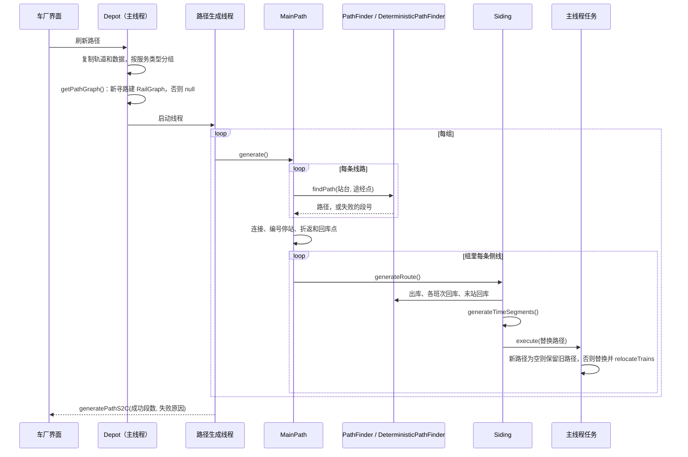

### 9.0 线路路径：`RoutePaths`（L1）

用时刻表的车厂不再自己寻每条线路，而是从线路拿路径（`RailwayData.routePaths`，只在服务端，不存档）：

| 类 | 做什么 |
|---|---|
| `RoutePaths` | 每条线路一份 `RoutePath`，按线路加锁，`get` 不存在或过期才找，`getFound` 只读不找；`getVehicles` 在主线程上收集跑每条线路的车型；`timesByPath` 判断线路是否按自己的路径算时刻（不是手画路径、飞机、连续运动） |
| `RoutePaths.Search` | 一个路径生成线程看到的线路路径：它那份轨道副本，要找时才建一次 `RailGraph`；`getFastestTimes(route)` |
| `RoutePaths.RoutePath` | 原始路径（每站用站台自己的停站时间，第 k 站在第一个 `stopIndex == k+1` 且有站台 ID 的轨道上，第 0 段停站为 0）；`getPath(停站设置)`、`getSlice(首站, 末站)`（第一段停站为 0，像从那站重新找的一样）、`getFastestTimes(route, 车型)`（逐站取最慢，按车型和停站设置缓存） |
| `RoutePaths.updateOwners` | 配属层（优化第二轮）：主线程只复制输入，在后台线程找出联络线的路径、算出每条联络线自己那一段（`getOwnRange`，减去手动放行的轨道）占的轨道段，加上"站台 → 线路组"（`LineDuties.getLineKey`），交给组件 `TrackOwnership.compute`，回到主线程 `GraphRecords.setOwners`；第一次算好之前车厂不寻路（`isOwnersReady`）。原来的 `Exclusion` 去掉了 |
| `PathTiming` | 车厂和线路共用的计时：`Vehicle`（存车线长、编组、车距、加减速、速度曲线、运输方式）和 `generateTimeSegments`，从 `Siding` 搬出来，规则不变 |

**找一条线路**（`RoutePaths.get`）：

1. 手画路径的线路返回 null，调用的人照旧处理。
2. 键 = 线路限速、线路组（联络线记"connecting"）、站台和站台停站时间、途经点。和已有的相同、**它查过的每个站间段都还是缓存里那一个**（`RoutePath.holds` → `LegCache.holds`，包括动态规划查过但没选中的），且路径上的轨道没变，就直接用。
3. 否则由站间段拼（优化第二轮）：每个站台取它所在的轨道段，`RouteLegs.plan(站台段, 途经关键节点, 线路组或 null, GraphRecords.Legs)`；缺的站间段在当前线程用 `LegRouter.find` 在只读快照上找，放进 `LegCache`（同一段两个线程同时找到时保留先放进去的）；拼好后 `expand` 把轨道段展开成 `PathData`，规则和 `DeterministicPathFinder` 相同（首站、停站、折返停留）。
4. 以下是第二轮之前的做法：`DeterministicPathFinder.findPath(..., exclusion::avoids)`。找不到时照常 `PathFailure.diagnose`；有联络线时再不避开地找一次，如果那条路经过联络线，失败原因改成 `CONNECTING_LINE`（位置字段是联络线的 ID）。

**存车线界面只管名称、颜色和车型**（0.38.0，5c 存车线这一步）：`SidingScreen` 只能改编号（名称）、颜色和车型；车数、加减速、最高速度、手动驾驶、手动驾驶最高速度、手动转自动时间、种别都只显示实际生效的值（`Depot.getVehicleSettings`：车池设了用车池的，没设用车池第一条存车线原来的），底下一行提示去网页改（`gui.mtr.siding_set_on_web`）。关界面只发名称颜色包（`NameColorDataBase.setNameColor`），不再发 `unlimited_trains`、`max_speed`、`deceleration_constant`，所以网页设的车数和配属不会被盖掉；服务端照旧接受这些包。网页车厂对话框车型一栏补上"手动驾驶最高速度"（按本体速度挡位的序号，`EditorData` 给车厂带 `manualSpeeds`，超出的序号保留成"其他"）、"多久不操作转回自动"（秒，存半秒）和"种别"（同一车型的几种编组共用，只在第一栏显示；操作 `depot` 的 `serviceTypes`，车型 → 文本，`EditorActions.applyDepot` 只发改了的，走 `Depot.setVehicleServiceTypes`）。网页设存车线车数（`Siding.setOperation` 和 `readOperation`）时也把上限（`unlimitedTrains`、`maxTrains`）设成一样（`limitToFleet`），不按运用跑的运输方式（飞机）还看上限。缆车照旧没有这些项。测试 `SidingSettingsTest`。

以下是 0.38.0 之前的做法。**存车线界面和车型设置不再重复**（2026-11-07 复查）：车厂给这个车型设了加减速和手动驾驶（`VehicleSettings`，R1）时，`SidingScreen` 不再显示存车线自己的那几项（本来就不起作用），只留一行提示去网页车厂对话框设；没设时照旧显示，存车线的值仍是车池第一条存车线的后备。按时刻表跑的运输方式，"侧轨车辆总数上限"改叫"最多停几列"（`gui.mtr.siding_capacity`），和网页一致：两者本来就是同一个值（`setUnlimitedTrains` 写 `fleetSize = getTrainLimit()`）。

**确定性寻路对按时刻表跑的车厂总是开**（2026-11-07 复查）：`Depot.getPathGraph` 对 `supportsTimetable` 的运输方式不看 `useDeterministicPath`，总用 `DeterministicPathFinder`，和线路路径、最快时刻、运用路径一致；游戏车厂界面不再显示这个勾选（`EditDepotScreen.showDeterministicPath`）。存档字段不变，老存档里关着的也照样按确定性寻路。

**寻路边界只约束计算**（2026-11-07，用户定的；**线路路径部分已由 2026-11-08 的配属层取代**：寻路边界划出的区域就是线路配属，线路只走配属本线的轨道，见 9.0 和 7.4）：寻路边界只决定"先在哪里找"，不决定"能不能走"；不让正线车走某段轨道是联络线的事。
- `RailRouter.route` 先按 `getLegRegions` 在每段两端所在的区域里找；找不到完整的路，**而且这次搜索确实因为区域剪掉过分支**（`Result.prunedByRegions`），才在整个路网里再找一次（联络线的 `avoid` 两次都照样生效）。区域里根本没碰到边界就失败的（被联络线挡住、方向不对），不再全网重找一遍，失败的搜索不会因此变成两次、范围也不会扩大到全网。第二次才找到的，`Result.crossedRegions` 为 true。区域内有路时照旧用区域内的路，所以大路网上还是快，也不会绕进无关的区域。
- `PlatformGraph` 不再用区域判断站台之间能不能到（`isAllowed` 总是 true），站台之间的连通只看轨道。每条分支本来只走到遇到的第一个站台，用不着区域限制计算量。
- `PathFailure.diagnose` 不再给出 `BOUNDARY`；枚举值保留，因为包里按序号写。
- 跟着变的：车厂和线路的寻路、最快时刻、沙箱和预览寻路都用同一个 `RailRouter`；咽喉锁的网络（`LockNetworks`）由运用路径拼成，路径不再被边界隔开，就跟着连在一起。
- 显示上和联络线分开：边界在网页配线图、全网配线里画成紫色细点线，仪表盘地图上是紫色，提示写"只划分先在哪里找路，不挡车"；联络线照旧是橙色和灰色虚线。

**隔离（寻路边界和联络线画在同一层，分开画法）**：

- 联络线自己的那一段（2026-11-07）：以前首末站台之间不是站台的轨道全算联络线的，联络线从一条线的站台出发、沿正线走一段再分岔时，正线那段也被挡住，这条线自己的线路就找不到路（压力测试线网上查出）。现在 `RoutePaths.getOwnRange` 只取联络线自己的那一段：设了关键节点（`waypoints`）时从第一个关键节点起，到它之后最后一个关键节点止（只有一个时到进末站前的最后一个分岔）；没设时从离开首站后的第一个分岔（连着三段以上轨道的节点，`isFork`）到进末站前的最后一个分岔；一个分岔都没有的照旧全算。客户端地图（`MapIsolation.getOwnRange`）按同一规则画。站内咽喉有渡线时，没设关键节点会从渡线算起，这时在离开正线处设关键节点。
- `RoutePaths.getConnectingRails` 给出联络线的轨道：`RAIL_TAKEN` 是独占，`RAIL_RELEASED` 是放行（`Route.connectingReleased`）。`RailwayData.sendRouteLayout` 再加上寻路边界的轨道段（`RAIL_BOUNDARY`）和边界节点，一起交给 `RouteLayouts.write`。
- 配线图的包里，每段轨道带上它的两个节点和隔离状态（`Layout.keys`），后面跟边界节点的位置（`Layout.boundaryNodes`）。`EditorLayout` 把它们转成 `railKeys`、`boundaryNodes` 给网页。
- 网页上右键一段轨道打开菜单（`railMenu`）：边界放进草稿 `draft.boundaries`，应用时是操作 `pathBoundary`，客户端用 `sendPathBoundaryC2S` 发出；放行是操作 `connectingRelease`，客户端用 `Route.setExtraData` 发出。
- 仪表盘地图（`WidgetMap.drawIsolation`）用客户端已有的数据画同一层，状态由 `MapIsolation.getStatuses` 给出（网页的全网配线也用它）：边界来自 `ClientData.PATH_REGIONS.boundaries`，联络线来自它在地图上的路径（`MAP_ROUTES`），去掉站台轨道。

**车站股道**（L2，`transitsim.network.StationTracks`）：输入每个站台（车站、轨道网、两端、名字、手动的待避线）和每条线路的各站（站台、沿站台的方向、是否通过）；输出每个站台的方向（`up`/`down`/`both`/空）、种类（`main`/`passing`/空）和在车站里的顺序。客户端 `ClientStationTracks.compute` 从 `ClientData` 取输入：沿站台的方向看线路在地图上的路径（`MAP_ROUTES`）里站台两端的先后。`EditorData.buildTopology` 把结果放在每个站台的 `track` 里，网页用 `trackLabel`/`trackShort` 统一写出；站台界面（`PlatformScreen`）也调它。

**咽喉进路**（L2，`transitsim.network.ThroatRoutes`）：输入路径的节点、各站站台所在的轨道序号和每个节点相交的轨道数，输出每站的进站、出站进路（道岔节点和两侧节点）。服务端在时刻表冲突检查里用 `RoutePath.getThroats`（按线路路径和当前轨道）给每条线路 `RouteTimes.setThroats`，`TimetableConflicts.checkThroats` 按到站前、开车后各 30 秒（`THROAT_MILLIS`）找冲突，`Conflict.turnoutNode` 随冲突包发回，游戏时刻表界面用 `gui.mtr.timetable_conflicts_found_throat` 显示。客户端 `ClientThroats` 用地图数据算同样的进路和静态交叉，`EditorData` 放在每个停站的 `throat` 里，网页 `throatHtml` 显示在停站编辑的车站配线图下面。

**地图上的弯道和全网配线**（MTM_Logic 0.5.0）：

- 地图同步原来每段轨道只有两个端点，长弯道画成一条斜直线。现在多了一类 `MapSyncData.KIND_RAIL_SHAPES`，按和轨道相同的 128 格区块分组，只放弯道：两个节点、点数、各点（`RailShapes.pack`，四分之一格精度）。
  - 点由 `Rail.getMapShape` 给出（`RailShapes.of`，每条轨道算一次留在对象里）：每 2 格取一个点，再用 Douglas–Peucker 化简到离真实曲线不超过 0.5 格，最多 64 个点，直的轨道没有。
  - 和其他几类一样走摘要和本地缓存（`MapDataCache`），只重发变了的区块。客户端放进 `ClientData.MAP_RAIL_SHAPES`，按轨道键，从较小的节点起。
  - 仪表盘地图的轨道、隔离层和线路路径都经 `WidgetMap.drawRailShape` 沿这些点画。
- 网页"全网配线"页签：`api/network` 由 `EditorNetwork.build` 从客户端的地图数据给出：
  - 节点表；
  - 每段轨道：两个节点、种类（站台、存车线、普通）、隔离状态、弯道点；
  - 边界节点、车站（各站台中点）、各线路在地图上的路径；
  - 一个版本号，没变时只回版本。
  - 打开时向服务端要一次最新地图（`requestMapRailsC2S`），之后每 3 秒问一次有没有变化。
  - 页面用 canvas 画，拖动平移，滚轮按光标缩放，按运输方式切换，放大后显示站名；树里选中的线路按颜色画出路径，其余变淡。
  - **示意图画法**（用户画的样子）：缩小到每格不到 2 像素时画成示意图。
    - 先把两个道岔之间的轨道连成一段（`netChains`）：只穿过连着两条轨道的节点，种类和隔离状态不同就断开，所以站台、存车线和隔离段各自成段，车站位置不变。
    - 每段按屏幕 10 像素化简（`simplifyPoints`，Douglas–Peucker），再把每一小段改成横、竖或 45°（`octilinear`：已接近这些方向的不动，否则先直走一半、再斜走、再直走），同方向相连的合成一段，所以大弯变成一条 45° 斜线、小弯拉直。相邻两小段的直走部分在拐角处会拼出一个凸起的直角台阶，或在两段斜线之间留一小段横竖的错台：`cutSteps` 把两条腿长短相近、又比两边短的直角切成斜线，把比两边短一半以上的错台去掉，再合并同方向的段。
    - 结果按缩放档（每档半个 2 的幂）缓存。放大后按实际轨道画。
    - 选中线路、隔离层、悬停高亮都画在这些段上；光标先找画出来的段，再取段里离光标最近的实际轨道，所以右键菜单仍是对一条轨道。
  - 按网格找光标下的轨道，悬停显示种类和隔离，右键弹出和配线图相同的隔离菜单（`railMenu`，参数是 `{a, b, status}`）。
- 地图上的线路路径（`RailwayData.MapRouteQuery`）：先取线路自己的路径（`RoutePath.getNodes`），找不到再沿轨道追。单条线路的地图请求，用的地图图可能比轨道旧，所以只取已经找好的路径（`getFound`），不在旧图里找。
- 失败原因（`PathFailure`）多了挡住的那段轨道（`node1`/`node2`，只有 `CONNECTING_LINE` 填），整体用 `writePacket`/`readPacket` 收发。车厂包和时刻回包都带上它，客户端存进 `ClientData.ROUTE_PATH_FAILURES`，文字由 `PathFailureText` 给出。

**最快时刻**：编辑器（`PacketTrainDataGuiServer.getKnownTimes` / `TimeSearch`，在复制的轨道和数据上另开线程找）、自动运用（`MainPath.generateAutoDuties`）和组件的数据集（`SimExport`，`RouteData.fastestTimes`）都用 `RoutePath.getFastestTimes`。车型来自 `RoutePaths.getVehicles`：跑这条线路的车厂的所有存车线（`Siding.getTimingVehicle(车厂.speedCurves)`），没有就用 `getDefaultVehicle`（8 × 20 m，0.8 m/s²，开速度曲线）。

### 9.1 发起：`Depot.generateMainRoute`

**几个车厂同时寻路**（2026-11-07，压力测试线网上量出：64 份黄线、128 个车厂从开服到排完 18 分钟，单个车厂只要 1 至 2 秒）：

- 一次寻路做的事：主线程上拍快照、定规划单元和可回的车厂、按车型分存车线组、作废轨道改过的存车线的实测出入库用时；后台线程里量终点折返用时（`turnTimesFor`）、给整个规划单元排运用（`Unit.plan`）、给每条存车线拼"出库 + 营业段 + 回库"的路径和各种变体、量出实际的出入库用时（差 15 秒以上记下，会改变单元的键，单元再寻一轮）。
- `RailwayDataPathGenerationModule.MAX_THREADS`：同时寻路的车厂数 = 核数减 1，至少 2、至多 8（以前固定 4）。`RailwayData` 每 100 tick 检查时把空闲线程填满（以前每次只启动一个就 `break`，实际上是串行）。
- 同一 tick 启动的车厂共用一份快照（`RailwayDataPathGenerationModule.Snapshot`：数据索引的副本、轨道的副本、各线路的车型，寻路图第一次用时在主线程上编一次）；数据版本或轨道数在 tick 内变了就另拍一份。以前每个车厂在主线程上各复制一次轨道、各编一次寻路图。
- 排运用按输入共用（`LineDuties.PlanCache`，`RailwayData.linePlans`）：键是单元的键、运营日起点和换站台用时；同一单元同时寻路的几个车厂，第一个排，其余的等它的结果；排的那个被新请求打断时，等着的自己排。最多留 64 份。"planned the duties of" 只在真正排的时候写日志。

**车厂的线路没有先后，派线路的单位是存车线**（MTM_Logic 0.13.0，2026-11-06）：

- 按运用跑的车厂（`Depot.runsByDutiesWith`：设了运用图，或线路里任意一条有启用的时刻表）不再把线路首尾相接成一条主路径。`MainPath.generateDutiesOnly` 只逐条检查各线路自己的路径（找不到的第一条报原因），再给每条存车线算运用路径（`Siding.generateDutyRoute`：存车线本身作为 `path`，运用路径总是应用，不会因为两条线路接不上而保留旧的），返回 `Depot.DUTIES_ONLY_FOUND`。线路之间的连接、"不回库"的绕回、`depotReturns`、`tripTails` 只给按频率发车的旧车厂用。
- 以前只看第一条线路的判断（`findTimetable`、`getTimetable`、`getDepotAutoDutiesKey`、`hasTimetable`、`generateAutoDuties` 的 `byTimetable`、`usesRoutePaths`、组件的 `DepotBoard.getTimetable`）改成"任意一条有启用的时刻表"（`findTimetabledRoute`），排在第一位的线路不再悄悄改变车厂的行为。
- 游戏内选线路的界面对按时刻表跑的车厂不显示排序、不能重复（`DashboardListSelectorScreen` 的 `canSort`）。"不回库"在这种车厂里显示成"允许长时间停在线上"（`gui.mtr.stay_on_line`），只放宽两班之间的等待（`MAX_STAY_MILLIS`）。模拟器比较车厂时按集合比较线路（`LiveSimulation`）。
- **存车线的线路和配属车数**（`Siding.routeIds`、`fleetSize`，存档键 `route_ids`、`fleet_size`，网络包末尾和更新键 `siding_operation`）：
  - 存车线的车跑的线路 = 车厂的线路 ∩ 存车线给的线路（空表示全部），再按车型的服务类型过滤（`Depot.getSidingRoutes`）。车厂寻路、`findDutyPaths`、`LineDuties` 建组都按"服务类型 + 存车线线路"分组（`Depot.getSidingGroupKey`），模拟器导出用 `getSidingRouteIds`。
  - 配属车数是这条存车线能派出的列车数（相当于车厂的配属），不受轨道长度限制；-1 表示按需要。按运用跑时，规划（`SidingInput.maxTrains`）、生成列车（`Siding.simulateTrain`）、回库选存车线（`chooseReturnSiding`）和模拟器导出都用它；按频率的旧车厂仍用 `max_trains`。旧存档没有这个键时取原来的上限，规划结果不变；游戏里改上限时配属车数跟着改。新建的存车线默认"无限车辆"。
  - 按长期目标（游戏内只管物理层），这两项只在网页"编辑车厂…"里改。

不回库（`cycleRoutes`）时，主路径从最后一条线路的终点接回第一条线路的起点（`closesPath`）。两站之间找不到路时记 `PathFailure.Type.CYCLE_BACK`（出发站台、要到的站台），车厂界面写明是哪两个站台接不上（`gui.mtr.path_failure_cycle_back`），不再只说"未创建路径"。

1. **复制数据**：`dataCache.copyIdMaps()` 和 `DataCache.copyRails(rails)`，后台线程只用这份副本，玩家同时改轨道不会影响它，也不会让它找到改了一半的线网。
2. **按服务类型分组**：车厂区域内、运输方式相同的侧线，按车辆能跑的服务类型（`getServiceTypes`）分组，每组只用它能跑的线路（`filterRoutes`），各生成一条主路径（`MainPath`）。
3. **建图**（在服务器主线程上）：`getPathGraph(rails, pathBoundaries)`。车厂开了新寻路（`useDeterministicPath`）、不是飞机、不是连续运动时，用 `DeterministicPathFinder.compile` 建组件的 `RailGraph`（按路径分界限定区域）；否则返回 null，用旧寻路。
4. **线路路径**：建一个 `RoutePaths.Search`（这份轨道副本、上面的图、主线程上读好的车型），给每个 `MainPath`。
5. **开线程**：逐组 `MainPath.generate`，完成后 `generatePathS2C` 把成功的段数和失败原因发给客户端。新的请求会让正在跑的旧线程以 `CancellationException` 停下，由新线程报告结果。

### 9.2 主路径：`MainPath.generate`

1. 逐条线路：
   - 和上一条线路的终点站不同时，`addConnection` 找两条线路之间的连接路径（可能包括折返）。
   - **用时刻表的车厂**（`usesRoutePaths`：有时刻表、不是连续运动、不是飞机）：拿 `routeSearch.get(线路)` 的路径，套这条线路的停站设置；线路找不到路径时用它的失败原因停止，下面的寻路不做。手画路径的线路仍用手画的。其他车厂照旧往下：
   - `PathFinder.findPath(...)` 按线路的站台顺序和途经点找路径：有 `RailGraph` 就走 `DeterministicPathFinder.findPath`（组件的 `RailRouter`，同样的线网和线路总是得到同样的路径）；没有就用旧的 `PathFinder`，旧寻路不支持途经点，有途经点的段直接判失败，而不是悄悄走另一条路。
   - 找不到时 `PathFailure.diagnose` 给出原因（哪两站之间、为什么），停止。
   - `applyStopSettings` 应用线路的停站设置（通过站、每站停站时间）。
   - 和上一段首尾相接：同一段轨道去掉重复的一段；反向的同一段（掉头）把那一段的停站去掉。
2. 留在线上的车厂（`closesPath`）：再找从最后一条线路回到第一条的连接，一圈的终点就是第一站。
3. **编号停站**：路径上每遇到一个新站台（站台轨道且有站台 ID，前一段不是站台），`stopIndex` 加 1；通过的站也算，因为线路的车站序号包括它们。
4. 折返段、回库点、环线入口、各班次的尾部（`TripTail`，在中途离开主路径回库的服务）都在这里找好。
5. 对组里每条侧线调 `siding.generateRoute(...)`。

### 9.3 侧线的完整路径：`Siding.generateRoute`

在路径生成线程上算：

1. 侧线 → 第一个站台的出库路径；找不到就算失败。
2. 环线连接路径接在后面；`repeatIndex1` 记下重复起点。
3. 接上主路径。
4. 每个班次尾部：找从它最后一站回侧线的路径，找到才加这个班次的路径（`addTripPath`），找不到这个班次就留在主路径上。
5. 最后一站 → 侧线的回库路径；找不到算失败。`repeatIndex2` 记下重复终点。
6. 有折返段就加折返路径（`addTurnBackPaths`），再加中途回库的路径（`addDepotReturnPaths`）。运用的折返段见 9.4 节"折返方式"。
7. `generateTimeSegments`：按速度算出每段轨道的时间段、各站台的到站时间和停站时间。
8. 按运用运行的车厂还要给每个运用找路径（`addDutyPath`），找不到的在日志里列出。

然后回到**服务器主线程**（`minecraftServer.execute`）替换：

- 新路径为空、而侧线原来有路径时，**保留旧路径和所有列车**，只报告失败。
- 否则替换路径、时间段、停站时间、站台时间、重复点、班次路径、折返；`relocateTrains` 按轨道把线上的列车放到新路径上对应的位置，列车不会跳走。
- 新路径为空且原来也没有时，用默认路径（侧线自己）。

### 9.4 运用路径和自动运用（用时刻表的车厂）

- **自动运用按运营线路排**（`LineDuties`，MTM_Logic 0.6.0）：车厂用时刻表、又没设运用时，运用不再按车厂各自排，而是按运营线路一起排。
  - **运营线路**是线路组（`LineDuties.getLineKey`：运输方式加 `Route.getLineKey`，和网页的 `lineKey` 相同），包括上下行、各种别和支线。
  - **规划单元**（`LineDuties.Unit`，`LineDuties.of` 在主线程上建）：从这个车厂出发，经它列的线路找到这些线路的所有线路组，再找列了这些线路组的其他按线路排的车厂（`plansByLine`：用时刻表、没设运用、不是连续运动或飞机），直通关系连着的线路组也算进来，一直连下去。
  - **班次**：单元里所有线路组的、启用时刻表的线路的全部班次（`DutyGenerator.servicesOf`），最快时刻用线路自己的（`RoutePaths.Search.getFastestTimes`）；设了运用的车厂已经在跑的班次先去掉。
  - **存车线**：单元里各车厂区域内的存车线，按车辆能跑的服务类型分组（`getServiceTypes`、`filterRoutes`），各组按先后排，前面的组用掉的班次后面的组不再排。
  - **车不够时均匀抽班**（`DutyGenerator.generateSpread`，游戏的自动运用 `LineDuties.Unit.plan`、网页一键生成 `EditorDuties`、组件的 `AutoDuties` 和 `PlanCheck` 都用它）：先照常 `generate`；有班次没车、存车线都有上限时，每条线路每种星期组合的班次按发车先后每 k 班留 1 班，k 从 2 起往上试（16 以内一次加 1，再大每次加八分之一），每个 k 再试其他线路留哪几班（错开 0 至 7 班，第一条线路不动），取第一个让留下的班次全部有车的；以前 k 从"跑满需要 ÷ 现有"起，折返时间差一点时"需要"被算得很大（VH 线 11 列），1 列车一小时才跑一个来回；没留下的班次计入没车。这样现有的车间隔相同、全天均匀，不会像贪心那样几列车挨着开（每分钟一班、3 列车时贪心排成 1 分钟、22 分钟交替，抽班后是每 24 分钟一班）。一直排不满时退回贪心的结果。车够时结果不变。
  - **从哪里出车**：一条存车线的车只从它自己车厂所列线路的首站出发（`DutyGenerator.SidingInput.links`），代价按存车线到站台的直线距离（每格 50 毫秒），规划器优先用最近的存车线；出发以后可以跑这条运营线路的任何线路，在同一车站折返接下一班。所以只列了单方向线路的车厂，车也能跑另一个方向。回库仍回自己车厂的车池。
  - **怎么分给车厂**：每个车厂在自己的寻路线程里取整个单元的排法（`Unit.plan`，同样的输入只排一次，`LineDuties.PlanCache`），只留下自己存车线的槽位；同样的单元总是排出同样的结果，所以各车厂一致。`MainPath.generateAutoDuties` 把这些槽位存进 `Depot.autoDuties` 并发给客户端。
  - **车够不够**（`LineDuties.Plan`、`Depot.Shortfall`）：有班次没车时，取离线路最近的存车线，用折半查找求出它最少再加几列，能让没车的班次降到车再多也降不下去的数（`Unit.extraTrains`，约 8 次规划），跑满需要的车数就是现有的加上这些。随自动运用发给客户端（`PACKET_AUTO_DUTIES` 和车厂整包末尾），车厂界面和网页（车厂一行、时刻表上方）显示"跑满需要 N 列，现有 M 列，每天 K 班没有车，建议加到 …"。日志每次排单元写一行 `planned the duties of line …`。
  - **一天的班次上限**（MTM_Logic 0.12.0）：一份运用一天最多 4096 班（`DepotDuties.MAX_SEGMENTS`，和一张时刻表的班次上限相同）。以前是 128，超出的部分在 `assignSlots` 里被直接截掉，1 列车跑密集班次时跑到第 128 班就停在线上。存档格式不变，只是允许更长；网络包也一样，旧客户端会截断，所以升了版本。
  - **运用数可以多于存车线放的车**：车回库再出来就是一份新运用，存车线的车跑完一份、回库后可以接着跑下一份（`DepotDispatcher` 放准备好的车），所以网页应用运用时只限制每条存车线最多 256 份（`MAX_SLOTS`），不再要求运用数不超过车数。游戏里出车的车数仍按存车线上限（`Siding` 生成列车时）。
  - **折返太短**（`DutyPlanner.findTrainInService`）：一班找不到线上的车时，如果同一站台有一列车在发车前就到了、只是到站加最短折返（`MIN_TURNAROUND_MILLIS`）来不及，记一条 `SHORT_TURNAROUND <站台> <有的毫秒> <要的毫秒>`，每个站台只留时间最紧的一次。它经 `DutyGenerator.Result.issues`、`LineDuties.Plan.issues` 传给网页（一键生成后提示"在某站折返时间不够……"，`shortTurnaroundText`）和日志（`turnaround too short at platform …`）。单站台的终点站折返不够时，车也不能在站台上等下一班（`isPlatformFree`），每列车只跑一个来回就回库。
  - **网页编辑车厂和同步状态**（0.13.0）：
    - 右键车厂"编辑车厂…"：勾负责的线路（按线路组）、"允许长时间停在线上"、每条存车线的配属车数和只跑哪些线路；放进草稿（`draft.depots`），应用时是一项 `depot` 操作（`EditorActions.applyDepot`：比对 `EditorData.getRevision(Depot)`，`depot.setData` 和 `siding.setOperation` 发更新包，然后刷新车厂路径）。树里存车线显示成车池（配属几列、几份运用），运用叫"运用 N"；"在线预约"改叫"自动排班"。
    - 选着一份运用时，在运行图上 Shift 点第二班，把两班之间这列车接得上的班次一次加进来（`chainBetween`：从上一班终点站找最早赶得上的下一班），两班都已在运用里时一起移出。
    - 顶栏"同步状态"（`syncProblems`）：连接、没应用的草稿和原因、车厂没选线路、路径生成中/失败（`EditorData` 的 `path`，来自 `generatePathS2C` 的失败原因）、运用找不到路的份数和键（服务端现在随结果发来，`Depot.clientFailedDuties`）、运用里有已删除线路、车不够、线路还没有时刻。网页每 1.5 秒查一次游戏的变化（页面在后台时 5 秒）。
  - **运用里两班之间的空车走行**（0.15.0）：`getDutyPlan` 接两段时，前一条线路没列折返线，就在终站附近 200 格内找折返线（`RailType.TURN_BACK` 的尽头，`getNearbyTurnBackNodes`），绕折返线比直接找到的路短就走折返线（站后折返）。以前没列折返线时只按不换向的最短路找，12 站后面有折返线也会绕到 South Village 再回来。接起来的路比两个站台的距离长 5 倍以上且超过 300 格的，记进 `pathDetours`，随寻路结果发给客户端（`Depot.clientDetours`），网页"同步状态"写明从哪个站台到哪个、走多远、怎么改。
  - **换站台后的首站要停**（`getDutyPlan`）：从另一个站台开过来接下一条线路时（例如 12 站进折返线换向后进 B 站台发上行），那条线路自己路径里的首站没有停站时间，接上后车会直接通过 B 站台、空跑一趟再从另一头接时刻表。现在首站的停站时间取开过来那段路上的停站时间或站台的停站时间，车在 B 站台停下等发车。`DutyTurnBackTest`（common）搭了一个同样的终点站：两个并排站台、两头道岔、远端一段折返线，检查运用路径从 A 进折返线到 B、不离开车站、在 B 停站。
  - **规划用轨道上实测的数据**（0.16.0）：以前规划里同站换站台一律当作走得通、用时 2 分钟，回库用出库用时（终点站不在出库表里时按 0），出库按直线距离估，网页按车厂排时出库按 0。现在：
    - 接续的走法抽成 `MainPath.findConnection`（运用路径的 `getDutyPlan` 和下面的用时计算共用）：先走前一条线路列的折返线，没列就取直接找到的路和附近折返线里短的那条。
    - `MainPath.turnTimesFor(routes)`：规划单元（或车厂自己的线路）里每条线路的终点站台到同一车站别的线路的首站站台，用 `findConnection` 找路，按两条线路的车型里最慢的（`RoutePaths.Search.getVehicles`）用 `PathTiming.generateTimeSegments` 算用时，车头从停着的站台末端起步，不是从存车线中间。第四轮第 2 步起在折返点切开（`legMillis`）：进段 = 起步到停在折返点，出段 = 再起步到到站，在折返点站着的时间不算，表里存进段 + 出段，不再加 30 秒余量（原来的 `TURN_MARGIN_MILLIS` 去掉）；换端由规划按全网的"换端最短时间"另加。站台到它自己（绕折返线回来）的一项照旧是来回总用时，另在同一张表里用 `DutyGenerator.HOLD_IN_KEY`（`Long.MIN_VALUE`，没有站台用这个 ID）记进段，出段 = 总用时 − 进段，所以包和合并都不用改；网页数据里这一项单独给成 `holdIns`。`-Dmtr.debugTurnTimes=true` 时每量一对就写一行日志，列出改前（30 秒 + 整段 + 30 秒）和现在（换端 + 进 + 出）的计划用时。找不到路的一对不写进表。寻路线程里在排运用前算好，存进 `Depot.clientTurnTimes`（`turnTimesMeasured` 标明量过），随 `generatePathS2C` 发给客户端（最多 4096 对，三元组：从、到、毫秒）。`Depot.measureTurnTimes` 给测试用。
    - 交给规划：`DutyGenerator.PlanInputs(turnTimes, backLinks)`。`turnTimes` 不为 null 时同站换站台的接续只按表里的用时，表里没有的一对当作走不通；为 null（车厂还没寻过路，例如网页在寻路之前一键生成）时照旧估 2 分钟（`TURN_BACK_MILLIS`）。最短折返（就绪 = 到站 + 它）取 `PlanInputs.minReverseMillis`，即全网设置的换端最短时间，所以换站台共要换端 + 进段 + 出段；在折返线上等的车按量出的进、出段（没有进段记录的旧数据仍对半分）。`backLinks` 是各存车线从各站台回库的实测用时（`DepotLegs.backMillis`），进 `OperationNetwork.addDepotBackLink`；`Depot.backMillis` 先查它，查不到用这个站台的出库用时，再查不到用这个车厂最长的出库用时，不再按 0。
    - 出库链接（`LineDuties.sidingLinks`）：量过的用 `DepotLegs.outMillis`，没量过的按直线距离 × 50 毫秒 × 1.5 + 30 秒。`LineDuties.Unit.plan(…, turnTimes)`、`generateAutoDuties`（车厂单独排）、网页"一键生成运用"（`EditorDuties.prepareGeneration` 两个分支，`LineDuties.turnTimesOf` 合并单元里各车厂的表）都用同一份数据，网页预览和游戏一致。
    - 过夜不换站台（`DutyPlanner.findTrainInService`）：跨过运营日起点的接续必须是同一站台，和运行时 `TrainService.updateOvernight` 一致。
    - **留在线上的车等多久**（2026-11-07）：留在线上的规划单元（`LineDuties.Unit.staysOnLine`）最长停留是 `MAX_STAY_MILLIS`（8 天）。以前没活的车在终点一停就是几天：上下行班次数不等时（yel 的黄线下行比上行每天多 10 班），多出来的车停在一端，第二天又因为过夜不换站台用不上，车厂每天再出新车，逐周重放越积越多（黄线算出要 140 至 200 列，实际 12 列左右）。现在 `DutyPlanner.retireIdleTrains` 在最长停留之外再看 `waitFrom`：这列车按 `findTrainInService` 的规则（含过夜不换站台）最早能接哪一趟，从那时起再等 `MAX_LAYOVER_MILLIS`（30 分钟）还没被用上就回库；一趟也接不上的，到站 30 分钟后回库。各首站的发车时刻在 `expandTrips` 里排好（`startsByFirstPlatform`，下周的也算，周日晚上过夜的车照样等周一早上）。最长停留就是 30 分钟的单元行为不变。
    - 在折返轨上过夜：原来的开关 `DutyPlanner.NIGHT_ON_RAIL` 一直关着、运行时也没做，第四轮第 2 步连同规划分支一起删掉；以后要做时按进、出两段重新做。
    - 车数算不出：逐周重放 16 周还不收敛（`NOT_PERIODIC`）时，`LineDuties.Unit.plan` 把 `Plan.needed` 记成 -1；日志、车厂界面（`gui.mtr.line_shortfall_unsettled`）和网页（`shortfallText`、车厂树上的"缺车"）都写"运用排不成每周一样，算不出需要几列"，不再给一个没有意义的数。
  - **出库、回库按运行时的规则排**（0.18.0，检查意见 P1-A、P1-B）：
    - 出车指令指定的车厂 D 在这次规划里没有存车线时，这一班没车（`startDepots` 留空），只记 `DEPLOY_DEPOT`，不再放开给所有存车线；回送指令同理，记 `RETURN_DEPOT`（`TimetableService.returnDepots`）。网页一键生成后写成句子（`orderIssueText`）；手工运用里有出车指令的一班不在运用开头，或运用不在指定车厂，`dutyProblems` 报出来。
    - 车池回库：`SidingInput.poolKey`（`Siding.getPoolKey()`，同一规划单元同车型）进 `OperationNetwork.addDepot(…, poolKey)`。`DutyPlanner.retire` 不再直接放回出发的存车线，而是记一条"在途回库"（`Returning`）；同车池下一次出车（`takeFromDepot`）时，在那之前到终站的在途车都算回到出车的这条存车线（和运行时"回到今天下一份运用最早的那条"一样，要有空位，自己的和不限车数的总有），当天没有存车线要车就在那天结束时回自己的（有回送指令的回 D 里第一条同车型的）。各存车线一周开头停着几列从上一周结尾带过来（`WeekStart.stock`），周签名带上它。结果 `Duty.returnDepotId`、`DutyGenerator.Result.returnSidings`（存车线/槽位/星期 → 回到哪条），`LineDuties.Plan.returnSidings`，网页一键生成后运用面板写"预计回 X"（`plannedReturns`，只是预测，运行时仍自己选）。
    - **出入库用时直接算**（第四轮第 3 步，取代下面"先估计、偏了才记下"）：车厂寻路线程在排运用之前，`Depot.measureDepotWays` 对规划单元（不按线路排的车厂就是它自己）的每条存车线，用 `RoutePaths.findDepotWay` 在轨道段上找出库到各首站、从各末站回库的路（按线路在这个站台的运行方向，起点不掉头；运行方向取自线路路径），`RoutePaths.timeDepotWay` 按存车线的车型计时；回库取同车厂同车池存车线里最短的（用户定），再加末站停站时间，和运用路径量的口径一样；找不到路记为走不通。结果直接交给 `LineDuties.Unit.plan(…, measured)` 排运用（`withMeasured` 换掉单元里的出库链接，回库链接同样），同时有变化就 `Siding.setRecordedLegs` 存档并发给客户端，网页一键生成也用它。单元的键不再带出入库链接（每次寻路都重新算），`linePlans` 的缓存键带上这次算出的值（`describeWays`）。`DepotLegs.record` 和 15 秒容差删掉。运用路径的出库段和回库段也是这同一条路：寻路线程设 `Siding.DEPOT_WAYS`，`addDutyPath` 和 `getReturnTail` 有它就用它（按运用主体在首站、末站的行车方向，`runningEnd`），没有（网页草稿试算、测试、站间段层还没好）才照旧整条搜索。所以规划用时和运用路径量出的用时一致（黄线 8 对全部一致）。估计值只剩站间段层还没好时用。
    - （以前）**出入库用时先估计、偏了才记下**（0.17.0）：规划用的出库和回库用时是 `Siding.getRecordedLegs()` 里记下的，没记的按估计（`LineDuties.estimateMillis`：直线距离 × 50 毫秒 × 1.5 + 30 秒；`sidingLinks`、`sidingBackLinks`）。每次寻路量出 `DepotLegs` 后，`DepotLegs.record` 把和规划所用值（记下的或估计）相差超过 15 秒（`RECORD_TOLERANCE_MILLIS`）的那几项换成实测值；有变化时 `Siding.setRecordedLegs` 存起来并发 `PACKET_UPDATE_SIDING` 给客户端，日志写一行。记下的值存档（`recorded_depot_legs`：入口站台，出库对数和各对，回库对数和各对；旧档没有就全按估计）、随存车线的包和 `update` 走。规划单元的键带着出库和回库链接，所以记下新值后单元重排一次；之后实测还在 15 秒内就不再变，不会每次寻路都重排，重启后也不用先多寻一轮。网页的"一键生成运用"用同一份记下的值；运行图上的出入库虚线仍画本次实测。车厂单独排（不按线路）的没有单元键，记下的值等下次刷新路径才用上。
    - 寻路开始和失败时发的短结果包不带换站台表（个数写 -1），客户端保留上一次的表，不再把它当成"量过、全都走不通"。
    - 网页（`dutyProblems`）：同一站台两班之间不到换端最短时间报"折返时间不够"；换站台和规划一样按换端最短时间加 `depot.path.turnTimes` 的用时检查时间够不够（`minReverseMillis()`：草稿里改了的值，否则全网设置，没有就 30 秒；终点配对 `terminal.js` 也传 `minTurn` 和 `holdIns`），表里没有这一对报"这两个站台之间没有路"（`turnTimeOf`，没量过不报）；过夜比较站台（`dutyEndPlatform`、`dutyStartPlatform`），下拉框标"不从这个站台出发"。回库虚线从终站发车时刻起算。同步状态列出走不通的换站台（`turnPairsOf`），对话框里另列各换站台的实测用时。
  - **没车的班次不占站台**（`DutyPlanner.isPlatformFree`、`occupy`）：判断一列车能不能停在站台上等下一班时，只算已经派了车的班次（排的过程中逐班记进 `platformStops`）。以前所有班次都算，车不够时那些没车的班次也"占着"站台，车一班都等不了，只能跑一趟就回库（VH 线 1 列车、两头折返差 2 秒时，一整周只排出 1 班或只在周六有运用）。车够时结果不变。
  - **每周对不上的运用**（`DutyPlanner.solve`）：16 周内没有一周和上一周一样时（例如车一直不回库，每周结束在线路的另一头），改为把这一周单独排：周一所有车从车厂出，周末还在外的车当晚回库，每天都有运用、每周相同。以前用最后一周的结果，有的日子没有运用。
  - **车厂行和出入库**（0.14.0，解耦文档 5d 第一步，只读）：车厂寻路时每条存车线从运用路径算出 `DepotLegs`（第一个经过的站台 = 接轨站，各首站站台的出库用时 `getLeadMillis`，各终站站台回到存车线的用时），随 `generatePathS2C` 发给客户端，`EditorData` 存车线带 `legs`。运行图在接轨站行外侧画一行"▤ 车厂"，按运用画出库虚线（首站到达 − 出库用时 − 15 秒，和 `DepotDispatcher` 一样）和回库虚线（终站到达 + 回库用时），点它选中那份运用；出入库计划加"出库""到库"两列。运行规则不变。
  - **新建线路在全网配线图上选站**：“新建 ▾ → 线路（在全网配线图上选站）…”进入选站模式（`picking`）：点车站（多站台时选一个）加进停站表，经过已选车站的线路高亮；每次变化问服务端 `api/route-preview`（客户端发 `PACKET_ROUTE_PREVIEW`，服务端 `RoutePreview` 用 `PathFinder` 和寻路图逐段找，返回节点或 `PathFailure`），找到的段画成线路色，走不通的画红色虚线并写原因；选一段后点节点作为途经点。最后填线名、种别、颜色，草稿 `stops` 带 `waypoints`，`EditorActions.createRoute` 写进 `RoutePlatform.waypoints`（第 i 站的途经点是去第 i+1 站的路）。原来的停站图新建保留。
  - **时刻表批量编辑**（`batch.js` 的纯函数，`common/src/test/js/batch.test.js` 用 node 检查）：Shift 点表头（或运行图上没选运用时 Shift 点线）选同一张表里连续的一段（`state.range`）；右键表头"调整选中 N 班的间隔…""删除选中的 N 班""在左边/右边新建一列"（相邻两班的中点，边上按另一侧的间隔外推）；"添加班次"改成起始、结束、期望间隔三栏（`stepTimes`：从起始时刻起每隔这么久一班，到结束时刻为止，正好落在结束时刻的也算；间隔写分钟或 `04:30`；只填起始仍可写 `07:10 + 10 * 00:03`），添加后不清空并记在 `localStorage`。运行图上按住选中的线左右拖（`servicesToMove`：选中的一段、选中的一班，或双击选中的整个种别；选了多班时，单独编辑过、有例外的班次不动，除非拖的就是它）整体平移发车时刻，停站和区间时分不变，拖动时预览、松手后进草稿（`moveServices`，有一班落在不动的班次上就整体不移动）；步长随缩放从 5 秒到 5 分钟。"清空"按钮和表名右键"清空这张表的班次"（`clearTable`）删掉这张表的全部班次和直通、回库、指令、例外，表本身、停站时分和星期保留，进草稿。
  - **网页上哪班没车**（`editor.js` 的 `coverageNow`，按数据、草稿和星期缓存）：按运用跑（含自动运用）的车厂负责的线路里，不在任何槽位运用里的班次算没车。运行图上有车的画线路色、稍粗，没车的画灰色细线（不再用点线，线密时也分得清）；顶栏"没车的班次"开关（存在 `localStorage`）把没车的标成红色、有车的变淡。线路卡片写"有车 N · 没车 M"，悬停看缺车的车厂；车厂不按运用跑时写"看不出哪班有车"。时刻表里没车的班次表头时刻变灰加删除线。
  - 原来的"共用线路的车厂让班次"（`getSharedTaken`、`autoTaken`）对按线路排的车厂不再用：一个班次在单元里只排一次。设了运用的车厂仍然先占它们的班次。
- **自动重算**：`RailwayData` 每 100 tick 检查一次，车厂的 `getAutoDutiesKey` 现在是整个规划单元的键（各线路的时刻表、站台和停站设置，各存车线的上限、车型和出车站台，设了运用的车厂占的班次，联络线），单元里任何一处变了，单元里每个车厂都会重新寻路，有几个空闲线程就同时启动几个（9.1"几个车厂同时寻路"）；读档后也会算一次。各车厂的规划单元每次检查只建一遍（`LineDuties.unitsOf`：全服的线路和车场只扫一次，同一单元的车厂共用一个 `Unit`，再交给 `Depot.takeAutoDutiesChange(Unit)`），以前每个车厂各扫一遍全服，64 份黄线上每 5 秒卡 2 至 3 秒，现在约 30 毫秒。车厂不再按线路排时（线路删了、时刻表停用了，`getAutoDutiesKey` 为空），如果还留着自动运用，就再寻路一次（`takeAutoDutiesChange` 记 `NOT_BY_LINE`，之后不再重复），`generateAutoDuties` 去掉这些存车线的自动运用并发给客户端（以前只在服务端去掉，不发，网页一直显示已删除线路的运用）。网页运用面板里，已删除线路的班次不再逐行列出"--:-- ?"，而是合成一句"有 N 班属于已经删除的线路"：自动运用说明会重排，设好的运用给"全部移出"；线路还在但时刻表里没有这一班时，写明星期和时刻。
- **网页"一键生成运用"**（MTM_Logic 0.8.1）：`EditorDuties.prepareGeneration` 在客户端线程上取 `LineDuties.of(depot, ClientData.DATA_CACHE, ClientData.SIDINGS, true)`（`forDraft`：车厂设了运用也算进单元，它自己的运用不算 `taken`），复制一份最快时刻，在后台 `unit.plan(...)`，只把这个车厂存车线的槽位放进结果，另带 `byLine`、`lineNames`、`lineDepots`、`needed`、`available`、`suggestedSiding` 给页面提示；不能按线路排的车厂照旧单独调 `DutyGenerator`。组件测试用的对照是 `PlanCheck.generateByLine` / `checkByLine`（线路组来自 `SimDataset.RouteData.lineKey`，格式 8）。
- **故障预案和报警**（0.29.0，晚点调度 D2）：晚点不自动处理，由故障预案决定；没有预案只报警。这一步只做预案、状态和报警，具体手段在 D3–D5 接上（跳站、临时折返、备车接替都已接上，见下面）。
  - **归属**：预案属于**路网**（用户定的），不属于车厂：一片连通的轨道是一个路网，路网里所有线路的车不管来自哪个车厂，都用同一套预案。
    - 路网 id 在轨道每次改动后都会重算，所以路网用它的一个站台来认，叫锚点（`mtr.data.ContingencySystems`，锚点站台 → `Contingencies`）。
    - 线路属于哪个路网，看它首站所在的网络（`RailwayData.getPlatformGraph()`，即 `PathRegionSync.getLatest()` 的 `platformGraph`）里有哪些锚点（`anchorsForRoute`）。
    - 还没有预案的路网，锚点取网络里 id 最小的站台（`anchorOf`）。
    - **轨道接通、两个路网合成一个时不丢数据**（用户要求）：两套都照旧存着、都生效。`DelayRules.evaluate(List<Contingencies>, …)` 先看各套里给这列车的临时处置，再按锚点从小到大逐套看预案；结果带 `systemIndex`，报警记下是哪一套的锚点，命令发给那一套。网页把同一网络里锚点较大的几套列为 `others`：同步状态提示"由 N 套预案接在一起"；"路网故障预案…"列出它们，勾"合成一套"后把它们的预案并进主套、重新编号，那几套在草稿里清空。
    - **锚点站台被删时换锚点**：服务端每 100 tick 调 `ContingencySystems.keepAnchors`：锚点还在时记下同一网络里另外最多 8 个站台（`backups`，跟着存档和同步）；锚点不在了就搬到其中第一个还在、又不是别的锚点的站台，写日志并重发。一个都不在时原样留着，不删。
  - **数据**：组件 `transitsim.plan.Contingency`：
    - 适用线路（空为路网的全部线路）；
    - 触发条件：晚点分钟、等进路分钟（0 为不看），以及锁死开关；
    - 启用方式：自动或手动；
    - 手段：折返（不折返 / 最近站 / 指定站，折返后接线运营或回送回库）、跳过的车站、备车接替。
    - `Contingencies` 存预案（按 id）、已启用的手动预案、调度员给单列车的临时处置（按车）。
  - **判断**：组件 `transitsim.sim.DelayRules.evaluate`，两个宿主共用：
    - 列车有临时处置时，临时处置生效；
    - 否则按 id 从小到大，取第一个适用于当前线路、条件满足、并且是自动或已启用的预案；
    - 条件满足但预案只能手动启用（且没启用）时报警，并给出这个预案；
    - 路网没有适用于这条线路的预案时，按默认条件报警（晚点 5 分、等进路 10 分、锁死）。
  - **输入**：
    - 晚点：`TrainService.getLateMillis()`，等于当前时间减去下一站（或所在站）的计划发车时间，不小于 0；
    - 等进路：`TickRunner.HeadlessTrain.getWaitingMillis()` 和 `TrainServer.getWaitingMillis()`，从申请走行没批下开始计，批下或换路径时清零，不存档；
    - 锁死：`RailwayData.deadlockedTrains`，由 `takeDeadlocks` 加入，列车不再等进路时移出。
  - **报警**：`RailwayData` 每 100 tick 对每个车厂调 `mtr.packet.DelayAlarms.collect`，按列车所在线路的路网取预案。
    - 结果分两段，中间用 `|` 隔开：前一段是报警的车，后一段是预案或临时处置正在生效的车；每条末尾带路网锚点。
    - 每条写的是**从什么时刻起**晚点、等进路（`TrainService.getLateSinceMillis` 是下一站计划发车时刻，`TrainServer.getWaitingSinceMillis`），不是晚了几秒，所以车的情况不变时内容不变，不会每 5 秒重发（0.30.0）。包头带服务端时钟，客户端记下和本机的差（`Depot.clientAlarmClockOffset`），网页显示时自己算晚了多久。
    - 每列车的原因变了才写日志。
    - 内容变了，或每分钟有内容时，发 `PACKET_DELAY_ALARMS`，客户端存进 `Depot.clientAlarms`。
    - **省的地方**：一次检查先把存车线按车厂分好组（原来每个车厂都把全部存车线筛一遍，`HeldTrains.collect` 一起改）；路网锚点只给要列出的车算，同一条线路在一次检查里只查一次（`DelayAlarms.Lookups`）。
  - **存放和同步**：
    - 新的存档类别 `contingency-systems`，每个路网一条（锚点、二进制的预案和状态、备用站台），每次存档都整份写；
    - `PACKET_CONTINGENCIES`：服务端在玩家进入时发全部路网，有人改了就再发给所有人，客户端存进 `ClientData.CONTINGENCY_SYSTEMS`；
    - 客户端改预案（`sendPlansC2S`）或状态（`sendStateC2S`）也用这个包，服务端检查编辑权限、锚点站台存在和路网数上限（64）后才改；删掉的预案同时停用，改到空的路网就删掉。
  - **网页**：
    - 数据多一项 `contingencySystems`（`EditorContingencies.systemsToJson`），每个有线路的路网一项：锚点、线路、经过的车站、预案（带是否已启用）、临时处置。
    - 线路和种别的右键菜单"路网故障预案…"编辑所在路网的预案，进草稿 `draft.contingencies[锚点]`，应用时用操作 `contingencies`（`system` 为锚点）整份替换。路网按它的线路名称称呼。
    - "同步状态"列出车厂的报警：每条可以"启用预案「X」"或"临时处置…"，已生效的可以"解除"或"停用预案"；各路网已启用的手动预案也列出来。这些命令都用操作 `contingency`（`activate` / `deactivate` / `adhoc` / `release`，`system` 为锚点）立即发出，不进草稿。
- **跳站**（0.31.0，晚点调度 D3）：预案或临时处置里勾了"跳过的车站"，生效时列车从下一站起在这些车站通过不停，追回到晚点 1 分钟以内、预案停用或临时处置解除后，从下一站起恢复停站。只对按运用跑的车。
  - **决定跳哪些站台**：`DelayAlarms.collect` 每 100 tick 给每列运用车算 `DelayRules.getSkipPlatforms`：生效的预案（或临时处置）的车站换成站台（`Lookups` 按 `dataCache.platformIdToStation` 反查，一次检查建一次）。
    - 已经在跳站的车，只要晚点还有 1 分钟以上（`KEEP_SKIPPING_MILLIS`），就按"假如还像原来那么晚"再判断一次，同一个预案仍会生效就接着跳，免得在触发阈值附近来回切换；预案停用、临时处置解除时立刻不跳。
    - 车不在运用上时，告诉它的站台清空。
    - 和车现在的不同才放进 `Lookups.skips`；`RailwayData` 在报警那一轮里逐个告诉列车：组件跑的车经 `LiveSimulation.submitSkip` → `HostInput.Skip`（下一 tick 由 `EventSimulator.apply` 设到组件列车的 `TrainService`），游戏自己跑的车直接 `TrainService.setSkipPlatforms`。
  - **列车换路径**：`TrainService.chooseSkip`，在 `TrainRules.isHeldAtStop` 的选择链最后（回库、运用回别的存车线、折返之后），每站准备发车时选一次。
    - 从当前站之后、运用最后一站之前，找本来停站、站台在告诉的集合里、又不是运用某一段首站或末站的轨道；已经过去的站在继续跳站时保留，所以键不会每站变一次。
    - 换上的是同一条路径的**跳站变体**：键是原路径键加 `~skip:轨道下标,…`（`TripPath.getSkipKey` / `getSkipBase` / `getSkipRails`），轨道下标、站序号都和原路径相同，只是这些站台的停站时间为 0（`PathTimes.isPassingPlatform` 就当它通过），并重算时刻（`TripPath.withSkips`）。`vehicle.changePath(变体, 同一站)`。
    - 告诉的集合空了就换回原路径。
    - 变体不预先生成、也不放进存车线的路径表：宿主给 `TrainService.setPathVariants`（`PathVariants`：把一条轨道复制成停站 0，以及宿主的计时器；游戏是 `Siding.pathVariants`，组件是 `SimDataset` 给 `TickRunner.Siding.pathVariants`），列车按键现建、留一份（`TrainService.findPath`）。存档恢复（`restoreTripPath`）、游戏照组件显示（`TrainServer.showSimulated`）都走 `findPath`，从键重建。
    - 别的按键找路径的地方用原路径的键：`chooseDutyReturn` 回别的存车线、`chooseTurnBack` 照常的折返方向（不算换路径）、`TripPath.getReturnSidingId`、`TrainServer.isReturningTo`。折返或回库换了路径后，如果还在跳站，下一站再换上那条路径的变体。
  - **计划时刻**：`StopTimes.matchRouteStops` 按站台对线路的站，变体里没有的站自动略过，后面各站的计划时刻不变，所以跳站的车变成"不那么晚"，巡航限速仍按计划到站时刻，不会早到。站台 PIDS 由变体的时间段（带 `pass`）写，显示通过。
  - **存档**：`TrainService` 多存 `skip_platforms`（`SAVED_KEYS` 16）。顺手修了一个旧错：0.2x 加 `duty_id` 时 `SAVED_KEYS` 没跟着加，存档里每列车的 map 头少算一项，最后一项（巡航限速）会被读成同一存车线的下一列车；现在有测试数写出的项数（`DutyRunTest.aServiceWritesAsManyValuesAsItSays`、`TrainIdentityTest`）。
  - **网页**：报警条目末尾多一个字段，1 表示正在跳站（`EditorContingencies` 读成 `skipping`），同步状态里原因后面加"，跳站中"。
- **临时折返**（0.32.0，晚点调度 D4）：预案或临时处置设了"最近站"或"指定站"折返时，运用车在第 k 段中途的一站清客，空车绕到同站对向站台：接线运营就从那里接上第 k+1 段（中途加入，早到就等计划时刻），回送就空车回本存车线、这份运用剩下的放弃。一份运用只折返一次。
  - **折返能力在路径生成时测**（游戏）：`Depot.MainPath.setTurnLinks`，在生成每条存车线的运用路径前调用。
    - 对每份运用的每对相邻段 k、k+1：第 k 段除末站外的每个停站 p，和第 k+1 段除末站外、同一车站的停站 p'，用 `findConnection(p, p', null)` 找绕过去的路（和段与段之间折返同一种找法）。
    - 超过 `MAX_TURN_LINK_BLOCKS`（1000 格）的不要。同一对站台在一轮生成里只找一次。
    - 结果交给存车线（`Siding.setTurnLinks`），存车线在生成时再对每个 p' 找回本存车线的路（`findTurnReturns`，和回库尾巴共用缓存），换路径时一起换上（`turnLinks`、`turnReturns`）。
    - 随存车线存档（`turn_links`、`turn_returns`，先读这两项再恢复列车），随 `SimDataset` 第 13 版发给组件（`SidingData.turnLinks`、`turnReturns`）。
  - **折返路径按需拼**（组件 `TripPath.withTurn`）：键是 `原键~turn:段:p 的轨道:p 在线路上的站号:目标:p' 在线路上的站号:r|d`（目标在接线运营时是 p' 在原路径上的轨道，回送时是 p' 的站台），`~skip:` 仍在最后。
    - 接线运营：原路径到 p + 连接中间的轨道 + 原路径从 p' 起的全部；第 k+1 段的起点改成 p' 的新轨道，后面各段平移。
    - 回送：原路径到 p + 连接 + p' 的回库路；运用只剩到第 k 段为止。p 之后的站台一律停站 0，只在存车线停。
    - 宿主经 `PathVariants.getTurnTargets` / `getTurnLink` / `getTurnReturn` 提供连接；和跳站一样从键重建（`TrainService.findPath`，跳站变体的底路径也可以是折返路径）。
    - 路径上记 `turnRail`（清客的站）和 `turnResumeRail`（接线的站，回送为 -1）。
  - **每段的切点和入点**（组件 `StopTimes`）：原来 `cutStops`、`entryStops` 按线路存，同一条线路在一份运用里出现几次就分不开。现在运用路径另存按段的 `segmentCuts`、`segmentEntries`、`segmentEntryTimes`（`segmentsKnown` 时用它们，老路径照旧按线路），`matchRouteStops` 带上段号，`RouteStop` 记下是哪一段的站。`Depot.getDutyPlan` 生成时填好（`DutyPlan.segmentCuts` 等）。
    - 折返路径的第 k+1 段从 p' 中途加入，它从线路首站到 p' 的最快时刻，在做计划时由原路径同一段的停站时刻算出（`segmentLeadSources`，`getSegmentLead`），所以拼路径时不需要线路数据，存档恢复时也能重建。
    - `TripPath` 多写四项（`WRITTEN_VALUES` 20，有测试数项数）。
  - **列车选择**（组件 `TrainService.chooseEarlyTurn`）：在 `TrainRules.isHeldAtStop` 的选择链里排在 `chooseTurnBack` 之后、`chooseSkip` 之前，每站发车前选一次。
    - 从当前站起，第 k 段里第一个（最近站）或属于指定车站的（指定站）、不是末站、有连接的站 p；接线运营还要第 k+1 段有对应的 p'（不是末站），回送要 p' 有回库路。
    - 指定站折不回去时记下（`getTurnState` 为 3），报警里写出来。
    - 换到折返路径以后，其他方向的折返选择（`chooseTurnBack`）不再做，因为那会换回原路径；回别的存车线时按原路径的回库路径、在它的末站换上。
  - **清客和不运营**：`TrainService.isClearingOut`（停在 p）、`isOutOfService`（离开 p 之后，到接上第 k+1 段为止；回送一直到库）。游戏的列车在不运营时把骑乘者放下（`TrainServer.simulateTrain`，和回库时一样），所以在 p 下车的人留在站台，之后也上不了车。
  - **宿主下发**：和跳站一样在报警那一轮里，`DelayRules.getTurnBack` 从生效的预案或临时处置取方式、车站（换成站台）和之后怎么走；正在折返的车晚点 1 分钟以上继续算生效。不同才发：组件的车经 `LiveSimulation.submitTurnBack` → `HostInput.TurnBack`，游戏的车直接 `setTurnBack`。车不在运用上时清掉。
  - **存档和报警**：`TrainService` 多存 `turn_back`（`SAVED_KEYS` 17）。报警条目末尾再加折返状态（0 无、1 将折返、2 已折返、3 指定站折不回去），网页在原因后面写出来。
- **调度控制台**（0.35.0，晚点调度 D6）：网页全网配线视图上的"调度台"，按信号区段看列车，并对单列车下命令。管的是物理层：一个维度里所有运用车，可以按路网（D2 的锚点）筛选。
  - **命令**（组件 `TrainService.dispatch`，存档键 `dispatch`，`SAVED_KEYS` 19）：扣停（`DISPATCH_HOLD`）、放行、延长停站 N 秒（先记 `extraDwellMillis`，到站发车前 `isDispatchHeld` 换成 `holdUntilMillis`）、提前折返到某站（`dispatchTurnPlatforms`，比预案优先）、下一站清客（`DISPATCH_CLEAR_OUT`）、本段跑完回库（`DISPATCH_RETURN`）、撤销。`TrainRules.isHeldAtStop` 最先看扣停和延长停站。
  - **选择链**：`chooseDutyReturn` → `chooseTurnBack` → `chooseDispatch` → `chooseHandOver` → `chooseEarlyTurn` → `chooseSkip`。
    - `chooseEarlyTurn` 的核心抽成 `turnAt(mode, platforms, resume, onlyRail, stopIndex)`；调度员给的车站优先于预案，有"下一站清客"时折返后回送。
    - `chooseDispatch`：下一站清客时，有折返要做就交给 `chooseEarlyTurn`；否则下一站能回送就在那里折返回送（`turnAt` 只看那一站）；都不行就换到 `~end` 路径：键可多带一个"清客站"（`TripPath.getEndKey(base, k, 末站, 清客站)`），清客站之后的站都不停，`turnRail` 设成清客站，所以从那里起就不运营。本段跑完回库同样用 `~end`，不派备车。最后一段的 `~end` 沿用运用自己的回库路。
  - **宿主**：组件跑的车经 `HostInput.Dispatch`（`LiveSimulation.submitDispatch`），游戏的车直接 `dispatch`；`RailwayData.dispatch` 按 id 找车。
  - **数据**：`mtr.packet.DispatchConsole`，`PACKET_CONSOLE`（网页每 2 秒经 `api/console` 让客户端请求，每秒最多一次；服务端只回给请求的玩家）：占用的信号区段 id，和每列运用车的存车线、线路、槽位、车头轨道（`TrainServer.getHeadRail`）、下一站、晚点和等进路起点、跳站、不运营、折返、接替和调度状态。`PACKET_DISPATCH` 带命令，服务端查编辑权限后执行并写日志。
  - **网页**：`EditorConsole.build` 用客户端的 `SIGNAL_BLOCKS` 把车头轨道换成所在区段（按颜色取第一个），只给占用的和有车的区段带上轨道；`applyCommand` 处理操作 `dispatch`。全网配线视图加"调度台"按钮：区段按轨道画（占用红、有车橙，缩小时跟着示意图走），车次标在车头轨道中间，右侧列车表带命令按钮（没有编辑权限只能看）。报警条目末尾多一个调度状态，同步状态里写"有调度命令"。
- **速度设置**（0.34.0）：一条轨道上列车实际能跑的速度 = min(轨道限速, 线路限速, 列车最高速度)，都不设时和以前一样。信号闭塞按什么速度切分（`BlockSections`、`TrainServer.cutSpeed`）和寻路代价（`DeterministicPathFinder`）仍只看轨道，不受这两个设置影响。
  - **45 km/h 轨道**：`RailType.COPPER(45, 赤陶橙)`，加在枚举**最后**。轨道存档按名字存，但手动驾驶最高速度按序号存（`Train.convertMaxManualSpeed`），附属模组也可能按序号用，所以不插在 40 和 60 之间；手动驾驶可选挡位不变。物品 `rail_connector_45`、`rail_connector_45_one_way`（`Items`、`MTR.registerItem`、`MTRClient` 的选中模型），配方用铜锭，贴图和配方在 `resources/common/normal`，模型在 `common/src/main/resources`，名称在 `common/src/main/lang`。颜色常量 `TERRACOTTA_ORANGE` 加在 `common/src/main/compat/legacy|modern/MaterialColor.java`（`mtr/compat` 下的那份是构建时从这里复制的）。
  - **25 和 35 km/h**（0.36.0）：木制轨道 `RailType.WOODEN` 从 20 改成 25 km/h（存档按名字存，已铺的木制轨道一起变成 25；它也是 `getDefaultMaxBlocksPerTick` 的默认速度）。新加 `RailType.SANDSTONE(35, 沙色)`，排在 `COPPER` 后面，理由同上；物品 `rail_connector_35`、`rail_connector_35_one_way`，配方用砂岩，颜色常量 `SAND`。贴图：木制的数字改成 25，35 的由 40 的石头色调成砂岩色再画数字。ANTE 的 `RailTypeMixin` 把 P 系列速度接在原有类型后面，所以 P 系列的序号又往后挪了一位（只影响按序号存的手动驾驶最高速度选到 P 系列的情况）。
  - **线路限速写进路径**：`Route.speedLimit`（km/h，0 不限；存档键 `speed_limit`、整包、`setExtraData` 的更新里都有，改了就 `timetable.revision++` 让车厂重新生成路径）。`PathData.speedCap`（每 tick 格数，0 无；存档里只有设了才写 `speed_cap`，网络包里总写）和 `PathData.getMaxSpeed()` = min(轨道, 上限)；`PathData.copy` 复制时带上它，原来各处 `new PathData(x.rail, …)` 的复制都改用它。写入点：
    - `RoutePaths.find` 给线路自己的路径全程设上（路径缓存的键带上限速，改了就重找），所以线路最快时刻和按这条路径切出的运用段都带上限；
    - `Depot.getDutyPlan` 给每一段 `segmentPath`（线路两站之间）设上，段间连接、出入库、D4/D5 的折返连接和出库路都不设；
    - 老车厂主路径在没有线路自己路径时找到的那段也设上。
  - **读速度的地方**改成读 `PathData.getMaxSpeed()`：`Train.getRailSpeed`、`Train` 的 `MotionTrack.getMaxSpeed`、`PathTiming`、`TrackViews`、`SimExport`（导出给组件的 `DataTrack.maxSpeed`，所以组件不用改就拿到线路限速）。
  - **列车最高速度跟着车**：`VehicleSettings.maxSpeed`（km/h，车厂统一设置的车型；存档数组第 6 项、包、网页）和 `Siding` 自己的 `maxSpeed`（存档键 `max_speed`、整包、更新键）。`Siding.getMaxSpeed()` 有车厂统一设置时用车厂的。生效：
    - 游戏：`Siding` 每 tick 设 `Train.vehicleMaxSpeed`，`getRailSpeed`、`getMaxSpeed(rail)`、`getDefaultMaxSpeed` 和速度曲线（`TrackViews.of(path, mode, maxSpeed)`，最高速度变了曲线重建）都取 min；计时用 `Siding.getTimingVehicle` → `PathTiming.Vehicle.maxSpeed`。
    - 组件：`SimDataset` 第 15 版 `SidingData.vehicleMaxSpeed` → `TickRunner.Siding.vehicleMaxSpeed`，`HeadlessTrain.getMaxSpeed`、`getDefaultMaxSpeed`、`RunTrack.toTrackView(path, minSpeed, vehicleMaxSpeed)` 都取 min（不加速的轨道上用的最低巡航速度也不超过它）。
  - **网页**：线路和种别右键"线路限速…"，对话框按线路列出输入框，上限是沿途最快的轨道限速（地图轨道数据第三个数的高位带上轨道限速，`MapRail.speedLimit`；`EditorData` 按 `MAP_ROUTES` 的节点求每条线路的 `fastestRail`），放进草稿，应用时发操作 `speedLimit`；时刻表面板标题旁显示"限速 X km/h"。车厂对话框车型那一栏加"最高速度"。游戏存车线界面在"手动驾驶"旁加"最高速度"滑条（5 km/h 一挡，车厂统一设置时不显示）。
- **备车接替**（0.33.0，晚点调度 D5）：预案或临时处置勾了"备车接替"时，晚点车跑完某一段在末站清客、空车回本存车线；运用后面的段由车厂里一列备车从存车线开出去接上。列车不凭空出现或消失（用户定的规则，见解耦文档）。
  - **出库路和回库路**（游戏）：`Depot.MainPath.setTurnLinks`（D4 那一处）同时列出每份运用除第一段外每段首站的站台（段首是在站台上折返的，取到达的那条站台），和除最后一段外每段末站的站台，交给存车线（`Siding.setTurnLinks(links, targets, wayOutTargets)`）。存车线在生成路径时找"存车线 → 段首站"的出库路（`findWayOuts`，存 `wayOuts`，存档键 `way_outs`），段末站的回库路和 D4 的回送路一起存在 `turnReturns`。`SimDataset` 第 14 版带 `wayOuts`。
  - **两种按需拼的路径**（组件 `TripPath`）：
    - `withFrom`（键 `原键~from:j`）：出库路 + 原路径从第 j 段首站起。段首是在站台上折返的（停站在到达那条，反向那条停站 0、没有站台），出库路就停在反向那条上，或者出库路从到达方向进站时停在出库路的最后一条、再按原路径折返（`PathVariants.withStop`）。前面各段的 `dutyStarts` 都指向新的首站，`segmentCuts` 记 -1，不对任何站的计划。
    - `withEnd`（键 `原键~end:k:末站轨道`）：原路径到第 k 段末站 + 回库路（之后不停站）。复用 D4 的 `turnRail`（末站）、`turnResumeRail` = -1，所以清客、不运营、不再选回别的存车线都和回送一样。
    - 都从键重建（`TrainService.findPath`）。`getTurnBase` 去掉 `~turn`、`~from`、`~end` 中最前的一个；`isChangedKey` 判断是否改过。
  - **交出**（组件 `TrainService.chooseHandOver`，选择链里排在 `chooseTurnBack` 之后、`chooseEarlyTurn` 之前）：每站发车前，从当前段起找第一个能交出的段 m：车还要跑到第 m 段末站；向车厂要第 m+1 段的备车（`Board.requestTakeover`），带上**受影响的轨道**：本车从这里到交出站还要走的轨道，加上占着其中任何一条的别的车所占的轨道（`Vehicle.getAffectedRails`，组件里从 `RunReservations` 取）。车厂答应了就换到 `~end` 路径；都不行时记下原因（`getTakeoverState` 3 没有备车，4 备车出场要经过受影响区段）。
  - **车厂派备车**（组件 `DepotDispatcher`）：
    - `requestTakeover`：在上一次看到的、有车待发的存车线里（运用本来的存车线优先，再同车池的），找出库路不经过受影响轨道（交出站本身不算，那是备车等原车走后才进的）、按出库用时来得及的，登记到 `takeovers`（`"dutySiding slot dayStart fromSegment"`，存进 `RunRecord` 第 4 版和车厂存档键 `duty_takeovers`）。
    - `findDutyDeploy` 先看登记：到出发时间（首站发车 − 出库用时 − 余量）就派出 `DutyDeploy.startSegment` = j，`deployDuty(…, startSegment)`；赶不上第 j 段就改接下一段；车池里哪条存车线都赶不上剩下的任何一段时删掉登记并写日志。
    - **晚发车不再放到线上**：原来判为 `late` 的运用用 `joinDutyLate` 直接放到中途能赶上的站。现在改成找第一个还赶得上的段，用"从这一段开始"的路径从存车线开出去；一段都赶不上就当天不跑并写日志。`joinDutyLate` 只留给人工的"按时刻表放车"。
    - `alignDuty`（重启后对时刻）对 `~from` 路径从它开始的那一段算起。
  - **宿主下发**：和跳站、折返一样在报警那一轮里，`DelayRules.getTakeover`；组件的车经 `LiveSimulation.submitHandOver` → `HostInput.HandOver`（不叫 Takeover，因为 Windows 上和手动驾驶的 `HostInput.TakeOver` 只差大小写，类文件会冲突），游戏的车直接 `setTakeover`。报警条目末尾再加接替状态，网页在原因后面写出来。
  - **存档**：`TrainService` 多存 `takeover`（`SAVED_KEYS` 18）。
- **实测余量**（0.28.0，晚点调度 D1）：列车实际比计划多用的时间记下来，下次生成运用时加上，时刻表不变。
  - **记录**：组件 `transitsim.sim.BufferRecorder` 按列车的 `MotionEvent` 量三种用时：
    - 出库：存车线 `DEPARTED`（第 0 条轨道）→ 第一个站台 `STOPPED`，计划用时 `stopTimes.getLeadMillis()`；
    - 折返：第 k 段末站 `DEPARTED` → 第 k+1 段首站 `STOPPED`，计划用时 `StopTimes.getMovingMillis`（中间停车点的停站时间不算）；
    - 回库：最后一站 `DEPARTED` → `RETURNED`，计划用时 `TripPath.getBackMillis()`，去别的存车线时按回库路径键里的存车线记。
  - 实际用时扣掉在中间停车点（折返线）站着的时间；在轨道中途被前车挡住停下的时间算进去，因为这正是晚点的来源。多用超过 20 分钟的一次当成被别的事卡住，不记。
  - 每个键（`Buffers.key(类别, 从, 到)`）留最近 20 次，余量取 85% 分位，低于 15 秒不记；和上次的差不超过 15 秒就不改，免得反复重排运用。
  - 一份运用的信息在一段开始时取好，所以游戏在 tick 结束后才处理事件也一样。
  - 组件：`TickRunner.recordBuffers(recorder)`（`addTrainListener`，原来的 `setTrainListener` 仍只有一个，给 `DayRun` 用）。
  - 游戏：`Siding.simulateTrain` 每列车跑完后把它这个 tick 的事件交给所属车厂的 `Depot.bufferRecorder`，再放进全局事件列表。去别的存车线的车（`returnedTo`）也先交事件再转走。
  - **存放**：车厂存档键 `measured_buffers` 存各键的测量值（不是余量），读档后重算。`RailwayData` 每 tick 在 `keepArrived` 之后调 `Depot.sendBuffersIfChanged`，余量变了才发 `PACKET_UPDATE_DEPOT`（键 `measured_buffers`），整包也带余量。
  - **清空**：网页车厂对话框"清空实测余量"，操作带 `clearBuffers`，`EditorActions` 调 `Depot.clearBuffers` 发空的余量。服务端收到空的就清掉测量；收到非空的、自己又有测量时仍用自己的，玩家发不进余量。
  - **使用**：`DutyGenerator.PlanInputs.buffers`，`generate` 里出库链接加 `out(存车线, 站台)`、回库链接加 `back(站台, 存车线)`（走不通的不加）、同站台最短折返和换站台的用时加 `turn(站台, 站台)`。游戏三处都传：`LineDuties.Unit`（单元里各车厂取较大的，并写进单元的键，余量变了会重排）、`Depot` 的自动运用、网页 `EditorDuties`。
  - 网页车厂对话框"实测余量"一节列出各项（出库 / 折返 / 回库，从哪到哪，多几秒），`EditorData` 给车厂 JSON 加 `buffers`。
- **运用归车池，存车线只是出车地点**（0.27.0，S8）：运用仍按存车线分组存放，那条存车线就是它的出车存车线；`DepotDuties.Slot.start`（格式 4，老数据为 `START_PREFER`）定出车方式，`DepotDispatcher.findDutyDeploy` 照它选：`PREFER` 自己有车就出、否则车池里第一条有车有路径的替（原来的做法）；`ONLY` 只从自己出，没车就等；`ANY` 车池里有车、有这份运用路径的存车线里取出库到首站最快的（`stopTimes.getLeadMillis()`），一样快取 id 小的。各存车线本来就为整个车池的运用生成路径（`MainPath.getDutyPlans`）。网页：运用 JSON 每天带 `start`；树状图按车型（车池）列运用，每份注明出车存车线，存车线另列一组只显示容量；运用面板"出车方式""出车存车线"两个下拉（改出车存车线就是原来的"移到存车线"，编号不变）。重新生成运用时出车方式按生成结果重来（`PREFER`）。
- **车池规则只留一份**（S7，协议不变）：组件 `transitsim.sim.FleetRules` 是车池和存车线规则的唯一一份，游戏和组件都调它：`whatToMake`（存车线这一 tick 不动、从库内取还是新造）、`hasRoom`（回库位置）、`sumFleets`（车池总数相加）、`keepsSecondStanding`（第二列停着的进库内队列）、`linePool`（哪些存车线是一个车池：本车厂同车池键的，加上同一线路规划单元里别的车厂同车池的）。游戏端 `Siding.simulateTrain` 的造车、`Depot` 的 `getLinePool`/`getPoolFleet`/`getLinePoolFleet` 和两处回库位置检查、`LineDuties.poolFleetsOf`，组件 `TickRunner` 的造车、`getLinePool`、`hasRoom`、`chooseReturnSiding` 都改成调它；宿主只负责把自己手上的数据（候选存车线、车数、容量、正在回来的车）交给它。
- **站台归属和车站立体范围**（0.26.0，R6）：
  - 归属（`DataCache.mapPlatformsToStations`，服务端和客户端同一段）：站台设了 `Platform.stationId` 且车站存在，就归那个车站，不管在不在它的范围里；否则看范围包含它的车站——先按车站各块范围的高度（`Station.inArea(x, y, z)`），还剩几个时取"有站台离它最近"的那个（立体距离，高度差按 `HEIGHT_WEIGHT` = 4 倍算，只拿手动设的和只在一个车站范围里的站台作参照，避免循环）；都没有参照时取 id 小的，记进 `platformsByIdAlone`。重叠里自动归属的站台记在 `overlappingPlatforms`（仪表盘提示、网页同步面板 hint）。结果和集合顺序无关。
  - 按位置找车站（站名方块、站牌、PIDS、闸机、ANTE 脚本，`RailwayData.getStation` → `DataCache.getStationAt`，按位置缓存到 `blockPosToStation`）：旁边有站台（`getClosePlatformId`）就跟那个站台的车站；否则范围包含它的车站里按高度、再按最近的站台选。
  - 车站立体范围：`Station.areaHeights`（按矩形 `rectangleKey` 记 {最低, 最高}，存档 `area_heights`、包、`update`，只写现存矩形的）。仪表盘重画一块范围时高度跟着走（`moveHeight`），范围按钮显示 "Y 低-高"。车站范围工具 `ItemStationAreaTool`（`ItemBlockClickingBase`，点两个方块）→ `PACKET_OPEN_STATION_AREA_TOOL` → `StationAreaToolScreen`（选车站：范围包含框中心的在前，再按距离；选主范围、第几块或新增），用 `setCorners`/`setExtraAreas`/`setAreaHeights` 发出；手持时 `RenderStationAreas` 画附近车站的框（设了高度的画立体框，没设的在脚下画框线）。合成：刷 + 纸。
  - 站台界面"所属车站"一直显示，可选：自动、范围里的、最近 8 个、已设的；不在范围内时按钮上注明。网页：时刻表格子右键"站台 X 归属车站 ▸"（自动 + 最近 8 个），草稿 `platformStations`，应用 `platformStation`（`EditorActions` 调 `setStationId`）；`EditorData` 拓扑带 `stations`、`overlapping` 和站台的 `stationSet`、坐标。
- **原版行为替换完毕**（R1–R5，2026-11-06）：列车类车厂（`Depot.supportsTimetable`：不是连续运行、不是飞机）的发车、造车、运行都只走新逻辑——时刻表 → 运用 → 车池和库内队列 → 组件代跑（速度曲线）。原版逻辑只剩一块，留给缆车（连续运行）和飞机：`Depot.deployTrain` 里的频率轮流和按时刻表依次跑、`Depot.generateTempDepartures`/`getDeployTimes`、`Siding.simulateTrain` 的非运用造车分支（`maxTrains`、`unlimitedTrains`、`MAX_UNLIMITED_TRAINS`）、车厂界面的游戏时间频率和"速度曲线"勾选框，组件 `SimDataset` 的频率发车（`DepotData.departures`）和 `TickRunner.deploy` 的非运用分支（`dutiesOnly` 为假时）。R5 删掉了 ANTE 的空注入 `SidingMixin`（注入早已注释掉）、代跑里走不到的"对比"代码（`LiveSimulation.compare` 等）、不再用的翻译键和两个运动设置包的 id。
- **运行规则只留一种**（0.25.0，R4）：列车只按组件的规则（`TrainMotion`）跑，组件代跑一直开着。
  - `MotionConfig` 只剩读旧的 `mtr_motion.json`：里面设了旧运动规则或代跑关、对比时，日志说一声已经不起作用。`useLegacyMotion`、`COMPONENT_DRIVE_*`、`set`/`setClient` 删掉；运动设置的包（`PACKET_MOTION_CONFIG`、`PACKET_USE_LEGACY_MOTION` 的收发）和设置界面里的两个选项删掉。
  - `LegacyTrainMotion` 挪到组件的测试源码（`transit-sim/src/test/java/transitsim/motion/legacy`），只给 `TrainMotionEquivalenceTest` 等对照测试用；`TrainRules.Train.usesLegacyMotion` 和旧的巡航上限算法删掉。
  - `LiveSimulation.tick` 只按"代跑"走，出错后停 5 分钟再试（以前要改设置才再开），这期间游戏自己按共享规则推车。
  - 速度曲线：列车类车厂一律开（`Depot` 读档、包、更新时 `speedCurves || supportsTimetable`），车厂界面不再显示这个勾选框；缆车、飞机照旧可选。
- **存车线只按运用**（R3，协议不变）：列车类车厂的存车线（`Siding.simulateTrain` 的 `runsByDuties`、组件 `SidingRun.tick` 的 `dutiesOnly`）即使还没有运用也走运用分支：车池按总数造车，"按需要"时车池总数等于运用份数、每条存车线至少有一列停着，第二列停着的进库内队列。原来每条存车线自己造车删车（`maxTrains`、`unlimitedTrains`）只留给缆车和飞机；老存档的 `maxTrains` 只作为没有 `fleet_size` 时的容量来源。
  - 咽喉锁：列车类车厂不再算"旧逻辑车厂"（`RailwayData.updateLockNetworks`、`SimDataset.getLockNetworks`、`EditorData`），只有飞机可能是；网页上没有运用的列车类车厂显示为"还没设置"，不再显示"旧逻辑"。
  - 规划：`DutyGenerator.PlanInputs.poolFleets`（`LineDuties.poolFleetsOf`：车厂设了按设的，没设按各存车线配属相加，有按需要的就不限）；`OperationNetwork.setPoolFleet`、`getStartingTrains` 让车池的车在一周开始时按存车线 id 顺序分给各存车线（每条不超过它的容量），`DutyPlanner` 按这个数起步并算出车数。
- **按频率、按发车表换成时刻表**（0.24.0，R2）：列车类车厂（`Depot.supportsTimetable`，缆车和飞机除外）只按运用发车。
  - 迁移：`Depot.generateMainRoute` 开头 `migrateFrequencies`，每个车厂一次（存档 `frequencies_migrated`，包、`update` 也带）。已有启用时刻表的线路或手工运用的车厂不动；否则把"每小时每 n 分钟一班"（现实时间，`Depot.headways`，存档 `headway_minutes`、包、车厂设置包都带；`FrequencyTimetable.departuresOfHeadways`：每个现实小时从整点起每 n 分钟一班）或真实时间发车表（`cleaned`）写成第一条线路的班次。老存档没有 `headway_minutes` 时由原来的游戏时间频率换算（`headwayOf`：频率 N 原来每 200/N 秒一班，取最接近的整分钟、至少 1 分钟，放到同号的现实小时），原来的 `frequencies` 保留，只给缆车和飞机用，后面每条线路按上一条到终点后再过 60 秒排（`chain`，用 `RoutePaths.Search.getFastestTimes`；某条线路时间不知道就停在那里），最多 4096 班；写进 `route.timetable` 并发给所有玩家。之后按时刻表的自动运用（`autoDuties`）照常生成。
  - 发车：`Depot.deployTrain` 对列车类车厂没有运用就不发车，原来的频率轮流、按时刻表依次跑只留给缆车和飞机。组件：`SimDataset` 12 的 `DepotData.dutiesOnly`，`DepotBoard.dutiesOnly` 时 `TickRunner.deploy` 只按运用；`SimExport` 对列车类车厂不再导出频率发车时刻。
  - 网页"添加班次"填了起始、结束和间隔时，这段时间里已有的班次按新时刻调整（`TimetableBatch.fitSpan`）：正好在新时刻上的保留，其余按先后挪到剩下的新时刻（`retimeService`，接续、回库、停运、指令、例外跟着走），新时刻多了就补，旧班次多了就删（`removeService`，先确认）；只填起始时刻或写 `07:10 + 10 * 00:03` 时照旧只加不重复的。
  - 车厂界面：列车类车厂的滑块改成每个现实小时"每 n 分钟一班"（0 到 60，0 为不发车），多一个"按这些发车填进时刻表"（`setFrequenciesToMigrate` + 生成路径），这时连已有时刻表的线路也加进去（`fillRequested`，不存档）。
- **列车身份和车型设置**（0.23.0，R1）：
  - 列车的身份 `TrainIdentity`：乘客、货物，以及别的部分按键存的数据（`getAttachment`；ANTE 的自定义设置、配置响应器存成 `TrainAnteState`，`TrainMixin` 不再自带字段）。车转到车池里别的存车线时，`Siding.adopt` 用 `new TrainServer(same, …)` 给新存车线新建列车，接过同一个身份，行程状态是新的（不逐个重置旧字段）。P2-C 的 `carryFrom` 删掉。组件代跑时 `showSimulatedTrains`/`showSimulatedShed` 也这样接身份。
  - 客户端：`Train.sidingId` 去掉 final，`TrainClient.copyFromTrain` 发现换了存车线就改 `sidingId` 并重查车厂和线路，同一个客户端对象接着用（ANTE 渲染和脚本状态不断）。
  - 车型设置 `VehicleSettings`（加速度、减速度、是否允许手动、手动最高速度、手动转自动时间）：`Depot.vehicleSettings` 按车池键存（存档 `vehicle_settings`、包、`update`、`setVehicleSettings`）；没设的取车池里 id 最小的存车线自己的设置（`getVehicleSettings`、`Siding.getOwnVehicleSettings`）。服务端 `Siding.setSidingData` 每 tick 取车池的设置，变了就重算时间段；`Siding` 的 `getAccelerationConstant` 等在服务端返回车池的值，客户端（界面）仍是存车线自己的；列车每 tick `Train.setVehicle` 跟上（这几个字段去掉 final）。缆车（连续运行）照旧用存车线自己的。存车线界面在车厂设了时提示设置不起作用；网页车厂对话框的车型栏可以统一设置加减速和手动驾驶。
- **车池配属和库内队列**（0.22.0，检查意见 P2-C）：按运用跑时车是车池的（同线路、同车型的存车线，`Depot.getLinePool`）。
  - 总数：`Depot.poolFleets`（车池键 → 这个车厂配给它的车数，存档 `pool_fleets`、包、`update` 键 `pool_fleets`，`setPoolFleets`）；没设的按该车厂这个车池各存车线配属数相加（`getPoolFleet`），线路车池的总数是各车厂之和（`getLinePoolFleet`），-1 为按需要。存车线的配属数（`fleetSize`）改作容量：停着的加库内的加正在回来的不超过它（`Siding.getHeldCount`，`Depot` 选回库存车线的两处）。
  - 库内队列：`Siding.shed`（存档 `shed`，和 `trains` 一样存列车）。`simulateTrain` 里车回到别的存车线时进那边的 `arriving`（`adopt`：同车号新建这条存车线的车，`TrainServer.carryFrom` 抄货物、乘客和 ANTE 的自定义设置），回到已有车停着的本存车线也进 `arriving`；`RailwayData` 在所有存车线跑完后 `keepArrived` 把 `arriving` 并进 `shed`，下一 tick 才可用（和组件一样，与存车线顺序无关）。没有停着的车时先从 `shed` 取最早的，车池少于总数才新造。
  - 组件：`TickRunner.Siding.poolFleet`（`SimDataset` 11）、`SidingRun.shed`/`arriving`（车号）、`shedIds`（新车号避开），`RunRecord.sheds`（版本 3）；`placeDutyTrains` 先用车池库内的车。组件代跑时 `LiveSimulation.show` 先按车号给游戏里的车建索引（`Siding.indexTrains`），`showSimulatedTrains` 和 `showSimulatedShed` 用同一车号的车。
  - 客户端：同一车号换了存车线时整列替换（`ClientData.updateTrains`）。规划：`LineDuties` 的可用车数用车池配属。网页：车厂对话框按车型填"配属车数"（空着按存车线相加），存车线的数字改名"最多停几列"；树状图显示车池配属。
- **运用编号**（0.21.0，检查意见 P2-D）：每份运用（`DepotDuties.Slot`）有自己的编号 `id`，挪存车线、调顺序都不变。
  - 格式版本 3：槽位先写编号，每天加 `nextDutyId`（过夜后按编号接的运用，可以在本车厂别的存车线；0 照旧用同一存车线的 `nextSlot`）、`returnSidingId`（A 出 B 入，回同车池的哪条存车线；0 照旧按车池规则）、`fromOvernight`（被别的存车线的车过夜接走，当天不从存车线出车，路径从线上开始）。旧数据读入时按"存车线、序号"算出确定的编号（`DepotDuties.defaultId`），读几次都一样。`findSlot(id)` 按编号找。`DayDuty.toText` 加这三项，旧文本照读。
  - 运行时：`DepotDispatcher.slotsOf` 让"跑过没有"按编号记（`runKey`），调用方不变；`TrainService` 存 `duty_id`，`readDutyDay` 按编号重新找到运用（挪过存车线也认得）；`updateOvernight` 按 `nextDutyId` 找下一份运用，改记那条存车线，找不到就停在原地（`NO_DUTY`）；`chooseDutyReturn` 先看 `returnSidingId`，有路径就回那里，没有就记"回库没能执行"（`Board.noteReturnMissed`）再按车池规则回。`DutyShapes.getOvernightSlot` 认 `fromOvernight`。`Board.findDuty` 由 `Depot`（运行运用）和 `DepotBoard` 实现。
  - 网页：运用 JSON 每天带 `duty`、`nextDuty`、`returnSiding`、`fromOvernight`（`EditorDuties.read` 读回，回库存车线必须同车池）；运用面板"第二天接着跑"列出同车池各存车线的运用、"回库存车线"下拉、"移到存车线 ▸"（先把本存车线按序号的过夜接续换成按编号，再挪，编号不变）；`editDuties` 之后 `relinkOvernight` 重算 `fromOvernight`。
  - 只允许回到同车池的存车线：这样回库路径已经由 `Siding.addDutyPath` 给车池里每条存车线生成，不用另外生成。
- **出入库路径三种状态**（0.20.0，检查意见 P2-A）：每条存车线对每个站台的出库和回库是"走得通（量到了）/ 走不通 / 没量过（按估计）"。
  - 走不通：`Siding.addDutyPath` 找不到出库段（存车线 → 首站）或回库段（末站 → 存车线）时，记下首站或末站（`foundNoWayOut` / `foundNoWayBack`，只在正式寻路时记，网页草稿试算不记），进这次的 `DepotLegs.unreachableOut` / `unreachableBack`。`DepotLegs.record` 以这次寻路的结果为准，量到了路的站台就不算走不通。存档在 `recorded_depot_legs` 列表后面加两组（旧档没有就是没有），包也加两组。
  - 作废：开始寻路前（`Depot.generateMainRoute`），存车线保存的运用路径上有轨道没了或变了（`Siding.areTripPathsStale`，同 `RoutePaths.isStale`），记下的出入库值整个清掉，按估计排，这次寻路后重新量、重新记。
  - 规划：`LineDuties.sidingLinks` 不给走不通的站台出库链接；`sidingBackLinks` 把回库走不通的站台标成 `OperationNetwork.UNREACHABLE`。组件里 `Depot.canGoBack` 判断，`DutyPlanner` 的车池在途回库不选回不去的存车线，当天没人要车时回自己的；自己的也回不去，就回车池里第一条回得去的；都回不去时仍回自己的，并报 `NO_WAY_BACK <存车线> <站台>`。
  - 网页：`EditorData` 存车线带 `noWayOut`、`noWayBack`、`measuredOut`；同步状态列出走不通的出库和回库（警告），以及还没量过、按估计排的出库（提示，不算进按钮上的计数）。
- **终点站的到发和接续**（2026-11-06）：一列车跑完一条线路后接哪一班，依次按：玩家指定（时刻表的接续 `ServiceLink`，终点 `fromStop = -1` → 起点 `toStop = 0`，和直通同一份数据），运用里前后相接，同站最近赶得上的一班（推测）。
  - 组件 `TerminalPairs.fixedNext` 从接续和运用读出确定的配对；`TimetableConflicts.RouteTimes.fixedNext` 先按它们把终点站台占到下一班发车（`linkFixedTurnBacks` → `addTurnBackStay`，有轮用站台的取第一个空的），剩下的再按 `nextRouteId` 就近配。所以一列车在站台上长时间等着时，后面的车会被分到别的站台，没有空站台就报冲突。调用方 `PacketTrainDataGuiServer.checkTimetableConflicts` 从各车厂的运行运用（`getRunDuties`）和时刻表的接续填 `fixedNext`。
  - 折返线上等（混合折返）：`MainPath.turnTimesFor` 顺带量"从终点站台进折返线再回到它"的用时，存成换站台用时表里站台到它自己的一项（不改包）。规划（`DutyPlanner.findTrainInService` → `isHoldFree`）在站台被占、或要等 5 分钟以上（`TrainService.LONG_TURN_BACK_WAIT_MILLIS`）时，让车停到折返线上等，折返线同一时间只停一列（`holds`）。运行时：`TrainService.chooseTurnBack` 在既有站台折返、又有折返线可选时，要等 5 分钟以上的车（从车能就绪到运用下一段的班次时刻，`getNextSegmentServiceMillis`）先找空着、赶得上的折返线（`isRailWay`），全是折返线的终点照旧按顺序选；在折返线上，`getTurnBackLeaveMillis` 算出"下一班的时刻减去从折返线开到发车站台的用时"（`StopTimes.getRunMillis`），`TrainRules.isHeldAtStop` 在那之前把车留在折返线上，站台空出来给别的车。
  - 网页 `terminal.js`（`TerminalPairs.pair`，纯函数，`common/src/test/js/terminal.test.js` 用 node 测）按同样的顺序配对，并分配终点站台（自己的、轮用站台、折返线），报 `HOLDS_PLATFORM`（停太久挤走后车）和 `NO_FREE_PLATFORM`（没处停）。`editor.js` 的 `terminalNow` 按当天的班次、运用、接续和各车厂的实测用时算一次（数据、草稿、星期变了就重算）：时刻表起点多"到"、终点多"发"（`terminalCell`，斜体，跟着上一班或下一班，不能直接改）；运行图上同站台折返画横线、换站台画虚线、折返线等候画到旁边一条细线再回来（`drawTerminalLinks`，指定的粗、推测的淡、站台被占的红）；运用面板写每两班之间怎么折返；同步状态列出警告；表头右键和终点"发"格右键"接下一班 ▸"列出赶得上的 8 班，选了就设成接续（`nextServiceItems`），表头写"接 hh:mm"（和跨线直通的"直通"分开）。站台名从全网配线图的站台表读（`platformById`；页面数据里没有 `data.platforms`，以前"折返时间不够"的提示读它会出错，一并改了）。
  - 站台显示没改：车停在终点站台等下一班时，到站显示取的是下一班的计划时刻（起点的计划到达就是班次时刻），只差停站时间。
- **停运的班次**（0.19.0）：每张表的 `RouteTimetable.suspended`（班次时刻的集合）是停运的班次：留在表里，时刻、例外、直通和指令都在，可以恢复。
  - 运行时：`getServicesBetween`、`getNextService`、`getLatestService` 经 `runsAt` 跳过它们，所以不出车、站台不显示。`isSuspended(serviceMillis)` 按那天的表查。
  - 规划和检查：`DutyGenerator.servicesOf` 不生成它们；时刻表冲突检查（`PacketTrainDataGuiServer` 里 `TimetableConflicts.addTable` 的调用）只传照常运行的班次，所以停运的班次和别的班次重合也不报，恢复后才按平常检查。
  - 存档：`Route` 的 `timetable_suspended`（每张表一个，和 `timetable_returns` 一样，`writeReturns` 一起写）；时刻表包在回库班次之后写个数和各班次；`TimetableBinary` 写在所有表和指令之后，读时还有字节才读。`sanitize` 去掉表里已经没有的班次。
  - 网页：表头右键"停运这一班 / 恢复这一班"，Shift 选一段后"停运 / 恢复选中的 N 班"（`setSuspended`）；表头时刻划掉并写"停运"，运行图上画成淡的虚线；"有车 / 没车"不算它们，卡片另写"（停运 N）"；平移和改间隔经 `retimeService` 带着停运标记走。手工运用里排了停运的班次，`dutyProblems` 报出来；运行时按运用跑的车仍按运用里写的班次跑，要从运用里移出。游戏的时刻表界面在指令按钮上显示"停运"（只看）。
- **出车和回送指令**（MTM_Logic 0.8.0）：时刻表每张表有 `deployOrders` 和 `returnOrders`，按班次记"第 j 站由车厂 D 出车接上""第 k 站转回送回车厂 D"（`RouteTimetable.ServiceOrder`，D 为 0 是自动），在网页汇总时刻表右键某格设。
  - **存档**：线路的 `timetable_orders`，每项四个数（班次、种类 0 出车 / 1 回送、站、车厂），旧档没有就是空。线路的包在回库班次之后带两组。`TimetableBinary` 把它们写在所有表之后，读的时候还有字节才读（`BinaryReader.hasMore`），所以旧的组件数据照常读。
  - **含义**：班次只在 j 到 k 之间载客（`RouteTimetable.getFirstStop`、`getLastStop`、`servesStop`）。时刻表冲突检查把这之外的站当作没到（`TimetableConflicts.RouteTimes.addTable` 多两个参数），站台时刻和到站显示跟着列车的运用路径走，本来就不含这些站。
  - **规划**：`DutyGenerator.servicesOf` 把指令放进 `ServiceInput`（`deployStop`、`deployDepot`、`returnStop`、`returnDepot`）。连成趟时，有出车指令的班次总是开一趟新的（不被前一班直通接上），从 j 站起；有回送指令的班次在 k 站截断，之后不再直通。`TimetableService.startDepots` 是只能从这些存车线新出库（D 的存车线，`SidingInput.depotId` 对上；D 没有存车线时报 `DEPLOY_DEPOT` 并放开），`endsDuty` 是跑完马上回库。`DutyPlanner.runWeek` 照这两条：前者不接在线上的车、只从这些存车线取车（存车线的 `links` 里没有 j 站时，按它到最近首站的时间补一条），后者跑完就让这列车回库。
  - **游戏界面**：时刻表界面的"跑完本趟回库"按钮上显示指令（`gui.mtr.timetable_deploy_order`、`timetable_return_order`），只看不改。
- **运用路径**：`MainPath.getDutyPlans` 读整个车池所有存车线的槽位，每个运用形状一个 `DutyPlan`（主体，整个车厂共用）。主体从线路路径上按站切出来（`getSlice`），中途接入的引导段也一样；网页草稿的路径（`findDutyPaths`）没有 `routeSearch`，仍各自寻路。`Siding.addDutyPath` 给每个形状生成"出库 + 主体 + 回本存车线"的路径，再给车池里每条别的存车线（加上同一规划单元别的车厂、和本车厂线路回送指令所指车厂的同键存车线）生成回那里的版本（键 `<运用键>#<存车线>`，末站到各存车线的路径只找一次）；留线过夜的运用没有回库段。网页草稿的路径（`findDutyPaths`）只有回本存车线的版本。

### 9.5 折返方式（MTM_Logic 0.9.0）

- **设置**：线路终点的折返方式由设置推出。
  - **站后**：末站途经点里的折返节点，`Depot.getTurnBackNodes`，原来就有。
  - **站前**：线路新字段 `Route.terminalPlatforms`，终点站的其他站台，按次序轮用。
  - **种别优先**：线路新字段 `Route.startPlatforms`，首站想从哪几个站台发车。
  - 两个字段都实现成组件的 `PlanRoute.getTerminalPlatforms` / `getStartPlatforms`，网页从 `EditorData`（`terminalPlatforms`、`startPlatforms`，停站的 `waypoints` 个数）读，用操作 `turnPlatforms` 改（`EditorActions`，经 `setExtraData` 发出）。
  - 页面在停站编辑的车站配线图下面画"折返方式"和"优先股道"两栏（`turnHtml`、`toggleTurnPlatform`）。
  - 存档键 `terminal_platforms`、`start_platforms`，旧档没有就是空。线路整包和 `setExtraData` 包在联络线放行之后带上两组。
- **运用的路径**：
  - `Depot.getDutyPlan` 拼运用主体时，把有几种走法的地方记成 `DutyPlan.turnBackSections`，起点是走法开始的停站在主体里的轨道。
    - 站后：连接两条线路时 `findTurnBackSection` 找到的各股，起点是末站。
    - 站前：`addFrontTurnBack`，起点是倒数第二站，每种走法从这一站经一个轮用站台（`findFrontWay`：进站台、在站台掉头，掉头的那段去掉停站和站台 ID）到下一条线路的第二站。
    - 次序：先按下一条线路的 `startPlatforms`，再按终点的次序；平常就在站台掉头时，原终点站台也是其中一种。平常走站后的，站后作为最后一种，所以先站前、后站后。
  - `Siding.addDutyPath` 把每个运用的这些地方编成存车线的折返点，接在主路径的点后面（`TurnBacks.with`）。
    - 每个运用先生成平常的路径（带 `turnBackStops`），再对每个点的每种别的走法生成一条回本存车线的路径，键 `TripPath.getTurnBackKey(运用键, 点, 走法)`。
    - 主体由 `Siding.DutyBody` 拼出：停站和下一站用主体自己的（保留停站设置），中间换成那种走法，后面的段起点和别的点顺移；落在换掉的那段里的点（站前走法里的站后点）不经过，记 -1。
    - 回库换存车线的路径（`#存车线`）只挂在平常路径上。走了别的走法的车在最后一站选回库时，换到平常路径的那条，按它自己的最后一站对位（`TrainService.chooseDutyReturn`）。
  - 网页草稿的运用路径（`findDutyPaths`）不生成这些走法。
  - 车厂主路径（按频率发车）的站后多股照旧，没有站前轮用；直通班次尾部的折返仍只走第一股。
- **怎么选**（组件 `TrainService.chooseTurnBack`，两边宿主一样）：在折返点前的那一站出发时选一次，记在 `turnBackStop`。
  1. 只看能用的：有这条路径，掉头的轨道没被别的车占着或留着（`isTurnBackFree`）。
  2. 每种走法用它自己路径上的计划（`getWayTimes`）算：现在出发、按最快时刻到下一条线路的那一站能发车的时刻，和下一班的计划发车时刻（按运用跑的车取运用的计划；环线取已预约的下一班）。
  3. 走法经过的轨道（`TurnBackPoint.getWayRails`）没有别的车占着、也没被别的车预约（`Vehicle.isWayClear`，游戏和组件都用 `RunReservations.isHeldByOther`：别的车持有其中一段，或持有两段之间节点上的道岔）。
  4. 按次序取第一种赶得上而且进路空着的；都不行就取进路空着的里面最早的，再不行取最早的；没有计划时刻的车（按频率发车）取第一种能用的。
- **计划对位**：组件 `StopTimes.matchRouteStops` 按站台 ID 把路径上的停站对到线路的站。车停在终点的轮用站台时，算作线路末站；下一条线路从同一车站开始的，同时算作它的首站。所以这一班的计划、发车时刻和后面各站照常。
- **冲突检查**：`TimetableConflicts.RouteTimes.terminalPlatforms`（服务端从线路填）。同站台折返时，各列车按到达先后取第一个在这段时间里空着的站台，都不空才在第一个站台上报冲突。
- **组件数据**：`SimDataset` 格式 9 在线路后面带两组站台 ID。`TurnBackPoint` 的数值在原来的各股之后加上每种走法的全部轨道，旧数据读出时全部轨道就是掉头的轨道。

## 10. ANTE 脚本

### 10.1 加载：`ScriptHolderBase.load`

1. 建一个 GraalJS 上下文，所有脚本共用一个引擎（`SharedEngine`）：
   - nashorn 兼容模式，ECMAScript 最新版；脚本开头先加载 `nashorn:mozilla_compat.js`。
   - 不允许本地代码和启动进程；允许建线程。
   - 文件访问只限 `./ante/script_data/` 目录（相对路径也按这个目录解析，不能跳出去），JS 引擎自己需要的内部资源除外。
   - Java 类访问：**加载阶段**（`loading[0]` 为真）允许所有类；加载完以后只允许 `ALLOWED_PACKAGES`（`java.awt`、`java.util`、`mtr`）下的类和 `ALLOWED_CLASSES` 里的少数 `java.lang` 类。
2. `appendImporter` 把工具类注入成全局变量，例如 `Executors`（`ScriptExecutors`）。
3. 依次执行脚本文件，把全局的 `create`、`render`、`dispose` 等函数收集起来（多个文件可以各有一个，按顺序都调用），然后从全局里删掉。

### 10.2 调用

- 所有对脚本的调用都提交到唯一的 `SCRIPT_THREAD`（单线程执行器），因为同一个 Graal 上下文不能同时被两个线程进入。
- `tryCallFunctionAsync`：这个对象（一列车或一个装饰物）的上一次调用还没结束、或对象已销毁时，**跳过这次**，不排队。
- `tryCallRenderFunctionAsync`：还没创建过就调 `create`，之后每帧调 `render`。调用参数是脚本上下文、状态对象（`state`）和包装对象（列车是 `TrainWrapper`）。
- 脚本抛异常时记日志，之后 4 秒内这个脚本的所有调用都跳过，避免每帧刷错误。
- 脚本自己用 `Executors` 开的定时任务，`ScriptExecutors` 包装成在 `SCRIPT_THREAD` 上执行。

**时序图**：

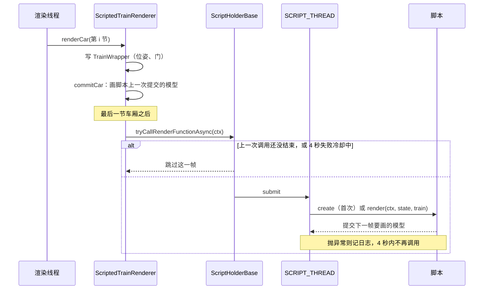

### 10.3 重置

资源重载时 `ScriptHolderClient.resetRunner()`：停掉 `SCRIPT_THREAD`（`shutdownNow`）并新建一个，`ScriptExecutors.shutdownAll()` 停掉脚本开的所有线程池，然后重新加载脚本。

## 11. 报站音频

玩家上传的录音存在服务器上，同步到各客户端缓存，由报站方块播放。设计和限制的细节见改造记录 6.11 节；还没测过游戏内，测试项是测试清单 U47 至 U54、S07、S08。

### 11.1 涉及的类

| 类 | 在哪一边 | 做什么 |
|---|---|---|
| `audio/AudioFiles` | 两边 | 校验和命名：按字节的 SHA-256；只收 Ogg Vorbis（单条音轨，每页校验和正确，开头三个 Vorbis 头齐全）；不解码 |
| `audio/AudioDatabase` | 两边 | 一个 SQLite 文件：名字索引（命名空间、文件名、上传者、哈希、声音 ID `sound_id`）和按哈希存的音频，同一个录音只存一份；`replace` 换录音并删掉没人用的旧录音 |
| `audio/AnnouncementSound` | 两边 | 报站方块"音频文件"一栏的三种写法：上传的文件（`steve:下一站.ogg`）、游戏或资源包声音（`mtr:ticket_barrier`）、网址（`https://...`）；上传文件的声音 ID 规则和游戏里的声音名 `mtr_audio:<上传者>/<声音 ID>` |
| `audio/AudioServer` | 服务端 | 存档的 `mtr/announce.db`，所有维度共用；收上传、删除、下载请求，按块发文件；`/mtr deleteaudio` 命令 |
| `client/AudioCache` | 客户端 | 本机缓存 `mtr_audio_cache`，按哈希存，所有世界和服务器共用；收列表后在后台下载缺的（`audio_download_all`、`audio_prefetch_max_kilobytes` 以内），被更新的文件马上下载；也替网页编辑器的音频页上传、删除、改声音 ID，等不到回复的请求超时标成失败 |
| `client/editor/EditorAudio` | 客户端 | 高级编辑器的"报站音频"页（`audio.html`）：列表、上传、试听、删除 |
| `client/AnnouncementPlayer` | 客户端 | 播放：上传的文件作为游戏声音播放（`UploadedSounds`），只有它没生效时才自己解码、用 Java 的音频输出播放；游戏声音走游戏的声音系统；网址只在 `config/mtr.json` 允许的网站下载 |
| `client/UploadedSounds` | 客户端 | 把服务器的音频登记成游戏声音 `mtr_audio:<上传者>/<声音 ID>`，`/playsound` 也能播；游戏要这个声音的数据时从缓存取出解码。由 mixin `SoundManagerMixin`（每次加载声音后重新登记）、`SoundBufferLibraryMixin`（取声音数据）调用，Fabric 和 Forge 各一份 |

### 11.2 生命周期

1. **开服**：`MTR.init` 注册的服务器启动事件里 `AudioServer.open`，打开 `mtr/announce.db`，读入索引；同时收集模组的命名空间（`minecraft`、`mtr` 和数据包里的），玩家名和它们重名时上传的命名空间加 `_player` 后缀，不会盖掉模组的声音。关服时 `AudioServer.close`。
2. **玩家进服**：`AudioServer.sendList` 发 `PACKET_AUDIO_LIST`（每个名字和它的哈希、大小、时长、上传者；所有名字之后再跟一段声音 ID，旧版本读不到这一段时按没有处理）。客户端 `AudioCache.receiveListS2C` 对比本机缓存，把缺的哈希用 `PACKET_AUDIO_WANTED` 请求：`audio_download_all` 开着时下 `audio_prefetch_max_kilobytes`（默认 1 MB）以内的；名字换了录音（被更新）而本机有旧录音的，不论大小马上下。然后 `UploadedSounds.refresh` 把每个名字登记成游戏声音。
3. **下载**：`AudioServer.receiveWantedC2S` 记下请求；`AudioServer.tick`（每个服务端 tick，由 `MTR.init` 的 tick 事件调用）给每个玩家发两块，每块 32 KB（`PACKET_AUDIO_DATA`，约 1.3 MB/s），大列表不会堵住连接。客户端 `receiveDataS2C` 收齐后**哈希不符就丢弃**，相符才存进缓存。
4. **上传**（网页编辑器的音频页 → `EditorAudio` → `AudioCache.upload`）：
   - 客户端先用 `AudioFiles` 检查一遍，再按顺序分块发 `PACKET_AUDIO_UPLOAD`。
   - 服务端 `receiveUploadC2S`：第一块时 `checkUploadStart` 检查权限等级、单个文件大小、总容量、每小时次数（`config/mtr_security.json`，单人存档的主人不受限）；每个玩家同时只能有一份在传，块必须按顺序。
   - 声音 ID 跟在每块数据后面，空的由服务端按文件名或哈希生成（`AnnouncementSound.getDefaultSoundId`）。
   - 收齐后 `finishUpload` 再校验一次，按"上传者命名空间 : 文件名"存索引，同一个哈希的音频已有就不再存；同一个上传者已有同名但内容不同的文件时算作更新：换成新录音，声音 ID 不变，旧录音没有别的名字用时删掉；本机有旧录音的客户端收到新列表后马上下载新录音。服务端出错时也一定回结果，客户端等不到回复会超时标成失败。成功后 `sendListToAll` 把新列表发给所有人，各客户端照第 2 步下载。结果用 `PACKET_AUDIO_RESULT` 回给上传者。
   - 改声音 ID：音频页"改声音 ID" → `AudioCache.setSoundId` → `PACKET_AUDIO_SOUND_ID` → `AudioServer.receiveSoundIdC2S`，上传者和管理员能改，同一个上传者内不能重复，然后 `sendListToAll`。
5. **删除**（音频页 `PACKET_AUDIO_DELETE`，或 `/mtr deleteaudio <名字>`）：任何人能删自己上传的，达到管理权限等级的能删别人的。删掉名字后，没有别的名字再用这份音频才删音频本身，然后同样 `sendListToAll`。删除和上传都写进服务端日志。
6. **播放**：列车车头经过报站方块时，`TrainServer.handlePositions` 对车上每位乘客调 `TileEntityTrainAnnouncer.announce`（同一玩家有冷却时间），服务端 `announceS2C` 把文字和"音频文件"一栏发给他。客户端 `AnnouncementPlayer.play`：
   - 先当作上传的文件，在服务器列表里按名字找到它的游戏声音，用 `playLocalSound` 播放，和游戏声音一样。游戏第一次要这个声音的数据时，`UploadedSounds.getBuffer` 从缓存读出、在后台线程解码；缓存里还没有时这次不响，顺便请求下载，下次就有了。
   - `/playsound mtr_audio:<上传者>/<声音 ID>` 走的是同一条路：服务端把名字发给附近的玩家，客户端在声音表里找到它。
   - 不是上传的文件，就当作游戏或资源包的声音，在方块处播放。
   - 是网址时，只有 `config/mtr.json` 允许的网站才下载播放，否则只记一行日志。
   - 报站方块的设置界面（`TrainAnnouncerScreen`）里可以试听，走同一个 `play`。

**时序图**：

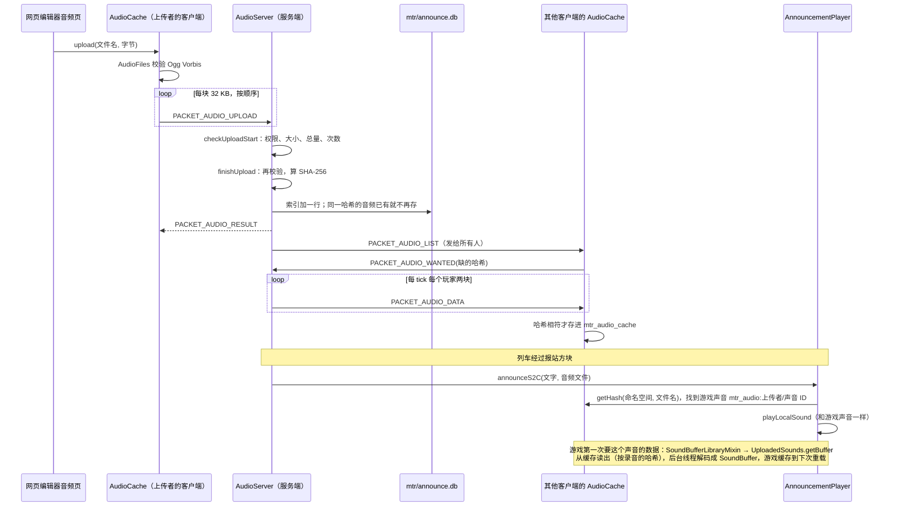

### 11.3 还没做的

线路、车站和时刻事件引用上传的音频（自动报站用它）；客户端缓存的容量上限和清理。按位置播放已经有了：上传的音频是游戏声音，单声道的录音按位置衰减（2026-11-05）。

### 运行层（0.40.0，`transitsim.run`）

规则见 `MTR-模拟组件与解耦.md` 5.5 节。组件里的列车类由它跑（`TickRunner.RUN_LAYER`，缆车仍走 `TrainMotion`）。
- `PathClaims`：路径上一段换成按顺序的资源组：普通区段每段一组（`BlockSections` 的段，涂色信号区段整块），连续的单线区间连同方向一组，要原地掉头的站台连同两个方向一组（掉头车优先）；方向是单独的资源键（`directionOf`）。`attach` 把咽喉道岔和联锁区并进经过其节点的那一组。
- `Authority`：每列车的移动授权。每 tick：车身和已批的组照常保持（`RunReservations.holdClaims`），前方没批的组按顺序一起申请（`requestGroups`），仲裁器结算时批最长可用前缀（`Arbiter.requestGroups` / `takeGrantedGroups`，批准的并进已有占用）；授权终点到下一组的起点为止，后面没有要申请的就到目标。已批的组被外部东西站上就收回到它之前。换路径时当场占上能占的；续跑时用记录里的终点（`restore`）。
- `RunMotion`：每 tick 的运动。下一站每 tick 从位置推出（`findNextStop`，车在动时不算刚离开的那站）；按运行段开到"下一站"和"授权终点"较近的一个；停在授权终点只等不开门；到站记在车停在站上的第一个 tick；在库和回库同原来。
- `TickRunner.HeadlessTrain.runLayerTick`：目标是在站时再下一站、在路上下一站、在库里第一个站台；先更新授权，再推进；`isRunGranted` 直接看授权是否已超过车头。`publishOccupied` 每 tick 结算前把外部占用、外部列车、被接管的车和已拆除的轨道报给仲裁器（`Arbiter.setOccupied`）。新内核下 `getQuietTicks` 返回 0。
- `RunRecord` 第 5 版：`authorityEnd`、`segment`（`RunSegment.Spec`），续跑时在第一个 tick 重建运行段（重建位置和列车对不上就不用）。
- 游戏（0.41.0）：`TrainServer` 的 `authority_end`、`run_segment` 两个存档键（`showSimulated` 从 `HeadlessTrain.getRecordAuthorityEnd` / `getRecordSegment` 抄，`toRecord` 交回）；手动驾驶的车 `updateManualAuthority`（在推进前）和 `limitToAuthority`（推进后）；`holdRun` 对有授权的手动车不再放掉占用。客户端 `Train.standsForRunLayer`：服务端新运行层跑的车，没有运行段时客户端原地不动、门按服务端状态，不跑 `TrainMotion`。

### 端到端检查（0.39.0）

- `transitsim.sim.RunInvariants`：只读的不变量检查，宿主或测试每 tick（或每秒）调 `check()`；违规在 `getViolations()`，想走走不了太久的在 `getStuck()`。规则见 `MTR-模拟组件与解耦.md` 2.4 节。
- `WholeDayTest`（组件，`-Dbenchmark=true` 才跑）、`GameChainTest`（common）、`RunInvariantsTest`（组件）。
- `SimulateDay --check`；`C:/gtmp/fast/e2e.sh` 跑本机存档的副本。
- 为了不开服务器也能生成运用路径：`Siding.generateDutyRoute(Executor, …)`（原来取 `MinecraftServer` 的那个调它）和 `Depot.generateDutyPathsNow`（照 `generateDutiesOnly` 给每条存车线找运用路径，结果立刻应用）。
- 修复的位置：`TickRunner.HeadlessTrain.canDeploy` 和 `TrainServer.canDeploy`（按运用跑、路径只有存车线时也请求出库）；两边的 `followPath`（回到存车线路径时归零下一个停车点）；`TrainMotion` 前方被占的分支（闭塞区段停车点不越过下一个站台）；`DepotDispatcher.findDutyDeploy`（`MAX_LEAD_MILLIS`、`getSlotKey` 按分钟缓存）；`RunReservations.toClaims` 和 `Arbiter.Claim.singleTrackBothWays`（同一列车两个方向合成双向占用），两边的 `getRunMoves`（到要掉头的站台为止时加上反方向）。

## 12. 读代码的几点提示

- **一份数据，服务端和客户端各有一份**：`Station`、`Route`、`Depot` 等在两边都有，都能用 msgpack（存档）和 `FriendlyByteBuf`（网络）读写。改字段时，存档读写、网络读写、`update(key, packet)` 三处都要改。
- **`DataCache` 是索引**：`RailwayData` 里的数据是集合，按 ID 查找和"站台属于哪个站"这类关系都在 `DataCache` 里；数据结构变了要 `sync()`。
- **新规则在组件里**：列车运动、时刻表、运用、寻路的新规则都在 `transit-sim`，MTR 里对应的是适配器（`advanced/` 和 `PlanAdapters` 等）。改规则先改组件并写组件测试。
- **注释里的编号**：代码注释里的 F1、G1、S1、R03 等是设计文档和架构审查里的步骤或问题编号，到 `MTR-模拟组件与解耦.md` 和 `MTR-设计与架构审查评估-2026-11-03.md` 里查。
- **找不到的行为先查 mixin**：见 3.4 节。
- **不参与编译的文件**：`scripting/ScriptHolderBase copy` 是旧版的副本（没有 `.java` 后缀），读代码时以 `ScriptHolderBase.java` 为准。
